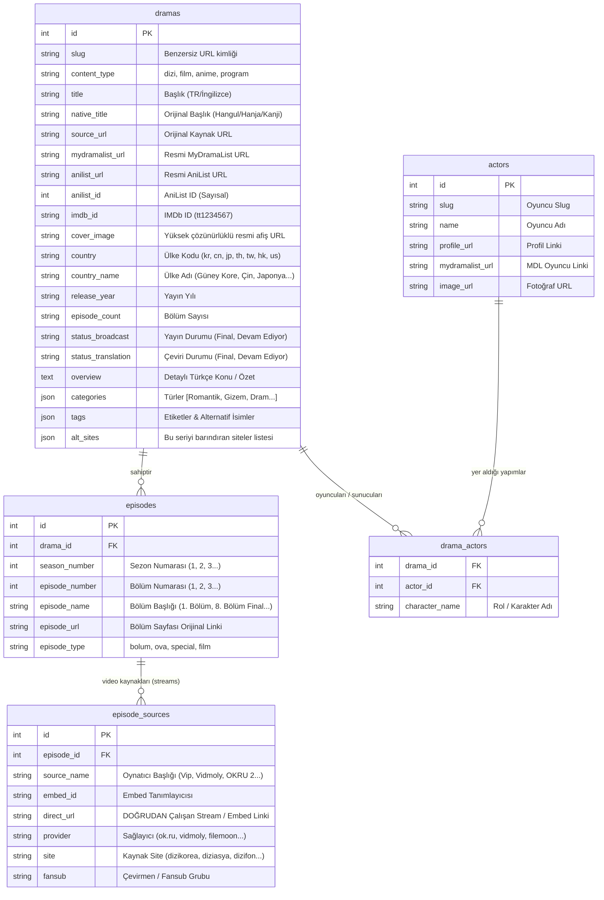

# 🎬 KoUp Asya & Global Master Arşiv Entegrasyon Rehberi (AI & Geliştirici Kılavuzu)

Bu rehber; **Diziler (KDrama, CDrama, JDrama, Thai BL), Filmler, Animeler ve TV Programlarını (Varyete/Reality)** tek çatı altında toplayan devasa master arşiv veritabanının yapısını, ilişkisel SQLite şemasını, **MyDramaList**, **AniList** ve **IMDb** senkronizasyonunu, çok aşamalı güvenlik ve deduplication mantığını açıklar. Herhangi bir yapay zekaya (Cursor, Claude, ChatGPT) veya yazılım geliştiriciye verildiğinde doğrudan uygulanabilir bir mimari kılavuzdur.

---

## 📊 Güncel Master Arşiv İstatistikleri

| Metrik | Değer | Açıklama |
| :--- | :--- | :--- |
| 🎬 **Toplam Aktif Master Yapım** | **16.274** | %100 Çalışan kaynağa sahip, hayalet/çöp kayıtlardan arındırılmış master yapımlar |
| 📺 **Toplam Gerçek Bölüm** | **218.086** | Sahte/phantom bölümlerden temizlenmiş gerçek bölüm hiyerarşisi |
| ⚡ **Oynatılabilir Doğrudan Kaynak** | **1.412.561** | Doğrudan oynatılabilir (%100 çalışan HLS/Direct/Embed) akışlar |
| 🏷️ **Entegre Platform Sayısı** | **11 Site** | DiziKorea, DiziFon, AsyaLuna, DiziAsya, AsyaKing, DiziYou, HDFilm, AsyaDizi, TRAnimeizle, AsyaWatch, DiziBox |
| 📡 **Desteklenen Sağlayıcı** | **70+ Provider** | OK.RU (213K), Sibnet (138K), Mail.ru (111K), MP4Upload (87K), GDrive (81K), Vudeo (75K) vb. |
| 📦 **Export Dosyası (`archive.json`)** | **486.8 MB** | 16.274 yapımın tüm metadata, oyuncu, bölüm ve çalışan kaynakları |
| ⚠️ **Eksik/Kaynaksız Kayıtlar (`eksikler.json`)** | **5.268 Yapım** | Henüz hiçbir sitede kaynağı düşmemiş veya telifli yapımların analitiği |

### İçerik Türü Dağılımı (Doğrulanmış & Düzeltilmiş):
- 📺 **Dizi (Drama / BL / Tarihi):** 9.460 yapım (Çok bölümlü yanlış 'film' etiketleri diziye aktarıldı)
- 🎌 **Anime:** 6.225 yapım (Türkanime & TRAnimeizle çift yönlü AniList bridge ile birleşik)
- 🍿 **Film (Gerçek Sinema Filmleri):** 515 yapım (Yalnızca tekil/2 parçalı gerçek sinema filmleri)
- 🎙️ **Program (Varyete / Reality Show):** 74 yapım

---

## 🗄️ 1. Veritabanı Mimarisi ve Tablo Şeması (ER Diagram)

Arşiv verisi, yüksek performanslı **SQLite WAL modunda (`webdrama_archive.db`)** saklanır.



---

## 🛡️ 2. Çok Aşamalı Güvenlik & Deduplication Mantığı (`is_safe_to_merge`)

Duplicate silme ve birleştirme işlemlerinde kesinlikle veri kaybı veya yanlış yapım birleşmesi yaşanmaması için **7 aşamalı güvenlik bariyeri** uygulanır:

1. **İçerik Türü Koruma:**
   - Bir film asla bir dizi veya anime ile birleştirilemez (`film != dizi`, `anime != dizi`). Örn: *The Beauty Inside (2015 Film)* ile *The Beauty Inside (2018 Dizi)* ayrı tutulur.
2. **Ülke Uyarlaması (Remake) Koruma:**
   - Aynı başlığa sahip farklı ülke yapımları asla birleştirilemez (`kr != th`, `cn != tw`, `kr != jp`).
   - Örn: *Emergency Couple* (2014 Kore) ile *Emergency Couple* (2024 Tayland) ayrı tutulur.
   - Örn: *The Glory* (2022 Kore - 더 글로리) ile *The Glory* (2025 Çin - 贵女 / 雁回时) ayrı tutulur.
   - Örn: *Marry My Husband* (2024 Kore) ile *Marry My Husband: Japon* (2025 Japonya) ayrı tutulur.
3. **Yıl Uyuşmazlığı Koruma:**
   - İki yapımın yapım yılı biliniyorsa ve aradaki fark **1 yıldan büyükse** (`abs(year1 - year2) > 1`) birleştirme engellenir.
   - Örn: *Aa! Megami-sama!* (1993 OVA) ile *Aa! Megami-sama! (2011)* ve *Aa! Megami-sama! (TV)* (2005) birbirinden kesin olarak ayrılır.
4. **Sezon Numarası Eşitleme & Koruma:**
   - "2. Sezon", "Season 2", "S2" ve "2" kalıpları sayısal sezon numarasına (`2`) indirgenir.
   - İki yapım aynı sezon numarasını paylaşıyorsa (Örn: *One Punch Man 3* ile *One Punch Man 3. Sezon*) güvenle birleştirilir.
   - Biri sezonlu diğeri temel seri ise (Örn: *Tiger & Bunny* ile *Tiger & Bunny 2*) birleştirme reddedilir.
5. **Özel Format & Anahtar Kelime Asimetrisi:**
   - `special`, `anniversary`, `epilogue`, `movie`, `film`, `ova`, `ona` gibi anahtar kelimelerden biri birinde var diğerinde yoksa birleştirme engellenir.
6. **Site Gürültü Tag'lerinden Arındırılmış Normalizasyon (`norm_title`):**
   - Sitelerin başlıklara ve slug'lara eklediği sunucu/sürüm kodları (`hd11`, `tr6`, `dq`, `d1`, `tek parca`, `altyazili`, `izle`) otomatik olarak ayıklanarak gerçek başlık karşılaştırılır.
   - Örn: *Descendants of the Sun* (#524) ile AsyaDizi'nin *Descendants Of The Sun Izle Hd11* ve DiziFon'un *Descendants Of The Sun Izle Tr6* kayıtları tek çatı altında toplanır.
7. **Doğrulanmış Harici ID Eşleşmesi (AniList, IMDb, MDL):**
   - İki yapım aynı AniList ID'yi, IMDb ID'yi veya MyDramaList URL'sini paylaşıyorsa, güvenlik bariyerlerinden geçtikten sonra mutlak doğrulukla birleştirilir.

---

## 🌐 3. Harici Kimlik Eşleştirme & Çapraz Dil Köprüsü (Cross-Language Bridge)

- 🎌 **Animeler (Türkanime & TRAnimeizle Çift Yönlü Köprüsü):**
  - **Problem:** Türkanime animeleri Romaji başlıklarla saklarken (*Shingeki no Kyojin*), TRAnimeizle İngilizce slug'larla saklar (*attack-on-titan-izle*).
  - **Çözüm (AniList Bridge):** Yerel `anilist_cache` üzerinden Romaji, İngilizce ve Japonca (Native) başlıklar taranır; *Shingeki no Kyojin* ve *attack-on-titan-izle* aynı `anilist_id: 16498` altında buluşturularak 25 bölüm ve 1.132 kaynak tek kayıtta birleştirilir.
- 🇰🇷 🇨🇳 🇯🇵 **Asya Dizileri (KDrama, CDrama, JDrama, Thai BL):**
  - **MyDramaList (`mydramalist_url`):** Yalnızca `KR`, `CN`, `JP`, `TH`, `TW`, `HK` ülkelerine ait dizilerle eşleştirilir. Batı dizilerine veya çöp kategorilere asla MDL atanmaz.
- 🍿 **Filmler & Batı Dizileri (DiziBox, HDFilm):**
  - **IMDb (`imdb_id`):** IMDb `tt...` kimliği üzerinden doğrulanır ve kopyalar IMDb ID bazında birleştirilir.

---

## 🖥️ 4. Demo Web Test Paneli (`index.html` + `server.py`)

Arşivi canlı olarak görselleştirmek, filtrelemek, aramak ve oynatmak için yerleşik bir test paneli geliştirilmiştir.

### Çalıştırma:
```bash
python server.py 8080
```
Tarayıcınızda açın: `http://127.0.0.1:8080/`

### Test Panelinin Öne Çıkan Yetenekleri:
- 📊 **Anlık İstatistik Kartları:** Toplam yapım, toplam bölüm, çalışan kaynak sayısı ve oynatılabilirlik oranı.
- 🔍 **Canlı Arama & Çift Yönlü Filtreleme:** Başlık araması, İçerik Türü (`Dizi`, `Film`, `Anime`, `Program`) ve Ülke filtresi (`Kore`, `Çin`, `Japonya`, `Tayland`, `Tayvan`, `ABD`).
- 📑 **Sezon Seçici Sekmeler (Season Tabs):** Çok sezonlu dizilerde (*The Glory*, *Voice*, *Kingdom* vb.) **1. Sezon (8 Bölüm)**, **2. Sezon (8 Bölüm)** sekmeleriyle bölümler muntazam şekilde ayrılır.
- 📺 **Hibrit Stream Player:** 
  - HLS `.m3u8` akışları yerleşik `hls.js` video oynatıcısında oynatılır.
  - Video embed'leri (Vidmoly, OK.RU, Filemoon, Doodstream) güvenli `iframe` içerisinde çalışır.
  - "Doğrudan Aç" butonu ile kaynak yeni sekmede açılabilir.

### REST API Endpoints:
1. `GET /api/stats` -> Master arşiv istatistikleri (yapım, bölüm, oynatılabilir kaynak sayıları).
2. `GET /api/dramas?search=&type=all&country=all&page=1&limit=24` -> Sayfalanmış ve filtrelenmiş yapım listesi.
3. `GET /api/drama/<id>` -> Belirli bir yapımın tüm detayları, oyuncuları, sezonları, bölümleri ve çalışan kaynakları.

---

## 📦 5. Export Dosyaları (`archive.json` & `eksikler.json`)

1. **`archive.json` (502.7 MB):**
   - 21.616 yapımın tamamını içeren devasa JSON master export.
   - Her yapımın altında `alt_sites` (orijinal siteler), `actors` (oyuncular), `episodes` ve her bölümün altında çalışan `sources` (provider, direct_url, site) yer alır.
2. **`eksikler.json` (2.878 Yapım):**
   - Kaynağı henüz telif nedeniyle düşmüş, silinmiş veya hiçbir sitede çalışan kaynağı kalmamış bölümlerin listesi. Gelecekteki hedefli scraper taramaları için yol haritası sunar.

---

## 🚀 6. Yeni Platform / Scraper Ekleme Rehberi

Yeni bir Asya dizi veya anime sitesi entegre ederken:
1. Veriyi `scraper_*.py` ile çekip `webdrama_archive.db` içine aktarın.
2. `multisite.py` veya `mdl_sync.py` içerisindeki `merge_two_dramas(cur, keep_id, dup_id)` fonksiyonunu çağırın.
3. `is_safe_to_merge` kontrolü sayesinde yeni sitenin yapımları mevcut master kayıtlarla **asla duplicate yaratmadan ve farklı yapımları silmeden** kusursuz birleşecektir.
4. İşlem sonrası `python dedupe.py` ve `python export_archive.py` çalıştırarak master arşivi güncelleyin.
