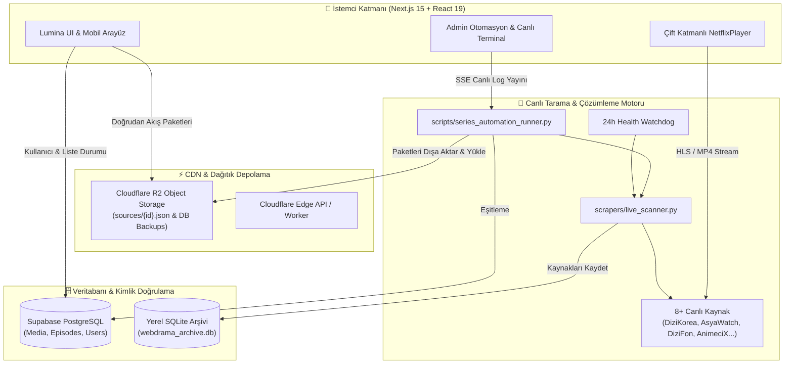

<div align="center">

# 🎬 KoUp — Next-Gen Cinematic Streaming & Asian Entertainment Platform

<p align="center">
  <strong>Apple TV+ (tvOS / macOS Sequoia) zarafeti, Netflix akıcılığı ve MUBI estetiğiyle tasarlanmış hibrit yayın, arşiv ve magazin ekosistemi.</strong>
</p>

[](https://nextjs.org/)
[](https://react.dev/)
[](https://www.typescriptlang.org/)
[](https://tailwindcss.com/)
[](https://motion.dev/)
[](https://supabase.com/)
[](https://cloudflare.com/)
[](https://koup-app.vercel.app)

<br/>

[🌟 Canlı Demo (Vercel)](https://koup-app.vercel.app) • [📖 Özellikler](#-öne-çıkan-özellikler) • [🏛 Mimari](#-sistem-mimarisi) • [🤖 Scraper & Otomasyon](#-canlı-tarama--otomasyon-merkezi) • [🚀 Kurulum](#-kurulum--çalıştırma)

</div>

---

## 💎 Genel Bakış

**KoUp**, K-Drama, C-Drama, Anime, Global Dizi/Film arşivini ve canlı Asya magazin akışını tek bir kusursuz arayüzde toplayan açık kaynaklı bir streaming platformudur. 

Geleneksel hantal dizi sitelerinin aksine; **karanlık OLED (`#08080A`)** paleti, yay fiziğine dayalı mikromotion animasyonları, reklam engelleyiciye gerek bırakmayan **çift katmanlı özel video oynatıcısı** ve **Cloudflare R2 + Edge JSON paketleme** mimarisi ile ultra hızlı bir deneyim sunar.

---

## ✨ Öne Çıkan Özellikler

### 🍿 1. Lumina Projection UI & Akordiyon Kartlar
* **Hover Akordiyon Genişlemesi:** Dizi kartlarının üzerine gelindiğinde `2:3` dikey poster formatından `16:9` sahne önizlemesine doğru akıcı yay fiziği (`framer-motion`) ile genişler.
* **OLED Sinematik Atmosfer:** `#08080A` taban arka plan, neon cyan ve mor ışıma katmanları, arka plan dinamik backdrop projeksiyonu.
* **100% Mobil & Dokunmatik Uyum:** Akıllı swipe çekmeceleri, bottom navigation bar ve parmak dostu dokunma hedefleri.

### ⚡ 2. Çift Katmanlı KoUp Cinema Player (`NetflixPlayer.tsx`)
* **Katman 1 — Native HLS & MP4 Motoru:**
  * `DiziYou HLS`, `HDFilm HLS` ve `Tau-Video` (`1080p`, `720p`, `480p`) doğrudan akışlarında yerel medya oynatımı.
  * **İntroyu Atla (+85s)**, **15sn Sonraki Bölüm Sayacı**, `-10s / +10s` atlama, ses/parlaklık kontrolleri ve playback hızı.
* **Katman 2 — Evrensel Üst Cam Kontrol Barı (Universal Top Glass Bar):**
  * `Vidmoly`, `OK.ru`, `Filemoon`, `Sibnet`, `VK` gibi harici iframe oynatıcılarının üzerine şeffaf bir cam HUD katmanı giydirilir.
  * Oynatıcıdan çıkmadan **Alternatif Kaynak / Fansub Değiştirici**, **Sezon & Bölüm Çekmecesi**, **Apple TV+ InSight (Kadro & Karakterler)** ve **Tam Ekran Sinema Modu**.

### 🤖 3. Çoklu Kaynak Çapraz Otomasyonu (Multi-Site Automation)
* **8 Aktif Kaynak Entegrasyonu:** DiziKorea, DiziFon, AsyaWatch, Dizilla, DiziBox, DDizi, AnimeciX ve HDFilmcehennemi.
* **Dinamik Slug Çözücü:** Sitelerdeki isim farklarını (`-2026-kore`, `-izle`, `-dq`, `1-sezon`) otomatik tespit eden bulanık arama motoru.
* **Canlı Çapraz Tarama:** Yeni bir dizi veya bölüm yayınlandığında tüm bağlı kaynaklar paralel olarak taranır ve eksik bölümler anında tamamlanır.
* **24 Saatlik Watchdog:** Canlı HTTP stream kontrolü ile ölü linkleri otomatik tespit eder ve sağlıklı alternatiflerle iyileştirir (Self-Healing).

### 🌐 4. Cloudflare R2 Dağıtık Akış Mimarisi (Edge JSON Bundles)
* Her yapımın tüm sezon, bölüm ve video kaynakları Cloudflare R2 üzerinde tekil bir JSON paketi olarak (`sources/{id}.json`) saklanır.
* İstemci oynatma sayfasına girdiğinde veritabanına sorgu atmak yerine R2 CDN önbelleğinden milisaniyeler içinde veri çeker; veritabanı yükü sıfıra iner.

### 🎭 5. Oyuncular & Karakter Ağı (`/oyuncular`)
* **21.800+ Oyuncu & Anime Karakteri:** MDL ve AniList verileriyle zenginleştirilmiş liderlik tablosu.
* **Co-Star Birlikte Rol Ağı:** Bir oyuncunun hangi dizilerde kimlerle birlikte oynadığını görselleştiren ilişki ağı.
* **Seiyuu & Seslendirmen Profilleri:** Anime karakterleri ve onları seslendiren orijinal Japon sanatçılar.

### 📰 6. Canlı AsyaMag Magazin & Dedikodu (`/magazin`)
* `asyamag.com` WP REST API entegrasyonu ile en yeni K-Drama, C-Drama, BL/GL ve magazin haberleri dış siteye yönlendirmeden doğrudan uygulama içinde sunulur.

---

## 🏛 Sistem Mimarisi



---

## 📡 Desteklenen Kaynaklar & Botlar

| Platform | Tür | Akış Sağlayıcıları | Çözümleme Yöntemi | Durum |
| :--- | :--- | :--- | :--- | :---: |
| **DiziKorea** | K-Drama / Asya | PlayerDKorea, Vidmoly | BeautifulSoup + Doğrudan Regex | 🟢 Aktif |
| **DiziFon** | Asya / Çin / Kore | OK.ru HD, Vidmoly, YouTube | Iframe Sniffing + URL Normalizer | 🟢 Aktif |
| **AsyaWatch** | K-Drama / C-Drama | AsyaWatch 1080p HLS | Next.js Build-ID REST Bypass | 🟢 Aktif |
| **Dizilla** | Yabancı Dizi / Trend | Dizilla 1080p HLS | Next.js Props & Direct Stream | 🟢 Aktif |
| **DiziBox** | Global / Batı | DiziBox HLS, Vidmoly | HTML Dom Parser + Slug Resolver | 🟢 Aktif |
| **AnimeciX** | Anime / Donghua | Tau-Video (1080p/720p/480p) | AES-128 Decryption + Fansub Sync | 🟢 Aktif |
| **DDizi** | Yerli Dizi / Arşiv | DDizi Player HLS, YouTube | Playeroynat Stream Sniffer | 🟢 Aktif |
| **HDFilmcehennemi** | Sinema & Film | Rapidrame, Doğrudan HLS | JSON Fetch API + Multi-Server | 🟢 Aktif |
| **AsyaMag** | Haber / Magazin | WordPress Canlı REST API | `wp-json/wp/v2/posts` + Embed | 🟢 Aktif |

---

## 📁 Proje Dizin Yapısı

```bash
KoUp/
├── koup-app/                     # Next.js 15 Frontend & Fullstack API
│   ├── src/
│   │   ├── app/                  # App Router (Sayfalar & API Routes)
│   │   │   ├── admin/            # Admin Kontrol Paneli & Seri Otomasyonu
│   │   │   ├── seri/[slug]/      # Dizi & Bölüm Oynatma Sayfaları
│   │   │   ├── oyuncular/        # Aktörler, Karakterler & Co-Star Ağı
│   │   │   ├── magazin/          # Canlı AsyaMag Haberleri
│   │   │   └── api/admin/        # Otomasyon, SSE Streaming ve Eşitleme Uçları
│   │   ├── components/           # Yeniden Kullanılabilir Lumina Bileşenleri
│   │   │   ├── NetflixPlayer.tsx # Çift Katmanlı Video Oynatıcı
│   │   │   └── AdminSeriesAutomation.tsx # Çapraz Tarama Arayüzü
│   │   └── lib/                  # Supabase istemcisi, Auth & Senkronizasyon
│   ├── package.json
│   └── pnpm-lock.yaml
├── scrapers/                     # Python Canlı Tarama ve Tersine Mühendislik Motorları
│   ├── live_scanner.py           # 8 sitenin canlı akış ve kaynak çıkarıcıları
│   ├── multisite.py              # Eşitleme ve sıra yönetimi
│   └── supabase_sync_helper.py   # R2 ve Supabase köprü fonksiyonları
├── scripts/                      # Otomasyon ve Arşiv Bakım Scriptleri
│   ├── series_automation_runner.py # Dizi bazlı çapraz arama & bundle üretici
│   ├── cron_sync_pipeline.py     # 24s Watchdog ve Genel Otomasyon Pipeline
│   ├── export_sources_bundles.py # R2 için JSON paket derleyici
│   └── upload_to_r2.py           # Cloudflare R2 toplu yükleme aracı
├── database.py                   # Yerel SQLite veritabanı yöneticisi
└── README.md
```

---

## 🚀 Kurulum & Çalıştırma

### Gereksinimler
* **Node.js** `>= 18.18.0` (Önerilen: Node 20+)
* **pnpm** `>= 9.0.0` veya **npm**
* **Python** `>= 3.10` (Scraper motorları için)

### 1. Depoyu Klonlayın
```bash
git clone https://github.com/perfectusmim1/KoUp.git
cd KoUp
```

### 2. Ortam Değişkenlerini Ayarlayın
`koup-app/.env.local` dosyasını oluşturun ve gerekli kimlik bilgilerini ekleyin:

```env
# Supabase
NEXT_PUBLIC_SUPABASE_URL=https://your-project.supabase.co
NEXT_PUBLIC_SUPABASE_ANON_KEY=your-anon-key
SUPABASE_SERVICE_ROLE_KEY=your-service-role-key

# Cloudflare R2 (Storage & CDN)
R2_ACCOUNT_ID=your-account-id
R2_ACCESS_KEY_ID=your-access-key-id
R2_SECRET_ACCESS_KEY=your-secret-access-key
R2_BUCKET_NAME=koup-sources
R2_PUBLIC_URL=https://pub-your-id.r2.dev

# TMDB & External APIs (Opsiyonel)
TMDB_API_KEY=your-tmdb-key
```

### 3. Frontend Bağımlılıklarını Kurun ve Başlatın
```bash
cd koup-app
pnpm install
pnpm dev
```
Uygulamanız varsayılan olarak `http://localhost:3000` adresinde çalışacaktır.

### 4. Canlı Scraper & Python Bağımlılıkları (Opsiyonel)
```bash
pip install -r requirements.txt
# Belirli bir siteyi test etmek için:
python scrapers/live_scanner.py --provider dizikorea --limit 30
```

---

## ⚙️ Otomasyon & Watchdog Çalıştırma

* **Yönetim Panelinden Tek Tıkla:** `/admin` sayfasına girip **"Seri Otomasyonu"** sekmesinden istediğiniz diziyi bağlayabilir, anlık canlı log akışıyla çapraz taramayı başlatabilirsiniz.
* **Komut Satırından:**
```bash
# Belirli bir dizi için tüm bağlı siteleri tara ve R2'ye yükle
python scripts/series_automation_runner.py --id 46297

# Tüm aktif diziler için haftalık yeni bölümleri tara
python scripts/series_automation_runner.py --all-active
```

---

## 🛡 Güvenlik & Defansif Mimari

* **Açıklara Karşı Koruma:** SQL Injection korumalı parametreli sorgular, XSS filtreleme ve Supabase Row Level Security (RLS) politikaları.
* **Akıllı Hız Sınırlaması (Rate Limiting):** Dış sitelere aşırı yük bindirmemek için istekler arasında rastgele gecikmeler ve oturum önbelleklemesi.
* **Hata İzolasyonu (Graceful Degradation):** Herhangi bir kaynak çöktüğünde veya video silindiğinde oynatıcı kullanıcıyı kesintiye uğratmadan alternatif kaynağa otomatik geçiş yapar.

---

## 📄 Lisans

Bu proje kişisel araştırma, eğitim ve eğlence amaçlarıyla geliştirilmiştir. Tüm telif hakları ilgili içerik sahiplerine aittir.

<div align="center">
  <sub>Designed with ❤️ for Cinema & Drama Lovers by <strong>KoUp Team</strong></sub>
</div>
