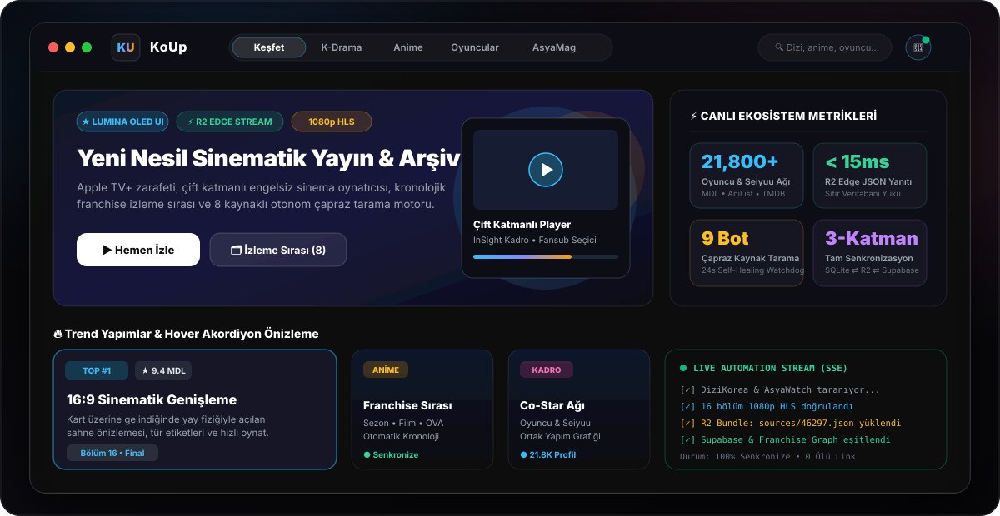
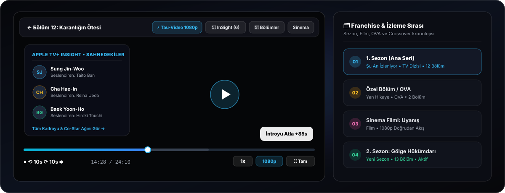
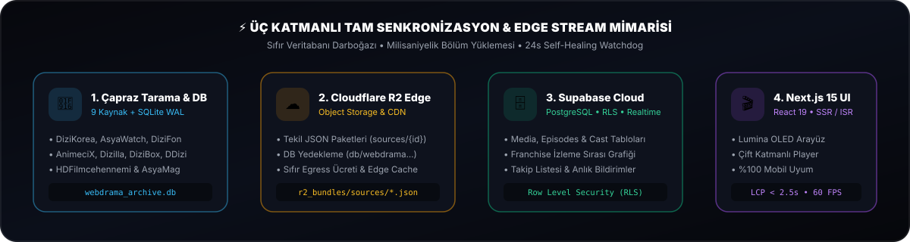
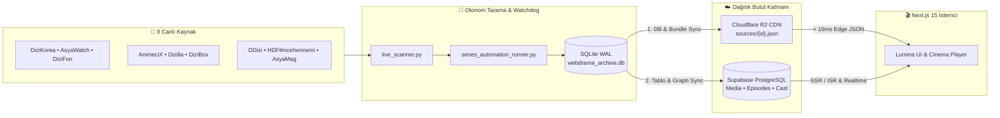

<div align="center">

<picture>
  <source media="(prefers-color-scheme: dark)" srcset="./koup-app/public/logo-dark.png" />
  <source media="(prefers-color-scheme: light)" srcset="./koup-app/public/logo.png" />
  
</picture>

# KoUp — Next-Gen Cinematic Streaming & Archive Ecosystem

**Apple TV+ (tvOS / macOS Sequoia) zarafeti, Netflix akıcılığı ve MUBI estetiğiyle tasarlanmış yeni nesil yayın, kronolojik arşiv ve Asya eğlence platformu.**

[](https://nextjs.org/)
[](https://react.dev/)
[](https://www.typescriptlang.org/)
[](https://tailwindcss.com/)
[](https://motion.dev/)
[](https://supabase.com/)
[](https://cloudflare.com/)

<p align="center">
   &nbsp;
   &nbsp;
   &nbsp;
   &nbsp;
   &nbsp;
   &nbsp;
   &nbsp;
   &nbsp;
   &nbsp;
  
</p>

[**🌟 Canlı Demo (Vercel)**](https://koup-app.vercel.app) &nbsp;•&nbsp; [**✨ Vitrin & Özellikler**](#-görsel-vitrin--öne-çıkan-özellikler) &nbsp;•&nbsp; [**🎬 Çift Katmanlı Player**](#-çift-katmanlı-koup-cinema-player--franchise-evreni) &nbsp;•&nbsp; [**⚡ Mimari & Senkronizasyon**](#-üç-katmanlı-bulut--arşiv-mimarisi) &nbsp;•&nbsp; [**🚀 Kurulum**](#-hızlı-kurulum--çalıştırma)

<br />



</div>

---

## ✨ Görsel Vitrin & Öne Çıkan Özellikler

<table>
  <tr>
    <td width="50%" valign="top">
      <h3>🌌 Lumina OLED Arayüz & Akordiyon Kartlar</h3>
      <ul>
        <li><b>Hover Akordiyon Genişlemesi:</b> Dikey <code>2:3</code> poster kartları, üzerine gelindiğinde yay fiziğiyle <code>16:9</code> sinematik sahne önizlemesine dönüşür.</li>
        <li><b>Pointer Takipli Kayar Sekmeler:</b> Fare ve dokunma hareketini gerçek zamanlı takip eden akıcı <i>Draggable Sliding Pill</i> navigasyonu.</li>
        <li><b>%100 Mobil Uyum:</b> Sıfır taşma, 44x44px parmak dostu dokunma hedefleri ve özel açılır menüler.</li>
      </ul>
    </td>
    <td width="50%" valign="top">
      <h3>🗂 Kronolojik Franchise & İzleme Sırası</h3>
      <ul>
        <li><b>Otomatik Evren Haritası:</b> Sezonlar, devam halkaları, sinema filmleri, OVA/OAD özel bölümleri ve <i>Crossover</i> bağlantıları tek kronolojik listede sunulur.</li>
        <li><b>Akıllı Öneri Filtresi:</b> Aynı serinin diğer sezonları "Benzer Yapımlar" listesini kirletmez; doğrudan izleme sırası modülünde gösterilir.</li>
      </ul>
    </td>
  </tr>
  <tr>
    <td width="50%" valign="top">
      <h3>🎭 21.800+ Oyuncu, Seiyuu & Co-Star Ağı</h3>
      <ul>
        <li><b>Kapsamlı Kadro Veritabanı:</b> MyDramaList (MDL), AniList ve TMDB verileriyle senkronize aktör, karakter ve Japon seslendirmen (Seiyuu) profilleri.</li>
        <li><b>Birlikte Rol (Co-Star) Grafiği:</b> Oyuncuların hangi projelerde kimlerle bir araya geldiğini gösteren etkileşimli ilişki ağı.</li>
      </ul>
    </td>
    <td width="50%" valign="top">
      <h3>🔔 Anlık Bildirimler & Canlı AsyaMag</h3>
      <ul>
        <li><b>Gerçek Zamanlı Bölüm Bildirimi:</b> Yalnızca takip ettiğiniz yapımlara yeni bölüm eklendiğinde tetiklenen akıllı bildirim merkezi.</li>
        <li><b>Uygulama İçi Magazin:</b> <code>asyamag.com</code> entegrasyonuyla dış siteye çıkmadan okunabilen K-Drama, C-Drama ve BL/GL haber akışı.</li>
      </ul>
    </td>
  </tr>
</table>

---

## 🎬 Çift Katmanlı KoUp Cinema Player & Franchise Evreni

<div align="center">
  
</div>

<br />

| Katman / Modül | Yetenekler & Deneyim |
| :--- | :--- |
| **Katman 1: Native HLS & MP4 Motoru** | `1080p / 720p / 480p` doğrudan akış, **İntroyu Atla (+85s)**, **15sn Sonraki Bölüm Sayacı**, `-10s / +10s` sarma, `1x` hız kontrolü ve klavye kısayolları. |
| **Katman 2: Universal Top Glass HUD** | `Vidmoly`, `OK.ru`, `Tau-Video`, `Sibnet`, `Filemoon` dahil tüm oynatıcıların üstüne giydirilen şeffaf cam kontrol barı; oynatıcıdan çıkmadan kaynak/fansub ve bölüm değiştirme. |
| **Apple TV+ InSight Kadrosu** | İzleme sırasında tek tıkla açılan şeffaf çekmecede o yapımdaki oyuncuları, karakterleri ve seslendirmenleri anında görüntüleme. |
| **Franchise İzleme Sırası (`FranchiseWatchOrder`)** | İzlenen yapımın 1. Sezon, OVA, Film ve 2. Sezon halkaları arasında tek tıkla kesintisiz geçiş. |

---

## ⚡ Üç Katmanlı Bulut & Arşiv Mimarisi

<div align="center">
  
</div>

<br />



---

## 🤖 Desteklenen Kaynaklar & Çözümleme Motorları

| Kaynak | Kategori | Akış Sağlayıcıları | Çözümleme Teknolojisi | Durum |
| :--- | :--- | :--- | :--- | :---: |
| **DiziKorea** | K-Drama / Asya | PlayerDKorea, Vidmoly | DOM Parser + Stream Regex | 🟢 Aktif |
| **AsyaWatch** | K-Drama / C-Drama | AsyaWatch 1080p HLS | Next.js Build-ID REST Bypass | 🟢 Aktif |
| **DiziFon** | Kore / Çin / Tayland | OK.ru HD, Vidmoly, YouTube | Iframe Sniffer + URL Normalizer | 🟢 Aktif |
| **AnimeciX** | Anime / Donghua | Tau-Video (1080p/720p/480p) | AES-128 Decryption + Fansub Sync | 🟢 Aktif |
| **Dizilla** | Yabancı Dizi | Dizilla 1080p HLS | Next.js Props & Direct Stream | 🟢 Aktif |
| **DiziBox** | Global Dizi | DiziBox HLS, Vidmoly | Dinamik Slug Çözücü + Parser | 🟢 Aktif |
| **DDizi** | Yerli Dizi / Arşiv | DDizi Player HLS, YouTube | Playeroynat Stream Sniffer | 🟢 Aktif |
| **HDFilmcehennemi** | Sinema & Film | Rapidrame, Doğrudan HLS | JSON Fetch API + Multi-Server | 🟢 Aktif |
| **AsyaMag** | Magazin & Haber | WordPress REST API | `wp-json/wp/v2/posts` + Embed | 🟢 Aktif |

---

## 📁 Proje Dizin Yapısı

```text
KoUp/
├── koup-app/                         # Next.js 15 (App Router) + React 19 Frontend & API
│   ├── public/                       # Site logoları, ülke bayrakları, fontlar ve görseller
│   └── src/
│       ├── app/                      # Sayfalar (Keşfet, Seri, Oyuncular, Magazin, Admin) & API Uçları
│       ├── components/               # NetflixPlayer, FranchiseWatchOrder, Lumina UI Bileşenleri
│       ├── data/                     # SSR için ön-derlenmiş franchise_graph.json
│       └── lib/                      # Supabase, R2 ve yardımcı servis katmanı
├── scrapers/                         # Python çoklu kaynak tarama ve akış çözümleme motorları
│   ├── live_scanner.py               # 9 kaynağın canlı bölüm ve video çıkarıcısı
│   └── supabase_sync_helper.py       # SQLite ⇄ Cloudflare R2 ⇄ Supabase senkronizasyon köprüsü
├── scripts/                          # Otomasyon, Watchdog, R2 paketleme ve veri iyileştirme araçları
│   ├── series_automation_runner.py   # Dizi bazlı çapraz tarama ve anlık SSE yayın motoru
│   ├── export_sources_bundles.py     # Cloudflare R2 için tekil JSON paket derleyici
│   └── upload_to_r2.py               # R2 Object Storage yüksek hızlı yükleyici
└── database.py                       # Yerel SQLite (WAL) arşiv veritabanı yöneticisi
```

---

## 🚀 Hızlı Kurulum & Çalıştırma

### 1. Depoyu Klonlayın
```bash
git clone https://github.com/perfectusmim1/KoUp.git
cd KoUp
```

### 2. Ortam Değişkenlerini Tanımlayın (`koup-app/.env.local`)
> [!IMPORTANT]
> **Sıfır Hardcoded Key Kuralı:** Özel anahtarlar, API keyler veya gizli token'lar **asla** kod içine yazılmaz. Tüm anahtarları yalnızca `.env.local` dosyasında tanımlayın:

```env
# Supabase (Database, Auth & Realtime)
NEXT_PUBLIC_SUPABASE_URL=https://your-project.supabase.co
NEXT_PUBLIC_SUPABASE_ANON_KEY=your-anon-key
SUPABASE_SERVICE_ROLE_KEY=your-service-role-key

# Cloudflare R2 (Edge Object Storage & CDN)
R2_ACCOUNT_ID=your-account-id
R2_ACCESS_KEY_ID=your-access-key-id
R2_SECRET_ACCESS_KEY=your-secret-access-key
R2_BUCKET_NAME=koup-sources
R2_PUBLIC_URL=https://pub-your-id.r2.dev

# Harici Metadata Servisleri (Opsiyonel)
TMDB_API_KEY=your-tmdb-api-key
```

### 3. Web Uygulamasını Başlatın
```bash
cd koup-app
pnpm install
pnpm dev
```

### 4. Otonom Tarama & Senkronizasyon Komutları (Opsiyonel)
```bash
# Python bağımlılıklarını yükleyin
pip install -r requirements.txt

# Belirli bir yapımı tüm bağlı sitelerden çapraz tarayıp R2 + Supabase ile eşitleyin
python scripts/series_automation_runner.py --id 46297

# Tüm aktif seriler için yeni bölümleri tarayın
python scripts/series_automation_runner.py --all-active
```

---

## 🛡️ Güvenlik, Performans & Kalite Standartları

- **Zero Hardcoded Secrets:** API anahtarları, `SUPABASE_SERVICE_ROLE_KEY` ve R2 secret anahtarları kesinlikle kaynak koda gömülmez ve istemci paketine (`client bundle`) sızdırılmaz.
- **Full-Stack Koruma:** Parametreli sorgular (SQLi koruması), SSRF/XSS/IDOR engelleme, Supabase Row Level Security (RLS) ve hız sınırlama (Rate-Limiting).
- **4 Kademeli Cihaz Performansı:** Masaüstü (1x CPU) yanı sıra Yüksek (2x), Orta (4x) ve Düşük (6x CPU yavaşlatma) mobil cihaz profillerinde **LCP < 2.5s**, **CLS < 0.1** ve **INP < 200ms** hedefleriyle doğrulanır.

---

<div align="center">
  
  <br />
  <sub>Designed & Engineered with ❤️ for Cinema, K-Drama & Anime Lovers</sub>
</div>
