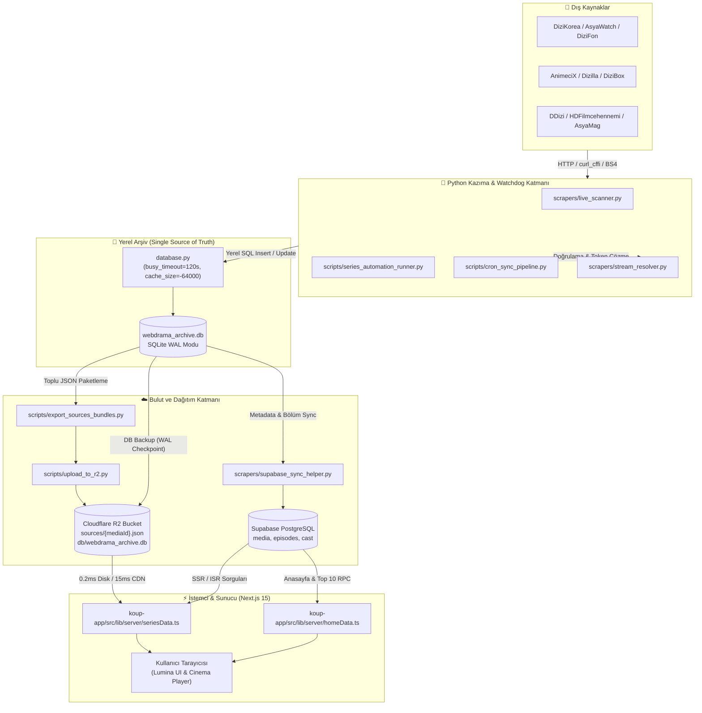
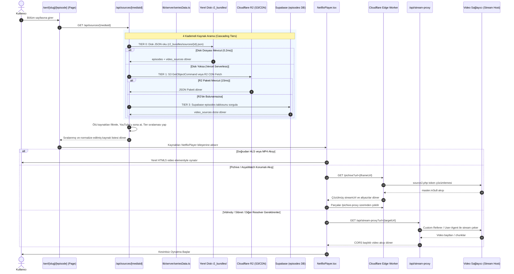

# 01 — KoUp Genel Bakış ve Mimari

Bu doküman; KoUp sinematik streaming, arşiv ve Asya eğlence platformunun temel amacını, desteklediği içerik türlerini, monorepo mimarisini, uçtan uca veri akışlarını, üç katmanlı depolama stratejisini ve render yöntemlerini teknik detaylarıyla açıklamaktadır.

---

## İçindekiler
- [1. KoUp Nedir? Misyon ve İçerik Kapsamı](#1-koup-nedir-misyon-ve-içerik-kapsamı)
- [2. Üst Düzey Sistem Mimarisi](#2-üst-düzey-sistem-mimarisi)
- [3. Monorepo Klasör Ağacı ve Rol Dağılımı](#3-monorepo-klasör-ağacı-ve-rol-dağılımı)
- [4. Uçtan Uca Veri Akışı ve Mimari Diyagramlar](#4-uçtan-uca-veri-akışı-ve-mimari-diyagramlar)
  - [4.1 Akış 1: Veri Toplama, Arşivleme ve Senkronizasyon Zinciri](#41-akış-1-veri-toplama-arşivleme-ve-senkronizasyon-zinciri)
  - [4.2 Akış 2: Kullanıcı Bölüm Oynatma ve Akış Çözümleme Zinciri](#42-akış-2-kullanıcı-bölüm-oynatma-ve-akış-çözümleme-zinciri)
- [5. Üç Katmanlı Depolama Mimarisi ve Tasarım Gerekçeleri](#5-üç-katmanlı-depolama-mimarisi-ve-tasarım-gerekçeleri)
  - [5.1 Tier 0 & Tier 1: Cloudflare R2 ve Yerel Disk JSON Paketleri](#51-tier-0--tier-1-cloudflare-r2-ve-yerel-disk-json-paketleri)
  - [5.2 Tier 2: Yerel SQLite WAL Veritabanı (Tek Doğruluk Kaynağı)](#52-tier-2-yerel-sqlite-wal-veritabanı-tek-doğruluk-kaynağı)
  - [5.3 Tier 3: Supabase PostgreSQL (İlişkisel Veri, Auth ve Realtime)](#53-tier-3-supabase-postgresql-ilişkisel-veri-auth-ve-realtime)
- [6. Teknoloji Yığını (Dependencies & Sürümler)](#6-teknoloji-yığını-dependencies--sürümler)
- [7. Render Stratejileri (SSR, ISR, CSR ve Edge Önbellekleme)](#7-render-stratejileri-ssr-isr-csr-ve-edge-önbellekleme)
- [8. İlgili Dokümanlar](#8-ilgili-dokümanlar)

---

## 1. KoUp Nedir? Misyon ve İçerik Kapsamı

### Ne İşe Yarar?
KoUp; Asya sineması, Uzak Doğu dizileri, anime ve dikey kısa dramalar başta olmak üzere zengin bir kronolojik arşiv sunan, reklam karmaşasından uzak, Apple TV+ (tvOS / macOS Sequoia) zarafeti, Netflix akıcılığı ve MUBI kürasyonu hissi veren yeni nesil bir streaming platformudur.

Platform, 17.000'den fazla yapımı ve on binlerce bölümü tek bir çatı altında toplayarak kullanıcıya akıllı oynatıcı (Universal Top Glass HUD, intro atlama, çözünürlük seçimi), franchise izleme sırası, oyuncu/seiyuu ilişki ağı, canlı Asya magazin akışı ve anlık bildirimler sunar.

### Desteklenen İçerik Türleri
1. **K-Drama (Kore Dizileri):** Romantik, gerilim, polisiye, fantastik ve tarihi (Sageuk) formatında haftalık veya tamamlanmış Güney Kore yapımları.
2. **C-Drama & Tayland / Asya Yapımları:** Çin tarihi (Wuxia / Xianxia), modern Çin dramaları, Tayland dizileri (Lakorn), Tayvan ve Japon dizileri.
3. **BL / GL (Boys' Love & Girls' Love):** Asya genelinden özel kategorize edilmiş popüler queer dramalar.
4. **Anime ve Donghua:** Japon anime serileri (sezonluk, OVA, OAD, sinema filmleri) ve yüksek çözünürlüklü Çin animasyonları (Donghua).
5. **Sinema & Asya/Dünya Filmleri:** Kore, Japonya, Çin, Hong Kong festivalleri ve gişe filmleri ile seçkin yabancı sinema arşivi.
6. **Batı / Yabancı Dizi:** Kullanıcı talepleri doğrultusunda eklenen seçkin küresel diziler.
7. **Dikey Kısa Drama (Short Drama):** 1-2 dakikalık dikey (9:16) formattaki modern webdrama yapımları (`ShortsDetailClient`, `scrapers/shortdrama/`).

---

## 2. Üst Düzey Sistem Mimarisi

KoUp mimarisi; yüksek trafik altında veritabanı kotalarını tüketmemek, sunucusuz (serverless) ortamlarda düşük gecikmeyle çalışmak ve harici video sağlayıcılarının getirdiği CORS/Referer engellerini aşmak üzere tasarlanmış dağıtık bir hibrit mimaridir:

1. **Ön Yüz & Sunucu Katmanı (Next.js 15 App Router on Vercel):**
   - React 19, TypeScript, Tailwind CSS v4 ve Framer Motion (`motion`) ile inşa edilmiş modern arayüz.
   - Vercel üzerinde Frankfurt (`fra1`) bölgesinde koşar ([vercel.json](../koup-app/vercel.json)).
   - SSR (Server-Side Rendering) ve ISR (Incremental Static Regeneration) ile arama motoru optimizasyonu (SEO) ve anlık açılış performansı sağlar.
2. **Uç Ağ & Akış Dağıtıcısı (Cloudflare Edge Worker):**
   - Global Cloudflare CDN ağı üzerinde (`cloudflare/worker.js`) çalışır.
   - Harici kaynaklardan gelen streamleri (Pichive, Tau-Video, Vidmoly, Sibnet, Ok.ru vb.) çözer, m3u8 manifestlerini rewrite eder, parça chunk'larını proxy'ler ve AsyaMag haberlerini önbelleğe alır.
3. **Nesne Depolama & JSON Dağıtımı (Cloudflare R2):**
   - Her yapımın video kaynaklarını barındıran tekil JSON paketlerini (`sources/{mediaId}.json`) ve tüm SQLite veritabanı yedeğini (`db/webdrama_archive.db`) depolar.
   - Sıfır egress maliyeti ve global S3 uyumlu CDN hızı sağlar.
4. **İlişkisel Veri & Kimlik Doğrulama (Supabase PostgreSQL):**
   - Kullanıcı profilleri, izleme listeleri, izleme geçmişi senkronizasyonu, yorumlar, reaksiyonlar ve Row Level Security (RLS) politikalarını yönetir.
5. **Otonom Tarayıcı ve Arşiv Motoru (Python 3.12 Katmanı):**
   - `scrapers/` ve `scripts/` altında çalışan Python otomasyonları.
   - 9 farklı sağlayıcıyı tarar, verileri yerel SQLite WAL veritabanına işler ve Cloudflare R2 ile Supabase'e senkronize eder.
   - Uzak bulut ortamında GitHub Actions workflow'ları (`.github/workflows/`) üzerinden tetiklenir.

---

## 3. Monorepo Klasör Ağacı ve Rol Dağılımı

```text
KoUp/
├── .github/
│   └── workflows/                    # GitHub Actions CI/CD ve bulut otomasyon işleri
│       ├── admin_job.yml             # Admin panelinden tetiklenen uzun soluklu scraper işleri
│       ├── scraper_cron.yml          # Her 4 saatte bir çalışan otonom kaynak tarayıcı cronu
│       └── sync_single_series.yml    # Tekil dizi canlı senkronizasyon işi
├── cloudflare/
│   └── worker.js                     # Cloudflare Edge Worker (Stream proxy, HLS rewrite, R2 gateway)
├── data/                             # Statik veri yedekleri ve JSON exportları
├── docs/                             # KoUp Yaşayan Dokümantasyon Sistemi
│   ├── 01-genel-bakis-ve-mimari.md   # Bu doküman (Mimari ve sistem tasarımı)
│   ├── 02-kurulum-ortam-ve-deploy.md # Kurulum, ortam değişkenleri ve deploy yönergeleri
│   └── ...
├── koup-app/                         # Next.js 15 Web Uygulaması & API Katmanı
│   ├── public/                       # Logolar, bayraklar, faviconlar ve statik varlıklar
│   ├── src/
│   │   ├── app/                      # Next.js App Router sayfaları ve API rotaları
│   │   │   ├── api/                  # 39+ API uç noktası (sources, resolve-stream, admin vb.)
│   │   │   ├── seri/[slug]/          # Dizi detay ve izleme sayfaları (SSR + ISR)
│   │   │   ├── kesfet/               # Filtreleme ve katalog arama
│   │   │   └── ...
│   │   ├── components/               # NetflixPlayer, FranchiseWatchOrder, Lumina UI bileşenleri
│   │   ├── context/                  # KoUpContext.tsx (Global state, auth, tema, oynatıcı)
│   │   ├── data/                     # franchise_graph.json (Franchise evren haritası)
│   │   ├── hooks/                    # Özel React hook'ları (useDebounce, useWatchHistory vb.)
│   │   └── lib/                      # Supabase istemcisi, adminAuth, yardımcı araçlar
│   │       └── server/               # Sunucu taraflı veri getirme ve scraper dispatch servisleri
│   ├── next.config.mjs               # Next.js yapılandırması (CSP, unoptimized images, redirects)
│   ├── package.json                  # Frontend bağımlılıkları ve npm scriptleri
│   ├── tsconfig.json                 # TypeScript konfigürasyonu ve path alias (@/*)
│   └── vercel.json                   # Vercel bölge konfigürasyonu (fra1)
├── r2_bundles/
│   └── sources/                      # R2'ye yüklenen tekil JSON paketleri ({mediaId}.json)
├── scrapers/                         # Çoklu kaynak tarama ve akış çözümleme motorları
│   ├── shortdrama/                   # Dikey webdrama özel scraperları
│   ├── sites/                        # Siteye özel ayrık scraper modülleri
│   ├── live_scanner.py               # 9 canlı sağlayıcının eşzamanlı bölüm çıkarıcısı
│   ├── stream_resolver.py            # Iframe, token ve HLS regex çözümleyici
│   └── supabase_sync_helper.py       # SQLite ⇄ R2 ⇄ Supabase senkronizasyon köprüsü
├── scripts/                          # 64 adet yönetim, iyileştirme, audit ve cron betiği
│   ├── series_automation_runner.py   # Çapraz arama, kaynak eşitleme ve SSE yayın motoru
│   ├── export_sources_bundles.py     # SQLite verilerini R2 JSON paketlerine dönüştürücü
│   ├── upload_to_r2.py               # Cloudflare R2 toplu asenkron yükleyici
│   ├── cron_sync_pipeline.py         # Periyodik senkronizasyon boru hattı
│   └── sync_vercel_env.py            # Ortam değişkenlerini Vercel CLI ile senkronize edici
├── database.py                       # SQLite WAL bağlantı yöneticisi ve pragma ayarları
├── webdrama_archive.db               # Yerel arşiv veritabanı (17.000+ yapım, tek doğruluk kaynağı)
├── GEMINI.md                         # Proje kuralları ve mimari prensipler
└── README.md                         # Tanıtım, vitrin ve hızlı başlangıç
```

---

## 4. Uçtan Uca Veri Akışı ve Mimari Diyagramlar

### 4.1 Akış 1: Veri Toplama, Arşivleme ve Senkronizasyon Zinciri
Bu akış; dış sağlayıcılardan (DiziKorea, AsyaWatch, AnimeciX vb.) verinin çekilip yerel veritabanına yazılmasını, ardından R2 ve Supabase katmanlarına senkronize edilerek kullanıcıya ulaştırılmasını gösterir.



---

### 4.2 Akış 2: Kullanıcı Bölüm Oynatma ve Akış Çözümleme Zinciri
Kullanıcı bir dizinin bölümünü açtığında, video kaynağının bulunması, önceliklendirilmesi ve oynatıcı motoruna iletilmesi süreci:



---

## 5. Üç Katmanlı Depolama Mimarisi ve Tasarım Gerekçeleri

KoUp sisteminde veriler tek bir depoda tutulmaz; **üç katmanlı hibrit bir mimari** kullanılır:

```text
[Yerel SQLite WAL]  ---> (Tek Doğruluk Kaynağı: Hızlı yazma, lock yok, sınırsız depolama)
         │
         ├───> [Cloudflare R2]     ---> (Bölüm Video Kaynakları: Sıfır egress, <15ms CDN hızı)
         │
         └───> [Supabase Postgres] ---> (Metadata, Kullanıcı State, Auth, RLS, Realtime)
```

### 5.1 Tier 0 & Tier 1: Cloudflare R2 ve Yerel Disk JSON Paketleri
- **Dosya Konumları:** Yerelde `r2_bundles/sources/{mediaId}.json`, bulutta R2 Bucket `sources/{mediaId}.json`.
- **Erişim Kodu:** [seriesData.ts: L208-L262](../koup-app/src/lib/server/seriesData.ts#L208-L262) ve [/api/sources/[mediaId]/route.ts: L533-L587](../koup-app/src/app/api/sources/[mediaId]/route.ts#L533-L587).
- **Hız:** Yerel diskte `0.2ms`, Vercel ortamında Cloudflare R2 Authenticated S3 istemcisi veya CDN üzerinden `~15ms`.
- **Neden Seçildi?**
  1. 17.000+ yapımın yüz binlerce bölümü ve her bölümün 3-5 farklı video kaynağı vardır. Bu devasa JSON yükünü veritabanı satırlarında tutmak Supabase disk kotasını (500MB Free / 8GB Pro) çok hızlı tüketir.
  2. R2 nesne depolama maliyeti gigabayt başına yalnızca $0.015'tir ve Cloudflare dışa aktarım (egress) için ücret almaz.
  3. Statik JSON dosyası olarak sunulduğunda, global Edge CDN üzerinden milisaniyeler mertebesinde yanıt verir.

### 5.2 Tier 2: Yerel SQLite WAL Veritabanı (Tek Doğruluk Kaynağı)
- **Dosya Konumu:** Proje kökünde `webdrama_archive.db`.
- **Erişim Kodu:** [database.py](../database.py) ve [/api/sources/[mediaId]/route.ts: L33-L53](../koup-app/src/app/api/sources/[mediaId]/route.ts#L33-L53) (`node:sqlite DatabaseSync`).
- **Ayarlar:**
  - `PRAGMA journal_mode=WAL;` (Write-Ahead Logging sayesinde okuma ve yazma birbirini kilitlemez).
  - `PRAGMA synchronous=NORMAL;` (Disk I/O darboğazını önler).
  - `PRAGMA busy_timeout=120000;` (Ağır tarama işlemlerinde kilitlenmeleri önlemek için 120 saniye tolerans).
  - `PRAGMA cache_size=-64000;` (64MB bellek içi sayfa önbelleği).
- **Neden Seçildi?**
  1. Python scraper'ları dakikada yüzlerce HTTP isteği atıp veriyi yerel diske sıfır ağ gecikmesiyle yazabilir.
  2. Dış servislerde (Supabase veya Cloudflare) kesinti veya kota aşımı olsa dahi yerel arşiv sapasağlam kalır.
  3. Tüm temizleme (purge), onarım (heal) ve tekilleştirme (dedup) işlemleri yerel SQLite üzerinde güvenle yapılıp ardından buluta aktarılır.

### 5.3 Tier 3: Supabase PostgreSQL (İlişkisel Veri, Auth ve Realtime)
- **Kapsam:** `media` tablosu (yapım künyesi, afişler, puanlar, türler), `media_cast` & `people` (aktörler, karakterler), `user_favorites`, `watch_history`, `comments`, `lists`, `magazine_posts`.
- **Erişim Kodu:** [koup-app/src/lib/supabase.ts](../koup-app/src/lib/supabase.ts).
- **Neden Seçildi?**
  1. İlişkisel sorgular (Örn: Haftalık Top 10 RPC fonksiyonu, aktörün oynadığı diğer diziler, türe göre filtreleme).
  2. Güçlü kimlik doğrulama (Supabase Auth) ve Row Level Security (RLS) politikalarıyla kullanıcı verisi güvenliği.
  3. Realtime abonelikler (yeni bölüm bildirimleri, anlık yorum akışı).

---

## 6. Teknoloji Yığını (Dependencies & Sürümler)

Tüm sürümler doğrudan [koup-app/package.json](../koup-app/package.json) ve kaynak kod dosyalarından doğrulanmıştır:

| Kategori | Teknoloji / Kütüphane | Sürüm | Kullanım Amacı |
| :--- | :--- | :--- | :--- |
| **Framework** | Next.js | `^15.2.0` | React 19 tabanlı App Router, SSR, ISR ve API rotaları |
| **UI Library** | React & React DOM | `^19.0.0` | Modern asenkron bileşen mimarisi ve Server Actions desteği |
| **Dil** | TypeScript | `^5.8.2` | Katı tip denetimi (`strict: true`) |
| **Stil & Tasarım** | Tailwind CSS | `^4.0.9` | Yeni nesil yüksek performanslı atomik CSS motoru |
| **PostCSS** | @tailwindcss/postcss | `^4.0.9` | PostCSS 8 entegrasyonu |
| **Animasyon** | Motion (Framer Motion) | `^12.4.7` | GPU hızlandırmalı modern UI animasyonları ve layout geçişleri |
| **İkon Seti** | Lucide React | `^0.477.0` | Apple ve Netflix tarzı minimalist SVG ikonlar |
| **Video Oynatıcı** | HLS.js | `^1.5.20` | HTML5 video üzerinde m3u8 Adaptive Bitrate oynatımı |
| **Görsel İşleme** | Sharp | `^0.35.5` | Sunucu taraflı görsel optimizasyonu |
| **Veritabanı (Cloud)** | @supabase/supabase-js | `^2.49.1` | PostgreSQL veri katmanı, Auth ve Realtime istemcisi |
| **Nesne Depolama** | @aws-sdk/client-s3 | `^3.1152.0` | Cloudflare R2 S3 API ile sunucu taraflı JSON paket okuma/yazma |
| **Veritabanı (WASM)**| sql.js | `^1.13.0` | WebAssembly tabanlı yerel SQLite sorgulama |
| **CSS Yardımcıları** | clsx & tailwind-merge | `^2.1.1` / `^3.0.2` | Koşullu class birleştirme ve çakışma yönetimi |
| **Edge Compute** | Cloudflare Workers | V8 Isolate | Global CDN üzerinde stream ve token çözümleme motoru |
| **Python Katmanı** | Python | `3.12` | Kazıyıcılar, otomasyon scriptleri ve veri senkronizasyonu |
| **Python Paketleri** | `requests`, `beautifulsoup4`, `curl_cffi`, `boto3`, `cryptography` | — | HTTP kazıma, HTML ayrıştırma, TLS parmak izi bypass, R2 S3 yönetimi, AES-128 şifre çözümü |

---

## 7. Render Stratejileri (SSR, ISR, CSR ve Edge Önbellekleme)

KoUp, sayfa tipine ve verinin değişim sıklığına göre optimize edilmiş hibrit render stratejileri uygular:

### 7.1 Sayfa Düzeyinde Render Stratejileri

| Rota | Render Modu | Revalidate Değeri | Açıklama |
| :--- | :--- | :--- | :--- |
| **`/` (Anasayfa)** | **ISR (Server Component)** | `revalidate = 300` (5 Dakika) | [page.tsx](../koup-app/src/app/page.tsx#L6) içinde `getHomeDataServer()` ile vitrin, son eklenenler ve Top 10 verisi sunucuda derlenir, 5 dakika önbelleğe alınır. |
| **`/seri/[slug]` (Dizi Detay)**| **ISR (Server Component)** | `revalidate = 3600` (1 Saat) | [seri/[slug]/page.tsx](../koup-app/src/app/seri/[slug]/page.tsx#L15) içinde `getSeriesDataServer()` ile künye, oyuncular, franchise ve bölümler sunucuda hazırlanır, arama motorlarına statik HTML olarak sunulur. |
| **`/seri/[slug]/[episode]` (Oynatıcı)** | **CSR (Client Component)** | — (`"use client"`) | Anlık kullanıcı geçmişi senkronizasyonu, video buffer yönetimi ve etkileşimli kontroller nedeniyle tamamen istemci tarafında render edilir. |
| **`/kesfet` (Katalog & Arama)** | **CSR (Client Component)** | — (`"use client"`) | Kullanıcının anlık tür, ülke, yıl filtrelemeleri ve arama terimleri için istemci tarafında dinamik state yönetir. |
| **`/admin` (Yönetim Paneli)** | **CSR (Client Component)** | — (`"use client"`) | Güvenlik, oturum kontrolü ve anlık otomasyon tetiklemeleri için tamamen dinamik istemci sayfasıdır. |
| **`/magazin`, `/takvim`, `/profil`** | **CSR (Client Component)** | — (`"use client"`) | Kullanıcı etkileşimi ve anlık veri gerektiren diğer sayfalar. |

### 7.2 API Rota Önbellekleme ve Dinamik Yapılandırmalar

| API Uç Noktası | Çalışma Modu (`dynamic`) | Önbellek Süresi (`revalidate`) | Cache-Control / İşlev |
| :--- | :--- | :--- | :--- |
| **`/api/sources/[mediaId]`** | `force-dynamic` | `revalidate = 0` | Anlık bölüm video kaynaklarını çözer; asla bayat veri dönmez. |
| **`/api/resolve-stream`** | `force-dynamic` | `revalidate = 0` | Canlı video iframe/token çözümlemesi. |
| **`/api/stream-proxy`** | `force-dynamic` | `revalidate = 0` | Canlı video chunk ve başlık aktarımı. |
| **`/api/image-proxy`** | — | `revalidate = 2592000` (30 Gün) | Dış afiş görsellerini proxy'ler; `public, max-age=2592000, immutable` başlığıyla tarayıcı ve CDN'de 1 ay önbelleklenir. |
| **`/api/person/bio`** | — | `revalidate = 3600` (1 Saat) | Oyuncu biyografi ve detaylarını 1 saat önbelleğe alır. |
| **`/api/magazin/live`** | — | `revalidate = 120` (2 Dakika) | AsyaMag canlı magazin yazılarını 2 dakika önbelleğe alır. |
| **`/api/magazin/actor`** | — | `revalidate = 300` (5 Dakika) | Oyuncuya ait haberleri 5 dakika önbelleğe alır. |
| **`/api/takvim/live`** | — | `revalidate = 60` (1 Dakika) | Güncel yayın takvimini 60 saniye önbelleğe alır. |
| **`/api/admin/*`** | `force-dynamic` | `revalidate = 0` | Tüm yönetim ve otomasyon rotaları zorunlu dinamiktir. |

---

## 8. İlgili Dokümanlar
- [02 — Kurulum, Ortam Değişkenleri ve Deploy Rehberi](./02-kurulum-ortam-ve-deploy.md)
- [05 — Oynatıcı ve Yayın Akışı](./05-oynatici-ve-yayin-akisi.md)
- [08 — Veri Katmanı](./08-veri-katmani.md)
- [09 — Kazıyıcılar, Scriptler ve Senkronizasyon](./09-kaziyicilar-scriptler-ve-senkron.md)
- [12 — Kurallar ve Yasaklar](./12-kurallar-ve-yasaklar.md)
