# KoUp Sayfalar ve Rotalar Rehberi

Bu doküman, KoUp platformunun (`koup-app/src/app`) Next.js 15 App Router tabanlı tüm sayfa ve rotalarını, layout/template mimarisini, veri besleme kaynaklarını (SSR/Client/API), render modlarını, kimlik doğrulama gereksinimlerini ve mobil davranışlarını ayrıntılı biçimde açıklar.

---

## İçindekiler

1. [Genel Bakış ve Rota Mimarisi](#1-genel-bakis-ve-rota-mimarisi)
2. [Site Haritası ve Navigasyon Tablosu](#2-site-haritasi-ve-navigasyon-tablosu)
3. [Mermaid Navigasyon ve Akış Diyagramı](#3-mermaid-navigasyon-ve-akis-diyagrami)
4. [Kök Şablon ve Genel Katmanlar (Layout, Template, Error, Not-Found)](#4-kok-sablon-ve-genel-katmanlar)
   - [RootLayout (`layout.tsx`)](#rootlayout-layouttsx)
   - [PageTransition & Template (`template.tsx`, `PageTransition.tsx`)](#pagetransition--template)
   - [Hata Yakalama (`error.tsx`)](#hata-yakalama-errortsx)
   - [404 Sayfa Bulunamadı (`not-found.tsx`)](#404-sayfa-bulunamadi-not-foundtsx)
   - [Eksik Yönlendiriciler ve Nedenleri (`middleware.ts`, `sitemap.ts`, `robots.ts`)](#eksik-yonlendiriciler-ve-nedenleri)
5. [Dikey Dizi & Shorts Rota Mimarisi](#5-dikey-dizi--shorts-rota-mimarisi)
6. [Tüm Sayfaların Detaylı Analizi (26 Sayfa)](#6-tum-sayfalarin-detayli-analizi)
   - [01. Ana Sayfa (`/`)](#01-ana-sayfa-)
   - [02. Keşfet & Arama (`/kesfet`)](#02-kesfet--arama-kesfet)
   - [03. Dizi / Film Detay (`/seri/[slug]`)](#03-dizi--film-detay-serislug)
   - [04. Bölüm İzleme & Sinema Oynatıcısı (`/seri/[slug]/[episode]`)](#04-bolum-izleme--sinema-oynaticisi-serislugepisode)
   - [05. Kütüphane (`/kutuphane`)](#05-kutuphane-kutuphane)
   - [06. İzleme Geçmişi (`/gecmis`)](#06-izleme-gecmisi-gecmis)
   - [07. Favoriler (`/favoriler`)](#07-favoriler-favoriler)
   - [08. Takip Edilenler (`/takip-edilenler`)](#08-takip-edilenler-takip-edilenler)
   - [09. Yayın Takvimi (`/takvim`)](#09-yayin-takvimi-takvim)
   - [10. Son Eklenenler (`/son-eklenenler`)](#10-son-eklenenler-son-eklenenler)
   - [11. Topluluk Listeleri (`/listeler`)](#11-topluluk-listeleri-listeler)
   - [12. Liste Detay (`/listeler/[id]`)](#12-liste-detay-listelerid)
   - [13. Özel Listelerim (`/listelerim`)](#13-ozel-listelerim-listelerim)
   - [14. Oyuncular ve Karakterler Dizini (`/oyuncular`)](#14-oyuncular-ve-karakterler-dizini-oyuncular)
   - [15. Oyuncu Detay & Filmografi (`/oyuncu/[slug]`)](#15-oyuncu-detay--filmografi-oyuncuslug)
   - [16. Asya Magazin Haber Akışı (`/magazin`)](#16-asya-magazin-haber-akisi-magazin)
   - [17. Magazin Makale Detayı (`/magazin/[slug]`)](#17-magazin-makale-detayi-magazinslug)
   - [18. Dizi İstek Portalı (`/seri-istek`)](#18-dizi-istek-portali-seri-istek)
   - [19. Kendi Profiline Yönlendirme (`/profil`)](#19-kendi-profiline-yonlendirme-profil)
   - [20. Kullanıcı Profili (`/profil/[username]`)](#20-kullanici-profili-profilusername)
   - [21. Kullanıcı Ayarları (`/ayarlar`)](#21-kullanici-ayarlari-ayarlar)
   - [22. Bildirim Merkezi (`/bildirimler`)](#22-bildirim-merkezi-bildirimler)
   - [23. Yönetim Paneli (`/admin`)](#23-yonetim-paneli-admin)
   - [24. Hakkımızda (`/hakkimizda`)](#24-hakkimizda-hakkimizda)
   - [25. Gizlilik Politikası & Çerezler (`/gizlilik-politikasi`)](#25-gizlilik-politikasi--cerezler-gizlilik-politikasi)
   - [26. Telif Hakkı & DMCA Bildirimi (`/telif-hakki`)](#26-telif-hakki--dmca-bildirimi-telif-hakki)
7. [İlgili Dokümanlar](#7-ilgili-dokumanlar)

---

## 1. Genel Bakış ve Rota Mimarisi

KoUp ön yüzü (`koup-app`), **Next.js 15 App Router** ve **React 19** mimarisi üzerinde çalışır. API uçları (`/api/*`) hariç uygulama genelinde **26 adet son kullanıcı sayfası** (`page.tsx`) bulunmaktadır.

### Temel Mimari Prensipler
- **Hızlı İlk Render & SEO Odaklılık:** Ana Sayfa (`/`) ve Dizi Detay (`/seri/[slug]`) gibi yüksek trafikli vitrin sayfaları Sunucu Tarafı Veri Çekimi (SSR) ve Artımlı Statik Yenileme (**ISR - Incremental Static Regeneration**) ile önbelleklenir.
- **İnteraktif İstemci Tarafı State:** Arama, filtreleme, kütüphane, profil ve oynatıcı sayfaları `'use client'` direktifi ile React Context (`KoUpContext`) ve `@supabase/supabase-js` istemcisi üzerinden gerçek zamanlı (real-time) çalışır.
- **Sıfır Çift Kaydırma Çubuğu:** Tarayıcı varsayılan kaydırma çubukları `globals.css` içinde global olarak gizlenmiş, sayfa geçişleri ve geri gitme (back navigation) konumları `ScrollRestoration` bileşeni ile piksel hassasiyetinde korunmuştur.
- **Zero Hardcoded Secret Kuralı:** Hiçbir sayfa dosyasında gizli anahtar, servis rolü tokenı veya özel veritabanı parolası bulunmaz. Tüm istemci erişimleri Supabase anon public key ve RLS (Row Level Security) korumalıdır; hassas işlemler ise yetkili API uçlarına yönlendirilir.

---

## 2. Site Haritası ve Navigasyon Tablosu

| # | URL Rotası | Dosya Yolu | Render Modu | Veri Kaynağı | Giriş Şartı? |
|---|---|---|---|---|---|
| 01 | `/` | `src/app/page.tsx` + `HomeClient.tsx` | SSR / ISR (`revalidate: 300`) | `getHomeDataServer()` (Supabase) | Hayır |
| 02 | `/kesfet` | `src/app/kesfet/page.tsx` | Client Dynamic | Supabase Client + Client Cache | Hayır |
| 03 | `/seri/[slug]` | `src/app/seri/[slug]/page.tsx` + `SeriesDetailClient.tsx` | SSR / ISR (`revalidate: 3600`) | `getSeriesDataServer()` | Hayır |
| 04 | `/seri/[slug]/[episode]` | `src/app/seri/[slug]/[episode]/page.tsx` | Client Dynamic | Supabase + Stream Proxy API | Hayır (Misafir izleyebilir) |
| 05 | `/kutuphane` | `src/app/kutuphane/page.tsx` | Client Dynamic | Supabase `user_media_progress` | Evet (Giriş modalı açar) |
| 06 | `/gecmis` | `src/app/gecmis/page.tsx` | Client Dynamic | `KoUpContext.progressMap` | Hayır (Yerel/Bulut hibrit) |
| 07 | `/favoriler` | `src/app/favoriler/page.tsx` | Client Dynamic | Supabase `user_favorites` | Evet (Giriş modalı açar) |
| 08 | `/takip-edilenler` | `src/app/takip-edilenler/page.tsx` | Client Dynamic | Supabase `user_follows` | Evet (Giriş modalı açar) |
| 09 | `/takvim` | `src/app/takvim/page.tsx` | Client Dynamic | `/api/takvim/live` + Supabase | Hayır |
| 10 | `/son-eklenenler` | `src/app/son-eklenenler/page.tsx` | Client Dynamic | Supabase `episodes` tablosu | Hayır |
| 11 | `/listeler` | `src/app/listeler/page.tsx` | Client Dynamic | Supabase `custom_lists` + `/api/lists` | Hayır |
| 12 | `/listeler/[id]` | `src/app/listeler/[id]/page.tsx` | Client Dynamic | `/api/lists/[id]` + Supabase | Hayır (Düzenleme: Sahip) |
| 13 | `/listelerim` | `src/app/listelerim/page.tsx` | Client Dynamic | `/api/lists` (Kullanıcı listeleri) | Evet |
| 14 | `/oyuncular` | `src/app/oyuncular/page.tsx` | Client Dynamic | Supabase `people` tablosu | Hayır |
| 15 | `/oyuncu/[slug]` | `src/app/oyuncu/[slug]/page.tsx` | Client Dynamic | Supabase `people`, `media_cast` | Hayır |
| 16 | `/magazin` | `src/app/magazin/page.tsx` | Client Dynamic | Supabase `magazine_posts` + Live API | Hayır |
| 17 | `/magazin/[slug]` | `src/app/magazin/[slug]/page.tsx` | Client Dynamic | Supabase `magazine_posts` | Hayır |
| 18 | `/seri-istek` | `src/app/seri-istek/page.tsx` | Client Dynamic | `/api/series-requests` + Metadata API | Evet (Talep göndermek için) |
| 19 | `/profil` | `src/app/profil/page.tsx` | Client Redirect | `KoUpContext.user` (otomatik yönlendirir) | Evet |
| 20 | `/profil/[username]` | `src/app/profil/[username]/page.tsx` | Client Dynamic | Supabase `profiles`, `user_media_progress` | Hayır (Gizli hesap hariç) |
| 21 | `/ayarlar` | `src/app/ayarlar/page.tsx` | Client Dynamic | Supabase Auth + `profiles` | Evet |
| 22 | `/bildirimler` | `src/app/bildirimler/page.tsx` | Client Dynamic | `KoUpContext.notifications` | Evet |
| 23 | `/admin` | `src/app/admin/page.tsx` | Client Protected | Admin Auth (`adminClient` / API) | Evet (Yalnızca Admin) |
| 24 | `/hakkimizda` | `src/app/hakkimizda/page.tsx` | Static Client | Statik içerik | Hayır |
| 25 | `/gizlilik-politikasi`| `src/app/gizlilik-politikasi/page.tsx` | Static Client | Statik içerik + Çerez tercihleri | Hayır |
| 26 | `/telif-hakki` | `src/app/telif-hakki/page.tsx` | Static Client | Statik DMCA & Telif hakları | Hayır |

---

## 3. Mermaid Navigasyon ve Akış Diyagramı

```mermaid
flowchart TD
    User(["Kullanıcı / Ziyaretçi"]) --> Navbar["Üst Menü / Navbar"]
    User --> BottomNav["Mobil Alt Bar"]

    subgraph Vitrin_ve_Icerik ["1. Vitrin & Keşif"]
        Home["Ana Sayfa (/)"]
        Kesfet["Keşfet & Arama (/kesfet)"]
        SonEklenen["Son Eklenenler (/son-eklenenler)"]
        Takvim["Yayın Takvimi (/takvim)"]
        Magazin["Asya Magazin (/magazin)"]
        Oyuncular["Oyuncular (/oyuncular)"]
    end

    subgraph Oynatici_ve_Detay ["2. Dizi & Oynatıcı Motoru"]
        SeriesDetail["Dizi Detay (/seri/[slug])"]
        ShortsDetail["Dikey Dizi Detay (/seri/[slug])"]
        WatchEpisode["Yatay Bölüm İzleme (/seri/[slug]/[episode])"]
        ShortsWatch["Dikey Shorts İzleme (/seri/[slug]/[episode])"]
        ActorDetail["Oyuncu Detay (/oyuncu/[slug])"]
        MagArticle["Haber Detay (/magazin/[slug])"]
    end

    subgraph Topluluk_ve_Kullanici ["3. Kullanıcı & Topluluk Alanı"]
        Library["Kütüphanem (/kutuphane)"]
        History["İzleme Geçmişi (/gecmis)"]
        Favorites["Favoriler (/favoriler)"]
        Follows["Takip Edilenler (/takip-edilenler)"]
        Lists["Topluluk Listeleri (/listeler)"]
        ListDetail["Liste Detayı (/listeler/[id])"]
        MyLists["Listelerim (/listelerim)"]
        Profile["Profil (/profil/[username])"]
        Settings["Ayarlar (/ayarlar)"]
        Notifs["Bildirimler (/bildirimler)"]
        Requests["Dizi İstek Portalı (/seri-istek)"]
    end

    subgraph Yonetim ["4. Yönetim"]
        Admin["Admin Paneli (/admin)"]
    end

    Navbar --> Home
    Navbar --> Kesfet
    Navbar --> Lists
    Navbar --> Oyuncular
    Navbar --> Magazin
    Navbar --> Takvim

    Home --> SeriesDetail
    Home --> WatchEpisode
    Home --> ShortsWatch
    Kesfet --> SeriesDetail
    SonEklenen --> WatchEpisode
    Takvim --> SeriesDetail

    SeriesDetail -->|Normal Dizi/Film| WatchEpisode
    SeriesDetail -->|Dikey Kısa Drama| ShortsDetail
    ShortsDetail --> ShortsWatch
    SeriesDetail --> ActorDetail
    Oyuncular --> ActorDetail

    Navbar -->|Girişli Kullanıcı| Library
    Navbar -->|Girişli Kullanıcı| History
    Navbar -->|Girişli Kullanıcı| Favorites
    Navbar -->|Girişli Kullanıcı| Profile
    Navbar -->|Girişli Kullanıcı| Settings
    Navbar -->|Girişli Kullanıcı| Notifs

    Lists --> ListDetail
    MyLists --> ListDetail
    Navbar --> Requests

    Navbar -->|Admin Rolü| Admin
```

---

## 4. Kök Şablon ve Genel Katmanlar

### RootLayout (`layout.tsx`)
- **Dosya:** [`koup-app/src/app/layout.tsx`](../koup-app/src/app/layout.tsx)
- **Görevi:** Tüm web uygulamasının HTML iskeletini, global tema tanımlarını, tipografi değişkenlerini, sağlayıcıları (providers) ve kalıcı bileşenleri barındırır.
- **Tipografi Entegrasyonu:**
  - `Plus_Jakarta_Sans` Google Fontu (`--font-sans` CSS değişkeniyle latin alfabesi ve 300-800 ağırlıklarında yüklenir, `preload: true`).
  - `JetBrains_Mono` Google Fontu (`--font-mono` CSS değişkeniyle kod/sayaç ve süre göstergeleri için yüklenir, `preload: false`).
  - `Netflix Sans` (`globals.css` içinde WOFF2 formatında yerel olarak barındırılan 400, 500, 700 ağırlıklı sinematik webfont).
- **Temel HTML & Body Ayarları:**
  - `lang="tr"`, `className="dark"`, `suppressHydrationWarning`.
  - Body: `bg-[#080808] text-[#F4F4F6] min-h-screen flex flex-col selection:bg-white selection:text-black antialiased w-full max-w-full`.
  - Sayfa yüklenir yüklenmez `<head>` içinde `history.scrollRestoration = 'manual'` çalıştırılarak tarayıcının istemsiz sıçramaları engellenir.
- **Sarmalayıcı Katman Sıralaması:**
  1. `<KoUpProvider>` (Tüm oturum, izleme geçmişi, favori, ses ve bildirim state'i).
  2. `<ScrollRestoration>` (Piksel hassasiyetinde geri dönüş pozisyonu koruyucusu).
  3. `<Navbar>` (Üst menü ve arama çubuğu).
  4. `<main className="flex-1 w-full max-w-full"><PageTransition>{children}</PageTransition></main>`
  5. `<Footer>` (Site alt bilgisi, telif ve hızlı linkler).
  6. `<CookieConsentBanner>` (Zevk profili ve çerez onay bildirim çubuğu).

### PageTransition & Template
- **Dosyalar:** [`koup-app/src/app/template.tsx`](../koup-app/src/app/template.tsx) ve [`koup-app/src/components/PageTransition.tsx`](../koup-app/src/components/PageTransition.tsx)
- **Görevi:** Sayfalar arası geçişlerde donma ve beyaz ekran sıçramalarını önlemek; GPU dostu mikro kayma ve solma (fade & slide) sağlamak.
- **Nasıl Çalışır:**
  - `template.tsx`: Next.js 15 App Router standardında her sayfa değişiminde yeniden mount olan bir `motion.div` render eder:
    - Başlangıç: `initial={{ opacity: 0, y: 6 }}`
    - Bitiş: `animate={{ opacity: 1, y: 0 }}`
    - Geçiş: `transition={{ duration: 0.22, ease: [0.22, 1, 0.36, 1] }}`
  - `PageTransition.tsx`: `usePathname` hook'unu dinleyerek doğrudan tarayıcının yerel Web Animations API'sini (`Element.animate`) tetikler (`duration: 180ms, easing: cubic-bezier(0.22, 1, 0.36, 1)`). Eğer kullanıcı işletim sisteminde `prefers-reduced-motion: reduce` tercih etmişse bu animasyon otomatik olarak pasifize edilir.

### Hata Yakalama (`error.tsx`)
- **Dosya:** [`koup-app/src/app/error.tsx`](../koup-app/src/app/error.tsx)
- **Görevi:** İstemci tarafında oluşabilecek beklenmeyen React runtime çökmelerini (Error Boundary) yakalar; kullanıcıya beyaz ekran göstermek yerine 500 hata kartı sunar.
- **Etkileşimler:**
  - `reset()` fonksiyonunu çağıran "Tekrar Dene" butonu.
  - Ana Sayfaya yönlendiren buton (`/`).
  - Hata detayını konsola loglar (`App Error Boundary caught: error`).

### 404 Sayfa Bulunamadı (`not-found.tsx`)
- **Dosya:** [`koup-app/src/app/not-found.tsx`](../koup-app/src/app/not-found.tsx)
- **Görevi:** Geçersiz URL'lerde veya `notFound()` fonksiyonu tetiklendiğinde (örneğin veritabanında silinmiş veya bulunamayan bir slug girildiğinde) modern sinematik 404 kartını gösterir.
- **Etkileşim:** "Ana Sayfaya Dön" butonuyla kullanıcıyı güvenle `/` rotasına taşır.

### Eksik Yönlendiriciler ve Nedenleri
1. **`middleware.ts` Neden Yok?**
   - KoUp mimarisinde Edge düzeyindeki yönlendirme, stream çözümleme (HLS m3u8 proxy) ve R2 erişim kontrolleri **Cloudflare Worker** katmanında ([`cloudflare/worker.js`](../cloudflare/worker.js)) çözülür.
   - Vercel tarafında her istek için middleware çalıştırmak Edge Function kota maliyetini artıracağı ve istemci sayfa geçişlerine ek gecikme (cold start) ekleyeceği için Next.js middleware kullanılmamış; kimlik doğrulama kontrolleri istemci düzeyinde (`KoUpContext`) ve API rotalarında (`adminAuth.ts` / Supabase RLS) gerçekleştirilmiştir.
2. **`sitemap.ts` & `robots.ts` Neden Yok?**
   - Uygulama 24.700'den fazla yapıma sahiptir. Tek parçalı statik bir `sitemap.ts` derleme süresini ve bellek tüketimini patlatacağı için arama motoru direktifleri doğrudan `layout.tsx` ve `seri/[slug]/page.tsx` içindeki `generateMetadata()` (`robots: { index: true, follow: true, ... }`) yapılandırmalarıyla yönetilmektedir.

---

## 5. Dikey Dizi & Shorts Rota Mimarisi

KoUp, geleneksel yatay sinema formatının yanı sıra Çin/Kore dikey kısa drama (**Shorts / Mini-Drama**) yapımlarını da yerel olarak destekler.

### Rota Eşleşmesi ve Akış
- **Dikey Dizi Tespiti:** Bir yapımın dikey kısa drama olup olmadığı `isShortDrama(media)` yardımcı fonksiyonu ile anlaşılır (`content_type === 'kisa_drama' || total_episodes >= 40 && avg_duration <= 5`).
- **Detay Sayfası (`/seri/[slug]`):**
  - Normal diziler için `SeriesDetailClient` render edilir.
  - Dikey kısa dramalar için doğrudan dikey poster, bölüm rozetleri ve bölüm listesini içeren `ShortsDetailClient` devreye girer.
- **İzleme Sayfası (`/seri/[slug]/[episode]`):**
  - Eğer yapım dikey kısa drama ise `seri/[slug]/[episode]/page.tsx` dinamik olarak `ShortsWatchClient` bileşenini (`ssr: false`) yükler.
  - **Kullanıcı Deneyimi:** 9:16 oranında tam ekran mobil TikTok/Reels deneyimi; yukarı/aşağı kaydırmayla (swipe) bir sonraki bölüme anında geçiş, ses açma/kapama, hızlı bölüm atlama çekmecesi ve otomatik bölüm tamamlama senkronizasyonu sunar.

---

## 6. Tüm Sayfaların Detaylı Analizi

### 01. Ana Sayfa (`/`)
- **Dosyalar:** [`koup-app/src/app/page.tsx`](../koup-app/src/app/page.tsx) ve [`koup-app/src/app/HomeClient.tsx`](../koup-app/src/app/HomeClient.tsx)
- **Ne İşe Yarar:** Platformun vitrin merkezidir. Öne çıkan yapımları, video fragmanlı vitrini (hero banner), izlemeye devam etme listesini, haftalık Top 10 sıralamalarını, dikey Shorts rayını, kişiselleştirilmiş önerileri ve tür odaklı vitrinleri bir arada sunar.
- **Nasıl Çalışır:**
  - Sunucu tarafında `getHomeDataServer()` fonksiyonu çalışır; `media` tablosundan vitrin dizilerini, son eklenen bölümleri, trend olanları, magazin yazılarını ve oyuncu verilerini tek bir paket (bundle) halinde derler.
  - İstemcide `HomeClient` bu paketi devralır. İlk 3 ray (`useDeferredMount(order <= 2)`) anında ekrana basılırken, ekran dışındaki (below-the-fold) raylar kullanıcı aşağı kaydırdıkça `requestAnimationFrame` ve `IntersectionObserver` ile aşamalı olarak mount edilir.
- **Render Modu:** ISR (Incremental Static Regeneration). `export const revalidate = 300` (5 dakika boyunca sunucuda önbelleklenir, sonra arka planda sessizce yenilenir).
- **Giriş Gereksinimi:** Giriş gerekmez. Giriş yapıldığında "Kaldığın Yerden Devam Et" rayı ve kişiselleştirilmiş Zevk Profili akışı otomatik doldurulur.
- **Kullanıcı Etkileşimleri:**
  - Hero banner üzerinde video fragmanı oynatma, ses açma/kapatma toggle'ı.
  - Kartların üzerine gelindiğinde (desktop) akordiyon genişleme ve mikro-fragman önizlemesi.
  - Yatay raylarda fareyle basılı tutup sürükleyerek akıcı kaydırma (120 FPS momentum drag).
  - Hızlı favoriye ekleme, takip etme, listeye ekleme ve izlemeye başlama butonları.
- **Mobil Davranışı:**
  - Hero banner dikey poster ve kompakt buton düzenine geçer.
  - Yatay raylar yerel dokunmatik kaydırma (`-webkit-overflow-scrolling: touch`) ile çalışır.
  - Akordiyon hover genişlemesi mobilde devre dışı kalır, karta tek dokunuş doğrudan detay veya izleme sayfasına yönlendirir.
- **Kullandığı Ana Bileşenler:** `AccordionMediaCard`, `DirectMediaCard`, `ShortsCard`, `Top10Numeral`, `CustomSelect`, `CountryFlag`, `ShortsRail`.

---

### 02. Keşfet & Arama (`/kesfet`)
- **Dosya:** [`koup-app/src/app/kesfet/page.tsx`](../koup-app/src/app/kesfet/page.tsx)
- **Ne İşe Yarar:** 24.700'den fazla yapım içeren dev katalogda anlık arama, çok kriterli filtreleme, sıralama ve sayfalama yapmayı sağlar.
- **Nasıl Çalışır:**
  - URL arama parametreleri (`?type=...&category=...&country=...&sort=...&q=...&page=...`) üzerinden senkronize çalışır.
  - Arama sorguları Türkçe karakter duyarsızlaştırma (`normalizeSearchQuery`) ve akıllı ağırlıklandırma (`rankSearchResults`) algoritmasından geçirilir.
  - Sorgu sonuçları `cachedQuery` modülüyle istemci önbelleğine alınarak gereksiz Supabase kota tüketimi engellenir.
- **Render Modu:** Client Component (`'use client'`). Sayfa boyutu `ITEMS_PER_PAGE = 36` yapımdır.
- **Giriş Gereksinimi:** Hayır.
- **Kullanıcı Etkileşimleri:**
  - Üst tür sekmeleri (Tüm Türler, Diziler, Filmler, Animeler, Kısa Dramalar, Programlar).
  - Çoklu kategori/etiket seçimi (Romantik, Aksiyon, Fantastik, Gizem, Komedi vb.).
  - Ülke seçimi (Kore, Çin, Japonya, Tayland vb.) ve Yıl filtrelemesi (2026'dan 2000 öncesine).
  - Sıralama dropdown'ı (`CustomSelect`): Popülerlik, KoUp Puanı, MDL Puanı, IMDb Puanı, En Yeni, İsim (A-Z).
- **Mobil Davranışı:**
  - Filtre seçenekleri yatay sürüklenebilir kapsül çubuğunda (`usePillDragTracking`) gösterilir.
  - Grid yapısı 2 sütuna düşer; dokunma alanları minimum 44px'e sabitlenir.
- **Kullandığı Ana Bileşenler:** `AccordionMediaCard`, `CustomSelect`, `CountryFlag`, `Pagination`, `ShortsCard`.

---

### 03. Dizi / Film Detay (`/seri/[slug]`)
- **Dosyalar:** [`koup-app/src/app/seri/[slug]/page.tsx`](../koup-app/src/app/seri/[slug]/page.tsx) ve [`koup-app/src/app/seri/[slug]/SeriesDetailClient.tsx`](../koup-app/src/app/seri/[slug]/SeriesDetailClient.tsx)
- **Ne İşe Yarar:** Belirli bir dizinin, filmin veya animenin tam kimlik kartıdır. Konu özeti, bölümler listesi, oyuncu kadrosu, franchise/evren izleme sırası, yorumlar ve benzer önerileri sunar.
- **Nasıl Çalışır:**
  - Sunucu tarafında `getSeriesDataServer(decodedSlug)` çalışır; dizi metadata'sını, mevcut tüm bölümleri, oyuncuları (`media_cast`) ve franchise bağlantılarını tek seferde çeker.
  - **Kanonik URL Yönlendirmesi (301 Permanent Redirect):** Rakip sitelerden kalma slug'lar (örn. `animecix`, `asyaanimeleri` ekleri) veya saf sayısal ID'ler geldiğinde arama motoru optimizasyonu için anında temiz kanonik slug'a `permanentRedirect()` ile yönlendirir.
  - **Schema.org JSON-LD:** Sayfanın `<head>` kısmına arama motorları için zengin `TVSeries` veya `Movie` yapılandırılmış verisi (`AggregateRating`, `actor`, `numberOfEpisodes`) enjekte eder.
  - Dikey kısa dramalarda `ShortsDetailClient`'ı, yatay sinema yapımlarında `SeriesDetailClient`'ı render eder.
- **Render Modu:** ISR (`export const revalidate = 3600` - 1 saat önbellek) + Sunucu Tarafı `generateMetadata`.
- **Giriş Gereksinimi:** Hayır.
- **Kullanıcı Etkileşimleri:**
  - "İzlemeye Başla" veya "Kaldığın Yerden Devam Et" butonu (en son izlenen bölüme anında atlar).
  - Fragman izleme modalı, Listeye Ekle (`AddToListModal`), Favorilere Ekle, Takip Et / Bildirim Aç.
  - Sezonlar arası geçiş ve bölüm kartlarından doğrudan oynatıcıya geçiş.
  - Bölüm listesinde tek tıkla "Tümünü İzlendi İşaretle" (veya geri alma) butonu ile aktif sezon/dizi bölümlerini toplu tamamlama.
  - Oyuncu kartlarına tıklayarak oyuncu detayına gitme.
- **Mobil Davranışı:**
  - Üst banner görseli dikey poster oranına uyarlanır.
  - Bölüm listesi dokunmatik yatay ray veya dikey liste olarak akıcı biçimde kaydırılır.
- **Kullandığı Ana Bileşenler:** `FranchiseWatchOrder`, `RichCommentSection`, `AddToListModal`, `CountryFlag`, `CustomSelect`.

---

### 04. Bölüm İzleme & Sinema Oynatıcısı (`/seri/[slug]/[episode]`)
- **Dosya:** [`koup-app/src/app/seri/[slug]/[episode]/page.tsx`](../koup-app/src/app/seri/[slug]/[episode]/page.tsx)
- **Ne İşe Yarar:** Video akışının oynatıldığı, kaynak/altyazı seçiminin yapıldığı, tepkilerin verildiği ve bölüm yorumlarının yazıldığı ana tüketim merkezidir.
- **Nasıl Çalışır:**
  - URL'den `slug` ve `episode` parametrelerini alır.
  - Eğer yapım dikey kısa drama ise dinamik olarak `ShortsWatchClient` devreye girer.
  - Normal yapımlarda `NetflixPlayer` yüklenir. İlgili bölümün kaynakları (`sources`), fansub çevirmen bilgileri ve kalite alternatifleri `/api/resolve-stream` ve `/api/sources/[mediaId]` uçları üzerinden çözülür.
  - Kullanıcı bölümü izledikçe ilerleme süresi (`progress_seconds`) yerel hafızaya ve oturum açıksa `user_media_progress` tablosuna sessizce kaydedilir.
  - Görüntülenme sayacı `trackMediaView()` ile şişirme olmaksızın kaydedilir.
- **Render Modu:** Client Component (`'use client'`). Ağır bileşenler (`ShortsWatchClient`, `RichCommentSection`) Next.js `dynamic(..., { ssr: false })` ile yüklenir.
- **Giriş Gereksinimi:** Misafir kullanıcılar da izleyebilir. Ancak ilerleme kaydı ve yorum yazma için giriş önerilir.
- **Kullanıcı Etkileşimleri:**
  - HLS video oynatımı, kalite değiştirme (1080p, 720p), oynatma hızı (0.5x - 2x).
  - Altyazı ve kaynak/fansub seçici dropdown (`CustomSelect`).
  - Sinema Işıkları Modu (player dışındaki tüm ekranı karartma).
  - Anlık Tepkiler: Alev, Gözyaşı, Şimşek, Öfke ikonlarıyla reaksiyon verme.
  - Sonraki bölüme otomatik geçiş geri sayımı.
  - Zaman damgalı (timestamp) yorum yazma ve yanıtlama.
- **Mobil Davranışı:**
  - Tam ekran (fullscreen) modu, ekran döndürme ve dokunmatik jest kontrolleri (çift dokunmayla 10sn ileri/geri).
  - Yan paneldeki bölüm listesi (`EpisodeRail`) oynatıcının altına yerleşir.
- **Kullandığı Ana Bileşenler:** `NetflixPlayer`, `EpisodeRail`, `RichCommentSection`, `FranchiseWatchOrder`, `CustomSelect`, `ShortsWatchClient`.

---

### 05. Kütüphane (`/kutuphane`)
- **Dosya:** [`koup-app/src/app/kutuphane/page.tsx`](../koup-app/src/app/kutuphane/page.tsx)
- **Ne İşe Yarar:** Kullanıcının MyDramaList / AniList mantığında kişisel dizi ve film arşivini yönettiği sayfadır.
- **Nasıl Çalışır:**
  - Supabase `user_media_progress` tablosundaki verileri kullanıcının `user_id`sine göre çeker.
  - Durum sekmeleri:
    - `watching` (İzleniyor)
    - `completed` (Tamamlandı)
    - `plan_to_watch` (Planlanan)
    - `on_hold` (Beklemede)
    - `dropped` (Bırakıldı)
- **Render Modu:** Client Component (`'use client'`).
- **Giriş Gereksinimi:** **Evet.** Kullanıcı giriş yapmamışsa ekranın ortasında şık bir kilit kartı ve "Giriş Yap" butonu (`AuthModal`) gösterilir.
- **Kullanıcı Etkileşimleri:**
  - Yapımların durumunu tek tıkla veya toplu olarak değiştirme (örn. İzleniyor -> Tamamlandı).
  - 1-10 arası kişisel puan verme.
  - İzlenen bölüm sayısını elle güncelleme (+1 butonu).
  - Toplu seçim modu (birden fazla yapımı seçip kütüphaneden kaldırma veya durumunu güncelleme).
  - Arama, tür filtresi ve sıralama (Son Güncellenen, Puan, İsim, Yıl).
- **Mobil Davranışı:**
  - Durum sekmeleri yatay sürüklenebilir kaydırıcıda ortalanır (`usePillDragTracking`).
  - Kartlar kompakt mobil düzende listelenir.
- **Kullandığı Ana Bileşenler:** `AccordionMediaCard`, `CustomSelect`, `Pagination`, `ConfirmModal`.

---

### 06. İzleme Geçmişi (`/gecmis`)
- **Dosya:** [`koup-app/src/app/gecmis/page.tsx`](../koup-app/src/app/gecmis/page.tsx)
- **Ne İşe Yarar:** Kullanıcının platformda izlediği tüm bölümleri, kaldığı dakikaları ve tamamlama yüzdelerini kronolojik sırada gösterir.
- **Nasıl Çalışır:**
  - `KoUpContext` içindeki `progressMap` state'inden beslenir.
  - Kullanıcı giriş yapmışsa Supabase'den senkronize edilir; misafir kullanıcı ise tarayıcı `localStorage` önbelleğindeki geçmişi gösterir.
- **Render Modu:** Client Component (`'use client'`).
- **Giriş Gereksinimi:** Zorunlu değildir; misafirler de yerel geçmişlerini görebilir. Ancak bulut senkronizasyonu için giriş tavsiye edilir.
- **Kullanıcı Etkileşimleri:**
  - "Kaldığın Yerden Devam Et" butonuyla doğrudan ilgili bölüm ve saniyeye atlama.
  - Geçmişten tekil kayıt silme veya "Tüm Geçmişi Temizle" butonu (`ConfirmModal`).
  - Filtreleme: Tümü, Devam Edenler, Tamamlananlar.
- **Mobil Davranışı:**
  - İlerleme çubukları kartların altında belirgin şekilde gösterilir. Dokunmayla anında oynatıcı açılır.
- **Kullandığı Ana Bileşenler:** `Pagination`, `ConfirmModal`, `usePillDragTracking`.

---

### 07. Favoriler (`/favoriler`)
- **Dosya:** [`koup-app/src/app/favoriler/page.tsx`](../koup-app/src/app/favoriler/page.tsx)
- **Ne İşe Yarar:** Kullanıcının kalp ikonuyla favorilerine eklediği dizi, anime ve filmleri listeler.
- **Nasıl Çalışır:**
  - `user_favorites` tablosundan kullanıcının favori `media_id` listesini çeker ve `media` tablosuyla birleştirir (join).
- **Render Modu:** Client Component (`'use client'`).
- **Giriş Gereksinimi:** **Evet.** Giriş yapılmamışsa giriş çağrısı (CTA) kartı gösterilir.
- **Kullanıcı Etkileşimleri:**
  - Favorilerden çıkarma (tek tıkla anında kaldırılır, geri alma toast bildirimi verilir).
  - Sıralama ve arama filtreleri.
- **Mobil Davranışı:**
  - 2 sütunlu responsive ızgara ve hızlı dokunmatik kartlar.
- **Kullandığı Ana Bileşenler:** `AccordionMediaCard`, `CustomSelect`, `Pagination`.

---

### 08. Takip Edilenler (`/takip-edilenler`)
- **Dosya:** [`koup-app/src/app/takip-edilenler/page.tsx`](../koup-app/src/app/takip-edilenler/page.tsx)
- **Ne İşe Yarar:** Kullanıcının çan ikonuyla takibe aldığı dizileri ve kalp ikonuyla takip ettiği oyuncuları yönetmesini sağlar. Yeni bölüm veya yeni proje yayınlandığında bildirim üretilmesinin kaynağıdır.
- **Nasıl Çalışır:**
  - `user_follows` ve `user_actor_follows` tablolarından aktif abonelikleri listeler.
- **Render Modu:** Client Component (`'use client'`).
- **Giriş Gereksinimi:** **Evet.**
- **Kullanıcı Etkileşimleri:**
  - İki ana sekme: **Diziler & Filmler** / **Oyuncular & Karakterler**.
  - Takibi bırakma (`ConfirmModal`) ve bildirim sıklığını açma/kapatma.
- **Mobil Davranışı:**
  - Üst sekme geçişi pürüzsüz animasyonla kayar (`usePillDragTracking`).
- **Kullandığı Ana Bileşenler:** `AccordionMediaCard`, `CustomSelect`, `Pagination`, `ConfirmModal`.

### 09. Yayın Takvimi (`/takvim`)
- **Dosya:** [`koup-app/src/app/takvim/page.tsx`](../koup-app/src/app/takvim/page.tsx)
- **Ne İşe Yarar:** Kore ve Asya kanallarında haftanın günlerine göre yayınlanan güncel devam eden (ongoing) dizilerin haftalık yayın programını gösterir.
- **Nasıl Çalışır:**
  - Güncel yayın verisini `/api/takvim/live` ucundan ve Supabase `calendar_schedules` tablosundan çeker.
  - Günler 1'den 7'ye (Pazartesi - Pazar) numaralandırılmıştır. Aktif gün otomatik olarak seçilir (`new Date().getDay()`).
- **Render Modu:** Client Component (`'use client'`).
- **Giriş Gereksinimi:** Hayır.
- **Kullanıcı Etkileşimleri:**
  - Haftanın günleri arasında geçiş (Pzt, Sal, Çar, Per, Cum, Cmt, Paz).
  - Dizinin yanındaki "Bildirim Aç" butonuyla yeni bölümlerde anlık bildirim alma.
  - Dizinin sayfasına gitme veya mevcut bölüme anında başlama.
- **Mobil Davranışı:**
  - Gün hapları üst kısımda kaydırılabilir şerit olarak sunulur; seçilen gün ekranın tam ortasına otomatik hizalanır.
- **Kullandığı Ana Bileşenler:** `CountryFlag`, `usePillDragTracking`.

---

### 10. Son Eklenenler (`/son-eklenenler`)
- **Dosya:** [`koup-app/src/app/son-eklenenler/page.tsx`](../koup-app/src/app/son-eklenenler/page.tsx)
- **Ne İşe Yarar:** Platforma en son eklenen veya çevirisi yeni yüklenen dizi bölümlerini ve yeni filmleri kronolojik olarak listeler.
- **Nasıl Çalışır:**
  - Supabase `episodes` tablosundaki `published_at` tarihine göre azalan sırada sorgu atar (`PAGE_SIZE = 50`).
  - İlgili yapımın afişi, sezon/bölüm numarası ve yayın saati ("2 saat önce", "Dün" vb.) hesaplanır.
- **Render Modu:** Client Component (`'use client'`).
- **Giriş Gereksinimi:** Hayır.
- **Kullanıcı Etkileşimleri:**
  - Tür filtreleme (Tümü, Diziler, Filmler, Animeler).
  - Bölüm kartına tıklayarak doğrudan o bölümün oynatıcısına gitme.
- **Mobil Davranışı:**
  - Geniş kart mimarisi; tek dokunuşla oynatmayı başlatma.
- **Kullandığı Ana Bileşenler:** `Pagination`, `usePillDragTracking`.

---

### 11. Topluluk Listeleri (`/listeler`)
- **Dosya:** [`koup-app/src/app/listeler/page.tsx`](../koup-app/src/app/listeler/page.tsx)
- **Ne İşe Yarar:** Platform üyeleri tarafından oluşturulmuş herkese açık (public) özel tematik dizi/film koleksiyonlarını keşfetme merkezidir (örneğin "Ağlatan Kore Dizileri", "En İyi Düşmandan Aşka K-Dramalar").
- **Nasıl Çalışır:**
  - `custom_lists` tablosundan `visibility = 'public'` olan kayıtları ve içerisindeki yapımların kapak görsellerini çeker.
- **Render Modu:** Client Component (`'use client'`).
- **Giriş Gereksinimi:** Listeleri gezmek için giriş gerekmez; yeni liste oluşturmak için giriş zorunludur.
- **Kullanıcı Etkileşimleri:**
  - Popüler ve Yeni listeler sıralaması.
  - Listeleri beğenme (kalp sayacı arttırma).
  - Liste arama çubuğu.
  - "Yeni Liste Oluştur" butonu (oturum açmış kullanıcılar için modal açar).
- **Mobil Davranışı:**
  - Kartlarda 3'lü kapak kolajı (poster collage) duyarlı biçimde küçülür.
- **Kullandığı Ana Bileşenler:** `Pagination`.

---

### 12. Liste Detay (`/listeler/[id]`)
- **Dosya:** [`koup-app/src/app/listeler/[id]/page.tsx`](../koup-app/src/app/listeler/[id]/page.tsx)
- **Ne İşe Yarar:** Belirli bir özel listenin içerdiği tüm yapımları, liste açıklamasını, oluşturan kullanıcının profilini ve etkileşimleri görüntüler.
- **Nasıl Çalışır:**
  - URL'deki `id` parametresiyle `/api/lists/[id]` ucunu veya doğrudan Supabase `custom_lists` tablosunu sorgular.
  - Listenin sahibi sayfayı ziyaret ettiğinde düzenleme yetkileri (yapım ekleme/çıkarma, başlık düzenleme) aktif olur.
- **Render Modu:** Client Component (`'use client'`).
- **Giriş Gereksinimi:** Herkese açık listeleri görüntülemek için giriş gerekmez. Listeyi beğenmek veya sahip olarak düzenlemek için giriş gerekir.
- **Kullanıcı Etkileşimleri:**
  - Yapımları sıralama: Eklenme Sırası, En Yeni Yıl, En Eski Yıl, Puan, İsim.
  - Liste sahibi için: Arama yaparak listeye yeni dizi/film ekleme, mevcut yapımları silme, toplu seçim modu.
  - Beğen / Beğenmekten Vazgeç toggle'ı.
- **Mobil Davranışı:**
  - Yapım kartları responsive akordiyon veya ızgara formatında listelenir.
- **Kullandığı Ana Bileşenler:** `AccordionMediaCard`, `CustomSelect`, `ConfirmModal`.

---

### 13. Özel Listelerim (`/listelerim`)
- **Dosya:** [`koup-app/src/app/listelerim/page.tsx`](../koup-app/src/app/listelerim/page.tsx)
- **Ne İşe Yarar:** Kullanıcının bizzat oluşturduğu hem gizli (private) hem de herkese açık (public) tüm kişisel koleksiyonlarını yönettiği sayfadır.
- **Nasıl Çalışır:**
  - Kullanıcının `user_id` sine ait `custom_lists` kayıtlarını `/api/lists` üzerinden listeler.
- **Render Modu:** Client Component (`'use client'`).
- **Giriş Gereksinimi:** **Evet.**
- **Kullanıcı Etkileşimleri:**
  - "Yeni Liste Oluştur" modalı: Liste başlığı, açıklaması, gizlilik tercihi (Herkese Açık / Yalnızca Ben).
  - Listeyi silme (`ConfirmModal` ile geri alınamaz silme onayı).
  - Görünürlüğü tek tıkla gizliden genele çevirme.
- **Mobil Davranışı:**
  - Kompakt kart dizilimi ve pratik hızlı eylem menüsü.
- **Kullandığı Ana Bileşenler:** `CustomSelect`, `ConfirmModal`, `Pagination`.

---

### 14. Oyuncular ve Karakterler Dizini (`/oyuncular`)
- **Dosya:** [`koup-app/src/app/oyuncular/page.tsx`](../koup-app/src/app/oyuncular/page.tsx)
- **Ne İşe Yarar:** Asya sinemasının ve dizilerinin önde gelen aktörlerini, aktrislerini, ses sanatçılarını (Seiyuu) ve popüler anime karakterlerini keşfetme dizinidir.
- **Nasıl Çalışır:**
  - Supabase `people` tablosundan popülerlik ve takipçi sayısına göre kayıtları çeker.
- **Render Modu:** Client Component (`'use client'`).
- **Giriş Gereksinimi:** Hayır.
- **Kullanıcı Etkileşimleri:**
  - Kategorik Sekmeler:
    - **Tüm Yıldızlar & Karakterler**
    - **Dizi & Sinema Oyuncuları**
    - **Anime Karakterleri**
    - **Seslendirmenler (Seiyuu)**
  - İsimle anlık canlı arama.
  - Ülke seçimi dropdown'ı (`CustomSelect`): Kore, Japonya, Çin, Tayland vb.
  - Oyuncuyu doğrudan takip etme / bildirim açma butonu.
- **Mobil Davranışı:**
  - Yuvarlak avatar kartları 3 veya 4 sütunlu duyarlı ızgarada listelenir.
- **Kullandığı Ana Bileşenler:** `CustomSelect`, `Pagination`, `usePillDragTracking`.

---

### 15. Oyuncu Detay & Filmografi (`/oyuncu/[slug]`)
- **Dosya:** [`koup-app/src/app/oyuncu/[slug]/page.tsx`](../koup-app/src/app/oyuncu/[slug]/page.tsx)
- **Ne İşe Yarar:** Belirli bir oyuncunun veya anime karakterinin kapsamlı profili, biyografisi, doğum/yaş bilgileri, oynadığı tüm yapımlar (filmografi), rol arkadaşları ve ilgili magazin haberlerini sergiler.
- **Nasıl Çalışır:**
  - `people` tablosundan oyuncu profilini, `media_cast` tablosundan oynadığı yapımları (Başrol, Yan Rol, Konuk Oyuncu olarak gruplanır), `magazine_posts` tablosundan ise oyuncuyla ilişkili haberleri çeker.
  - **İnteraktif Biyografi Motoru (`WikiBioText`):** Oyuncunun biyografi metni içinde geçen diğer dizi isimlerini ve rol arkadaşlarını otomatik olarak tespit eder; fare üzerine getirildiğinde anında mikro-kart popover'ı açar.
- **Render Modu:** Client Component (`'use client'`).
- **Giriş Gereksinimi:** Hayır (Takip etmek için giriş gerekir).
- **Kullanıcı Etkileşimleri:**
  - "Takip Et" butonu (yeni projesi eklendiğinde bildirim gönderilir).
  - Rol filtreleme sekmeleri (Tümü, Başroller, Yan Roller).
  - Filmografi kartları üzerinde akordiyon önizleme.
  - Oyuncuya özel topluluk yorumları (`RichCommentSection`).
- **Mobil Davranışı:**
  - Profil başlığı, avatar ve sosyal/biyo bilgileri dikey hizaya geçer.
- **Kullandığı Ana Bileşenler:** `AccordionMediaCard`, `RichCommentSection`, `WikiBioText`, `useDragScroll`.

---

### 16. Asya Magazin Haber Akışı (`/magazin`)
- **Dosya:** [`koup-app/src/app/magazin/page.tsx`](../koup-app/src/app/magazin/page.tsx)
- **Ne İşe Yarar:** K-Drama, Asya sineması, K-Pop ve oyuncular hakkındaki en güncel haberleri, röportajları, dizi duyurularını ve magazin gelişmelerini sunan AsyaMag akışıdır.
- **Nasıl Çalışır:**
  - Supabase `magazine_posts` tablosundan beslenir. Eğer veritabanında yeni yazı yoksa `/api/magazin/live` servisi tetiklenerek anlık haber derlemesi yapılır.
- **Render Modu:** Client Component (`'use client'`).
- **Giriş Gereksinimi:** Hayır.
- **Kullanıcı Etkileşimleri:**
  - Kategori filtreleme kapsülleri: Dedikodu, Kore, Çin, Dizi, Müzik, Film, BL/GL, Tayland.
  - Başlık veya içerikte canlı arama.
  - "Yenile" butonuyla taze haber taraması tetikleme.
- **Mobil Davranışı:**
  - Haber kartları büyük kapak görselleri ve okunaklı özet metinleriyle dikey kart akışına dönüşür.
- **Kullandığı Ana Bileşenler:** `usePillDragTracking`.

---

### 17. Magazin Makale Detayı (`/magazin/[slug]`)
- **Dosya:** [`koup-app/src/app/magazin/[slug]/page.tsx`](../koup-app/src/app/magazin/[slug]/page.tsx)
- **Ne İşe Yarar:** Seçilen magazin haberinin tam metnini, galerisini, ilgili dizi/oyuncu bağlantılarını ve okuyucu yorumlarını görüntüler.
- **Nasıl Çalışır:**
  - URL'deki `slug` ile `magazine_posts` tablosunu sorgular.
  - Yazıda adı geçen ilişkili diziler (`media`) ve oyuncular (`people`) kartlar halinde makalenin altına iliştirilir.
- **Render Modu:** Client Component (`'use client'`).
- **Giriş Gereksinimi:** Hayır.
- **Kullanıcı Etkileşimleri:**
  - Makaleyi beğenme (kalp sayacı).
  - Sosyal medyada paylaşma (Web Share API veya panoya kopyalama).
  - İlgili dizilerin kartlarına tıklayarak izlemeye geçme.
  - Makale altına yorum yazma (`RichCommentSection`).
- **Mobil Davranışı:**
  - Tipografik satır aralıkları ve görsel boyutları mobil okuma rahatlığına göre optimize edilir.
- **Kullandığı Ana Bileşenler:** `RichCommentSection`, `AccordionMediaCard`.

---

### 18. Dizi İstek Portalı (`/seri-istek`)
- **Dosya:** [`koup-app/src/app/seri-istek/page.tsx`](../koup-app/src/app/seri-istek/page.tsx)
- **Ne İşe Yarar:** Kullanıcıların sitede bulunmayan Asya dizilerini, animeleri veya filmleri platforma eklenmesi için talep ettiği akıllı istek merkezidir.
- **Nasıl Çalışır:**
  - Kullanıcı MyDramaList, AniList, TMDb veya IMDb bağlantısı yapıştırdığında `/api/series-requests/preview` ucu harici kaynaktan yapım afişini, konusunu, türünü ve yayın yılını anında çekerek bir önizleme kartı oluşturur.
  - Talep gönderildiğinde `series_requests` tablosuna kaydedilir ve durum takibi başlar:
    - `pending` (İnceleniyor)
    - `approved` (Onaylandı / Sıraya Alındı)
    - `completed` (Siteye Eklendi)
    - `rejected` (Reddedildi - Gerekçesiyle)
- **Render Modu:** Client Component (`'use client'`).
- **Giriş Gereksinimi:** **Evet.** İstek göndermek için oturum açılması zorunludur.
- **Kullanıcı Etkileşimleri:**
  - URL yapıştırma ve anında canlı önizleme doğrulama.
  - Ek açıklama / not yazma.
  - Kendi geçmiş isteklerinin durumunu ve varsa admin yanıtını canlı takip etme.
- **Mobil Davranışı:**
  - Tek sütunlu form ve dokunmatik durum takip kartları.
- **Kullandığı Ana Bileşenler:** `usePillDragTracking`.

### 19. Kendi Profiline Yönlendirme (`/profil`)
- **Dosya:** [`koup-app/src/app/profil/page.tsx`](../koup-app/src/app/profil/page.tsx)
- **Ne İşe Yarar:** Kullanıcının dinamik profil URL'sini (`/profil/[username]`) bilmesine gerek kalmadan doğrudan kendi profiline yönlenmesini sağlayan akıllı yönlendirme köprüsüdür.
- **Nasıl Çalışır:**
  - `KoUpContext` üzerinden aktif oturumu kontrol eder.
  - Eğer kullanıcı giriş yapmışsa `router.replace('/profil/' + encodeURIComponent(user.username))` çalıştırarak anında kendi profil sayfasına aktarır.
  - Eğer kullanıcı misafir ise şık bir karşılama kartı ve "Giriş Yap" butonu sunar.
- **Render Modu:** Client Component (`'use client'`).
- **Giriş Gereksinimi:** Giriş yapılmamışsa giriş kartı gösterir.
- **Kullanıcı Etkileşimleri:**
  - "Giriş Yap" butonuna basıldığında `AuthModal`ı tetikler.
- **Mobil Davranışı:**
  - Yönlendirme süresince hafif bir yükleniyor animasyonu gösterilir.
- **Kullandığı Ana Bileşenler:** `AuthModal`.

---

### 20. Kullanıcı Profili (`/profil/[username]`)
- **Dosya:** [`koup-app/src/app/profil/[username]/page.tsx`](../koup-app/src/app/profil/[username]/page.tsx)
- **Ne İşe Yarar:** Kullanıcının veya diğer üyelerin halka açık profil sayfasıdır. Avatar, kapak görseli, toplam izleme süresi istatistikleri, kütüphanesi, favorileri, özel listeleri ve yorum geçmişini sergiler.
- **Nasıl Çalışır:**
  - URL'deki `username` parametresini çözer ve Supabase `profiles` tablosundan kullanıcıyı çeker.
  - **Gizlilik Denetimi:** Kullanıcı profilini gizli (`is_private: true`) yapmışsa ve sayfayı ziyaret eden kişi profilin sahibi değilse, kütüphane ve izleme geçmişi gizlenerek "Bu Hesap Gizlidir" rozeti gösterilir.
- **Render Modu:** Client Component (`'use client'`).
- **Giriş Gereksinimi:** Profil görüntülemek için giriş gerekmez (kullanıcıyı takip etmek veya engellemek için gerekir).
- **Kullanıcı Etkileşimleri:**
  - Profil sekmeleri:
    - **İzleme Geçmişi**
    - **Kütüphane** (İzlenen, Tamamlanan, Planlanan)
    - **Favoriler**
    - **Özel Listeler**
    - **İstatistikler & Zevk Profili** (Toplam izleme saati, favori türler ve oyuncular)
    - **Yorumlar**
  - "Takip Et / Takipten Çık" butonu.
  - "Engelle / Engeli Kaldır" butonu (`/api/users/block`).
- **Mobil Davranışı:**
  - Profil başlığı, istatistik sayaçları ve sekme çubuğu dikey hiyerarşide parmakla rahat gezilecek şekilde yeniden düzenlenir.
- **Kullandığı Ana Bileşenler:** `AccordionMediaCard`, `CustomSelect`, `ConfirmModal`.

---

### 21. Kullanıcı Ayarları (`/ayarlar`)
- **Dosya:** [`koup-app/src/app/ayarlar/page.tsx`](../koup-app/src/app/ayarlar/page.tsx)
- **Ne İşe Yarar:** Kullanıcının profil bilgilerini güncellediği, gizlilik tercihlerini belirlediği, aktif cihaz oturumlarını yönettiği ve dış platformlardan (MDL, AniList) veri aktardığı kapsamlı yönetim merkezidir.
- **Nasıl Çalışır:**
  - `updateProfileSettings` eylemleriyle Supabase `profiles` tablosunu günceller.
  - **Aktif Oturum ve Cihaz Güvenliği:** Kullanıcının giriş yaptığı tüm tarayıcı ve cihazları (cihaz türü, işletim sistemi, IP adresi, son görülme saati) listeler. Şüpheli bir oturumu tek tıkla sonlandırma (`terminateDeviceSession`) olanağı tanır.
  - **1-Click Veri İçe Aktarma:** MyDramaList veya AniList kullanıcı adını girerek tek tıkla tüm izleme geçmişini ve kütüphaneyi KoUp'a aktarır (`/api/mdl-import`).
- **Render Modu:** Client Component (`'use client'`).
- **Giriş Gereksinimi:** **Evet.**
- **Kullanıcı Etkileşimleri:**
  - Görünen ad, biyografi, avatar URL'si ve banner görseli düzenleme.
  - Gizlilik anahtarları: Gizli Hesap, İzleme Geçmişini Gizle, Kütüphaneyi Gizle, Yorumları Gizle.
  - Ses Efektleri açık/kapalı anahtarı.
  - Engellenen kullanıcılar listesini görme ve engeli kaldırma.
  - Aktif cihazları uzaktan sonlandırma.
- **Mobil Davranışı:**
  - Form alanları mobil klavyelerle uyumludur; buton dokunma alanları geniştir.
- **Kullandığı Ana Bileşenler:** `KoupInput`, `CustomSelect`, `ConfirmModal`.

---

### 22. Bildirim Merkezi (`/bildirimler`)
- **Dosya:** [`koup-app/src/app/bildirimler/page.tsx`](../koup-app/src/app/bildirimler/page.tsx)
- **Ne İşe Yarar:** Kullanıcıya yönelik tüm sistem duyurularını, takip ettiği dizilerin yeni bölümlerini, oyuncu haberlerini ve yorum yanıtlarını listeleyen tam sayfa bildirim merkezidir.
- **Nasıl Çalışır:**
  - `KoUpContext` altındaki `notifications` dizisinden beslenir.
  - Bildirimler `dedupeAndSortNotifications` algoritmasıyla mükerrer kayıtlardan arındırılır.
- **Render Modu:** Client Component (`'use client'`).
- **Giriş Gereksinimi:** **Evet.**
- **Kullanıcı Etkileşimleri:**
  - Kategori filtreleme: Tümü, Yeni Bölümler, Oyuncu Haberleri, Yanıtlar, Sistem.
  - "Tümünü Okundu İşaretle" butonu.
  - "Tümünü Temizle" butonu (`ConfirmModal`).
  - Bildirime tıklandığında ilgili bölüm veya yoruma anında atlama.
- **Mobil Davranışı:**
  - Kategori hapları yatay kaydırılır (`usePillDragTracking`).
- **Kullandığı Ana Bileşenler:** `ConfirmModal`, `usePillDragTracking`.

---

### 23. Yönetim Paneli (`/admin`)
- **Dosya:** [`koup-app/src/app/admin/page.tsx`](../koup-app/src/app/admin/page.tsx)
- **Ne İşe Yarar:** Platformun arka plan yönetim paneli; katalog düzenleme, bölüm senkronizasyonu, kazıyıcı (scraper) tetikleme, eşleşme sırası (match queue), kullanıcı rolleri, yorum moderasyonu ve sistem sağlığını yönetir.
- **Nasıl Çalışır:**
  - Çift katmanlı koruma: İstemcide kullanıcının Supabase profilindeki `role === 'admin'` kontrol edilir; sunucuda ise `adminAuth.ts` tarafından `admin_session` tokenı veya `SUPABASE_SERVICE_ROLE_KEY` doğrulanır.
  - 14 farklı yönetim sekmesini (`activeTab`) barındırır:
    1. `overview`: Sistem istatistikleri, toplam yapım, izlenme ve kullanıcı sayıları.
    2. `users`: Kullanıcı listesi, yetkilendirme, yasaklama (ban) ve şüpheli hesap takibi.
    3. `series`: Dizi/film kataloğu, metadata düzenleme, afiş güncelleme.
    4. `series_automation`: Animecix ve dış sitelerden otomatik bölüm çekme (`AdminSeriesAutomation`).
    5. `match_queue`: Kazıyıcılardan gelen otomatik eşleşmelerin onay/red havuzu (`AdminMatchQueue`).
    6. `episodes`: Bölüm ve HLS kaynak yönetimi (`AdminSeriesSync`).
    7. `comments`: Yorum moderasyonu, spoiler inceleme ve uygunsuz yorum silme.
    8. `scrapers`: Canlı scraper tetikleyici ve cron izleme (`AdminAutomationCenter`).
    9. `maintenance`: DB temizliği, yedekleme ve Cloudflare R2 eşitlemesi (`AdminMaintenanceHub`).
    10. `reports`: Kullanıcı hata ve telif bildirimleri.
    11. `broadcast`: Tüm kullanıcılara anlık canlı sistem duyurusu fırlatma.
    12. `requests`: Dizi isteklerini onaylama/reddetme (`AdminSeriesRequests`).
    13. `settings`: Sistem yapılandırmaları ve global anahtarlar.
    14. `audit_log`: Yönetici hareket ve denetim kayıtları (`AdminSettingsAndAudit`).
- **Render Modu:** Client Component (`'use client'`).
- **Giriş Gereksinimi:** **Kesinlikle Evet (Admin Rolü Zorunludur).**
- **Kullanıcı Etkileşimleri:**
  - Kazıyıcıları manuel tetikleme, kaynak akışlarını test etme, kullanıcı banlama, logları inceleme.
- **Mobil Davranışı:**
  - Masaüstü odaklı geniş veri tabloları içerir; mobilde yatay kaydırılabilir taşma panelleri ve akordiyon kartlara dönüştürülür.
- **Kullandığı Ana Bileşenler:** `AdminSeriesAutomation`, `AdminMatchQueue`, `AdminAutomationCenter`, `AdminMaintenanceHub`, `AdminSeriesRequests`, `AdminSettingsAndAudit`, `AdminSeriesSync`, `CustomSelect`, `ConfirmModal`, `KoupInput`.

---

### 24. Hakkımızda (`/hakkimizda`)
- **Dosya:** [`koup-app/src/app/hakkimizda/page.tsx`](../koup-app/src/app/hakkimizda/page.tsx)
- **Ne İşe Yarar:** KoUp Cinema Studio'nun kuruluş vizyonunu, bağımsız sinema kataloğu felsefesini, Asya sinemasına yaklaşımını ve teknik altyapısını tanıtan kurumsal bilgi sayfasıdır.
- **Render Modu:** Client Component (`'use client'`).
- **Giriş Gereksinimi:** Hayır.
- **Kullanıcı Etkileşimleri:**
  - Ana sayfaya dönüş linki, iletişim yönlendirmeleri.
- **Mobil Davranışı:**
  - Geniş tipografik hiyerarşi ve tam ekran responsive bloklar.

---

### 25. Gizlilik Politikası & Çerezler (`/gizlilik-politikasi`)
- **Dosya:** [`koup-app/src/app/gizlilik-politikasi/page.tsx`](../koup-app/src/app/gizlilik-politikasi/page.tsx)
- **Ne İşe Yarar:** KVKK ve GDPR uyumlu veri koruma prensiplerini, platformda tutulan bilgileri, çerez kullanım şartlarını ve kullanıcı haklarını açıklar.
- **Nasıl Çalışır:**
  - Sayfa içinden "Çerez Tercihlerini Yönet" butonu tıklandığında `koup:open-cookie-modal` custom event'i tetiklenerek `CookieConsentBanner` ayar penceresi açılır.
- **Render Modu:** Client Component (`'use client'`).
- **Giriş Gereksinimi:** Hayır.
- **Kullanıcı Etkileşimleri:**
  - Çerez tercihlerini sıfırlama veya kişiselleştirme ayarlarını anında açma.

---

### 26. Telif Hakkı & DMCA Bildirimi (`/telif-hakki`)
- **Dosya:** [`koup-app/src/app/telif-hakki/page.tsx`](../koup-app/src/app/telif-hakki/page.tsx)
- **Ne İşe Yarar:** KoUp'un 5651 sayılı kanun ve DMCA (Digital Millennium Copyright Act) kapsamında "Yer Sağlayıcı" (Hosting Provider) statüsünü, sunucularda video barındırılmadığını, içeriklerin üçüncü taraf kaynaklardan indekslendiğini ve hak sahipleri için telif kaldırma iletişim prosedürünü açıklar.
- **Render Modu:** Client Component (`'use client'`).
- **Giriş Gereksinimi:** Hayır.
- **Kullanıcı Etkileşimleri:**
  - Resmi telif bildirim iletişim adresleri ve gerekli form bilgileri rehberi.

---

## 7. İlgili Dokümanlar

- [Bileşenler ve Tasarım Sistemi (04-bilesenler-ve-tasarim-sistemi.md)](./04-bilesenler-ve-tasarim-sistemi.md) — CustomSelect, KoupInput, ConfirmModal ve animasyon sistemi.
- [Oynatıcı ve Yayın Akışı (05-oynatici-ve-yayin-akisi.md)](./05-oynatici-ve-yayin-akisi.md) — NetflixPlayer, ShortsWatchClient, HLS akış mimarisi ve stream proxy.
- [API Referansı (06-api-referansi.md)](./06-api-referansi.md) — Sayfaların veri çektiği tüm REST ve Edge API rotaları.
- [Kimlik, Yetki ve Güvenlik (07-kimlik-yetki-ve-guvenlik.md)](./07-kimlik-yetki-ve-guvenlik.md) — Supabase Auth, admin korumaları ve session yönetimi.
- [Kullanıcı Özellikleri (10-kullanici-ozellikleri.md)](./10-kullanici-ozellikleri.md) — Kütüphane, izleme geçmişi, Zevk Profili ve topluluk listeleri.
- [Kurallar ve Yasaklar Rehberi (12-kurallar-ve-yasaklar.md)](./12-kurallar-ve-yasaklar.md) — Tasarım tutarlılığı, mobil standartlar ve mimari yasaklar.
