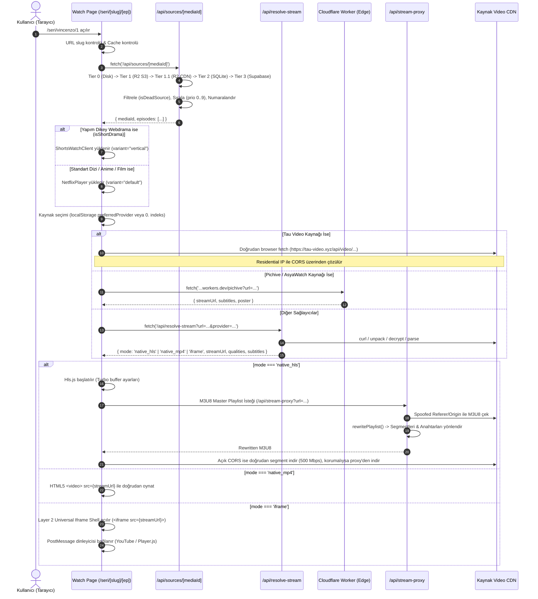
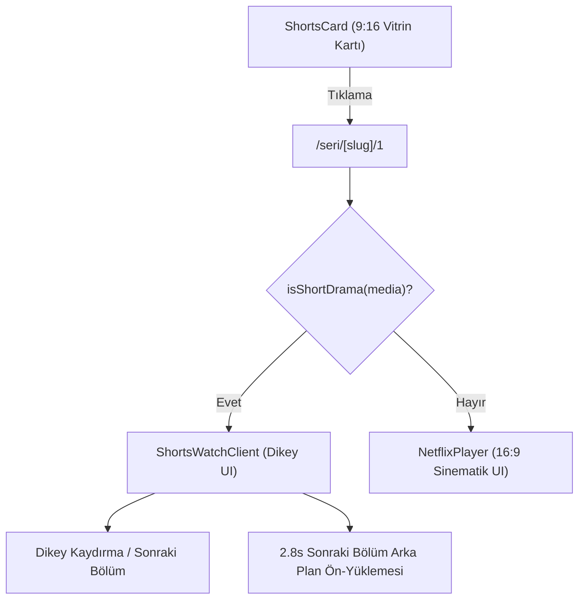

# 05 — Oynatıcı & Yayın Akışı Mimarisi

KoUp platformunun video oynatma, akış çözümleme (stream resolving), manifest dönüştürme (hls stream proxying), görsel optimizasyonu ve uç nokta (edge) altyapısının teknik mimari dokümantasyonudur.

Bu doküman; `/seri/[slug]/[episode]` rotasından başlayan uçtan uca akışı, `NetflixPlayer.tsx` bileşeninin çift katmanlı yapısını, `NetflixEpisodePopover.tsx` ve dikey webdrama (`ShortsWatchClient.tsx`) mantığını, Next.js API proxy uçlarını (`/api/resolve-stream`, `/api/stream-proxy`, `/api/image-proxy`), `cloudflare/worker.js` edge dağıtımını ve Python tabanlı `scrapers/stream_resolver.py` motorunu eksiksiz ayrıntısıyla ele alır.

---

## İçindekiler

1. [Uçtan Uca Oynatma Akışı](#1-uçtan-uca-oynatma-akışı)
   - [Büyük Resim ve Veri Akış Şeması](#büyük-resim-ve-veri-akış-şeması)
   - [Dizi vs Dikey Webdrama Ayrımı](#dizi-vs-dikey-webdrama-ayrımı)
2. [Kaynak Getirme ve Öncelik Sıralaması](#2-kaynak-getirme-ve-öncelik-sıralaması)
   - [4 Kademeli Kaynak Getirme Hiyerarşisi](#4-kademeli-kaynak-getirme-hiyerarşisi)
   - [Akış Türü Sınıflandırması (`classifyStreamType`)](#akış-türü-sınıflandırması-classifystreamtype)
   - [Ölü Kaynak Filtresi (`isDeadSource`)](#ölü-kaynak-filtresi-isdeadsource)
   - [Sağlayıcı Öncelik Matrisi (`getProviderPriority`)](#sağlayıcı-öncelik-matrisi-getproviderpriority)
   - [Kaynak Tekilleştirme ve Temiz Adlandırma](#kaynak-tekilleştirme-ve-temiz-adlandırma)
   - [Canlı Metrikler ve İntro/Outro Şablon Birleştirme](#canlı-metrikler-ve-introoutro-şablon-birleştirme)
3. [`NetflixPlayer.tsx` — Çift Katmanlı Oynatıcı Motoru](#3-netflixplayertsx--çift-katmanlı-oynatıcı-motoru)
   - [Çift Katmanlı Mimari Nedir?](#çift-katmanlı-mimari-nedir)
   - [State Mimarisi ve Yaşam Döngüsü](#state-mimarisi-ve-yaşam-döngüsü)
   - [Akış Çözümleme Stratejisi](#akış-çözümleme-stratejisi)
   - [Hls.js Yapılandırması ve Hata Kurtarma Döngüsü](#hlsjs-yapılandırması-ve-hata-kurtarma-döngüsü)
   - [Layer 2: Evrensel Iframe Kabuğu ve PostMessage Köprüsü](#layer-2-evrensel-iframe-kabuğu-ve-postmessage-köprüsü)
   - [Yapışkan Kaynak Hafızası (`koup_preferred_provider`)](#yapışkan-kaynak-hafızası-koup_preferred_provider)
   - [Kalite, Çoklu Ses ve Altyazı Yönetimi](#kalite-çoklu-ses-ve-altyazı-yönetimi)
   - [İntro ve Outro Atlama Mantığı](#intro-ve-outro-atlama-mantığı)
   - [Sinematik Işıklandırma (YouTube Stili Dual-Buffer Ambient Canvas)](#sinematik-ışıklandırma-youtube-stili-dual-buffer-ambient-canvas)
   - [Klavye Kısayolları Referans Tablosu](#klavye-kısayolları-referans-tablosu)
   - [Mobil Dokunma ve Jest Kontrolleri](#mobil-dokunma-ve-jest-kontrolleri)
   - [İzleme İlerlemesi Kaydetme (`flushCurrentProgress`)](#izleme-ilerlemesi-kaydetme-flushcurrentprogress)
   - [İzlenme Sayımı (`trackMediaView`)](#izlenme-sayımı-trackmediaview)
   - [Bölüm Reaksiyonları](#bölüm-reaksiyonları)
   - [Kırık Kaynak Bildirim Sistemi (`/api/reports`)](#kırık-kaynak-bildirim-sistemi-apireports)
   - [Bellek Temizliği ve Dynamic Import](#bellek-temizliği-ve-dynamic-import)
4. [`NetflixEpisodePopover.tsx` — Açılır Bölüm Çekmecesi](#4-netflixepisodepopovertsx--açılır-bölüm-çekmecesi)
5. [Dikey Webdrama / Shorts İzleme Akışı (`ShortsWatchClient.tsx`)](#5-dikey-webdrama--shorts-izleme-akışı-shortswatchclienttsx)
6. [Akış Çözümleme Uçları (`/api/resolve-stream` & `/api/stream`)](#6-akış-çözümleme-uçları-apiresolve-stream--apistream)
7. [Akış Tüneli ve Manifest Dönüştürücü (`/api/stream-proxy` & `/api/proxy`)](#7-akış-tüneli-ve-manifest-dönüştürücü-apistream-proxy--apiproxy)
8. [Görsel Tüneli ve WebP Dönüştürücü (`/api/image-proxy`)](#8-görsel-tüneli-ve-webp-dönüştürücü-apiimage-proxy)
9. [Cloudflare Global Edge Worker (`cloudflare/worker.js`)](#9-cloudflare-global-edge-worker-cloudflareworkerjs)
10. [Python Akış Çözümleyicisi (`scrapers/stream_resolver.py`)](#10-python-akış-çözümleyicisi-scrapersstream_resolverpy)
11. [Kısıtlar, Yasaklar ve Mimari Kararlar](#11-kısıtlar-yasaklar-ve-mimari-kararlar)
12. [Sorun Giderme: "Video Açılmıyor" Teşhis Rehberi](#12-sorun-giderme-video-açılmıyor-teşhis-rehberi)
13. [İlgili Dokümanlar](#13-ilgili-dokümanlar)

---

## 1. Uçtan Uca Oynatma Akışı

### Büyük Resim ve Veri Akış Şeması

Kullanıcı bir yapımın bölümünü izlemek istediğinde Next.js App Router üzerindeki [`koup-app/src/app/seri/[slug]/[episode]/page.tsx`](../koup-app/src/app/seri/[slug]/[episode]/page.tsx) rotasına girer. İstemci ve sunucu katmanları arasında gerçekleşen tüm akış aşağıdaki sequence diyagramında özetlenmiştir:



### Dizi vs Dikey Webdrama Ayrımı

İzleme sayfasında ilk render anında [`isShortDrama(media)`](../koup-app/src/lib/supabase.ts) fonksiyonu çalıştırılır:

1. **Koşullar:** `media.content_type === 'kisa_drama'` veya `media.format === 'vertical'` veya toplam bölüm sayısı yüksek ancak bölüm süreleri 1-3 dakika olan yapımlar.
2. **Yönlendirme:**
   - Koşul **doğruysa**: Sayfa [`ShortsWatchClient`](../koup-app/src/components/shorts/ShortsWatchClient.tsx) bileşenini dynamic import ile yükler. Bu bileşen dikey (9:16) telefon oranlı bir video kabuğu ve dokunmatik dikey kaydırma mekanizması sunar.
   - Koşul **yanlışsa**: Sayfa standart yatay (16:9 sinematik) [`NetflixPlayer`](../koup-app/src/components/NetflixPlayer.tsx) ve sağ tarafta [`EpisodeRail`](../koup-app/src/components/EpisodeRail.tsx) bileşenlerini render eder.

---

## 2. Kaynak Getirme ve Öncelik Sıralaması

### 4 Kademeli Kaynak Getirme Hiyerarşisi

Bölüm kaynakları, istemciye [`/api/sources/[mediaId]/route.ts`](../koup-app/src/app/api/sources/[mediaId]/route.ts) uç noktası üzerinden sunulur. Sunucu tarafında veya SSG/ISR süreçlerinde ise [`seriesData.ts:getSeriesDataServer()`](../koup-app/src/lib/server/seriesData.ts#L107-L290) fonksiyonu çalışır.

Sistem 4 kademeli ("Tiered Storage") mimariyle sorgu gecikmesini minimuma indirir:

| Aşama | Kaynak Yeri | Ortalama Yanıt Süresi | Açıklama |
|---|---|---|---|
| **Tier 0** | Yerel Disk JSON Paketi (`r2_bundles/sources/{id}.json`) | **0.2 ms** | Yerel ortamda veya disk önbelleğinde varsa anında sıfır gecikmeyle okunur. |
| **Tier 1** | Cloudflare R2 Authenticated S3 Client (`sources/{id}.json`) | **15 - 35 ms** | `@aws-sdk/client-s3` (`GetObjectCommand`) ile R2 bucket üzerinden doğrudan serverless bellek okuması. |
| **Tier 1.1** | Cloudflare R2 Public CDN Fallback | **40 - 80 ms** | S3 erişim anahtarları tanımlı değilse R2 public dağıtım adresi üzerinden fetch edilir (`next: { revalidate: 3600 }`). |
| **Tier 2** | Yerel SQLite Veritabanı (`webdrama_archive.db`) | **2 - 5 ms** | `node:sqlite` (`DatabaseSync` read-only) ile `dramas`, `episodes` ve `episode_sources` tablolarından join ile derlenir. |
| **Tier 3** | Supabase Postgres Veritabanı | **70 - 150 ms** | R2 veya SQLite üzerinde paket yoksa Supabase `episodes` tablosundaki `video_sources` JSONB kolonu okunur. |

### Akış Türü Sınıflandırması (`classifyStreamType`)

Gelen ham URL ve sağlayıcı adına göre kaynak şu 5 moddan birine atanır:

```typescript
function classifyStreamType(
  provider: string,
  directUrl: string
): 'hls' | 'mp4' | 'tau' | 'postmessage_iframe' | 'locked_iframe'
```

- **`hls`:** Hls.js ile tarayıcıda doğrudan oynatılabilen M3U8 oynatma listeleri. (Örn: `diziyou-hls`, `hdfilm-close`, `asyawatch`, `dizilla`, `morencius`, `ev`, `filemoon`, `byse`, `streamwish`, `vidhide`, `dzen`, `shortizle`, `wdt`, `dtpasn`, `pilavyer`, `diziizle`, `ok.ru`, `vk`).
- **`mp4`:** HTML5 native video etiketine doğrudan verilebilen ilerlemeli (progressive) video dosyaları. (Örn: `mp4upload`, `ddizi.tel/player/mp4`, `my.mail.ru`, `yadi.sk`).
- **`tau`:** Tau Video API ile çözülüp doğrudan MP4 kalite listesi (1080p, 720p, 480p) dönen akışlar.
- **`postmessage_iframe`:** YouTube veya Player.js uyumlu, çift yönlü telemetri sağlayan gömülü oynatıcılar.
- **`locked_iframe`:** Çapraz köken (cross-origin) kısıtlamalı, doğrudan çözülemeyen üçüncü taraf iframe'ler.

### Ölü Kaynak Filtresi (`isDeadSource`)

Aşağıdaki sağlayıcı ve URL desenleri kod seviyesinde **ölü (dead)** kabul edilir ve istemciye asla iletilmez:

- **Eski/Kapanmış Sağlayıcılar:** `rapidrame`, `/rplayer/`, `sibnet`, `sendvid`, `pixeldrain`, `asyaanim.upns.one`, `upns.one`, `upns.live`, `embed-7fm0wb9yzf4m.html`, `playerdkorea.xyz`.
- **Google Drive / Limitli Sağlayıcılar:** `drive.google.com`, `docs.google.com`, `p2pplay`, `4meplayer`, `rpmplay`, `uns.bio`, `video.diziasya.com`.
- **Kapatılan Dosya Barındırıcılar:** `openload.co`, `streammango.com`, `rapidvideo.com`, `estream.to`, `vid.me`, `cloudvideo.tv`, `wolfstream.tv`, `fembed.com`, `feurl.com`, `mixdrop`, `supervideo.tv`.
- **Geçersiz URL'ler:** `javascript:`, `void(0)`, boş string veya `http` ile başlamayan bağlantılar.

### Sağlayıcı Öncelik Matrisi (`getProviderPriority`)

Bir bölüme ait kaynaklar listelenirken kullanıcıya en yüksek hız, en iyi kalite (1080p) ve sıfır reklam deneyimi sunmak için öncelik puanı atanır (en küçük sayı en yüksek önceliktir):

| Öncelik Seviyesi | Puan | Sağlayıcılar & URL Desenleri | Tercih Nedeni |
|---|---|---|---|
| **Tier 0 (En Yüksek)** | `0` | `pilavyer`, `diziizle`, `tau-video`, `morencius`, `ev` | 1080p saf HLS, ultra hızlı yükleme, sıfır reklam, stabil bant genişliği. |
| **Tier 1** | `1` | `wdt`, `dtpasn`, `dramavadisi`, `shortizle`, `rapidrame`, `diziyou-hls`, `animelvl` | Yüksek hızlı yerel/bölgesel HLS akışları, Türkçe altyazı entegrasyonu. |
| **Tier 2** | `2` | `hdfilm-close`, `dizikorea`, `dizibox`, `dbx`, `dizilla`, `asyawatch`, `mail.ru`, `vk`, `ok.ru`, `dramabox` | Büyük platform kaynakları, stabil ancak ara proxy gerektirebilen akışlar. |
| **Tier 3** | `3` | `vidmoly`, `filemoon`, `byse`, `uqload`, genel `.m3u8` | Standart video barındırıcıları; JS unpacker veya özel referer gerektirebilir. |
| **Tier 5 (Varsayılan)** | `5` | Diğer tanımlanamayan harici kaynaklar | İkincil yedek akışlar. |
| **Tier 9 (En Düşük)** | `9` | `turnstile_iframe`, `pixel_turnstile`, `youtube` | Cloudflare Turnstile korumalı veya harici webview gerektiren son çare kaynaklar. |

> **YouTube Filtresi (`filterYoutubeIfAlternativesExist`):** Eğer bir bölümde oynatılabilir herhangi bir yerel veya üçüncü taraf alternatif kaynak varsa YouTube linkleri otomatik olarak elenir. Yalnızca hiçbir alternatif kaynak kalmadığında YouTube linki son çare olarak bırakılır.

### Kaynak Tekilleştirme ve Temiz Adlandırma

1. **Tekilleştirme (`deduplicateSources`):** Molystream/DBX embed linklerindeki ID'ler (`sheila/{id}`) normalize edilerek mükerrer kayıtlar engellenir. Aynı direct_url birden fazla kez eklenemez.
2. **Kullanıcı Dostu İsimler (`getDisplaySourceName`):**
   - `morencius` / `ev` → **"EV"**
   - `asyawatch` / `pichive` → **"Orijinal"**
   - `dizilla` / `dplayer` → **"Dizilla"**
   - `diziyou` → **"Orijinal (Altyazılı)"** veya **"Orijinal (Dublaj)"**
   - `tau-video` → **"Tau Video"**
   - Harici barındırıcılar → **"VK"**, **"Mail.ru"**, **"Uqload"**, **"VOE"**, **"OK.ru"**, **"Filemoon"**
3. **Numaralandırma (`applySourceNumbering`):** Aynı isimde birden fazla kaynak varsa kullanıcıya "Orijinal", "Orijinal 2", "Orijinal 3" şeklinde net ayrım sunulur.

### Canlı Metrikler ve İntro/Outro Şablon Birleştirme

API, R2 veya SQLite paketini okuduktan sonra Supabase `episodes` tablosuna canlı bir sorgu atarak şu verileri anlık olarak birleştirir:
- `views_count`, `react_fire`, `react_cry`, `react_shock`, `react_angry` sayaçları.
- `scheduled_release_at` ve `status` (yeni eklenen veya yayına girecek bölümler).
- **Sezon Şablonu:** Eğer `episode_number === 0` olan özel bir kayıt varsa, bu kayıttaki `intro_start_sec`, `intro_end_sec`, `outro_start_sec` değerleri o sezonun tüm bölümlerine varsayılan intro/outro şablonu olarak devredilir.

---

## 3. `NetflixPlayer.tsx` — Çift Katmanlı Oynatıcı Motoru

[`koup-app/src/components/NetflixPlayer.tsx`](../koup-app/src/components/NetflixPlayer.tsx) bileşeni, ~6.400 satırlık gelişmiş bir video oynatıcı mimarisidir.

### Çift Katmanlı Mimari Nedir?

Oynatıcı mimarisi kod tabanında 2 temel icra katmanına ("Dual-Engine Architecture") ve 1 görsel ışıklandırma katmanına ayrılmıştır:

```
+-----------------------------------------------------------------------+
|  GÖRSEL KATMAN: YouTube Stili Dual-Buffer Ambient Canvas (A & B Ping-Pong) |
+-----------------------------------------------------------------------+
|                                                                       |
|  [ LAYER 1: Native HTML5 / Hls.js Video Engine ]                      |
|  - <video ref={videoRef} playsInline />                                |
|  - Özel Netflix HUD Arayüzü (Play/Pause, Scrubber, Hover Preview)     |
|  - Özel WebVTT Altyazı Motoru (Font boyutu, arkaplan, forced parser)   |
|  - Çoklu Ses İzi (Audio Track) & Çoklu Çözünürlük Seçici              |
|  - İntro/Outro Atlama ve 3s Otomatik Sonraki Bölüm Geri Sayımı         |
|  - İki Parmak Pinch-to-Zoom (1.15x / 1.24x) & Çift Dokunma (+-10s)    |
|                                                                       |
|  -- VEYA (Akış Doğrudan Çözülemezse) --                               |
|                                                                       |
|  [ LAYER 2: Universal Iframe Shell With Netflix Top HUD ]             |
|  - <iframe ref={iframeRef} allowFullScreen />                         |
|  - PostMessage Telemetri Köprüsü (Player.js, YouTube API, JWPlayer)   |
|  - Üst Bar Kontrolleri (Geri dön, Bölüm başlığı, Tam ekran geçişi)    |
|  - Harici YouTube İzleme Uyarısı & "Özel Ekrana Dön" Butonu           |
+-----------------------------------------------------------------------+
```

### State Mimarisi ve Yaşam Döngüsü

Bileşenin kritik state değişkenleri şunlardır:

- **Oynatma & Zaman:** `isPlaying` (boolean), `currentTime` (number), `duration` (number), `bufferedPercent` (number), `isBuffering` (boolean), `playbackRate` (0.5x .. 2x).
- **Çözümleme:** `resolvedMode`: `'resolving' | 'native_hls' | 'native_mp4' | 'iframe' | 'trailer' | 'error'`.
- **Arayüz & Paneller:** `showOverlay` (boolean), `isControlsLocked` (ekran kilidi), `activePanel`: `'episodes' | 'speed' | 'sources' | 'audio_subtitles' | 'quality' | 'playback_settings' | null`.
- **Sinematik:** `ambientLightingEnabled` (localStorage: `koup_ambient_lighting`), `cinemaLightsOff` (boolean).
- **Atlama & Otomasyon:** `autoNextEnabled` (localStorage: `koup_auto_next`), `autoSkipIntro` (localStorage: `koup_auto_skip_intro`), `countdownRemaining` (varsayılan 3s).

### Akış Çözümleme Stratejisi

Oynatıcı seçilen kaynağı oynatmadan önce 3 aşamalı çözümleme zincirinden geçirir:

1. **Doğrudan İstemci/Edge Çözümü (Tau Video):**
   - Vercel'in ABD veri merkezleri `tau-video.xyz` tarafından WAF ile engellendiği için, oynatıcı önce kullanıcının kendi konut (residential) IP'si ile doğrudan `https://tau-video.xyz/api/video/{code}` uç noktasına fetch atar.
   - Bu başarısız olursa Cloudflare Edge Worker üzerindeki `/tau?key={code}` servisine başvurur.
2. **Doğrudan İstemci/Edge Çözümü (Pichive / AsyaWatch):**
   - `pichive.online` ve `sn.hotlinger.com` kaynakları için Cloudflare Edge Worker'daki `/pichive?url={url}` çağrılır. Worker token'ı çözer, master M3U8 ve VTT altyazıları hazırlar.
3. **Genel Çözümleyici Uç Noktası (`/api/resolve-stream`):**
   - Geriye kalan tüm kaynaklar `/api/resolve-stream?url={url}&provider={provider}` rotasına gönderilir.
   - Yanıt `410 Gone` veya `isDead: true` dönerse kaynak ölü olarak işaretlenir (`deadSourceKeys`) ve oynatıcı **otomatik olarak listedeki sıradaki çalışan kaynağa geçer**.

### Hls.js Yapılandırması ve Hata Kurtarma Döngüsü

Kaynak `native_hls` olarak çözüldüğünde `hls.js` kütüphanesi dynamic import ile yüklenir. Yüksek hızlı genişbant bağlantılarda takılmasız oynatma ve anında ileri/geri sarma için optimize edilmiş turbo tampon ayarları uygulanır:

```typescript
const hls = new Hls({
  enableWorker: true,
  lowLatencyMode: false,
  maxBufferLength: 90,             // 90 saniye ileri tampon
  maxMaxBufferLength: 300,         // Maksimum 300 saniye tampon
  maxBufferSize: 250 * 1024 * 1024, // 250 MB bellek tamponu
  backBufferLength: 90,            // 90 saniye geri sarma tamponu
  maxBufferHole: 0.5,
  highBufferWatchdogPeriod: 2,
  nudgeMaxRetry: 5,
  abrEwmaDefaultEstimate: 5000000, // 5 Mbps başlangıç bant genişliği tahmini
  capLevelToPlayerSize: false,
  fragLoadingMaxRetry: 4,
  fragLoadingRetryDelay: 500,
  fragLoadingMaxRetryTimeout: 10000,
  levelLoadingMaxRetry: 4,
  levelLoadingRetryDelay: 500,
  levelLoadingMaxRetryTimeout: 10000,
  startPosition: resumeSec > 3 ? resumeSec : -1,
});
```

#### Hata Kurtarma Algoritması (`Hls.Events.ERROR`)

1. **`NETWORK_ERROR` (Ağ Hatası):**
   - HTTP 403 veya 404 alındığında akış belirtecinin (token) süresi dolmuş olabilir.
   - Oynatıcı 1 defaya mahsus olmak üzere `/api/resolve-stream?refresh=1` parametresiyle taze akış bağlantısı almaya çalışır (`hasRefreshedStreamRef`).
   - Taze akış da başarısız olursa veya hata 2'den fazla tekrarlanırsa kaynak ölü olarak işaretlenir, `onSourceDead` tetiklenir ve sıradaki yedek kaynağa geçilir.
   - Geçici ağ kopmalarında ise `hls.startLoad()` çağrılarak yeniden yükleme denenir.
2. **`MEDIA_ERROR` (Medya Çözümleme Hatası):**
   - `hls.recoverMediaError()` çağrılarak codec veya segment bozulması kurtarılır.
3. **Diğer Kritik Hatalar:**
   - Kaynak listeden düşürülür, varsa `fallbackIframeUrl` moduna geçilir veya sonraki kaynağa atlanır.

### Layer 2: Evrensel Iframe Kabuğu ve PostMessage Köprüsü

Yerel olarak çözülemeyen veya Cloudflare Turnstile ile korunan kaynaklar Layer 2 kabuğunda çalıştırılır:

- `<iframe ref={iframeRef} allowFullScreen src={streamUrl} />`
- **PostMessage Köprüsü:** Oynatıcı iframe yüklendiğinde (`onLoad`) `listening`, `addEventListener: timeupdate` ve `addEventListener: ended` mesajlarını yayınlar. YouTube, Player.js, Video.js ve JWPlayer altyapılarından gelen `currentTime`, `duration`, `timeupdate` mesajlarını yakalayarak izleme ilerlemesini senkronize tutar.
- **Dışa Aktarım Uyarısı:** Eğer video YouTube kaynaklıysa ve yayıncı harici oynatmayı kısıtladıysa ekranın üstünde *"YouTube'da Doğrudan İzle"* bağlantısı belirir.

### Yapışkan Kaynak Hafızası (`koup_preferred_provider`)

Kullanıcı bir bölümde belirli bir kaynağı (örneğin *"EV"* veya *"Dizilla"*) seçtiğinde bu tercih `localStorage.setItem('koup_preferred_provider', provider)` olarak kaydedilir. Sonraki bölüme geçildiğinde oynatıcı yeni bölümün kaynakları arasında aynı sağlayıcıyı arar ve otomatik olarak seçer. Böylece her bölümde yeniden kaynak seçme zorunluluğu ortadan kalkar.

### Kalite, Çoklu Ses ve Altyazı Yönetimi

- **Çözünürlük (Quality):** Hls.js `MANIFEST_PARSED` olayında seviyeler taranır (`hls.levels`). `1080p`, `720p`, `480p`, `360p` ve `Otomatik` etiketleri oluşturulur. Kullanıcının `koup_preferred_quality` tercihi saklanır.
- **Ses İzi (Audio Tracks):** `AUDIO_TRACKS_UPDATED` dinlenerek Türkçe Dublaj ve Orijinal Ses seçenekleri listelenir; `hls.audioTrack = trackId` ile anında kesintisiz geçiş yapılır.
- **Altyazı (Subtitles):** WebVTT formatındaki altyazılar `/api/stream-proxy` üzerinden çekilir. İstemci tarafında parse edilen altyazı cue'ları (`parseVttToCues`) özel HTML katmanında render edilir; harici video oynatıcıların çirkin varsayılan fontları yerine KoUp'un optimize altyazı tasarımı uygulanır.

### İntro ve Outro Atlama Mantığı

> [!NOTE]
> **Envanter Yanılgısının Düzeltilmesi:** Envanter notlarında geçen "+85s sabit intro atlama" iddiası **kod seviyesinde incelenmiş ve doğrulanmamıştır**. Kod tabanında 85 sayısı yalnızca YouTube fragman ses seviyesinde (`setVolume(85)`) ve canvas JPEG kalitesinde (`0.85`) yer almaktadır.

İntro ve Outro atlama mekanizması tamamen **veritabanı odaklıdır (database-driven)**:

1. **İntro Tespiti:**
   - Bölüm verisinde `intro_start_sec` ve `intro_end_sec` alanları tanımlıysa `hasIntro = true` olur.
   - Video süresi `currentTime >= intro_start_sec && currentTime < intro_end_sec` aralığına girdiğinde sağ altta **"İntroyu Atla"** butonu belirir (`S` kısayolu).
   - Eğer `autoSkipIntro` açıksa intro başladığı anda otomatik olarak `intro_end_sec` saniyesine atlanır (bölüm başına 1 kez tetiklenir).
2. **Outro ve Sonraki Bölüm Geri Sayımı:**
   - Bölüm verisinde `outro_start_sec` varsa veya video bitimine 5 saniye kaldıysa (`currentTime >= duration - 5`) otomatik sonraki bölüm geri sayımı başlar.
   - Sağ alt köşede **3 saniyelik geri sayım sayacı** belirir (`setCountdownRemaining(3)`).
   - Kullanıcı "İptal" butonuna basarak geri sayımı durdurabilir (`cancelledAutoNextForEp`). İptal edilmezse süre dolduğunda `handleNextEpisode()` çağrılır.

### Sinematik Işıklandırma (YouTube Stili Dual-Buffer Ambient Canvas)

Masaüstü ve tiyatro modlarında videonun arkasında gerçek zamanlı renk parıltısı üreten çift tamponlu (dual-buffer) bir canvas motoru çalışır:

- `ambientCanvasRefA` ve `ambientCanvasRefB` (2 adet HTML5 canvas).
- `activeAmbientBufferRef` (0 veya 1).
- Video karesinden 16x9 piksellik mikro örnek alınır, CSS `blur(60px)` ve `opacity` geçişiyle iki canvas arasında akıcı crossfade (dalgalı renk akışı) yapılır. Bu yöntem GPU yükünü %90 azaltırken sinematik atmosfer sağlar.

### Klavye Kısayolları Referans Tablosu

Oynatıcı açıkken form girdileri (input, textarea) dışındayken aşağıdaki klavye kısayolları aktiftir:

| Tuş | Eylem | Açıklama |
|---|---|---|
| `Space` / `K` | Oynat / Duraklat | Videoyu duraklatır veya kaldığı yerden devam ettirir. |
| `ArrowRight` | +5 Saniye İleri | 5 saniye ileri sarar, HUD üzerinde yay animasyonu gösterir. |
| `ArrowLeft` / `J` | -5 Saniye Geri | 5 saniye geri sarar, HUD üzerinde yay animasyonu gösterir. |
| `ArrowUp` | Ses Artır (+%10) | Ses seviyesini %10 artırır ve bildirim gösterir. |
| `ArrowDown` | Ses Azalt (-%10) | Ses seviyesini %10 azaltır ve bildirim gösterir. |
| `M` | Sesi Kapat / Aç | Sessize alır veya kaydedilen son ses seviyesini geri yükler. |
| `F` | Tam Ekran | HTML5 Fullscreen API ile tam ekrana geçer / çıkar. |
| `L` / `C` | Sinema Işıkları | Arka plan ışıklarını / tiyatro modunu açar veya kapatır. |
| `N` | Sonraki Bölüm | Sıradaki bölüme kesintisiz geçiş yapar. |
| `E` | Bölüm Listesi | Bölüm çekmecesini (`NetflixEpisodePopover`) açar / kapatır. |
| `S` | İntro / Outro Atla | İntro bölgesindeyse introyu atlar; outro bölgesindeyse sonraki bölüme geçer. |
| `0` .. `9` | %0 .. %90 Atlama | Video süresinin ilgili yüzdelik dilimine doğrudan atlar. |
| `Escape` | Kapat | Açık panelleri, çekmeceleri veya fragman modunu kapatır. |

### Mobil Dokunma ve Jest Kontrolleri

Mobil cihazlarda kullanıcı deneyimini mükemmelleştirmek için tasarlanmış jestler:

1. **Çift Dokunma (Double-Tap):**
   - **Sol %38 Alanı:** -10 saniye geri sarar (dalga animasyonu eşliğinde).
   - **Sağ %38 Alanı:** +10 saniye ileri sarar (dalga animasyonu eşliğinde).
   - **Orta Alan (%38 - %62):** Oynat / Duraklat.
   - Çift dokunma gerçekleştiğinde tek dokunma menüsü baskılanır; arayüz gereksiz yere açılmaz.
2. **İki Parmakla Yakınlaştırma (Pinch-to-Zoom):**
   - Tam ekrandayken iki parmakla dışa doğru kıstırma hareketi yapıldığında video ölçeği 1.15x (sinematik siyah barları gizle) ve 1.24x (tam ekranı doldur) seviyelerine büyütülür. İçe doğru kıstırma orijinal en-boy oranına döndürür.
3. **Ekran Kilidi (Screen Lock):**
   - Yanlışlıkla dokunmaları önlemek için ekran kilitlenebilir. Kilitliyken tüm arayüz butonları gizlenir, yalnızca kilit açma ikonu görünür.

### İzleme İlerlemesi Kaydetme (`flushCurrentProgress`)

- **4 Saniyelik Yerel Döngü:** Video oynatılırken her 4 saniyede bir yerel state ve `localStorage` güncellenir. Bu işlem network trafiği yaratmaz.
- **Backend Senkronizasyonu (`flushCurrentProgress`):** Kullanıcı sayfadan ayrılırken (`beforeunload`, `pagehide`), sekmeyi değiştirdiğinde (`visibilitychange: hidden`), video duraklatıldığında veya bölüm tamamlandığında `updateEpisodeProgress()` fonksiyonu çağrılır.
- **Keepalive Desteği:** Sayfa kapanırken atılan istekler tarayıcı tarafından iptal edilmesin diye `fetch` isteğinde `{ keepalive: true }` kullanılır.
- *(İzleme geçmişi ve backend veri yapısı hakkında detaylı bilgi için [bkz. 10-kullanici-ozellikleri.md](./10-kullanici-ozellikleri.md)).*

### İzlenme Sayımı (`trackMediaView`)

İzlenme sayıları botlara ve F5 spam'lerine karşı çift katmanlı korumayla artırılır:

1. **İstemci Tarafı 6 Saatlik Soğuma (`COOLDOWN_MS = 6 * 60 * 60 * 1000`):**
   - Bir bölüm açıldığında `watch:{mediaId}:s{s}:e{e}` anahtarı `localStorage` içine kaydedilir. 6 saat dolmadan aynı bölüm için yeni bir izlenme isteği atılmaz.
2. **Sunucu Tarafı Parmak İzi & RPC (`/api/media/view`):**
   - İstek istemci parmak izi (`viewer_key`) ile sunucuya iletilir. Sunucu PostgreSQL `increment_media_view` RPC fonksiyonunu çalıştırarak hem dizi toplam izlenmesini (`media.views_total`) hem de bölüm izlenmesini (`episodes.views_count`) güvenli şekilde 1 artırır.

### Bölüm Reaksiyonları

Her bölüm için kullanıcılar tek bir duygu reaksiyonu verebilir:
- `fire` (Alev / Harika)
- `cry` (Gözyaşı / Duygusal)
- `shock` (Şok / Beklenmedik)
- `angry` (Öfke / Sinir Bozucu)

Reaksiyonlar Supabase `episode_reactions` tablosunda saklanır ve `episodes` tablosundaki `react_fire`, `react_cry`, `react_shock`, `react_angry` sayaçlarına anlık olarak yansıtılır.

### Kırık Kaynak Bildirim Sistemi (`/api/reports`)

Oynatıcı arayüzündeki bayrak butonuna tıklandığında açılan hata bildirim formu:

- **60 Saniye Soğuma Süresi:** Kullanıcılar peş peşe bildirim gönderemez; her bildirim arasında minimum 60 saniye beklemek zorundadır (`COOLDOWN_MS = 60_000`).
- **10 Dakika Limiti:** Bir IP veya kullanıcı 10 dakika içinde en fazla 5 bildirim gönderebilir.
- **Mükerrer Bildirim Engeli:** Aynı medya ve bölüm için son 15 dakika içinde bildirim yapılmışsa veritabanına mükerrer kayıt açılmaz.

### Bellek Temizliği ve Dynamic Import

Oynatıcı unmount olduğunda veya bölüm değiştiğinde bellek sızıntılarını (memory leak) önlemek için:
- `hlsRef.current.stopLoad()`, `detachMedia()`, `destroy()` sırasıyla çağrılır ve ref sıfırlanır (`null`).
- Ambient canvas `requestAnimationFrame` döngüsü iptal edilir.
- Tüm `ResizeObserver`, touch listener ve `window.keydown` event listener'ları temizlenir.
- `NetflixPlayer`, `ShortsWatchClient` ve `RichCommentSection` ana sayfada `next/dynamic` ile `ssr: false` olarak yüklenir; ilk sayfa yükleme boyutu hafif tutulur.

---

## 4. `NetflixEpisodePopover.tsx` — Açılır Bölüm Çekmecesi

[`koup-app/src/components/NetflixEpisodePopover.tsx`](../koup-app/src/components/NetflixEpisodePopover.tsx), video oynatılırken tam ekranı bozmadan bölümler arasında geçiş yapmayı sağlayan kayar çekmecedir.

- **İki Kademeli Satır Mimarisi:**
  - **Daraltılmış Satır (Collapsed — 44px):** Yalnızca bölüm numarası, başlık, izleme ilerleme çubuğu ve kalan süre yer alır. Performans için DOM ağırlığı minimumdur.
  - **Genişletilmiş Satır (Expanded — 132px):** Tıklanan bölüm genişler; video önizleme görseli, oynat butonu, izlenme sayısı ve varsa "İntro Atlama / Outro Atlama" rozetleri görüntülenir.
- **Dinamik Video Önizleme Hafızası (`episodePreviewCache`):** Oynatıcı bölümler arasında gezinirken videodan aldığı anlık canvas ekran görüntülerini bellek önbelleğinde (`Map<string, string>`) saklar; çekmece açıldığında gerçek video sahneleri küçük resim olarak sunulur.
- **Performans İzolasyonu:** Satır elemanlarında CSS `contain: 'content'` kullanılarak 100+ bölümlü dizilerde bile sıfır kaydırma takılması (60 FPS) sağlanır.

---

## 5. Dikey Webdrama / Shorts İzleme Akışı (`ShortsWatchClient.tsx`)

[`koup-app/src/components/shorts/ShortsWatchClient.tsx`](../koup-app/src/components/shorts/ShortsWatchClient.tsx) ve [`ShortsCard.tsx`](../koup-app/src/components/shorts/ShortsCard.tsx), dikey (9:16) formattaki Asya mini dramaları için özel olarak geliştirilmiştir.



### Öne Çıkan Özellikler

1. **Ekran Uyumu:** Mobilde ekranın %100'ünü kaplar; masaüstünde ortalanmış şık bir akıllı telefon çerçevesi ve sağ tarafında dikey bölüm listesi sunar.
2. **Akıllı Arka Plan Ön-Yüklemesi (Prefetch):** Kullanıcı bir bölümü izlemeye başladıktan 2.8 saniye sonra (`setTimeout 2800ms`), sıradaki bölümün ilk kaynağı arka planda `/api/resolve-stream` üzerinden sessizce çözülür (`cache: 'force-cache'`). Kullanıcı sonraki bölüme kaydırdığında video beklemeden anında başlar.
3. **Mobil Çekmeceler:** Mobil cihazlarda bölümler ve kaynaklar alt çekmece (bottom sheet) olarak açılır, tek dokunuşla bölüm değiştirilir.

---

## 6. Akış Çözümleme Uçları (`/api/resolve-stream` & `/api/stream`)

Dosya yolları:
- Asıl rota: [`koup-app/src/app/api/resolve-stream/route.ts`](../koup-app/src/app/api/resolve-stream/route.ts)
- Alias (Kısayol): [`koup-app/src/app/api/stream/route.ts`](../koup-app/src/app/api/stream/route.ts) (`export async function GET(req) { return resolveStreamGET(req); }`)

### Desteklenen Sağlayıcılar ve Çözüm Yöntemleri

| Sağlayıcı / Desen | Çözüm Yöntemi | Çıktı Türü |
|---|---|---|
| **Tau Video** (`tau-video`) | `https://tau-video.xyz/api/video/{key}` API çağrısı ile çoklu kalite çekilir. | `native_mp4` (1080p, 720p, 480p) |
| **Pichive / AsyaWatch** | HTML içindeki `openPlayer(token)` ayıklanır; `source2.php?v={token}` çağrılarak master M3U8 ve VTT altyazılar üretilir. | `native_hls` |
| **Dizipal** | Ciphertext, IV, Salt ve Key ayıklanır; PBKDF2 (SHA-512, 999 iterasyon) + AES-256-CBC ile deşifre edilir. | `native_hls` |
| **RapidVid / FHD Film** | Ters çevrilmiş base64 + karakter kaydırma algoritması (`decodeRapidvid`) çözülür. | `native_hls` |
| **Filemoon / Byse** | Dean Edwards JS Unpacker (`eval(function(p,a,c,k,e,d)...)`) çalıştırılarak M3U8 URL'si regex ile çekilir. | `native_hls` |
| **GDrivePlayer** | `atob` XOR şifreleme fonksiyonu (`resolveGDrivePlayer`) çözülür. | `native_hls` |
| **Pilavyer / Diziİzle** | `s.php?s={slug}` üzerinden `window.__PLAYER__` JSON nesnesi okunur. | `native_hls` |
| **WDT / Dtpasn** | `dtpasn.asia/video/{hash}` adresine spoofed header ile istek atılır. | `native_hls` |
| **Uqload / Mp4Upload** | Sayfa HTML'i taranarak video etiketi `src` özniteliğindeki doğrudan MP4 bağlantısı ayıklanır. | `native_mp4` |
| **VOE** | Sayfa kaynağındaki Base64/Rot13 kodlu HLS playlist URL'si çözülür. | `native_hls` |
| **VK / Mail.ru** | JSON video manifestosu okunarak doğrudan CDN MP4/HLS bağlantıları listelenir. | `native_hls` / `native_mp4` |

### Dean Edwards JS Unpacker Algoritması

Birçok korsan video sağlayıcısı (Filemoon, Byse vb.) oynatıcı kodlarını Dean Edwards p,a,c,k paketleyicisiyle gizler. `/api/resolve-stream` içinde bu şifreyi güvenli ve yerel olarak çözen algoritma:

```typescript
function unpackDeanEdwards(packedJs: string): string {
  const match = packedJs.match(/\}\s*\(\s*['"](.*?)['"]\s*,\s*(\d+)\s*,\s*(\d+)\s*,\s*['"](.*?)['"]\.split\(['"]\|['"]\)/s);
  if (!match) return packedJs;
  let [, p, aStr, cStr, kStr] = match;
  const a = parseInt(aStr, 10);
  let c = parseInt(cStr, 10);
  const k = kStr.split('|');
  const baseN = (num: number, b: number) => {
    const digits = '0123456789abcdefghijklmnopqrstuvwxyzABCDEFGHIJKLMNOPQRSTUVWXYZ';
    let res = '';
    while (num > 0) {
      res = digits[num % b] + res;
      num = Math.floor(num / b);
    }
    return res || '0';
  };
  while (c--) {
    if (k[c]) {
      const regex = new RegExp('\\b' + baseN(c, a) + '\\b', 'g');
      p = p.replace(regex, () => k[c]);
    }
  }
  return p;
}
```

### Bellek Önbelleği (In-Memory Cache) ve TTL

- Çözülen akış bağlantıları `streamResolutionCache` isimli `Map` içinde saklanır.
- **Varsayılan TTL:** **2 Saat** (`2 * 60 * 60 * 1000 ms`).
- **Bellek Limiti:** Önbellek boyutu 2.500 kaydı aştığında süresi dolmuş tüm kayıtlar otomatik temizlenir.
- **Yenileme Parametresi:** İstekte `refresh=1` gönderilirse önbellek atlanır ve upstream sağlayıcıdan taze bağlantı çözülür.

### SSRF Koruması (`isSafeExternalUrl`)

Dışarıdan gelen rastgele URL'lerin iç ağlara veya bulut metadata servislerine saldırmasını engellemek için katı doğrulama uygulanır:
- Yalnızca `http:` ve `https:` protokollerine izin verilir.
- `localhost`, `127.0.0.1`, `0.0.0.0`, `::1` yasaktır.
- Özel IP blokları engellenir: `10.0.0.0/8`, `172.16.0.0/12`, `192.168.0.0/16`, `169.254.0.0/16` (AWS/GCP Link-Local).
- Hex/Octal/Decimal IP gösterimleri (`0x7f000001`, `2130706433`), `.internal`, `.local` uzantıları reddedilir.

---

## 7. Akış Tüneli ve Manifest Dönüştürücü (`/api/stream-proxy` & `/api/proxy`)

Dosya yolları:
- Asıl rota: [`koup-app/src/app/api/stream-proxy/route.ts`](../koup-app/src/app/api/stream-proxy/route.ts)
- Alias (Kısayol): [`koup-app/src/app/api/proxy/route.ts`](../koup-app/src/app/api/proxy/route.ts)

### M3U8 Manifest Yeniden Yazımı (`rewritePlaylist`)

Upstream M3U8 manifestoları tarayıcı tarafından doğrudan oynatılamaz; çünkü segmentler göreli (relative) yollara sahiptir, CORS başlıkları eksiktir veya upstream sunucu katı `Referer` kontrolü yapar.

`rewritePlaylist` fonksiyonu manifestoyu satır satır işler:
1. **Sözdizimi Hatalarını Onarma:** Bozuk master manifestolardaki hatalar (örneğin Pichive'da `RESOLUTION=` öncesi eksik virgüller, çift virgüller veya geçersiz `CODECS` değerleri) regex ile düzeltilir.
2. **Alt Oynatma Listeleri (Sub-playlists):** Çözünürlük listeleri (`1080p.m3u8`, `master.txt`) `/api/stream-proxy?url={absoluteUrl}&ref={referer}` formatına dönüştürülür.
3. **Şifreleme Anahtarları (`#EXT-X-KEY`):** AES-128 anahtar URL'leri (`URI="..."`) tespit edilerek proxy üzerinden tünellenir.
4. **Doğrudan Geçiş (Open-CORS CDN Bypass):**
   - Aşağıdaki CDN'ler açık CORS politikasına sahiptir ve doğrudan erişime izin verir: `vmpx.online`, `media.mybigdramapool.com`, `acek-cdn.com`, `owphbf24.com`, `sprintcdn`, `tau-video.xyz`, `fastsupplyhub.shop`, `smartcheckout.shop`, `videopixelvanto.com`, `dramiyos`, `sibnet.ru`.
   - Bu CDN'lerin `.ts` / `.m4s` medya segmentleri proxy tüneline sokulmaz; doğrudan mutlak CDN bağlantısı olarak bırakılır.
   - **Kazanım:** Sunucu bant genişliği korunur, Vercel veri transfer kotası harcanmaz ve kullanıcı doğrudan CDN'den **500 Mbps'e varan hızla** video indirir.
5. **Korumalı Segmentler:** Referer koruması uygulayan CDN'ler (Pichive, Ok.ru, Mail.ru) proxy tüneli üzerinden akıtılır.

### DNS Rebinding Koruması (`isBlockedAfterDnsLookup`)

Saldırganlar bazen genel bir alan adını (örn. `evil.com`) DNS seviyesinde `127.0.0.1` veya `169.254.169.254` adresine yönlendirerek SSRF filtrelerini aşmaya çalışırlar (DNS Rebinding).

`api/stream-proxy` bu saldırıyı engellemek için bağlantı öncesinde gerçek DNS çözümlemesi yapar:

```typescript
async function isBlockedAfterDnsLookup(hostname: string): Promise<boolean> {
  if (isBlockedIpOrHost(hostname)) return true;
  try {
    const records = await dns.promises.lookup(hostname, { all: true });
    if (!records || records.length === 0) return true;
    return records.some((rec) => isBlockedIpOrHost(rec.address));
  } catch {
    return true; // DNS çözülemezse güvenli tarafta kalıp engelle
  }
}
```

### Referer ve Origin Sahteciliği (Spoofing)

Upstream video sunucuları istekleri `Referer` ve `Origin` başlıklarına göre doğrular. `stream-proxy`, hedef alan adına göre doğru başlığı otomatik olarak enjekte eder:
- `dizikorea` → `Referer: https://dizikorea3.com/`
- `diziyou` → `Referer: https://diziyou.one/`
- `molystream` / `dbx` → `Referer: https://dbx.molystream.org/`
- `morencius` → `Referer: https://morencius.com/`
- `pichive` / `hotlinger` → `Referer: https://sn.hotlinger.com/` veya `https://four.pichive.online/`
- `ok.ru` → `Referer: https://ok.ru/`
- `vk.com` → `Referer: https://vk.com/`

### Curl Geri Çekilme (Fallback) Mekanizması

Node.js standart `fetch` çağrıları bazı upstream sunucuların Cloudflare / WAF parmak izi korumalarına takılabilir (HTTP 403 / 503). `stream-proxy`, özellikle Pichive, Hotlinger ve Diziyou M3U8 ve VTT dosyalarında fetch başarısız olursa arka planda yerel `curl.exe` ikili dosyasını çalıştırarak (`execFile`) akışı kurtarır.

---

## 8. Görsel Tüneli ve WebP Dönüştürücü (`/api/image-proxy`)

Dosya yolu: [`koup-app/src/app/api/image-proxy/route.ts`](../koup-app/src/app/api/image-proxy/route.ts)

### Ne İşe Yarar ve Neden Afişler Proxy'den Geçer?

1. **Hotlink Koruması ve Domain Maskeleme:** Üçüncü taraf kazıma siteleri afişlerin doğrudan başka sitelerden yüklenmesini engeller. Proxy sayesinde görseller KoUp'un kendi alan adı üzerinden sunulur.
2. **Performans ve Bant Genişliği:** Orijinal afişler genellikle 3-8 MB boyutunda ağır JPEG veya PNG dosyalarıdır. `sharp` kütüphanesi bunları **WebP (%80 kalite)** formatına dönüştürür ve %85 boyut tasarrufu sağlar.
3. **Standart Boyutlandırma:**
   - `w185`: 185px (oyuncu profil fotoğrafları).
   - `w300`: 300px (küçük kartlar).
   - `w500`: 500px (standart afiş kartları).
   - `w1280` / `original`: 1280px (yatay banner ve backdrop'lar).
4. **Next.js Image Kısıtlamasını Aşma:** Next.js `<Image>` bileşeni `next.config.mjs` içinde tanımlı olmayan host'lardan görsel yüklemeyi reddeder. Image proxy tüm harici görselleri yerel `/api/image-proxy` rotasına bağlar.

### Dinamik Zenginleştirme (TMDB / AniList Auto-Enrichment)

Eğer bir yapımın afişi bozuksa veya scraper host'tan (`diziyou`, `hdfilmcehennemi` vb.) geliyorsa, image-proxy arka planda:
1. Başlığı temizler (`cleanTitleForSearch`).
2. TMDB API (`/search/tv`, `/search/movie`, `/search/person`) ve AniList GraphQL API üzerinde doğru afişi/fotoğrafı arar.
3. Bulunan yüksek çözünürlüklü resmi istemciye sunarken eşzamanlı olarak Supabase'deki `media.cover_image` veya `people.image_url` kolonunu kalıcı olarak günceller (`persistEnrichedCoverToSupabase`).
4. **Koruma:** Kısa dramalar (`kisa_drama`) ve AniList özel kapakları genel sinema afişleriyle ezilmeye karşı korunur.

### SVG Fallback Üreticisi

Görsel hiçbir kaynaktan bulunamazsa 404 dönmek yerine KoUp markalı şık vektörel SVG üretilir:
- **Yapımlar İçin:** Koyu degrade zemin, ışık huzmesi, "KoUp CINEMA ARCHIVE" logosu ve yapımın temiz başlığı.
- **Oyuncular İçin:** İki renkli dairesel avatar, oyuncunun baş harfleri (inisiyal) ve "KOUP CAST" rozeti.

### Önbellek Süresi

- `Cache-Control: public, max-age=2592000, stale-while-revalidate=86400, immutable` (30 gün tarayıcı ve CDN önbelleği).
- `export const revalidate = 2592000;`

---

## 9. Cloudflare Global Edge Worker (`cloudflare/worker.js`)

Dosya yolu: [`cloudflare/worker.js`](../cloudflare/worker.js)
Canlı Dağıtım URL'si: `https://koup-edge-worker.caganhuseyinerdil.workers.dev`

### Neden Vercel Değil de Edge Worker?

| Karşılaştırma Kriteri | Vercel Serverless Functions | Cloudflare Edge Worker |
|---|---|---|
| **Sunucu Konumu** | ABD Doğu (iad1 / Washington DC) | 300+ Şehir (İstanbul, İzmir, Frankfurt vb.) |
| **Gecikme (Latency)** | 180 - 240 ms (Transatlantik) | **10 - 25 ms (Yerel Edge PoP)** |
| **Bölgesel WAF Engelleri** | Türk/Avrupa video CDN'leri ABD veri merkezi IP'lerini Cloudflare 1015/WAF ile engeller. | Cloudflare küresel ağı üzerinden konut tipi bağlantı gibi kabul görür, engellenmez. |
| **Bant Genişliği Maliyeti** | Yüksek GB transfer maliyeti | Cloudflare unmetered (sınırsız) bant genişliği |
| **Soğuk Başlatma (Cold Start)** | 500 - 1500 ms | **0 ms** |

### Worker Uç Noktaları ve Görevleri

1. **`/tau?key={id}`:** Tau Video API akışlarını çözüp 10 dakika önbelleğe alır.
2. **`/pichive?url={iframeUrl}`:** Pichive / AsyaWatch iframe sayfalarını ziyaret eder, `openPlayer` token'ını ayıklar, `source2.php` üzerinden master M3U8 listesini ve VTT altyazılarını çıkarır (1 saat edge cache).
3. **`/pichive-proxy?url={url}&ref={ref}`:** Pichive manifestolarını yeniden yazar ve video parçacıklarını (`.ts` veya sahte `.jpg` chunk'ları) istemciye tüneller (`Content-Type: video/mp2t`).
4. **`/resolve?url={targetUrl}`:** Vidmoly, Sibnet, Ok.ru vb. barındırıcılardan doğrudan video bağlantılarını ayıklar.
5. **`/archive/sources/{id}.json` (R2 Dağıtımı):**
   - **GET:** Cloudflare R2 bucket'ından (`env.ARCHIVE_BUCKET`) JSON paketini okur (`Cache-Control: public, max-age=3600, s-maxage=86400`). Sadece `sources/{id}.json` desenine izin verir; iç veritabanı veya gizli dosyalar asla dışarı açılmaz.
   - **PUT / POST:** Python senkronizasyon scriptlerinin (`upload_to_r2.py`) R2'ye yeni kaynak paketi yazmasını sağlar. `Authorization: Bearer <token>` başlığı `env.R2_SECRET` ile zamanlama saldırılarına karşı güvenli (`timingSafeEqualStr`) fonksiyonla doğrulanır.
6. **`/magazin?limit=20`:** AsyaMag WordPress REST API içeriklerini 5 dakika edge cache ile önbelleğe alır.

---

## 10. Python Akış Çözümleyicisi (`scrapers/stream_resolver.py`)

Dosya yolu: [`scrapers/stream_resolver.py`](../scrapers/stream_resolver.py)

### Ne Zaman ve Nerede Kullanılır?

Python çözümleyici, istemci tarafından **çalışma anında değil**, arka plan sunucu ve arşiv süreçlerinde kullanılır:

1. **Kazıyıcı Pipeline'ı (`scrapers/`):** Yeni eklenen veya taranan dizilerin kaynakları veritabanına kaydedilmeden önce doğrudan doğrulanabilir video linkine çevrilir.
2. **Katalog İyileştirme (`scripts/heal_catalog.py`):** Kırık veya süresi dolmuş embed bağlantılarını toplu olarak tarayıp taze HLS linkleriyle günceller.
3. **Canlı Tarayıcı (`scrapers/live_scanner.py`):** Güncel bölümler düştüğünde anında çalışan ham stream linklerini çıkartıp Supabase ve R2'ye aktarır.

### TLS Parmak İzi Taklidi (`curl_cffi`)

Gelişmiş bot koruma sistemlerini (Cloudflare Turnstile, Akamai, Imperva) aşmak için standart Python `requests` kütüphanesi yerine `curl_cffi` kullanılır:

```python
def _get_session() -> cfr.Session:
    if hasattr(cfr, "Session"):
        try:
            return cfr.Session(impersonate="chrome124")
        except Exception:
            return cfr.Session()
    return cfr.Session()
```

Bu sayede TLS Client Hello el sıkışması, cipher suite sırası ve HTTP/2 frame ayarları birebir masaüstü Google Chrome 124 gibi görünür; IP tabanlı engellemeler haricinde WAF bloklarına takılmaz.

---

## 11. Kısıtlar, Yasaklar ve Mimari Kararlar

1. **Rastgele URL Tünelleme Yasağı (Strict SSRF & Host Whitelist):**
   - `/api/stream-proxy`, `/api/resolve-stream` ve Cloudflare Worker uç noktaları asla açık birer internet proxy'si değildir.
   - Sadece izin verilen video sunucuları, bilinen CDN anahtar kelimeleri veya M3U8/TS/VTT dosya uzantıları kabul edilir. Yerel IP'ler ve bulut metadata uçları kesin olarak engellenir.
2. **Kod İçine Anahtar Gömme Yasağı (Zero Hardcoded Secrets):**
   - R2 erişim anahtarları (`CF_R2_ACCESS_KEY_ID`, `CF_R2_SECRET_ACCESS_KEY`), bucket adları (`CF_R2_BUCKET`), Worker gizli anahtarı (`R2_SECRET`) ve Supabase servis anahtarı (`SUPABASE_SERVICE_ROLE_KEY`) kesinlikle kod dosyalarına yazılmaz; `.env` veya Cloudflare Worker Environment Variables üzerinden okunur.
3. **Tarayıcı Varsayılan `<select>` Etiketi Yasağı:**
   - Oynatıcı içinde veya sayfa genelinde tarayıcının çirkin varsayılan select menüsü kullanılamaz. Tüm kalite, ses, kaynak ve sezon seçimleri özel Tailwind + Lucide animasyonlu popover veya [`CustomSelect.tsx`](../koup-app/src/components/CustomSelect.tsx) ile yapılır.
4. **Oynatıcı Bileşeninin Lazy/Dynamic Yüklenme Zorunluluğu:**
   - Hls.js ve oynatıcı DOM yapısı ağır olduğu için sayfa açılışında LCP (Largest Contentful Paint) skorunu bozmamak adına `next/dynamic` ile istemci tarafında yüklenir (`ssr: false`).
5. **Tam Senkronizasyon Kuralı:**
   - Arşivde (`webdrama_archive.db`) bir kaynak onarıldığında yalnızca yerel veritabanında bırakılamaz; Cloudflare R2 veritabanına yedeklenmeli, JSON paketleri dışa aktarılmalı ve Supabase'e senkronize edilmelidir ([bkz. 08-veri-katmani.md](./08-veri-katmani.md)).

---

## 12. Sorun Giderme: "Video Açılmıyor" Teşhis Rehberi

Kullanıcı veya geliştirici bir videonun açılmadığını bildirdiğinde izlenmesi gereken kontrol adımları:

```
[Video Açılmıyor / Siyah Ekran]
        │
        ├── 1. Ağ Konsolunu Aç (F12 -> Network)
        │       ├── /api/sources/[mediaId] 200 dönüyor mu?
        │       │     └── Boşsa: Arşivde bölüm veya kaynak eksiktir (DB / R2 kontrolü).
        │       │
        │       ├── /api/resolve-stream isteği ne dönüyor?
        │       │     ├── 410 Gone / isDead: true -> Kaynak sağlayıcı tarafından silinmiş.
        │       │     ├── 403 Forbidden -> SSRF filtresi engellemiş veya IP bloklanmış.
        │       │     └── 200 OK -> Dönen streamUrl geçerli mi?
        │       │
        │       └── /api/stream-proxy veya doğrudan CDN isteği ne dönüyor?
        │             ├── 403 Forbidden -> Upstream Referer kontrolü değişmiş, stream-proxy'ye yeni referer eklenmeli.
        │             ├── CORS Hatası -> CDN açık CORS değil ve proxy üzerinden geçmemiş.
        │             └── 404 Not Found -> M3U8 parçacıkları silinmiş.
        │
        ├── 2. Oynatıcı Katmanını Kontrol Et
        │       ├── Kaynak Değiştiricide başka kaynak var mı? -> Sıradaki kaynağa geç.
        │       └── Layer 2 Iframe modunda içerik engellendi mi? -> Tarayıcı üçüncü taraf çerez/reklam engelleyici eklentisini kapat.
        │
        └── 3. Sunucu / Edge Loglarını İncele
                ├── Cloudflare Worker Dashboard -> /pichive veya /tau loglarında hata var mı?
                └── Vercel Function Logs -> Node.js DNS lookup veya curl.exe zaman aşımı var mı?
```

---

## 13. İlgili Dokümanlar

- [01 — Genel Bakış ve Mimari](./01-genel-bakis-ve-mimari.md)
- [03 — Sayfalar ve Rotalar](./03-sayfalar-ve-rotalar.md)
- [04 — Bileşenler ve Tasarım Sistemi](./04-bilesenler-ve-tasarim-sistemi.md)
- [06 — API Referansı](./06-api-referansi.md)
- [07 — Kimlik, Yetkilendirme ve Güvenlik](./07-kimlik-yetki-ve-guvenlik.md)
- [08 — Veri Katmanı](./08-veri-katmani.md)
- [09 — Kazıyıcılar, Scriptler ve Senkronizasyon Zinciri](./09-kaziyicilar-scriptler-ve-senkron.md)
- [10 — Kullanıcı Özellikleri ve İlerleme Takibi](./10-kullanici-ozellikleri.md)
- [12 — Kurallar, Kısıtlar ve Mimari Yasaklar](./12-kurallar-ve-yasaklar.md)
- [13 — Sıkça Sorulan Sorular (SSS)](./13-sss.md)
