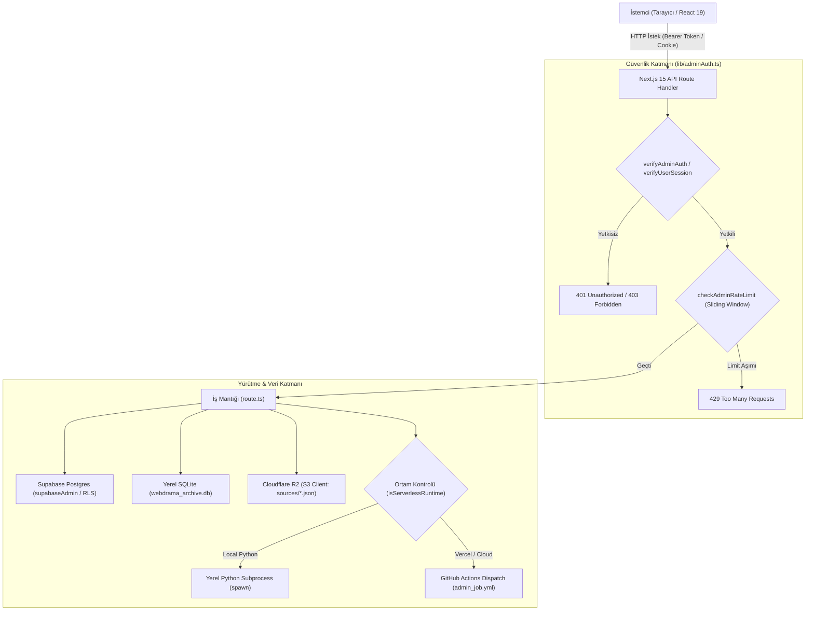

# KoUp API Referansı

KoUp platformunun Next.js 15 App Router (`koup-app/src/app/api/`) mimarisi altında çalışan tüm REST API uç noktalarının (39 adet `route.ts`), yetkilendirme seviyelerinin, girdi doğrulama kurallarının, hız sınırlamalarının (rate limit), önbellek başlıklarının ve yan etkilerinin teknik referans dokümanıdır.

---

## İçindekiler
1. [Genel Mimari & Standartlar](#genel-mimari--standartlar)
2. [Özet API Envanter Tablosu](#özet-api-envanter-tablosu)
3. [Admin & Yönetim API'leri (13 Rota)](#admin--yönetim-apileri-13-rota)
   - [/api/admin/animecix-sync](#1-apiadminanimecix-sync)
   - [/api/admin/automation](#2-apiadminautomation)
   - [/api/admin/bulk-fix-overviews](#3-apiadminbulk-fix-overviews)
   - [/api/admin/catalog](#4-apiadmincatalog)
   - [/api/admin/maintenance](#5-apiadminmaintenance)
   - [/api/admin/masterpieces](#6-apiadminmasterpieces)
   - [/api/admin/match-queue](#7-apiadminmatch-queue)
   - [/api/admin/scraper](#8-apiadminscraper)
   - [/api/admin/series-automation](#9-apiadminseries-automation)
   - [/api/admin/series-automation/resolve-slugs](#10-apiadminseries-automationresolve-slugs)
   - [/api/admin/series-automation/search](#11-apiadminseries-automationsearch)
   - [/api/admin/series-automation/sync](#12-apiadminseries-automationsync)
   - [/api/admin/sync-series](#13-apiadminsync-series)
4. [Medya & Katalog Zenginleştirme API'leri (7 Rota)](#medya--katalog-zenginleştirme-apileri-7-rota)
   - [/api/media/auto-enrich](#14-apimediaauto-enrich)
   - [/api/media/cast](#15-apimediacast)
   - [/api/media/trailer](#16-apimediatrailer)
   - [/api/media/view](#17-apimediaview)
   - [/api/person/bio](#18-apipersonbio)
   - [/api/franchise/[id]](#19-apifranchiseid)
   - [/api/sources/[mediaId]](#20-apisourcesmediaid)
5. [Yayın, Stream & Proxy API'leri (5 Rota)](#yayın-stream--proxy-apileri-5-rota)
   - [/api/resolve-stream](#21-apiresolve-stream)
   - [/api/stream](#22-apistream-alias)
   - [/api/stream-proxy](#23-apistream-proxy)
   - [/api/proxy](#24-apiproxy-alias)
   - [/api/image-proxy](#25-apiimage-proxy)
6. [Topluluk, Kullanıcı & İstek API'leri (8 Rota)](#topluluk-kullanıcı--istek-apileri-8-rota)
   - [/api/lists](#26-apilists)
   - [/api/lists/[id]](#27-apilistsid)
   - [/api/follow](#28-apifollow)
   - [/api/users/block](#29-apiusersblock)
   - [/api/series-requests](#30-apiseries-requests)
   - [/api/series-requests/preview](#31-apiseries-requestspreview)
   - [/api/reports](#32-apireports)
   - [/api/mdl-import](#33-apimdl-import)
7. [Magazin, Takvim & Yardımcı API'ler (6 Rota)](#magazin-takvim--yardımcı-apiler-6-rota)
   - [/api/magazin/live](#34-apimagazinlive)
   - [/api/magazin/[slug]](#35-apimagazinslug)
   - [/api/magazin/actor](#36-apimagazinactor)
   - [/api/takvim/live](#37-apitakvimlive)
   - [/api/gifs/search](#38-apigifssearch)
   - [/api/client-ip](#39-apiclient-ip)
8. [İlgili Dokümanlar](#ilgili-dokümanlar)

---

## Genel Mimari & Standartlar

KoUp API katmanı, Next.js 15 App Router üzerinde Route Handler (`route.ts`) mimarisiyle geliştirilmiştir. API'lerin tasarımında şu temel prensipler uygulanmıştır:

1. **Çok Katmanlı Hibrit Çalışma (Local Subprocess vs. Cloudless Dispatch):** Ağır otomasyon ve kazıma rotalarında (`/api/admin/automation`, `/api/admin/scraper`, `/api/admin/maintenance`, `/api/admin/catalog`), sunucu ortamı denetlenir:
   - Yerel/VPS ortamında Python ikilisi varsa `child_process.spawn` ile doğrudan Python betiği çalıştırılır ve loglar istemciye `ReadableStream` (`application/x-ndjson`) üzerinden canlı akıtılır.
   - Vercel Serverless ortamında (`process.env.VERCEL`) ise [scraperDispatch.ts](../koup-app/src/lib/server/scraperDispatch.ts) devreye girerek GitHub REST API üzerinden GitHub Actions iş akışlarını (`admin_job.yml`, `scraper_cron.yml`, `sync_single_series.yml`) tetikler ve Supabase `scraper_runs` tablosuna durum kaydı atar.
2. **Merkezi Kimlik & Yetkilendirme:**
   - Admin ve Moderatör uç noktalarında [adminAuth.ts](../koup-app/src/lib/adminAuth.ts) içindeki `verifyAdminAuth(req, { allowModerator?: boolean })` kullanılır.
   - Kullanıcı oturumu gerektiren uçlarda `verifyUserSession(req)` kullanılır.
   - Token'lar hem HTTP `Authorization: Bearer <token>` başlığından hem de Supabase auth çerez parçalarından (`-auth-token`) ayrıştırılır.
3. **Defansif Ağ Güvenliği & SSRF Filtresi:** Dış URL'lerle etkileşime giren tüm uçlarda (`resolve-stream`, `stream-proxy`, `catalog` source_probe, `series-requests`) özel IP blokları (`127.0.0.1`, `10.0.0.0/8`, `192.168.0.0/16`, `172.16.0.0/12`, `169.254.169.254`, AWS metadata) ve yerel ağ ana bilgisayarları filtrelenir; `stream-proxy` üzerinde ek olarak DNS çözümlemesi yapılarak DNS Rebinding saldırıları engellenir.
4. **Sıfır Hardcoded Secret Prensibi:** Veritabanı ve bulut servis anahtarları (`SUPABASE_SERVICE_ROLE_KEY`, `CF_R2_SECRET_ACCESS_KEY`, `GITHUB_TOKEN`, `TMDB_API_KEY`) yalnızca sunucu ortam değişkenlerinden okunur; istemci tarafına sızdırılmaz.



---

## Özet API Envanter Tablosu

| No | Uç Nokta (Yol) | HTTP Metodları | Yetki Seviyesi | Hız Limiti (Rate Limit) | Önbellek / Cache-Control |
|---|---|---|---|---|---|
| 1 | `/api/admin/animecix-sync` | `GET` | Admin | Standart | `no-store` |
| 2 | `/api/admin/automation` | `GET`, `POST` | Admin | 6 istek / dk (POST) | `force-dynamic`, `no-store` (NDJSON stream) |
| 3 | `/api/admin/bulk-fix-overviews` | `GET`, `POST` | Admin | 60 sn timeout | `force-dynamic`, `no-store` |
| 4 | `/api/admin/catalog` | `GET`, `POST` | Admin (GET: Mod+) | 60 istek / dk (POST) | `force-dynamic`, `no-store` |
| 5 | `/api/admin/maintenance` | `GET`, `POST` | Admin (GET: Mod+) | 25 istek / dk (POST) | `force-dynamic`, NDJSON stream |
| 6 | `/api/admin/masterpieces` | `GET`, `POST` | GET: Public, POST: Admin | Standart | `no-store` |
| 7 | `/api/admin/match-queue` | `GET`, `POST`, `PATCH` | GET: Mod+, POST/PATCH: Admin | 30 istek / dk | `force-dynamic`, `revalidate: 0` |
| 8 | `/api/admin/scraper` | `GET`, `POST` | Admin | 12 istek / dk (POST) | `no-store`, NDJSON stream |
| 9 | `/api/admin/series-automation` | `GET`, `POST`, `DELETE` | Admin | Standart | `force-dynamic`, `revalidate: 0` |
| 10 | `/api/admin/series-automation/resolve-slugs` | `POST` | Admin | Standart | `force-dynamic`, `revalidate: 0` |
| 11 | `/api/admin/series-automation/search` | `GET` | Admin | 12 sn timeout | `force-dynamic`, `revalidate: 0` |
| 12 | `/api/admin/series-automation/sync` | `POST` | Admin | 15 istek / dk | `force-dynamic`, NDJSON stream |
| 13 | `/api/admin/sync-series` | `GET`, `POST` | Admin | Standart | `no-store`, NDJSON stream |
| 14 | `/api/media/auto-enrich` | `GET`, `POST` | Public | Standart | `force-dynamic`, `no-store` |
| 15 | `/api/media/cast` | `GET` | Public | Standart | `public, s-maxage=86400, stale-while-revalidate=604800` |
| 16 | `/api/media/trailer` | `GET` | Public | Standart (6 saat in-memory LRU) | `public, s-maxage=3600, stale-while-revalidate=86400` |
| 17 | `/api/media/view` | `POST` | Public | DB RPC içi limit | `force-dynamic`, `no-store` |
| 18 | `/api/person/bio` | `GET` | Public | Standart | `public, s-maxage=3600, stale-while-revalidate=86400` |
| 19 | `/api/franchise/[id]` | `GET` | Public | 120 istek / dk (IP başı) | `public, s-maxage=3600, stale-while-revalidate=86400` |
| 20 | `/api/sources/[mediaId]` | `GET` | Public | Standart | `public, max-age=30, stale-while-revalidate=120` |
| 21 | `/api/resolve-stream` | `GET` | Public | Standart (2 saat in-memory cache) | `no-store, no-cache, must-revalidate` |
| 22 | `/api/stream` | `GET` | Public | Alias -> `/api/resolve-stream` | `no-store` |
| 23 | `/api/stream-proxy` | `GET`, `OPTIONS` | Public | Standart | Video Range Stream (`video/mp4`, HLS) |
| 24 | `/api/proxy` | `GET`, `OPTIONS` | Public | Alias -> `/api/stream-proxy` | Video Range Stream |
| 25 | `/api/image-proxy` | `GET` | Public | Standart (10MB max buffer) | `public, max-age=2592000, immutable` |
| 26 | `/api/lists` | `GET`, `POST` | GET: Public, POST: Oturum | Standart | GET: `public, s-maxage=30, stale-while-revalidate=120` |
| 27 | `/api/lists/[id]` | `GET`, `PATCH`, `DELETE` | GET: Public/Oturum, PATCH/DEL: Sahip/Admin | Standart | `force-dynamic` |
| 28 | `/api/follow` | `POST` | Oturum (IDOR korumalı) | Standart | `force-dynamic` |
| 29 | `/api/users/block` | `GET`, `POST` | Oturum (IDOR korumalı) | Standart | `no-store` |
| 30 | `/api/series-requests` | `GET`, `POST`, `PATCH`, `DELETE` | GET: Oturum (admin=1 ise Mod+), POST: Oturum, PATCH: Mod+, DEL: Sahip/Mod+ | 10 istek / dk (POST) | `force-dynamic` |
| 31 | `/api/series-requests/preview` | `GET`, `POST` | Public | 25 istek / dk (IP başı) | `force-dynamic` |
| 32 | `/api/reports` | `POST` | Public / Oturum | 60 sn cooldown + 10 dk'da max 5 | `no-store` |
| 33 | `/api/mdl-import` | `POST` | Public / Oturum | 10 sn timeout | `no-store` |
| 34 | `/api/magazin/live` | `GET` | Public | Standart | `public, max-age=120, stale-while-revalidate=300` |
| 35 | `/api/magazin/[slug]` | `GET` | Public | Standart | `public, max-age=120, stale-while-revalidate=300` |
| 36 | `/api/magazin/actor` | `GET` | Public | Standart | `revalidate: 300` |
| 37 | `/api/takvim/live` | `GET` | Public | Standart | `public, max-age=60, s-maxage=60, stale-while-revalidate=300` |
| 38 | `/api/gifs/search` | `GET` | Public | Standart (30 dk in-memory cache) | `public, s-maxage=1800, stale-while-revalidate=86400` |
| 39 | `/api/client-ip` | `GET` | Public | Sınırsız | `no-store` |

---

## Admin & Yönetim API'leri (13 Rota)

### 1. `/api/admin/animecix-sync`

- **Ne İşe Yarar:** AnimeciX platformundan One Piece gibi devasa anime serilerinin tüm bölümlerini ve alternatif Tau-Video video kaynaklarını AES-256-GCM kriptolu başlıklarla doğrudan yerel SQLite veritabanına (`webdrama_archive.db`) çeker, ölü alan adlarını (`sendvid`, `gdrive`, `sibnet` vb.) topluca temizler ve SQLite WAL dosyasını ana veritabanına sıfırlar (`PRAGMA wal_checkpoint(TRUNCATE)`).
- **Nasıl Çalışır:**
  - `GET /api/admin/animecix-sync?action=<inspect|purge_broken|wal_checkpoint|sync_one_piece>`
  - `makeAnimecixHeader`: AnimeciX güvenli API'si (`/secure/videos`) için rastgele 12 baytlık IV ile `aes-256-gcm` şifrelemesi yapar ve `X-E-H` başlığını üretir.
  - `sync_one_piece`: Sayfalanmış olarak (sayfa başı 200 video) 30 sayfaya kadar AnimeciX API'sini tarar; var olan bölümleri ve doğrudan URL'leri önbellekleyerek mükerrer kayıtları engeller.
- **Yetkilendirme:** Admin zorunludur. `verifyAdminAuth(req)` ile doğrulanır (401/403).
- **Rate Limit:** Tanımlanmamıştır (tekil admin işlemi).
- **Önbellek:** `no-store`.
- **Query Parametreleri:**
  - `action`: `inspect` (varsayılan), `purge_broken` (ölü kaynakları siler), `wal_checkpoint` (WAL'ı ana dosyaya yazar), `sync_one_piece` (One Piece senkronu).
- **Yanıt Şeması:**
```json
{
  "ok": true,
  "deletedSendvid": 42,
  "deletedGdrive": 12,
  "deletedOtherDead": 185,
  "totalDeleted": 239,
  "checkpoint": [{"busy": 0, "log": 0, "checkpointed": 0}]
}
```
- **Hata Kodları:**
  - `401 Unauthorized`: Admin oturumu eksik veya geçersiz.
  - `403 Forbidden`: Kullanıcı admin rolüne sahip değil.
  - `404 Not Found`: `webdrama_archive.db` yerel dosyası bulunamadı.
- **Yan Etkileri:** Yerel SQLite `episodes` ve `episode_sources` tablolarına doğrudan `node:sqlite` üzerinden satır ekler/siler. `PRAGMA wal_checkpoint(TRUNCATE)` çalıştırır.
- **Kullanan İstemci:** [AdminSeriesSync.tsx](../koup-app/src/components/AdminSeriesSync.tsx), doğrudan admin bakım istekleri.

---

### 2. `/api/admin/automation`

- **Ne İşe Yarar:** 20 aktif kazıyıcı botun (`scraper_configs`) cron zamanlamalarını ve çalışma durumlarını listeler; botları tek tek veya topluca açıp kapatır; 12 saatlik tam senkronizasyon boru hattını (`scripts/cron_sync_pipeline.py`) canlı NDJSON log akışıyla başlatır.
- **Nasıl Çalışır:**
  - `GET`: Supabase `scraper_configs` (aktif 8 çekirdek bot: ddizi, animecix, dizibox, dizikorea, hdfilm, asyawatch, dizilla, dizifon) ve `automation_runs` tablosundaki son çalıştırma geçmişini döner.
  - `POST`: `action` parametresine göre:
    - `toggle_scraper`: Tekil botun `is_enabled` durumunu günceller.
    - `toggle_all`: Tüm botları topluca aktif/pasif yapar.
    - `trigger_automation`: `isServerlessRuntime()` kontrolü yapar. Yerel ortamda Python varsa `scripts/cron_sync_pipeline.py` betiğini `child_process.spawn` ile çalıştırıp satır satır JSON akıtır (`ReadableStream`). Vercel Serverless ortamında ise [scraperDispatch.ts](../koup-app/src/lib/server/scraperDispatch.ts) üzerinden GitHub Actions `scraper_cron.yml` iş akışını tetikler (`target_site`, `pending_limit: 150`, `batch_dramas: 30`).
- **Yetkilendirme:** Admin zorunludur (`verifyAdminAuth(req)`).
- **Rate Limit:** `checkAdminRateLimit("automation:${userId}", 6, 60_000)` — Dakikada en fazla 6 POST isteği. Limit aşımında `429 Too Many Requests` ve `retryAfterSec` döner.
- **Önbellek:** `export const dynamic = 'force-dynamic'`, `no-store`.
- **Gövde (Body) Parametreleri:**
  - `action`: `'toggle_scraper' | 'toggle_all' | 'trigger_automation'`
  - `scraperId` (toggle_scraper için): string
  - `is_enabled` (toggle için): boolean
  - `target` (trigger_automation için): string (örn. `'all'`, `'ddizi'`, `'dizikorea'`)
- **Yanıt Şeması (NDJSON Canlı Akış Örneği):**
```json
{"type": "log", "line": "[14:20:05] [SİSTEM] Otomasyon boru hattı başlatıldı..."}
{"type": "log", "line": "[14:20:08] [SENKRON] AsyaWatch: 12 yeni bölüm eklendi."}
{"type": "result", "ok": true, "target": "all", "message": "GitHub Actions otomasyonu başarıyla başlatıldı."}
```
- **Hata Kodları:**
  - `400 Bad Request`: Eksik veya geçersiz gövde parametreleri.
  - `401 / 403`: Yetkisiz erişim.
  - `409 Conflict`: Yerel ortamda zaten çalışan aktif bir otomasyon süreci varken mükerrer tetikleme denemesi.
  - `429 Too Many Requests`: Hız limiti aşımı.
- **Yan Etkileri:** Supabase `scraper_configs` tablosunu günceller; `scraper_runs` tablosuna runId ekler; GitHub Actions iş akışı tetikler veya yerel Python sürecini başlatır.
- **Kullanan İstemci:** [AdminAutomationCenter.tsx](../koup-app/src/components/AdminAutomationCenter.tsx).

---

### 3. `/api/admin/bulk-fix-overviews`

- **Ne İşe Yarar:** Veritabanında özeti eksik, boş veya reklam/çöp metin ("1080p", "altyazılı tek parça izle", "dizibox", "webdramaturkey") içeren yapımları tespit eder; yerel SQLite arşivinden (`dramas.overview`) veya harici servislerden (TMDb, Cinemeta, MyDramaList, AniList) temiz özetleri çekerek topluca onarır.
- **Nasıl Çalışır:**
  - `GET` ve `POST` (aynı işlevi görür). `mode` parametresine göre Supabase `media` tablosunu filtreler (`bad_overviews`, `missing_imdb_rating`, `vitrin`, `top`).
  - Her medya için `enrichSingleMedia` çalıştırılır: Önce yerel SQLite'taki temiz özet kontrol edilir; yoksa TMDb veya Cinemeta API'sine gidilir. Hâlâ bulunamazsa editoryal standart açıklama üretilir (`"{title}, {year} yılı {categories} türündeki {type} yapımıdır..."`).
  - Hazırlanan yamalar Supabase `patch_media_metadata_batch` RPC fonksiyonuyla tek seferde uygulanır ve yerel SQLite `dramas` tablosuna da yansıtılır (Full Storage Sync).
- **Yetkilendirme:** Admin zorunludur (`verifyAdminAuth(req)`).
- **Rate Limit:** 60 saniyelik sunucu zaman aşımı (`export const maxDuration = 60`).
- **Önbellek:** `force-dynamic`, `no-store`.
- **Query Parametreleri:**
  - `mode`: `'bad_overviews'` (varsayılan), `'missing_ratings'`, `'vitrin'`, `'top'`.
  - `limit`: Sayı (1 ile 150 arası, varsayılan 60).
  - `offset`: Sayı (varsayılan 0).
- **Yanıt Şeması:**
```json
{
  "success": true,
  "mode": "bad_overviews",
  "batchSize": 60,
  "offset": 0,
  "limit": 60,
  "patchesPrepared": 48,
  "appliedCount": 48,
  "samplePatches": [
    {"id": 104, "overview": "Temiz özet metni...", "imdb_rating": 8.4}
  ]
}
```
- **Hata Kodları:**
  - `401 / 403`: Yetkisiz erişim.
  - `500 Internal Server Error`: Supabase RPC veya SQLite güncelleme hatası.
- **Yan Etkileri:** Supabase `media` tablosunda ve yerel SQLite `dramas` tablosunda `overview`, `imdb_rating`, `tmdb_id`, `mdl_id` kolonlarını topluca günceller.
- **Kullanan İstemci:** [AdminMaintenanceHub.tsx](../koup-app/src/components/admin/AdminMaintenanceHub.tsx).

---

### 4. `/api/admin/catalog`

- **Ne İşe Yarar:** KoUp katalogunun tam CRUD ve senkronizasyon merkezidir. Yapım (dizi/film/anime), bölüm ve video kaynağı ekleme/düzenleme/silme işlemlerini yönetir; dış video akışlarını canlı test eder (`source_probe`); AniList/TMDb üzerinden otomatik önizleme üretir; yapılan değişiklikleri Supabase, yerel SQLite ve Cloudflare R2 üçgeninde anında eşitler.
- **Nasıl Çalışır:**
  - `GET`:
    - `action=r2_sources`: Cloudflare Worker üzerinden ilgili yapımın kaynak JSON paketini (`sources/{mediaId}.json`) okur.
    - `action=enrich_preview`: Girilen başlık ve türe göre AniList GraphQL veya TMDb API'sinden poster, kapak, özet, çıkış yılı ve ülke bilgilerini çeker.
  - `POST`:
    - `source_probe`: Girilen harici URL'nin güvenliğini `isSafeExternalUrl` ile doğrular (SSRF engeli); `HEAD`/`GET` istekleriyle HTTP durum kodunu, yanıt süresini (gecikme ms), `Content-Type` başlığını ve akış türünü (`HLS (.m3u8)`, `MP4 Direct`, `Iframe / Embed`) analiz eder.
    - `series_save`: Supabase `media` tablosuna ekler/günceller, yerel SQLite'a `runLocalCatalogPatch('series_upsert')` ile yansıtır.
    - `series_delete`: Seriyi Supabase'den siler, SQLite'tan kaldırır ve R2'deki `sources/{mediaId}.json` dosyasını siler.
    - `episode_save` / `episode_delete`: Bölüm ekler, düzenler veya kaldırır.
    - `source_save`: Cloudflare R2 üzerindeki `sources/{mediaId}.json` paketini `@aws-sdk/client-s3` (`PutObjectCommand`) ile günceller ve SQLite'a işler.
    - `backup_db`: `scripts/admin_apply_catalog_patch.py --action backup_db --backup-r2` komutunu tetikleyerek veritabanını R2'ye yedekler.
- **Yetkilendirme:**
  - `GET`: Admin veya Moderatör (`verifyAdminAuth(req, { allowModerator: true })`).
  - `POST`: Yalnızca Admin (`verifyAdminAuth(req)`).
- **Rate Limit:** `checkAdminRateLimit("catalog:${auth.userId}", 60, 60_000)` — Dakikada en fazla 60 istek.
- **Önbellek:** `force-dynamic`, `no-store`.
- **Hata Kodları:**
  - `400 Bad Request`: Başlık/slug eksikliği veya SSRF filtresine takılan güvensiz URL.
  - `401 / 403`: Yetkisiz erişim.
  - `429 Too Many Requests`: Dakikalık hız sınırı aşımı.
  - `500 Internal Server Error`: S3 R2 yükleme veya veritabanı hatası.
- **Yan Etkileri:** Supabase `media`, `episodes` tablolarını günceller; Cloudflare R2'deki `sources/{id}.json` dosyasını yazar; yerel Python scriptini veya GitHub Actions `admin_job.yml` işini çalıştırır.
- **Kullanan İstemci:** `app/admin/page.tsx` (Dizi/Bölüm Yönetim Sekmeleri), [AdminMediaPicker.tsx](../koup-app/src/components/admin/AdminMediaPicker.tsx).

---

### 5. `/api/admin/maintenance`

- **Ne İşe Yarar:** KoUp altyapısının merkezi sağlık ve bakım motorudur. Supabase sorgu gecikmesini, Cloudflare Edge Worker erişilebilirliğini, R2 üzerindeki `db/webdrama_archive.db` yedek dosyasının boyut ve tazelik yaşını, yerel SQLite durumunu ölçer; 9 adet streaming bakım aracını canlı loglarla yürütür; zamanlanmış bölümleri yayına alır; site ayarlarını (`site_settings`) yönetir.
- **Nasıl Çalışır:**
  - `GET`: Altyapı telemetrisi toplar:
    - Supabase sorgu süresi (`supabaseLatencyMs`).
    - Cloudflare Worker `/archive/sources/1.json` kontrolü (`workerLatencyMs`, `workerStatusOk`).
    - S3 `HeadObjectCommand` ile `db/webdrama_archive.db` son değiştirilme tarihi (`r2DbLastModified`), boyutu (`r2DbSizeMb`) ve kaç dakika önce güncellendiği (`r2DbAgeMinutes`).
    - Yerel dosya sistemi kontrolü (`localDbExists`, `localDbSizeMb`, `localDbModifiedAt`).
    - 20 botun senkronizasyon istatistikleri ve son `automation_runs`, `admin_jobs`, `admin_audit_log` kayıtları.
  - `POST`:
    - `save_site_setting`: İzin verilen anahtarları (`announcement_banner`, `comment_watchlist`, `scraper_defaults`, `masterpieces`) günceller ve audit log kaydeder.
    - `publish_due_scheduled`: Vakti gelen (`scheduled_publish_at <= NOW()`) zamanlanmış bölümleri `status: 'published'` yapar.
    - Canlı Bakım Araçları (NDJSON Akışı): `auto_heal_gaps` (eksik bölüm onarımı), `recheck_pending` (bekleyen kaynak çözümü), `audit_catalog` (katalog sağlık denetimi), `purge_dead` (ölü kaynak temizliği), `merge_duplicates` (çift kayıt birleştirme), `sync_all` (Supabase senkronu), `export_bundles` (R2 JSON paketleme), `upload_r2` (R2 yükleme), `backup_r2` (R2 DB yedekleme). Ortam Vercel ise GitHub Actions `admin_job.yml` tetiklenir.
- **Yetkilendirme:**
  - `GET`: Admin veya Moderatör (`allowModerator: true`).
  - `POST`: Yalnızca Admin.
- **Rate Limit:** `checkAdminRateLimit("maintenance:${auth.userId}", 25, 60_000)` — Dakikada en fazla 25 istek.
- **Önbellek:** `force-dynamic`, NDJSON canlı akış.
- **Yanıt Şeması (GET Örneği):**
```json
{
  "ok": true,
  "health": {
    "supabaseOk": true,
    "supabaseLatencyMs": 45,
    "workerOk": true,
    "workerLatencyMs": 110,
    "r2DbBackupOk": true,
    "r2DbLastModified": "2026-10-27T08:30:00.000Z",
    "r2DbSizeMb": 68.4,
    "r2DbAgeMinutes": 214,
    "localDbExists": true,
    "localDbSizeMb": 68.4
  },
  "siteSettings": { "announcement_banner": { "enabled": false, "text": "" } }
}
```
- **Hata Kodları:** `400`, `401`, `403`, `429`, `500`.
- **Yan Etkileri:** `site_settings`, `episodes`, `admin_audit_log` tablolarına yazar; bakım betiklerini çalıştırır; R2 depolamasını günceller.
- **Kullanan İstemci:** [AdminMaintenanceHub.tsx](../koup-app/src/components/admin/AdminMaintenanceHub.tsx), [AdminSettingsAndAudit.tsx](../koup-app/src/components/admin/AdminSettingsAndAudit.tsx).

---

### 6. `/api/admin/masterpieces`

- **Ne İşe Yarar:** Ana sayfadaki "Başyapıtlar" (K-Drama & Asya Şaheserleri) vitrin bölümünü yönetir. Günlük rotasyon, haftalık rotasyon veya manuel sabitleme modlarına göre vitrine çıkacak 4 ana yapımı belirler; adminlerin vitrin serilerini sabitlemesini (`pinnedIds`) sağlar.
- **Nasıl Çalışır:**
  - `GET` (Public): `site_settings` tablosundan `key = 'masterpieces'` yapılandırmasını okur. En yüksek puanlı 36 adayı çeker; tarihe dayalı deterministik seed algoritması ile (`(seed * needed) % maxStart`) günlük veya haftalık olarak 4 seriyi vitrine yerleştirir. Manuel modda sabitlenmiş seriler önceliklidir.
  - `POST` (Admin): `rotationMode` (`'daily' | 'weekly' | 'manual'`) ve en fazla 12 adet `pinnedIds` dizisini doğrular, `site_settings` tablosuna kaydeder.
- **Yetkilendirme:**
  - `GET`: Herkese açık (Public).
  - `POST`: Admin zorunludur (`verifyAdminAuth(req)`).
- **Rate Limit:** Standart admin hız sınırı.
- **Önbellek:** `no-store`.
- **Gövde (POST) Parametreleri:**
```json
{
  "rotationMode": "daily",
  "pinnedIds": [1024, 2048, 512, 128]
}
```
- **Hata Kodları:** `401 / 403` (POST için yetkisiz), `500` (Veritabanı hatası).
- **Yan Etkileri:** Supabase `site_settings` tablosunda `masterpieces` kaydını günceller.
- **Kullanan İstemci:** Ana sayfa vitrini (`HomePageClient.tsx`), Admin Paneli Vitrin Ayarları.

---

### 7. `/api/admin/match-queue`

- **Ne İşe Yarar:** Kazıyıcı botların katalog ile eşleştiremediği veya düşük benzerlik puanı aldığı şüpheli serilerin yer aldığı inceleme kuyruğunu (`match_review_queue`) yönetir; adminlerin yanlış eşleşmeleri reddetmesini veya onaylamasını sağlar; alan adı değişen botların (`scraper_configs`) temel URL'lerini güvenli şekilde günceller.
- **Nasıl Çalışır:**
  - `GET`: `match_review_queue` tablosundan durumu `pending`, `approved`, `rejected` veya `all` olan kayıtları çeker (varsayılan 100, azami 200 adet); ayrıca güncel `scraper_configs` alan adı stratejilerini listeler.
  - `POST` / `PATCH`:
    - `action=approve` | `action=reject`: Kuyruk kaydının durumunu günceller ve `reviewed_at` damgalar.
    - `action=update_domain`: Scraper ID regex kontrolünden (`/^[a-z0-9_-]{2,32}$/`) ve HTTPS güvenlik kontrolünden (`isSafeHttpsUrl`) geçirilir. `scraper_configs.base_url` ve `site_url` güncellenir; işlem `logAdminAudit` ile denetim kütüğüne yazılır.
- **Yetkilendirme:**
  - `GET`: Admin veya Moderatör (`allowModerator: true`).
  - `POST` / `PATCH`: Yalnızca Admin.
- **Rate Limit:** `checkAdminRateLimit("match-queue:${auth.userId}", 30, 60_000)` — Dakikada en fazla 30 işlem.
- **Önbellek:** `force-dynamic`, `revalidate: 0`.
- **Hata Kodları:**
  - `400 Bad Request`: Güvensiz URL (HTTP veya özel IP aralıkları) veya geçersiz scraperId formatı.
  - `401 / 403`: Yetkisiz erişim.
  - `429 Too Many Requests`: Hız limiti aşımı.
- **Yan Etkileri:** Supabase `match_review_queue`, `scraper_configs` ve `admin_audit_log` tablolarını günceller.
- **Kullanan İstemci:** [AdminMatchQueue.tsx](../koup-app/src/components/admin/AdminMatchQueue.tsx).

---

### 8. `/api/admin/scraper`

- **Ne İşe Yarar:** KoUp bünyesindeki 20 botun (DDizi, AnimeciX, DiziBox, DiziKorea, HDFilmcehennemi, AsyaWatch, Dizilla, DiziFon, Diziİzle, WebDramaTurkey, KoreDizi, Shortİzle, DramaVadisi, DramaBox, AnimeLVL, SezonlukDizi, Dizipal, FullHDFilmizlesene, TRAnimeci, Anizm) protokollerini, durumlarını ve veritabanındaki gerçek kaynak sayılarını listeler; admin panelinden tek bir sağlayıcı veya spesifik dizi için anlık canlı tarama (`live_scanner.py`) tetikler.
- **Nasıl Çalışır:**
  - `GET`: `scraper_configs` tablosundaki konfigürasyonları çeker, yerel SQLite `episode_sources` tablosundan her botun gerçekte kaç aktif kaynağa sahip olduğunu sayarak (`items_synced`) zenginleştirir; seçilen botun son eklediği 16 içeriği döner.
  - `POST`: İlgili bot için tarama başlatır. `activeScraperRuns` Set nesnesi üzerinden aynı botun aynı anda iki kez çalıştırılması engellenir (`409 Conflict`). Yerel Python varsa `scrapers/live_scanner.py` çalıştırılır ve NDJSON ile loglar akar; Vercel Serverless ortamında ise GitHub Actions `admin_job.yml` iş akışı tetiklenir (`dispatchCloudScraperJob`).
- **Yetkilendirme:** Admin zorunludur (`verifyAdminAuth(req)`).
- **Rate Limit:** `checkAdminRateLimit("scraper:${auth.userId}", 12, 60_000)` — Dakikada en fazla 12 tarama isteği.
- **Önbellek:** `no-store`.
- **Gövde (POST) Parametreleri:**
  - `scraperId`: Desteklenen 20 bottan biri (örn. `'dizikorea'`, `'animecix'`).
  - `targetSeries` (isteğe bağlı): Taranacak özel dizi adı/slug'ı (azami 120 karakter, zararlı kontrol karakterleri temizlenir).
  - `limit` (isteğe bağlı): Taranacak azami öğe sayısı (1 ile 200 arası, varsayılan 30).
- **Yan Etkileri:** Supabase `scraper_runs` tablosuna görev ekler; yeni bölümler bulunduğunda SQLite ve Supabase'e işler; GitHub Actions işi başlatır.
- **Kullanan İstemci:** [AdminAutomationCenter.tsx](../koup-app/src/components/AdminAutomationCenter.tsx).

---

### 9. `/api/admin/series-automation`

- **Ne İşe Yarar:** Yayını devam eden ("Devam Ediyor") serilerin otomatik takibini yönetir. Hangi serilerin hangi sitelerden (`connected_sites`: AsyaWatch, DiziKorea, DiziFon vb.) takip edileceğini listeler, yeni serileri otomasyona bağlar veya otomasyondan çıkarır.
- **Nasıl Çalışır:**
  - `GET`: `series_automations` tablosundaki serileri döner (Supabase öncelikli, SQLite yedekli). Aynı başlık veya `media_id`ye sahip tekrarları tekilleştirir.
  - `POST`: Yeni bir seriyi otomasyona bağlar. Yapım daha önce katalogda yoksa (`media_id === 'new'`), `scripts/series_automation_runner.py --add` komutunu çalıştırarak seriyi önce katalogda oluşturur, ardından otomasyon tablosuna yazar. Eğer seri veritabanında "Final" yapmışsa, kural gereği otomasyona eklenmesi engellenir (`400 Bad Request`).
  - `DELETE`: `media_id` parametresiyle seriyi hem SQLite hem Supabase `series_automations` tablosundan siler.
- **Yetkilendirme:** Admin zorunludur (`verifyAdminAuth(req)`).
- **Rate Limit:** Standart admin koruması.
- **Önbellek:** `force-dynamic`, `revalidate: 0`.
- **Hata Kodları:**
  - `400 Bad Request`: Final yapmış seriyi otomasyona ekleme denemesi veya eksik başlık.
  - `401 / 403`: Yetkisiz erişim.
- **Yan Etkileri:** Supabase ve SQLite `series_automations` tablolarını günceller.
- **Kullanan İstemci:** [AdminSeriesAutomation.tsx](../koup-app/src/components/AdminSeriesAutomation.tsx).

---

### 10. `/api/admin/series-automation/resolve-slugs`

- **Ne İşe Yarar:** Bir dizinin KoUp başlığını alarak bağlı olduğu harici sitelerdeki (AsyaWatch, DiziKorea, DiziFon vb.) karşılık gelen URL slug'larını otomatik olarak tahmin eder ve çözer.
- **Nasıl Çalışır:**
  - `POST`: `title`, `drama_id`, `connected_sites` parametrelerini alır.
  - Yerel Python ortamında `scripts/series_automation_runner.py --resolve-slugs --title "{title}"` betiğini çalıştırarak siteler üzerinde arama yapar ve kesin slug'ları döner.
  - Vercel Serverless ortamında ise Türkçe karakter dönüşümü (`slugifyTR`) ile deterministik normalleştirilmiş slug haritası üretir (`cloud_fallback: true`).
- **Yetkilendirme:** Admin zorunludur (`verifyAdminAuth(req)`).
- **Önbellek:** `force-dynamic`, `revalidate: 0`.
- **Yanıt Şeması:**
```json
{
  "ok": true,
  "title": "Queen of Tears",
  "suggested_slugs": {
    "asyawatch": "queen-of-tears",
    "dizikorea": "queen-of-tears",
    "dizifon": "queen-of-tears"
  }
}
```
- **Kullanan İstemci:** [AdminSeriesAutomation.tsx](../koup-app/src/components/AdminSeriesAutomation.tsx).

---

### 11. `/api/admin/series-automation/search`

- **Ne İşe Yarar:** Seri otomasyonuna yeni yapım eklerken hem mevcut KoUp kataloğunda hem de harici sitelerde eş zamanlı canlı arama yapar.
- **Nasıl Çalışır:**
  - `GET /api/admin/series-automation/search?q={query}`
  - Yerel ortamda `scripts/live_multi_search.py` betiğini çalıştırarak hem katalog hem dış kaynak sonuçlarını döner (12 sn zaman aşımı).
  - Vercel ortamında ise Supabase `search_catalog` RPC fonksiyonuyla doğrudan veritabanı kataloğunda arama yapar.
- **Yetkilendirme:** Admin zorunludur (`verifyAdminAuth(req)`).
- **Önbellek:** `force-dynamic`, `revalidate: 0`.
- **Kullanan İstemci:** [AdminSeriesAutomation.tsx](../koup-app/src/components/AdminSeriesAutomation.tsx).

---

### 12. `/api/admin/series-automation/sync`

- **Ne İşe Yarar:** Otomasyona bağlı aktif serileri (tek bir seriyi veya tüm aktif serileri) tetikleyerek yeni yayınlanmış bölümleri harici kaynaklardan tarar, indirir ve sisteme işler.
- **Nasıl Çalışır:**
  - `POST`: `dramaId` veya `allActive: true` parametresi alır.
  - Yerel Python ortamında `scripts/series_automation_runner.py` çalıştırılır ve NDJSON stream ile loglar istemciye aktarılır.
  - Vercel ortamında ise `dispatchCloudScraperJob` üzerinden:
    - Tekil seri ise: `workflowFile: 'sync_single_series.yml'`, `script: 'scrapers/sync_target_drama.py'`
    - Tüm seriler ise: `workflowFile: 'admin_job.yml'`, `script: 'scripts/series_automation_runner.py'`
    iş akışını GitHub Actions üzerinde başlatır.
- **Yetkilendirme:** Admin zorunludur (`verifyAdminAuth(req)`).
- **Rate Limit:** `checkAdminRateLimit("series-auto-sync:${auth.userId}", 15, 60_000)` — Dakikada en fazla 15 istek.
- **Önbellek:** `force-dynamic`, NDJSON akışı.
- **Kullanan İstemci:** [AdminSeriesAutomation.tsx](../koup-app/src/components/AdminSeriesAutomation.tsx).

---

### 13. `/api/admin/sync-series`

- **Ne İşe Yarar:** Belirli bir serinin tüm bölümlerini ve alternatif oynatıcı kaynaklarını (özellikle AnimeciX Tau-Video, AsyaWatch, DiziKorea vb.) derinlemesine senkronize eden özel operasyon motorudur.
- **Nasıl Çalışır:**
  - `GET`: AnimeciX veya hedef platformlar üzerinde dizi araması yapar; eşleşen serinin bölüm/video sayısını ve mevcut veritabanı durumunu döner.
  - `POST`: Hedef dizi için senkronizasyonu başlatır. Bulut ortamında Cloudflare Edge Worker (`/pichive-proxy`) veya ayna alan adları üzerinden verileri çeker; doğrudan R2 `sources/{mediaId}.json` paketini yazar ve Supabase'e aktarır. Yerel ortamda ise `scrapers/sync_target_drama.py` betiğini çalıştırır.
- **Yetkilendirme:** Admin zorunludur (`verifyAdminAuth(req)`).
- **Önbellek:** `no-store`, NDJSON akışı.
- **Kullanan İstemci:** [AdminSeriesSync.tsx](../koup-app/src/components/AdminSeriesSync.tsx).

---

## Medya & Katalog Zenginleştirme API'leri (7 Rota)

### 14. `/api/media/auto-enrich`

- **Ne İşe Yarar:** Bir yapımın detay sayfasına girildiğinde veya katalog taramalarında eksik olan üst verileri (Türkçe özet, yatay backdrop görseli, yüksek çözünürlüklü kapak, IMDb/MDL/AniList puanları, fragman URL'si, tür etiketleri ve TMDb/AniList kimlikleri) isteğe bağlı (`on-demand`) olarak zenginleştirir.
- **Nasıl Çalışır:**
  - `GET /api/media/auto-enrich?id={mediaId}&force=true` veya `?slug={mediaSlug}`
  - Supabase `media` tablosundan yapımı çeker; eksik alanları inceler.
  - Anime ise AniList GraphQL API'sine (`Media(id, search)`), dizi/film ise TMDb API'sine (`/search/tv`, `/search/movie`, `/tv/{id}`, `/movie/{id}`) sorgu atar.
  - İngilizce özetleri Google GTX API üzerinden Türkçeleştirir (`translateToTurkish`); TMDb'den gelen poster/backdrop yollarını tam URL'ye çevirir.
  - Kısa dramaların (`kisa_drama`) ve resmi AniList kapaklarının ezilmesini engelleyen koruma mekanizmalarına (`isProtectedCover`) sahiptir.
  - Elde edilen veriler `supabaseAdmin` ile `media` tablosuna ve varsa yerel SQLite `dramas` tablosuna kaydedilir.
  - `POST`: Toplu ID listesi (`media_ids`) alarak birden fazla yapımı sıralı zenginleştirir.
- **Yetkilendirme:** Herkese açık (Public). İstemcide eksik veri görüldüğünde arka planda otomatik tetiklenebilir.
- **Rate Limit:** Standart Next.js API sınırı.
- **Önbellek:** `force-dynamic`, `no-store`.
- **Yanıt Şeması:**
```json
{
  "ok": true,
  "enriched": true,
  "media": {
    "id": 412,
    "title": "Vincenzo",
    "overview": "İtalyan mafyası için çalışan Kore asıllı bir avukat...",
    "backdrop_image": "https://image.tmdb.org/t/p/original/...",
    "imdb_rating": 8.4,
    "tmdb_id": 117376
  }
}
```
- **Yan Etkileri:** Supabase `media` tablosunda ve yerel SQLite `dramas` tablosunda ilgili yapımın üst verilerini günceller.
- **Kullanan İstemci:** Dizi/Film Detay Sayfası (`app/seri/[slug]/page.tsx`, `app/film/[slug]/page.tsx`), [NetflixPlayer.tsx](../koup-app/src/components/NetflixPlayer.tsx).

---

### 15. `/api/media/cast`

- **Ne İşe Yarar:** Bir dizinin, filmin veya animenin oyuncu kadrosunu, yönetmenini ve canlandırılan karakterleri döner. Oyuncuların başrol (`lead`) veya yan rol (`support`) ayrımını ve fatura sıralamasını (`billing_order`) sağlar.
- **Nasıl Çalışır:**
  - `GET /api/media/cast?mediaId={mediaId}&type={anime|dizi|film}&tmdbId={tmdbId}&title={title}&force=false`
  - 1. Adım: Supabase `media_cast` ve `people` tablolarında önbelleğe alınmış veri var mı kontrol eder. Varsa veritabanından anında döner (`source: 'cache'`).
  - 2. Adım (Önbellek yoksa):
    - Anime ise: AniList GraphQL `characters(sort: [ROLE, RELEVANCE])` sorgusuyla karakterleri ve Japon seslendirme sanatçılarını (`voiceActors`) çeker.
    - Dizi/Film ise: TMDb API'sinden (`/tv/{id}/credits` veya `/movie/{id}/credits`) oyuncuları, karakter adlarını ve profil fotoğraflarını çeker.
  - 3. Adım: Çekilen kişiler `people` tablosuna eklenir veya güncellenir; ardından `media_cast` tablosuna ilişkilendirilir (`role_type: 'lead' | 'support'`).
- **Yetkilendirme:** Herkese açık (Public).
- **Önbellek:** `public, s-maxage=86400, stale-while-revalidate=604800` (1 gün CDN önbelleği, 7 gün bayat veri tazeleme).
- **Yanıt Şeması:**
```json
{
  "ok": true,
  "source": "cache",
  "cast": [
    {
      "id": 12,
      "role_type": "lead",
      "character_name": "Vincenzo Cassano",
      "billing_order": 0,
      "person": {
        "id": 88,
        "name": "Song Joong-ki",
        "slug": "song-joong-ki",
        "image_url": "https://image.tmdb.org/t/p/w300/..."
      }
    }
  ]
}
```
- **Yan Etkileri:** Supabase `people` ve `media_cast` tablolarına yeni satırlar ekler (`supabaseAdmin`).
- **Kullanan İstemci:** Detay sayfası Oyuncu Kadrosu sekmesi (`CastSection.tsx`).

---

### 16. `/api/media/trailer`

- **Ne İşe Yarar:** Yapımların resmi YouTube fragman kimliğini (`youtubeId`) ve fragman URL'sini döner; kartların üzerine gelindiğinde (hover) veya detay sayfasında kesintisiz fragman oynatılmasını sağlar.
- **Nasıl Çalışır:**
  - `GET /api/media/trailer?mediaId={mediaId}&slug={slug}&title={title}&contentType={type}`
  - 6 saatlik sunucu içi bellek önbelleğine (`trailerCache`, LRU 2500) bakar.
  - Önbellekte yoksa önce Supabase `media.trailer_url` kolonunu kontrol eder.
  - Tanımlı değilse TMDb API (`/videos`), AniList (`trailer.site === 'youtube'`) veya YouTube resmi fragman arama motorunu devreye sokar.
  - Bulunan geçerli YouTube ID'sini `supabaseAdmin` ile `media.trailer_url` kolonuna işler.
- **Yetkilendirme:** Herkese açık (Public).
- **Önbellek:** `public, s-maxage=3600, stale-while-revalidate=86400` (1 saat CDN önbelleği).
- **Yanıt Şeması:**
```json
{
  "youtubeId": "S12-4MVu2LM",
  "trailerUrl": "https://www.youtube.com/watch?v=S12-4MVu2LM",
  "source": "tmdb"
}
```
- **Kullanan İstemci:** [MediaCard.tsx](../koup-app/src/components/MediaCard.tsx) (Hover Video Önizleme), Detay Sayfası Fragman Modalı.

---

### 17. `/api/media/view`

- **Ne İşe Yarar:** Bir yapımın detay sayfası açıldığında (`kind: 'detail'`) veya video oynatıcıda bir bölüm izlendiğinde (`kind: 'watch'`) izlenme sayısını atomik olarak artırır; haftalık ve toplam trend istatistiklerini günceller.
- **Nasıl Çalışır:**
  - `POST /api/media/view`
  - Gövdede `media_id`, `viewer_key` (cihaz/oturum karma anahtarı, en az 8 karakter), `kind` (`'detail' | 'watch'`), `season`, `episode` parametrelerini alır.
  - Supabase `increment_media_view` RPC fonksiyonunu çalıştırır. Fonksiyon, aynı kullanıcının/cihazın kısa sürede tekrarlayan sahte görüntüleme üretmesini engeller; `views_total` ve `views_weekly` sayaçlarını artırır.
- **Yetkilendirme:** Herkese açık (Public).
- **Rate Limit:** Veritabanı RPC seviyesinde zaman pencereli tekilleştirme.
- **Önbellek:** `force-dynamic`, `no-store`.
- **Yanıt Şeması:**
```json
{
  "counted": true,
  "views_total": 14250,
  "views_weekly": 1240
}
```
- **Yan Etkileri:** Supabase `media` tablosunda `views_total` ve `views_weekly` sayaçlarını artırır; varsa izleme kütüğüne satır ekler.
- **Kullanan İstemci:** [NetflixPlayer.tsx](../koup-app/src/components/NetflixPlayer.tsx), `app/seri/[slug]/page.tsx`.

---

### 18. `/api/person/bio`

- **Ne İşe Yarar:** Oyuncu, yönetmen veya seiyuu (seslendirme sanatçısı) detay sayfasında biyografi, doğum yeri/tarihi, ölüm tarihi, IMDb kimliği ve yüksek çözünürlüklü profil fotoğraflarını sunar.
- **Nasıl Çalışır:**
  - `GET /api/person/bio?id={personId}&slug={slug}&name={name}`
  - Önce Supabase `people` tablosunu kontrol eder; biyografi varsa döner.
  - Biyografi yoksa TMDb `/person/{id}` veya `/search/person` uçlarına başvurur.
  - İngilizce biyografiyi Google GTX API üzerinden akıcı Türkçeye çevirir (`translateToTurkish`); doğum yerini Türkçe ülke isimleriyle eşleştirir (`normalizePlaceOfBirth`: Seoul -> Güney Kore, Tokyo -> Japonya vb.).
  - Elde edilen biyografi ve doğum bilgileri `supabaseAdmin` ile `people` tablosuna yazılır.
- **Yetkilendirme:** Herkese açık (Public).
- **Önbellek:** `public, s-maxage=3600, stale-while-revalidate=86400` (1 saat CDN).
- **Kullanan İstemci:** Oyuncu Detay Sayfası (`app/kisi/[slug]/page.tsx`).

---

### 19. `/api/franchise/[id]`

- **Ne İşe Yarar:** Bir serinin evrenine (franchise/seri kümesi) ait diğer sezonları, devam filmlerini, yan hikayelerini (spin-off) ve öncül hikayelerini (prequel) kronolojik sırayla listeler.
- **Nasıl Çalışır:**
  - `GET /api/franchise/[id]`
  - İstemci IP adresi üzerinden hız sınırı kontrolü yapar (`checkRateLimit`).
  - [seriesData.ts](../koup-app/src/lib/server/seriesData.ts) içindeki `getFranchiseForMedia(mediaId)` fonksiyonunu çağırır. İlişkili serileri tespit eder, afiş ve yapım yılına göre sıralar.
- **Yetkilendirme:** Herkese açık (Public).
- **Rate Limit:** `RATE_MAX_REQ = 120` — IP başına dakikada azami 120 istek.
- **Önbellek:** `public, s-maxage=3600, stale-while-revalidate=86400`.
- **Hata Kodları:** `400 Bad Request` (Geçersiz veya aralık dışı ID), `429 Too Many Requests`.
- **Kullanan İstemci:** Detay sayfası Sezonlar & Seri Evreni bölümü (`FranchiseSection.tsx`).

---

### 20. `/api/sources/[mediaId]`

- **Ne İşe Yarar:** Bir dizinin veya filmin tüm bölümlerine ait video oynatıcı kaynaklarını (HLS, MP4, Embed iframe, Tau-Video) 3 kademeli hiyerarşik depolama mimarisinden okuyarak istemciye ulaştırır.
- **Nasıl Çalışır:**
  - `GET /api/sources/[mediaId]`
  - 1. Kademe (Birincil): Cloudflare R2 üzerindeki `sources/{mediaId}.json` paketini `@aws-sdk/client-s3` (`GetObjectCommand`) ile okur.
  - 2. Kademe (İkincil): R2'de yoksa veya yerel geliştirme ortamındaysa yerel SQLite `webdrama_archive.db` dosyasından `episodes` ve `episode_sources` tablolarını `node:sqlite` ile sorgular.
  - 3. Kademe (Üçüncül): Supabase veritabanındaki `episodes` tablosuna başvurur.
  - Kaynakları `classifyStreamType` ile sınıflandırır (`hls`, `mp4`, `tau`, `postmessage_iframe`, `locked_iframe`); reklam ve ölü alan adlarını filtreler; fansub isimlerini temizler (`cleanFansubName`).
- **Yetkilendirme:** Herkese açık (Public).
- **Önbellek:** `public, max-age=30, stale-while-revalidate=120`.
- **Kullanan İstemci:** [NetflixPlayer.tsx](../koup-app/src/components/NetflixPlayer.tsx), [NetflixEpisodePopover.tsx](../koup-app/src/components/NetflixEpisodePopover.tsx).

---

## Yayın, Stream & Proxy API'leri (5 Rota)

> **Detaylı Mimari Referansı:** Bu rotaların tersine mühendislik çözümlemeleri, HLS manifest yeniden yazımı, şifreli anahtar algoritmaları ve oynatıcı entegrasyonu hakkında eksiksiz bilgi için [05-oynatici-ve-yayin-akisi.md](./05-oynatici-ve-yayin-akisi.md) dokümanını inceleyiniz.

### 21. `/api/resolve-stream`
- **Ne İşe Yarar:** 30'u aşkın harici video barındırıcısının (Tau-Video, Rapidrame, Close, DBX/DiziBox, DiziKorea, AsyaWatch, Dizilla, SezonlukDizi, Filemoon, Vidmoly, Doodstream vb.) karmaşık/şifreli sayfalarını arka planda çözer ve yerel HTML5 oynatıcının doğrudan oynatabileceği ham `.m3u8` (HLS) veya doğrudan `.mp4` akış adresini çıkarır.
- **Güvenlik & Kısıtlar:** Katı SSRF filtresi (`isSafeExternalUrl`) uygular; `curl` fallback mekanizmasına sahiptir. Çözülen akışlar 2 saat boyunca bellek içi LRU haritasında (`streamResolutionCache`) saklanır.
- **Önbellek:** `no-store, no-cache, must-revalidate`.

### 22. `/api/stream` (Alias)
- **Ne İşe Yarar:** Geriye dönük uyumluluk amacıyla `/api/resolve-stream` uç noktasına yönlendirme yapan takma addır (`GET resolveStreamGET(req)`).

### 23. `/api/stream-proxy`
- **Ne İşe Yarar:** CORS kısıtlamalı veya anti-hotlink korumalı harici HLS manifestlerini (`.m3u8`), şifreleme anahtarlarını (`.key`) ve video parçalarını (`.ts`, `.m4s`, `.mp4`) HTTP Range isteklerini destekleyerek istemciye proxy'ler. Manifest dosyalarındaki göreli bağlantıları dinamik olarak kendi proxy uç noktasına dönüştürür.
- **Güvenlik & Kısıtlar:** DNS Rebinding ve SSRF koruması için `isBlockedAfterDnsLookup` ile hedef ana bilgisayarın IP adresini resolve edip özel IP bloklarında olup olmadığını denetler.

### 24. `/api/proxy` (Alias)
- **Ne İşe Yarar:** `/api/stream-proxy` uç noktasına doğrudan yönlendirme yapan takma addır (`GET streamProxyGET(req)`).

### 25. `/api/image-proxy`
- **Ne İşe Yarar:** 17.000+ yapımın harici sunuculardaki poster ve kapak görsellerini Next.js sunucusunda CPU/RAM şişmesi yaratmadan proxy'ler; `sharp` kütüphanesiyle WebP formatına dönüştürür; bozuk/reklamlı afişleri TMDb/AniList üzerinden otomatik onarır.
- **Güvenlik & Kısıtlar:** Maksimum 10MB resim tampon boyutu (`MAX_IMAGE_SIZE_BYTES`); kazıyıcı blok listesi (`SCRAPER_BLOCK_HOSTS`) ve bilinen zararlı afiş filtresi (`TOXIC_POSTER_SUBSTRINGS`).
- **Önbellek:** `next.config.mjs` üzerinden `public, max-age=2592000, stale-while-revalidate=86400, immutable` (30 gün tarayıcı/CDN önbelleği).

---

## Topluluk, Kullanıcı & İstek API'leri (8 Rota)

### 26. `/api/lists`

- **Ne İşe Yarar:** Kullanıcıların oluşturduğu herkese açık özel listeleri (`custom_lists`) arama, filtreleme ve popülerlik sıralamasıyla listeler; oturum açmış kullanıcıların yeni özel liste oluşturmasını sağlar.
- **Nasıl Çalışır:**
  - `GET`: Supabase `get_public_lists` RPC fonksiyonunu çağırır. Dönen listelere kapak/arka plan görsellerini ve `custom_list_likes` tablosundaki gerçek güncel beğeni sayılarını ekler; arama sorgusuna (`q`) ve sıralama tipine (`popular`, `items`, `newest`) göre filtreler.
  - `POST`: Oturum açmış kullanıcının kimliğini `verifyUserSession(req)` ile doğrular (IDOR koruması: `body.user_id !== session.userId` ise 401). Liste başlığından otomatik SEO uyumlu slug üretir (`baseSlug-timestamp`); Supabase `create_custom_list` RPC veya doğrudan `custom_lists` tablosu üzerinden listeyi oluşturur.
- **Yetkilendirme:**
  - `GET`: Herkese açık (Public).
  - `POST`: Oturum açmış kullanıcı (`verifyUserSession`).
- **Önbellek:** `GET`: `public, s-maxage=30, stale-while-revalidate=120`. `POST`: `force-dynamic`.
- **Gövde (POST) Parametreleri:**
```json
{
  "title": "2026'nın En İyi K-Dramaları",
  "description": "Mutlaka izlenmesi gereken başyapıtlar",
  "visibility": "public",
  "media_ids": [101, 204, 305],
  "cover_image_url": "https://image.tmdb.org/...",
  "backdrop_image_url": "https://image.tmdb.org/..."
}
```
- **Hata Kodları:** `400 Bad Request` (Başlık < 2 karakter), `401 Unauthorized` (Oturumsuz deneme), `500`.
- **Yan Etkileri:** Supabase `custom_lists` tablosuna yeni liste ekler.
- **Kullanan İstemci:** Listeler Sayfası (`app/listeler/page.tsx`), Yeni Liste Oluşturma Modalı.

---

### 27. `/api/lists/[id]`

- **Ne İşe Yarar:** Belirli bir özel listenin detaylarını, içerdiği tüm yapımları ve oluşturan kullanıcının profilini getirir; liste sahibinin veya adminin listeyi güncellemesini (yapım ekleme, çıkarma, başlık/kapak değiştirme) veya silmesini sağlar.
- **Nasıl Çalışır:**
  - `GET /api/lists/[id]?user_id={optional}`: Supabase `get_list_detail` RPC'sini çağırır. Liste gizli (`private`) ise yalnızca liste sahibi görebilir; herkese açıksa tüm ziyaretçilere sunulur.
  - `PATCH /api/lists/[id]`: Oturumu `verifyUserSession` ile denetler. Liste sahibinin kimliği ile oturum kimliğini karşılaştırır (`existingList.user_id !== session.userId && session.role !== 'admin'`). Yetkisiz ise `403 Forbidden` döner (Katı IDOR engeli). `action: 'add' | 'remove' | 'toggle'` ile `media_ids` dizisini günceller; başlık ve kapak bilgilerini yeniler.
  - `DELETE /api/lists/[id]`: Yalnızca liste sahibi veya Admin silebilir. `delete_custom_list` RPC fonksiyonu veya doğrudan tablo silme işlemiyle listeyi kaldırır.
- **Yetkilendirme:**
  - `GET`: Herkese açık (Gizli listelerde sahip oturumu zorunlu).
  - `PATCH` & `DELETE`: Yalnızca Liste Sahibi veya Admin (`403 Forbidden` koruması).
- **Hata Kodları:** `400`, `401`, `403`, `404 Not Found`, `500`.
- **Yan Etkileri:** Supabase `custom_lists` tablosunu günceller veya satırı siler.
- **Kullanan İstemci:** Liste Detay Sayfası (`app/liste/[id]/page.tsx`), `AddToCustomListModal.tsx`.

---

### 28. `/api/follow`

- **Ne İşe Yarar:** Kullanıcıların dizileri, filmleri veya oyuncuları takibe almasını / takipten çıkarmasını (toggle) sağlar; takip edilen yapımlara yeni bölüm geldiğinde otomatik bildirim oluşturulmasının temelini teşkil eder.
- **Nasıl Çalışır:**
  - `POST /api/follow`
  - `verifyUserSession(req)` ile aktif oturumu doğrular. Gövdeden gelen `user_id` ile token'dan çıkarılan `session.userId` birebir eşleşmek zorundadır; aksi takdirde işlem reddedilir (`401 Unauthorized` / IDOR engeli).
  - Supabase `toggle_user_follow` RPC fonksiyonunu (`p_user_id`, `p_target_type: 'media' | 'person'`, `p_target_id`) çağırır.
- **Yetkilendirme:** Oturum açmış kullanıcı (`verifyUserSession`).
- **Önbellek:** `force-dynamic`, `no-store`.
- **Gövde Parametreleri:**
```json
{
  "user_id": "89cc34ec-3b3e-4d8f-b891-b84b2bdb3b25",
  "target_type": "media",
  "target_id": 512
}
```
- **Yanıt Şeması:**
```json
{
  "success": true,
  "following": true
}
```
- **Yan Etkileri:** Supabase `user_follows` tablosuna kayıt ekler/kaldırır; `media.followers_count` veya `people.followers_count` sayacını günceller.
- **Kullanan İstemci:** [FollowButton.tsx](../koup-app/src/components/FollowButton.tsx), Detay Sayfaları.

---

### 29. `/api/users/block`

- **Ne İşe Yarar:** Topluluk içinde rahatsızlık veren diğer kullanıcıları engelleme (`block`) ve engel kaldırma (`unblock`) işlemlerini yönetir; kullanıcının engellediği hesapların yorumlarını ve bildirimlerini gizler.
- **Nasıl Çalışır:**
  - `GET /api/users/block?user_id={id}`: Oturumu denetler (`session.userId === requestedId || session.role === 'admin'`). `fetch_user_blocks_for_id` RPC'si ile engellenen kullanıcılar listesini döner.
  - `POST /api/users/block`:
    - `blocker_id` ile `session.userId` eşleşmelidir.
    - Kullanıcının kendisini engellemesi engellenir (`verifiedBlockerId === blocked_id` ise `400 Bad Request`).
    - Supabase `manage_user_block` RPC fonksiyonunu (`p_blocker_id`, `p_blocked_id`, `p_action: 'toggle' | 'block' | 'unblock'`) çalıştırır.
- **Yetkilendirme:** Oturum açmış kullanıcı (IDOR korumalı).
- **Önbellek:** `no-store`.
- **Yanıt Şeması:**
```json
{
  "success": true,
  "result": { "action": "blocked", "blocked_id": "uuid-here" }
}
```
- **Yan Etkileri:** Supabase `user_blocks` tablosuna satır ekler veya kaldırır.
- **Kullanan İstemci:** [RichCommentSection.tsx](../koup-app/src/components/RichCommentSection.tsx) (Kullanıcı Profil Popover), Ayarlar Sayfası Engellenenler Sekmesi.

---

### 30. `/api/series-requests`

- **Ne İşe Yarar:** Kullanıcıların sitede bulunmayan Asya dizileri, animeler veya filmler için istek göndermesini; gönderdikleri isteklerin durumunu takip etmesini; admin ve moderatörlerin bu istekleri onaylayıp/reddedip katalogdaki gerçek diziyle eşleştirmesini sağlar.
- **Nasıl Çalışır:**
  - `GET`:
    - `admin=1` ise: Admin veya Moderatör yetkisi zorunludur (`allowModerator: true`). Tüm kullanıcıların gönderdiği son 250 isteği profilleriyle zenginleştirilmiş olarak döner.
    - Normal istek ise: Oturum sahibinin kendi gönderdiği istekleri (`user_id = session.userId`, azami 100) döner.
  - `POST`:
    - Oturum doğrulanır (`verifyUserSession`). Hız sınırı kontrolü yapılır (`checkAdminRateLimit`, 10 istek/dk).
    - Kullanıcının girdiği URL (AniList, TMDb, MyDramaList veya IMDb), sunucu tarafında [seriesRequestResolver.ts](../koup-app/src/lib/seriesRequestResolver.ts) ile çözülür (İstemcinin sahte başlık/puan göndermesi imkansızdır).
    - Aynı kullanıcının aynı dış yapım için mükerrer aktif istek göndermesi engellenir (`409 Conflict`).
    - İstek `series_requests` tablosuna `pending` durumuyla eklenir.
  - `PATCH`:
    - Yalnızca Admin veya Moderatör erişebilir.
    - Durumu (`pending`, `approved`, `rejected`), yönetici notunu (`admin_note`) ve eşleşen katalog slug'ını (`media_slug`, `media_id`) günceller.
    - İstek onaylandığında veya reddedildiğinde, isteği gönderen kullanıcıya Supabase `user_notifications` tablosu üzerinden otomatik sistem bildirimi oluşturulur!
  - `DELETE`:
    - Normal kullanıcı: Yalnızca kendi gönderdiği ve henüz onaylanmamış (`status === 'pending'`) istekleri silebilir (IDOR koruması).
    - Admin veya Moderatör: Herhangi bir isteği silebilir.
- **Yetkilendirme:**
  - `GET` (kullanıcı), `POST`: Oturum açmış kullanıcı.
  - `GET?admin=1`, `PATCH`: Admin veya Moderatör.
  - `DELETE`: İstek Sahibi (yalnızca pending) veya Admin/Moderatör.
- **Rate Limit:** `POST`: Dakikada en fazla 10 istek.
- **Önbellek:** `force-dynamic`, `no-store`.
- **Yanıt Şeması (POST):**
```json
{
  "ok": true,
  "request": {
    "id": "uuid-here",
    "title": "A Shop for Killers",
    "source_type": "tmdb",
    "status": "pending",
    "release_year": 2024
  }
}
```
- **Yan Etkileri:** Supabase `series_requests` tablosuna ekler/günceller/siler; `user_notifications` tablosuna otomatik bildirim fırlatır.
- **Kullanan İstemci:** Dizi İstek Modalı (`SeriesRequestModal.tsx`), Profil İsteklerim Sekmesi, [AdminSeriesRequests.tsx](../koup-app/src/components/admin/AdminSeriesRequests.tsx).

---

### 31. `/api/series-requests/preview`

- **Ne İşe Yarar:** Kullanıcı dizi istek modalına bir bağlantı (AniList, TMDb, MyDramaList, IMDb) yapıştırdığında, veritabanına kayıt atmadan önce başlık, afiş, çıkış yılı ve özet bilgilerini anlık olarak çekerek kullanıcıya canlı önizleme kartı gösterir.
- **Nasıl Çalışır:**
  - `GET` ve `POST /api/series-requests/preview`
  - URL formatını denetler; [seriesRequestResolver.ts](../koup-app/src/lib/seriesRequestResolver.ts) üzerinden dış API'leri sorgular.
  - Eğer yapım zaten KoUp kataloğunda mevcutsa, yanıt içinde `existing_media` nesnesi döner; böylece kullanıcıya "Bu dizi zaten sitemizde var!" uyarısı verilir.
- **Yetkilendirme:** Herkese açık (Public).
- **Rate Limit:** `checkAdminRateLimit("series-req-preview:${ip}", 25, 60_000)` — IP başına dakikada azami 25 önizleme.
- **Önbellek:** `force-dynamic`.
- **Kullanan İstemci:** `SeriesRequestModal.tsx`.

---

### 32. `/api/reports`

- **Ne İşe Yarar:** Video oynatıcıda karşılaşılan teknik aksaklıkların (kırık yayın linki, ses/altyazı senkron kayması, yanlış video/bölüm, oynatıcı çökmesi vb.) izleyiciler tarafından hata bildirim kütüğüne iletilmesini sağlar.
- **Nasıl Çalışır:**
  - `POST /api/reports`
  - Çok Kademeli Hız Sınırlaması:
    1. Zorunlu Bekleme (Cooldown): Peş peşe iki bildirim arasında en az 60 saniye geçmelidir (`COOLDOWN_MS = 60_000`).
    2. Zaman Penceresi Tavanı (Window Cap): 10 dakikada en fazla 5 bildirim gönderilebilir (`resetTime = now + 600_000`).
    3. Veritabanı Mükerrer Kontrolü: Aynı medya, sezon ve bölüm için son 15 dakika içinde bildirim yapılmışsa mükerrer kayıt engellenir.
  - Açıklama metni (`details`) 500 karakterle sınırlandırılır ve HTML etiketleri regex ile temizlenir (`stripHtml`).
  - Bildirim `supabaseAdmin` ile `issue_reports` tablosuna eklenir.
- **Yetkilendirme:** Herkese açık (Ziyaretçi IP'si veya giriş yapmış kullanıcı kimliği ile takip edilir).
- **Rate Limit:** 60 sn cooldown + 10 dakikada en fazla 5 rapor.
- **Önbellek:** `no-store`.
- **Hata Kodları:** `400 Bad Request`, `429 Too Many Requests` (`cooldownRemaining` süresiyle döner).
- **Yan Etkileri:** Supabase `issue_reports` tablosuna yeni arıza kaydı ekler.
- **Kullanan İstemci:** [NetflixPlayer.tsx](../koup-app/src/components/NetflixPlayer.tsx) (Sorun Bildir Butonu / Modalı).

---

### 33. `/api/mdl-import`

- **Ne İşe Yarar:** Kullanıcıların MyDramaList veya AniList üzerindeki izleme geçmişlerini, puanlarını ve izleme listelerini ("İzleniyor", "Tamamlandı", "İzlenecek") tek tıkla KoUp hesabına aktarmasını sağlar.
- **Nasıl Çalışır:**
  - `POST /api/mdl-import`
  - `platform === 'anilist'`: AniList GraphQL API'si üzerinden kullanıcının `MediaListCollection` listesini çeker; KoUp kataloğundaki `anilist_id`lerle eşleştirir.
  - `platform === 'mdl'`: MyDramaList profilini tarar veya yerel `scripts/mdl_importer.py` betiğini çalıştırır.
  - `platform === 'text'`: Kullanıcının yapıştırdığı dizi listesini satır satır ayrıştırır ve fuzzy title matching ile katalogla eşleştirir.
  - Eğer istekte `Authorization: Bearer <token>` varsa, eşleşen içerikleri doğrudan kullanıcının Supabase profil izleme geçmişine işler.
- **Yetkilendirme:** Herkese açık / Oturum açmış kullanıcı.
- **Zaman Aşımı:** 10 saniye AbortSignal kontrolü.
- **Önbellek:** `no-store`.
- **Kullanan İstemci:** Profil Sayfası Dışa/İçe Aktar Sekmesi (`MdlImportModal.tsx`).

---

## Magazin, Takvim & Yardımcı API'ler (6 Rota)

### 34. `/api/magazin/live`

- **Ne İşe Yarar:** Kore ve Asya eğlence dünyasına dair son dakika magazin, dizi ve oyuncu haberlerini AsyaMag ve KoreZin kaynaklarından eş zamanlı ve canlı olarak toplayarak ana sayfaya ve magazin akışına sunar.
- **Nasıl Çalışır:**
  - `GET /api/magazin/live?limit=36&fresh=0&source=all`
  - `fetchLiveAsyaMagPosts` ve `fetchLiveKoreZinPosts` fonksiyonlarını `Promise.allSettled` ile paralel çalıştırır.
  - Gelen haberleri başlık ve slug normalizasyonuyla tekilleştirir (`seenSlugs`, `seenTitles`); en güncel tarihe göre sıralar.
- **Yetkilendirme:** Herkese açık (Public).
- **Önbellek:** `fresh=1` ise `no-store`, aksi halde `public, max-age=120, stale-while-revalidate=300`.
- **Kullanan İstemci:** Magazin Sayfası (`app/magazin/page.tsx`), Ana Sayfa Magazin Bloğu.

---

### 35. `/api/magazin/[slug]`

- **Ne İşe Yarar:** Belirli bir magazin haberinin tam içeriğini, HTML gövdesini, kaynak bağlantısını, atomik beğeni ve yorum sayılarını döner.
- **Nasıl Çalışır:**
  - `GET /api/magazin/[slug]`
  - Slug `kz-` ile başlıyorsa KoreZin üzerinden, aksi halde AsyaMag üzerinden canlı haberi çeker.
  - Haberin KoUp veritabanındaki beğeni ve yorum sayılarını (`magazine_posts.likes_count`, `comments_count`) ekler.
  - Haber veritabanında henüz yoksa, ilk görüntülemede `supabaseAdmin` ile otomatik olarak `magazine_posts` tablosuna tohumlanır (`auto-seed`).
- **Yetkilendirme:** Herkese açık (Public).
- **Önbellek:** `public, max-age=120, stale-while-revalidate=300`.
- **Kullanan İstemci:** Magazin Detay Sayfası (`app/magazin/[slug]/page.tsx`).

---

### 36. `/api/magazin/actor`

- **Ne İşe Yarar:** Bir oyuncunun veya ünlünün detay sayfasında, o kişiyle ilgili çıkmış tüm güncel magazin ve dizi haberlerini listeler.
- **Nasıl Çalışır:**
  - `GET /api/magazin/actor?name={actorName}&id={personId}&slug={slug}&type={actor|character}`
  - Karakter tipindeki anime/kurgusal profillerde (`type === 'character' || slug.startsWith('char-')`) kural gereği magazin araması yapılmaz (`{ posts: [], total: 0 }`).
  - Önce yerel Supabase `magazine_posts` tablosunda arar (`related_person_ids`, başlık veya etiketler); ardından canlı AsyaMag etiket API'sini sorgulayarak sonuçları harmanlar.
- **Yetkilendirme:** Herkese açık (Public).
- **Önbellek:** `export const revalidate = 300` (5 dakika).
- **Kullanan İstemci:** Oyuncu Detay Sayfası İlgili Haberler Sekmesi (`app/kisi/[slug]/page.tsx`).

---

### 37. `/api/takvim/live`

- **Ne İşe Yarar:** Yayını devam eden Asya dizilerinin ve animelerin haftalık yayın takvimini (Pazartesi'den Pazar'a) Türkiye yerel saatine (UTC+3) göre canlı geri sayım sayaçlarıyla birlikte sunar.
- **Nasıl Çalışır:**
  - `GET /api/takvim/live`
  - Türkiye saati (`getTurkeyNow`: UTC+3) hesaplaması yapar.
  - Supabase `media` tablosundan `status_broadcast = 'Devam Ediyor'` olan ve yayın günleri (`air_days: [1..7]`) tanımlı serileri çeker.
  - TMDb veya AniList üzerinden gelecek bölümün yayın tarihini (`next_episode_at`) ve saatini hesaplar; gün bazında (Pazartesi=1, Pazar=7) gruplayarak "Bugün", "Yarın", "X gün sonra" etiketlerini üretir.
- **Yetkilendirme:** Herkese açık (Public).
- **Önbellek:** `public, max-age=60, s-maxage=60, stale-while-revalidate=300`.
- **Kullanan İstemci:** Yayın Takvimi Sayfası (`app/takvim/page.tsx`), Ana Sayfa Takvim Widget'ı.

---

### 38. `/api/gifs/search`

- **Ne İşe Yarar:** Yorum alanında ve topluluk etkileşimlerinde kullanıcıların GIF araması yapmasını veya trend GIF'leri listelemesini sağlar.
- **Nasıl Çalışır:**
  - `GET /api/gifs/search?q={searchQuery}&limit=16`
  - 30 dakikalık sunucu içi LRU önbelleği (`searchCache`, azami 200 sorgu) barındırır.
  - Önbellekte yoksa Giphy API'sine (`/v1/gifs/search` veya `/v1/gifs/trending`) güvenli parametrelerle (`rating=pg-13&lang=tr`) istek atar; yalnızca sabit yükseklikteki optimize URL'leri döner.
- **Yetkilendirme:** Herkese açık (Public).
- **Önbellek:** `public, s-maxage=1800, stale-while-revalidate=86400` (30 dakika CDN).
- **Kullanan İstemci:** [RichCommentSection.tsx](../koup-app/src/components/RichCommentSection.tsx) (GIF Seçici Paneli).

---

### 39. `/api/client-ip`

- **Ne İşe Yarar:** İstemcinin gerçek genel IP adresini tespit eder; cihaz takibi (`deviceTracker.ts`), hız sınırlamaları ve güvenlik denetimleri için temel oluşturur.
- **Nasıl Çalışır:**
  - `GET /api/client-ip`
  - HTTP istek başlıklarındaki `x-forwarded-for` (ilk virgül öncesi IP) veya `x-real-ip` değerini okur.
  - IPv6 yerel döngü adreslerini (`::1`, `::ffff:127.0.0.1`) standart `'127.0.0.1'` formatına normalleştirir.
- **Yetkilendirme:** Herkese açık (Public).
- **Rate Limit:** Sınırsız.
- **Önbellek:** `no-store`.
- **Yanıt Şeması:**
```json
{
  "ip": "85.105.142.18"
}
```
- **Kullanan İstemci:** [deviceTracker.ts](../koup-app/src/lib/deviceTracker.ts), Güvenlik loglayıcıları.

---

## İlgili Dokümanlar
- [01-genel-bakis-ve-mimari.md](./01-genel-bakis-ve-mimari.md) — 3 Katmanlı Mimari ve Veri Akışı
- [05-oynatici-ve-yayin-akisi.md](./05-oynatici-ve-yayin-akisi.md) — Oynatıcı, HLS, Stream Proxy ve Worker Akışı
- [07-kimlik-yetki-ve-guvenlik.md](./07-kimlik-yetki-ve-guvenlik.md) — Kimlik Doğrulama, Roller, Ban Sistemi ve Güvenlik Standartları
- [08-veri-katmani.md](./08-veri-katmani.md) — Veritabanı Şemaları, RPC Fonksiyonları ve RLS Politikaları
- [09-kaziyicilar-scriptler-ve-senkron.md](./09-kaziyicilar-scriptler-ve-senkron.md) — Bot Altyapısı ve Arşiv Senkronizasyonu
