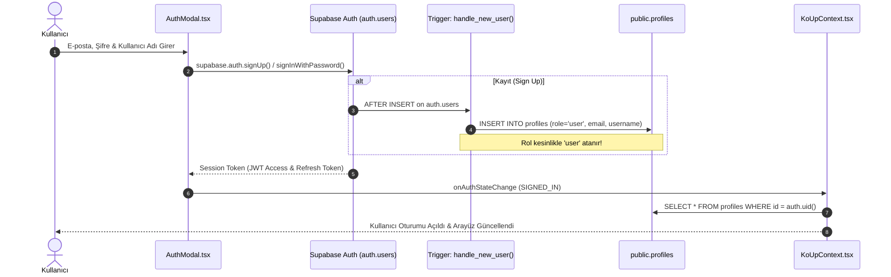
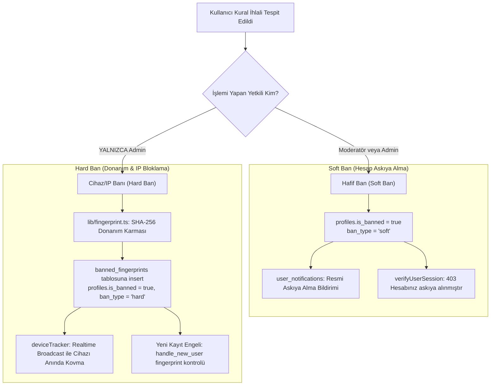

# KoUp Kimlik, Yetki ve Güvenlik Mimarisi

Bu doküman; KoUp platformunun Supabase Authentication altyapısını, rol tabanlı erişim denetimini (RBAC), iki kademeli moderasyon ve yasaklama (ban) mimarisini, sunucu güvenlik doğrulayıcılarını (`adminAuth.ts`), savunma odaklı web güvenliği korumalarını (SSRF, XSS, IDOR, SQLi, CSP) ve Admin Paneli (`app/admin/page.tsx`) yetki sınırlandırmalarını derinlemesine açıklamaktadır.

---

## İçindekiler
1. [Supabase Auth Akışı & Yaşam Döngüsü](#1-supabase-auth-akışı--yaşam-döngüsü)
   - [AuthModal Mimarisi ve İstemci Güvenliği](#authmodal-mimarisi-ve-istemci-güvenliği)
   - [Veritabanı Tetikleyicisi: `handle_new_user()`](#veritabanı-tetikleyicisi-handle_new_user)
   - [Kayıt ve Yorumlarda Sunucu Tarafı Hız Sınırları](#kayıt-ve-yorumlarda-sunucu-tarafı-hız-sınırları)
2. [Kullanıcı Rolleri & Hiyerarşisi (RBAC)](#2-kullanıcı-rolleri--hiyerarşisi-rbac)
   - [Rol Hiyerarşisi ve Yetki Matrisi](#rol-hiyerarşisi-ve-yetki-matrisi)
   - [Admin Bootstrap Engeli (Neden Kayıtta Admin Olunamaz?)](#admin-bootstrap-engeli-neden-kayıtta-admin-olunamaz)
   - [Rol Koruma Tetikleyicisi: `protect_profile_role()`](#rol-koruma-tetikleyicisi-protect_profile_role)
   - [Admin Rol Değiştirme RPC'leri](#admin-rol-değiştirme-rpcleri)
3. [Sunucu Güvenlik Katmanı (`lib/adminAuth.ts` & `lib/adminClient.ts`)](#3-sunucu-güvenlik-katmanı-libadminauthts--libadminclientts)
   - [Token Ayrıştırma: `extractBearerOrCookieToken`](#token-ayrıştırma-extractbearerorcookietoken)
   - [Kullanıcı Oturum Doğrulama: `verifyUserSession`](#kullanıcı-oturum-doğrulama-verifyusersession)
   - [Yönetici Yetki Doğrulama: `verifyAdminAuth`](#yönetici-yetki-doğrulama-verifyadminauth)
   - [`ADMIN_DEV_BYPASS` Analizi & Üretim Güvenliği](#admin_dev_bypass-analizi--üretim-güvenliği)
   - [Admin İşlem Denetim Kütüğü: `logAdminAudit`](#admin-işlem-denetim-kütüğü-logadminaudit)
   - [İstemci Güvenli Çağrı Sarmalayıcısı: `adminClient.ts`](#istemci-güvenli-çağrı-sarmalayıcısı-adminclientts)
4. [Moderasyon & 2 Kademeli Ban Sistemi (Two-Tier Ban Architecture)](#4-moderasyon--2-kademeli-ban-sistemi-two-tier-ban-architecture)
   - [Kademeli Ban Felsefesi: Soft Ban vs. Hard Ban](#kademeli-ban-felsefesi-soft-ban-vs-hard-ban)
   - [Donanım & Tarayıcı Parmak İzi: `lib/fingerprint.ts`](#donanım--tarayıcı-parmak-izi-libfingerprintts)
   - [Cihaz Takibi ve Uzaktan Oturum Kapatma: `lib/deviceTracker.ts`](#cihaz-takibi-ve-uzaktan-oturum-kapatma-libdevicetrackerts)
   - [Kullanıcı Engelleme: `/api/users/block`](#kullanıcı-engelleme-apiusersblock)
5. [Rate Limiting Mimarisi & Sunucusuz (Serverless) Sınırları](#5-rate-limiting-mimarisi--sunucusuz-serverless-sınırları)
6. [Web Güvenliği, Başlıklar, CSP, XSS, SSRF, IDOR & SQLi Korumaları](#6-web-güvenliği-başlıklar-csp-xss-ssrf-idor--sqli-korumaları)
   - [Güvenlik Başlıkları & CSP (`next.config.mjs`)](#güvenlik-başlıkları--csp-nextconfigmjs)
   - [XSS (Cross-Site Scripting) Koruması](#xss-cross-site-scripting-koruması)
   - [SSRF (Server-Side Request Forgery) Savunması](#ssrf-server-side-request-forgery-savunması)
   - [IDOR (Insecure Direct Object Reference) Koruması](#idor-insecure-direct-object-reference-koruması)
   - [SQL Injection (SQLi) Önleme](#sql-injection-sqli-önleme)
7. [Gizli Anahtar İzolasyonu (Zero Hardcoded Secrets) & Supabase Advisor Denetimi](#7-gizli-anahtar-izolasyonu-zero-hardcoded-secrets--supabase-advisor-denetimi)
8. [Admin Paneli Mimarisi (`app/admin/page.tsx`) & Bileşenleri](#8-admin-paneli-mimarisi-appadminpagetsx--bileşenleri)
9. [İlgili Dokümanlar](#ilgili-dokümanlar)

---

## 1. Supabase Auth Akışı & Yaşam Döngüsü

KoUp kullanıcı kimlik doğrulama süreçleri; ön yüzde Supabase JS SDK (`@supabase/supabase-js`), arka yüzde PostgreSQL RLS (Row Level Security) ve `auth.users` tetikleyicileri ile yönetilir.



### AuthModal Mimarisi ve İstemci Güvenliği

[AuthModal.tsx](../koup-app/src/components/AuthModal.tsx) bileşeni, giriş yapma (`login`) ve kayıt olma (`register`) akışlarını kullanıcı dostu ve savunmacı bir yaklaşımla sunar:
- **Kullanıcı Dostu Hata Çevirisi (`translateAuthError`):** Supabase Auth servisinden dönen ham İngilizce hata mesajları (`Invalid login credentials`, `User already registered`, `Password should be at least...`) istemcide yakalanarak Türkçeye dönüştürülür.
- **Kaba Kuvvet (Brute-Force) & İstemci Kilidi:** Art arda yapılan hatalı giriş denemelerinde `failedAttempts` sayacı artar; 5 hatalı denemeden sonra `lockoutSec` devreye girerek modal üzerinden istek gönderilmesini geçici olarak kilitler.
- **E-posta Aktivasyon Soğuma Sayacı (`resendCooldown`):** Onaylanmamış hesaplar için aktivasyon e-postasının peş peşe talep edilmesini engellemek amacıyla 60 saniyelik zorunlu geri sayım sayacı uygulanır.

### Veritabanı Tetikleyicisi: `handle_new_user()`

Supabase `auth.users` tablosuna yeni bir kullanıcı kaydolduğunda, PostgreSQL seviyesinde `handle_new_user()` tetikleyicisi (`20261018140000_server_side_comment_and_register_rate_limits.sql`) otomatik çalışır:

```sql
CREATE OR REPLACE FUNCTION public.handle_new_user()
RETURNS trigger
LANGUAGE plpgsql
SECURITY DEFINER
SET search_path TO 'public', 'extensions', 'pg_temp'
AS $function$
DECLARE
  base_username TEXT;
  final_username TEXT;
  recent_reg_count INT;
BEGIN
  -- 1. Anti-bot / Anti-spam sel koruması: 2 dakikada azami 10 yeni kayıt
  SELECT COUNT(*) INTO recent_reg_count 
  FROM public.profiles 
  WHERE created_at > (NOW() - INTERVAL '2 minutes');

  IF recent_reg_count >= 10 THEN
    RAISE EXCEPTION 'Sistem yoğunluğu veya çok fazla kayıt denemesi. Lütfen birkaç dakika bekleyip tekrar deneyin.';
  END IF;

  -- 2. Kullanıcı adı temizleme ve sınırlandırma
  base_username := coalesce(
    NEW.raw_user_meta_data->>'username',
    regexp_replace(split_part(coalesce(NEW.email, 'user'), '@', 1), '[^a-zA-Z0-9_]', '', 'g')
  );
  base_username := regexp_replace(base_username, '[^a-zA-Z0-9_]', '', 'g');
  IF char_length(base_username) < 3 THEN
    base_username := 'koup_' || substr(NEW.id::text, 1, 6);
  END IF;
  IF char_length(base_username) > 28 THEN
    base_username := substr(base_username, 1, 28);
  END IF;

  final_username := base_username;
  IF EXISTS (SELECT 1 FROM public.profiles WHERE username = final_username) THEN
    final_username := base_username || '_' || substr(NEW.id::text, 1, 4);
  END IF;

  -- 3. Kesinlikle role = 'user' atanır!
  INSERT INTO public.profiles (id, username, display_name, avatar_url, role, email)
  VALUES (
    NEW.id,
    final_username,
    coalesce(NEW.raw_user_meta_data->>'display_name', base_username),
    NEW.raw_user_meta_data->>'avatar_url',
    'user',
    NEW.email
  )
  ON CONFLICT (id) DO UPDATE SET 
    email = EXCLUDED.email;
  RETURN NEW;
END;
$function$;
```

### Kayıt ve Yorumlarda Sunucu Tarafı Hız Sınırları

Kötü niyetli kullanıcıların ve bot ağlarının veritabanını şişirmesini engellemek amacıyla doğrudan PostgreSQL trigger seviyesinde iki katı kural konulmuştur:
1. **Kayıt Sınırı:** Son 2 dakika içinde sistem genelinde 10'dan fazla profil oluşturulmuşsa, yeni kayıt işlemi veritabanı seviyesinde `RAISE EXCEPTION` ile engellenir.
2. **Yorum Sınırı (`prepare_comment_insert`):**
   - Kullanıcı admin değilse, 1 saat içinde en fazla 15 yorum yazabilir (`v_hourly_count >= 15`).
   - Peş peşe iki yorum arasında en az 10 saniye geçmek zorundadır (`v_last_created > NOW() - INTERVAL '10 seconds'`).

---

## 2. Kullanıcı Rolleri & Hiyerarşisi (RBAC)

KoUp platformunda Rol Tabanlı Erişim Denetimi (Role-Based Access Control - RBAC) uygulanmaktadır. Roller `public.profiles.role` sütununda tutulur.

### Rol Hiyerarşisi ve Yetki Matrisi

| Rol | Tanım | Yetki ve Sınırlar |
|---|---|---|
| **`user`** | Standart Kayıtlı Kullanıcı | Dizi/film izleme, izleme geçmişi senkronizasyonu, yorum yazma, özel liste oluşturma, serileri takibe alma, dizi isteği gönderme, sorun bildirme. Admin paneline erişemez. |
| **`moderator`** / **`mod`** | Topluluk Moderatörü | Standart kullanıcı yetkilerine ek olarak: Admin panelindeki **Kullanıcılar** (`users`) ve **Yorumlar** (`comments`) sekmelerine erişebilir; kural ihlali yapan kullanıcılara resmi uyarı gönderebilir ve **Hafif Ban (Soft Ban)** uygulayabilir. İnceleme kuyruğundaki yapımları inceleyebilir. Sistem ayarlarına, botlara veya katalog silme işlemlerine erişemez. |
| **`admin`** | Sistem Yöneticisi | Sistemin tam sahibi: Tüm admin paneli sekmelerine erişim, botları tetikleme, katalog ekleme/silme/düzenleme, veritabanı onarımı ve yedekleme, kullanıcı rollerini değiştirme, **Hard Ban (Cihaz/IP Banı)** uygulama. |
| **`translator`** / **`editor`** | Çevirmen / Editör | Fansub çevirileri ve altyazı yüklemeleri için ayrılmış ara rollerdir. |
| **`banned`** | Yasaklanmış Hesap | Giriş yapması, yorum yazması, liste oluşturması ve topluluk özelliklerini kullanması engellenmiş hesap. |

### Admin Bootstrap Engeli (Neden Kayıtta Admin Olunamaz?)

Web uygulamalarında sıkça görülen en kritik zafiyetlerden biri "Kayıt sırasında admin yetkisi elde etme" (Privilege Escalation via Registration) açığıdır. KoUp mimarisinde bu açık mutlak olarak kapatılmıştır:
1. **İstemci Tarafı Manipülasyonu İmkansızdır:** Kullanıcı kayıt formunda veya API isteğinde `role: "admin"` gönderse dahi, `handle_new_user()` fonksiyonu `NEW.raw_user_meta_data->>'role'` değerini **asla okumaz**. Fonksiyonda `'user'` değeri sabit kodlanmıştır (hardcoded literal).
2. **Kendini Admin Yapma Loophole'u Kaldırılmıştır:** `grant_admin_by_email` fonksiyonu daha önce ilk kullanıcının kendini admin yapmasına olanak tanıyan bir mantığa sahiptiyse de, `20261016160000_security_and_database_hardening.sql` göçüyle bu açık tamamen kaldırılmış ve fonksiyonun başına `IF NOT public.is_admin() THEN RAISE EXCEPTION` konulmuştur.
3. **İlk Admin Yalnızca Veritabanından Tanımlanabilir:** Sistemin ilk admini, yalnızca Supabase Dashboard'daki SQL Editor üzerinden `service_role` yetkisiyle doğrudan veritabanına sorgu atılarak atanabilir:
   ```sql
   UPDATE public.profiles SET role = 'admin' WHERE email = 'yonetici@koup.app';
   ```

### Rol Koruma Tetikleyicisi: `protect_profile_role()`

Bir kullanıcının kendi profilini güncellerken (`UPDATE profiles SET role = 'admin' WHERE id = auth.uid()`) yetki yükseltmesini engellemek için PostgreSQL seviyesinde `BEFORE UPDATE` tetikleyicisi çalışır:

```sql
CREATE OR REPLACE FUNCTION public.protect_profile_role()
RETURNS trigger
LANGUAGE plpgsql
SECURITY DEFINER
SET search_path = ''
AS $$
BEGIN
  IF NEW.role IS DISTINCT FROM OLD.role AND NOT public.is_admin() THEN
    RAISE EXCEPTION 'Yetkisiz rol değişikliği: Sadece yöneticiler kullanıcı rollerini değiştirebilir.';
  END IF;
  RETURN NEW;
END;
$$;
```
Bu sayede RLS politikaları esnetilse bile, veritabanı çekirdeği admin olmayan birinin rol sütununu değiştirmesine izin vermez.

### Admin Rol Değiştirme RPC'leri

- `public.admin_set_user_role(target_user_id uuid, new_role text)`: Yalnızca mevcut bir admin tarafından çağrılabilir. `new_role` parametresinin geçerli bir rol (`'user', 'translator', 'editor', 'moderator', 'mod', 'admin', 'banned'`) olduğunu doğrular.
- `public.admin_toggle_mod_role(target_user_id uuid)`: Yalnızca admin tarafından çağrılabilir; kullanıcının moderatörlük yetkisini açıp kapatır ve kullanıcıya otomatik bildirim gönderir.
- Fonksiyonların anonim (`anon`) çalıştırma yetkileri `REVOKE EXECUTE ... FROM public, anon` komutlarıyla iptal edilmiştir.

---

## 3. Sunucu Güvenlik Katmanı (`lib/adminAuth.ts` & `lib/adminClient.ts`)

Next.js API rotalarında istemciden gelen isteklerin kimlik ve yetki denetimi, merkezi [adminAuth.ts](../koup-app/src/lib/adminAuth.ts) kütüphanesi üzerinden yürütülür.

### Token Ayrıştırma: `extractBearerOrCookieToken`

NextRequest nesnesinden JWT token'ı iki farklı kaynaktan güvenli şekilde çıkarır:
1. `Authorization: Bearer <token>` başlığı (Mobil veya API istemcileri).
2. Supabase çerezleri: Supabase tarayıcıda token'ı bazen parça parça (`sb-xxx-auth-token.0`, `sb-xxx-auth-token.1`) saklar. Fonksiyon, tüm `-auth-token` çerezlerini bularak alfabetik birleştirir, URI decode eder ve JSON içerisindeki `access_token` değerini çözer.

### Kullanıcı Oturum Doğrulama: `verifyUserSession`

Oturum zorunlu uç noktalarda (`/api/follow`, `/api/lists`, `/api/users/block`, `/api/series-requests`) çağrılır:
- Token yoksa `401 Unauthorized` döner (`Oturum anahtarı bulunamadı`).
- `supabase.auth.getUser(token)` ile Supabase Auth sunucusunda imza ve süre (expiration) kontrolü yapılır.
- `profiles` tablosundan `is_banned` kontrolü yapılır. Eğer kullanıcının hesabı askıya alınmışsa işlem `403 Forbidden` (`Hesabınız askıya alınmıştır.`) ile kesilir.

### Yönetici Yetki Doğrulama: `verifyAdminAuth`

Tüm `/api/admin/*` rotalarının giriş kapısıdır:
- `options.allowModerator: true` verilmişse, kullanıcının rolü `'admin'` VEYA `'moderator'` / `'mod'` ise izin verir (`status: 200`).
- Varsayılan olarak yalnızca `'admin'` rolüne izin verir; moderatörler admin rotalarına girmeye çalıştığında `403 Forbidden` (`Bu işlem için Admin yetkisi zorunludur.`) fırlatılır.

### `ADMIN_DEV_BYPASS` Analizi & Üretim Güvenliği

[adminAuth.ts](../koup-app/src/lib/adminAuth.ts) satır 126-143 arasında yerel geliştirme kolaylığı sağlayan bir fallback mekanizması bulunur:

```ts
const isStrictLocalDev =
  process.env.NODE_ENV === 'development' &&
  process.env.ADMIN_DEV_BYPASS === '1' &&
  !process.env.VERCEL &&
  !process.env.CF_PAGES;

if (!token) {
  if (isStrictLocalDev) {
    return {
      authorized: true,
      status: 200,
      userId: '89cc34ec-3b3e-4d8f-b891-b84b2bdb3b25',
      role: 'admin',
      username: 'admin',
    };
  }
  return buildUnauthorizedResult('Yetkisiz erişim: Oturum anahtarı bulunamadı.', 401);
}
```

#### Neden Üretimde (Production) Kesinlikle Kapalı Olmalıdır?
- **Host / Header Sahteciliği Engeli:** Eski sürümlerde `req.headers.get('host') === 'localhost:3000'` kontrolü gibi sahteciliğe (`Host header injection`) açık yöntemler vardı. Bu yöntem tamamen kaldırılmış ve yerine **4 katı kural** getirilmiştir:
  1. `NODE_ENV === 'development'` olmak zorunda,
  2. Ortam değişkeninde açıkça `ADMIN_DEV_BYPASS=1` tanımlanmış olmak zorunda,
  3. `process.env.VERCEL` tanımlı **olmamak** zorunda,
  4. `process.env.CF_PAGES` tanımlı **olmamak** zorunda.
- Eğer bu değişken üretimde açık bırakılırsa, saldırganlar token göndermeden tüm admin paneli API'lerine tam yönetici yetkisiyle erişebilir. Bu nedenle üretim ortamı (Vercel) değişkenlerinde `ADMIN_DEV_BYPASS` asla yer almaz.

### Admin İşlem Denetim Kütüğü: `logAdminAudit`

Yöneticilerin ve moderatörlerin gerçekleştirdiği kritik işlemler (domain güncelleme, ayar değişikliği, seri onaylama/reddetme, zamanlanmış bölüm yayınlama) `admin_audit_log` tablosuna atomik olarak kaydedilir:
- `actor_id`: Eylemi gerçekleştiren kullanıcının UUID'si.
- `actor_role`: `'admin'` veya `'moderator'`.
- `action`: Eylemin türü (örn. `'settings.update'`, `'scraper_config.update_domain'`).
- `target_type` & `target_id`: Etkilenen kayıt türü ve ID'si.
- `summary`: İnsan tarafından okunabilir özet açıklama.
- `metadata`: İlgili JSON parametreleri.

### İstemci Güvenli Çağrı Sarmalayıcısı: `adminClient.ts`

[adminClient.ts](../koup-app/src/lib/adminClient.ts), ön yüzde admin istekleri gönderirken `adminFetch(url, options)` wrapper'ı sunar. `getAdminAuthHeaders` fonksiyonu, oturum token'ını önce Supabase SDK'dan, asenkronluk nedeniyle henüz hazır değilse `localStorage` üzerindeki `sb-*-auth-token` anahtarlarından çıkararak `Authorization: Bearer <token>` başlığına otomatik enjekte eder.

---

## 4. Moderasyon & 2 Kademeli Ban Sistemi (Two-Tier Ban Architecture)

KoUp platformunda topluluk huzurunu ve platform güvenliğini sağlamak için `20261016200000_moderation_and_two_tier_ban_system.sql` göçüyle **İki Kademeli Yasaklama Mimarisi** hayata geçirilmiştir.



### Kademeli Ban Felsefesi: Soft Ban vs. Hard Ban

1. **Hafif Ban (Soft Ban - Hesap Askıya Alma):**
   - **Kapsam:** Yalnızca ilgili kullanıcı hesabını kilitler.
   - **Kimler Uygulayabilir?** Hem **Moderatörler** hem de **Adminler** uygulayabilir.
   - **Etkisi:** Kullanıcı oturumu `verifyUserSession` ve `prepare_comment_insert` kontrollerinde reddedilir (`403 Forbidden`). Yorum yazamaz, liste oluşturamaz.
   - **Kaldırma:** Moderatör veya Admin tarafından kaldırılabilir (`admin_unban_user`).
2. **Cihaz / IP Banı (Hard Ban - Kalıcı Donanım Engeli):**
   - **Kapsam:** Saldırgan yeni bir hesap açsa veya e-posta değiştirse dahi aynı cihaz veya ağdan siteye erişimini ve işlem yapmasını engeller.
   - **Kimler Uygulayabilir?** **YALNIZCA SİSTEM YÖNETİCİLERİ (Admin)** uygulayabilir! Moderatörlerin Hard Ban yetkisi yoktur (`IF p_ban_type = 'hard' AND NOT v_caller_is_admin THEN RAISE EXCEPTION`).
   - **Etkisi:** Kullanıcının donanım parmak izi (`fingerprint_hash`) `banned_fingerprints` tablosuna aktif olarak işlenir. Bu parmak izine sahip hiçbir tarayıcıdan yorum yazılamaz, yeni hesap açılamaz.
   - **Kaldırma:** YALNIZCA Admin kaldırabilir. Moderatörün Hard Ban'ı kaldırma denemesi veritabanı seviyesinde reddedilir (`IF v_old_ban_type = 'hard' AND NOT public.is_admin() THEN RAISE EXCEPTION`).

### Donanım & Tarayıcı Parmak İzi: `lib/fingerprint.ts`

[fingerprint.ts](../koup-app/src/lib/fingerprint.ts), istemci tarayıcısının donanımsal ve çevresel özelliklerini birleştirerek kararlı (deterministic) bir SHA-256 karması üretir:
- Toplanan donanım bileşenleri:
  - `navigator.userAgent`
  - `navigator.language`
  - `navigator.platform`
  - `navigator.hardwareConcurrency` (İşlemci çekirdek sayısı)
  - `navigator.deviceMemory` (RAM miktarı GB)
  - `screen.width x screen.height x screen.colorDepth` (Ekran çözünürlüğü ve renk derinliği)
  - `window.devicePixelRatio` (Ekran piksel yoğunluğu)
  - `Intl.DateTimeFormat().resolvedOptions().timeZone` (Zaman dilimi)
  - **Canvas Parmak İzi (Canvas Fingerprinting):** Görünmez bir 160x30 piksel boyutunda HTML5 Canvas öğesi oluşturularak üzerine renkli metinler (`KoUp,Cinema~2026`) ve dikdörtgenler çizilir; ekran kartının ve font motorunun piksel işleme farkları `canvas.toDataURL()` ile dizeye dökülür.
- Tüm bu bileşenler `|||` ayracıyla birleştirilerek Web Cryptography API (`crypto.subtle.digest('SHA-256')`) ile 64 karakterlik benzersiz bir karma haline getirilir ve `localStorage`'da önbelleğe alınır.

### Cihaz Takibi ve Uzaktan Oturum Kapatma: `lib/deviceTracker.ts`

KoUp, kullanıcıların hesaplarına hangi cihazlardan (Windows, Mac, iPhone, Android vb.) giriş yapıldığını şeffaf bir şekilde listeler ve şüpheli durumlarda cihaz oturumunun uzaktan kapatılmasını sağlar:
- **Ortam Ayrıştırma (`parseDeviceEnvironment`):** User-Agent bilgisini analiz ederek cihaz tipini (`desktop`, `mobile`, `tablet`), işletim sistemini ve tarayıcıyı tespit eder.
- **Cihaz Kalp Atışı (`registerOrHeartbeatDevice`):** Oturum açıldığında veya sayfa yüklendiğinde `user_devices` tablosuna `device_id` ve IP adresi ile kayıt (`upsert`) atar.
- **Uzaktan Cihazı Kovma (Remote Revocation & Sign-Out):**
  1. Kullanıcı profil ayarlarından eski bir telefonunu veya cihazını "Çıkış Yap" (`terminateDeviceSession`) diyerek iptal ettiğinde, veritabanında `is_revoked = true` işaretlenir.
  2. Supabase Realtime kanalı (`device_session_${userId}`) üzerinden tüm sekmelere `device_revoked` yayını yapılır.
  3. İptal edilen cihazdaki tarayıcı bu olayı yakaladığı anda `performRemoteSignOut` fonksiyonunu çalıştırır: Supabase çerezlerini, localStorage verilerini temizler ve sayfayı misafir moduna zorla yeniler (`window.location.reload()`).

### Kullanıcı Engelleme: `/api/users/block`

Kullanıcıların birbirlerini engellemesi durumunda `user_blocks` tablosu devreye girer:
- Bir kullanıcı engellendiğinde, engellenen kişinin yaptığı yorumlar engelleyen kullanıcıya gösterilmez (`RichCommentSection.tsx`).
- `GET /api/users/block` ve `POST /api/users/block` uçları `verifyUserSession` ile korunur; kimse başkasının adına kullanıcı engelleyemez (IDOR koruması).

---

## 5. Rate Limiting Mimarisi & Sunucusuz (Serverless) Sınırları

KoUp API katmanında DoS/DDoS ve spam saldırılarına karşı çok katmanlı hız sınırlandırma (Rate Limiting) uygulanmaktadır:

1. **Admin Uç Noktaları Hız Sınırı (`adminRateBuckets`):**
   - [adminAuth.ts](../koup-app/src/lib/adminAuth.ts) içindeki `checkAdminRateLimit(key, maxRequests, windowMs)` fonksiyonu, sliding-window (kayan zaman penceresi) algoritması ile bellek içi `Map<string, RateBucket>` üzerinde çalışır.
   - Örnek limitler:
     - `/api/admin/automation`: 6 istek / dakika
     - `/api/admin/scraper`: 12 istek / dakika
     - `/api/admin/series-automation/sync`: 15 istek / dakika
     - `/api/admin/maintenance`: 25 istek / dakika
     - `/api/admin/match-queue`: 30 istek / dakika
     - `/api/admin/catalog`: 60 istek / dakika
2. **Kullanıcı ve Ziyaretçi Uç Noktaları:**
   - `/api/reports`: Peş peşe bildirimler arası 60 sn zorunlu bekleme + 10 dakikada en fazla 5 rapor.
   - `/api/franchise/[id]`: IP başına dakikada en fazla 120 istek.
   - `/api/series-requests`: Kullanıcı başına dakikada en fazla 10 istek.
   - `/api/series-requests/preview`: IP başına dakikada en fazla 25 önizleme.
3. **Veritabanı Seviyesi Sınırlar (PostgreSQL Triggers):**
   - `prepare_comment_insert`: Kullanıcı başına saatte en fazla 15 yorum + 10 sn aralık.
   - `handle_new_user`: Sistem genelinde 2 dakikada en fazla 10 kayıt.

### Sunucusuz (Serverless) Ortamların Sınırları & Mimari Değerlendirme

> [!NOTE] Dürüst Mimari Tespit: Serverless Bellek İzolasyonu
> Node.js bellek içi `Map` yapıları (`adminRateBuckets`, `rateLimitMap`, `ipHits`), tekil bir sunucuda veya yerel geliştirme ortamında son derece hızlı ve sıfır ek maliyetle çalışır.
> Ancak **Vercel Serverless / AWS Lambda** gibi dağıtık ortamlarda her istek farklı bir fonksiyon örneğine (instance) düşebilir. Bellek örnekler arasında paylaşılmadığından, eş zamanlı dağıtık bir kaba kuvvet saldırısında bellek içi sayaçlar tam senkronize olamaz.
> 
> **Mevcut Defansif Önlemler:**
> 1. Kritik kullanıcı eylemleri (kayıt ve yorum) **doğrudan PostgreSQL veritabanı trigger'ı** seviyesinde sınırlandırılmıştır; dolayısıyla sunucusuz ortamda kaç farklı Lambda açılırsa açılsın veritabanı kilitleri bu sınırları %100 korur.
> 2. Admin rotalarında her işlemden önce JWT token ve veritabanı rol sorgulaması yapıldığı için yetkisiz kişilerin rate-limit aşımıyla bir şey elde etmesi engellenir.
> 3. Gelecek Ölçeklenme İyileştirmesi: Çok yüksek trafikli dönemlerde sunucu katmanı hız sınırlarının Upstash Redis veya Cloudflare KV üzerine taşınması önerilmektedir.

---

## 6. Web Güvenliği, Başlıklar, CSP, XSS, SSRF, IDOR & SQLi Korumaları

KoUp mimarisinde OWASP Top 10 web zafiyetlerine karşı uçtan uca savunma prensipleri (Defense in Depth) uygulanmıştır:

### Güvenlik Başlıkları & CSP (`next.config.mjs`)

Sitenin tüm yanıtlarına (`/:path*`) [next.config.mjs](../koup-app/next.config.mjs) üzerinden modern güvenlik başlıkları eklenir:

```javascript
async headers() {
  return [
    {
      source: '/:path*',
      headers: [
        {
          key: 'X-Content-Type-Options',
          value: 'nosniff', // MIME türü koklamasını ve içerik türü sahteciliğini engeller
        },
        {
          key: 'X-Frame-Options',
          value: 'SAMEORIGIN', // Clickjacking saldırılarına karşı siteyi üçüncü taraf iframe'lere kilitler
        },
        {
          key: 'Referrer-Policy',
          value: 'strict-origin-when-cross-origin', // Dış sitelere gereksiz hassas URL parametresi sızmasını önler
        },
        {
          key: 'Permissions-Policy',
          value: 'camera=(), microphone=(), geolocation=()', // Tarayıcının donanım izinlerini tamamen kapatır
        },
        {
          key: 'Content-Security-Policy',
          value: "frame-ancestors 'self';", // Sitenin yalnızca kendi origin'i tarafından gömülmesini sağlar
        },
      ],
    },
  ];
}
```

### XSS (Cross-Site Scripting) Koruması

Kullanıcıların zengin yorum yazabildiği (kalın, italik, renkli yazı vb.) topluluk alanlarında Stored XSS saldırılarını engellemek için çok katı filtreler uygulanır:

1. **`dangerouslySetInnerHTML` Denetimi:**
   - Kod tabanında `dangerouslySetInnerHTML` kullanımı taranmış ve yalnızca iki yerde tespit edilmiştir:
     1. [layout.tsx](../koup-app/src/app/layout.tsx#L70): Yalnızca statik bir tarayıcı geçmişi ayarı (`history.scrollRestoration = 'manual'`) çalıştırır; kullanıcı girdisi içermez.
     2. [RichCommentSection.tsx](../koup-app/src/components/RichCommentSection.tsx#L1946): Kullanıcıların yorum HTML'ini render eder.
2. **Özel HTML Temizleyici (`sanitizeHtml`):**
   - `<script>`, `<style>`, `<iframe>`, `<object>`, `<embed>`, `<link>`, `<meta>` etiketleri tamamen ayıklanır.
   - `on*` inline JavaScript olay işleyicileri (`onclick`, `onerror`, `onload` vb.) silinir.
   - `href` veya `src` içinde `javascript:` veya `data:` protokolü içeren tüm bağlantılar engellenir.
   - Yalnızca güvenli etiket beyaz listesine (`div, span, strong, em, b, i, br, p, h1-h4, blockquote, ul, ol, li, font`) izin verilir; stil özniteliklerinde yalnızca güvenli CSS renk değerleri (`#hex`, `rgba`, renk adı) bırakılır.
3. **Güvenlik Tavsiyesi / İyileştirme:** Özel yazılan regex tabanlı HTML temizleyicileri mXSS (Mutation XSS) gibi gelişmiş vektörlerde atlatma riskleri taşıyabileceğinden, ilerleyen aşamada endüstri standardı `DOMPurify` / `isomorphic-dompurify` kütüphanesine geçilmesi tavsiye edilir.

### SSRF (Server-Side Request Forgery) Savunması

Sunucunun harici video akışlarını çözdüğü (`resolve-stream`), proxy'lediği (`stream-proxy`), dış bağlantıları incelediği (`catalog` probe) ve seri isteği doğruladığı (`seriesRequestResolver`) uç noktalarda SSRF saldırılarına karşı katı kontroller bulunur:
- **Özel / Dahili Ağ Bloklaması (`isSafeExternalUrl`):**
  - `localhost`, `127.0.0.1`, `::1`, `0.0.0.0`
  - `10.0.0.0/8`, `192.168.0.0/16`, `172.16.0.0/12` (RFC 1918 Özel Ağlar)
  - `169.254.169.254` (AWS/Bulut Metadata Servisi)
  - `.internal`, `.local`, `.lan`, `.arpa` dahili alan adları.
- **DNS Rebinding Engeli (`stream-proxy`):**
  - Saldırganın genel bir alan adını (örn. `attacker.com`) önce genel IP'ye, sunucu doğrulamasından sonra ise dahili bir IP'ye (`127.0.0.1`) yönlendirmesini engellemek için `isBlockedAfterDnsLookup` fonksiyonu devreye girer. İstek atılmadan hemen önce `dns.lookup` çalıştırılarak IP adresi çözümlenir ve hedefin yerel bir ağda olup olmadığı doğrulanır.

### IDOR (Insecure Direct Object Reference) Koruması

Kullanıcıların başkalarına ait verileri (listeler, takip kayıtları, engellenenler, seri istekleri) manipüle etmesini önlemek amacıyla çift katmanlı kontrol uygulanır:
1. **API Katmanı Eşleşmesi:**
   - `/api/follow`, `/api/lists`, `/api/users/block` ve `/api/series-requests` uçlarında, istemciden gönderilen `body.user_id` ile JWT token'ından doğrulanan `session.userId` karşılaştırılır. Eşleşmiyorsa işlem `401 Unauthorized` ile sonlandırılır.
2. **PostgreSQL RLS (Row Level Security):**
   - Kullanıcı listeyi veya yorumu doğrudan Supabase API'si üzerinden güncellemeye kalksa dahi, RLS politikası (`auth.uid() = user_id`) devreye girerek başka birinin satırını güncellemesini veritabanı seviyesinde reddeder.

### SQL Injection (SQLi) Önleme

- **Supabase / PostgreSQL:** Ham SQL dizesi birleştirme (string concatenation) kesinlikle kullanılmaz. Tüm sorgular Supabase PostgREST istemcisi üzerinden nesne formatında veya parametreli RPC çağrıları (`p_user_id`, `p_media_id`) ile yürütülür.
- **Yerel SQLite (`node:sqlite` & Python `sqlite3`):** Tüm sorgular parametrik `?` yer tutucularıyla (`db.prepare('SELECT ... WHERE id = ?').all(id)`) çalıştırılır; kullanıcı girdisi asla SQL komutunun içine doğrudan eklenmez.

---

## 7. Gizli Anahtar İzolasyonu (Zero Hardcoded Secrets) & Supabase Advisor Denetimi

### Service Role Key İzolasyonu

Supabase'de `service_role` anahtarı, veritabanındaki tüm RLS politikalarını baypas edebilen süper yönetici anahtarıdır. Bu anahtarın istemci tarafına (tarayıcı bundle'ına) sızması projenin tamamen ele geçirilmesine yol açabilir.

KoUp'ta [supabase.ts](../koup-app/src/lib/supabase.ts) satır 16-29 arasında mutlak izolasyon sağlanmıştır:

```ts
const serviceRoleKey =
  typeof window === 'undefined'
    ? process.env.SUPABASE_SECRET_KEY || process.env.SUPABASE_SERVICE_ROLE_KEY
    : undefined;

export const supabaseAdmin =
  typeof window === 'undefined' && serviceRoleKey
    ? createClient(supabaseUrl, serviceRoleKey, {
        auth: {
          persistSession: false,
          autoRefreshToken: false,
        },
      })
    : supabase;
```

#### İzolasyon Garantisi:
1. `typeof window !== 'undefined'` (tarayıcı ortamı) ise, `serviceRoleKey` değeri zorla `undefined` yapılır.
2. `supabaseAdmin` nesnesi tarayıcıda çağrılırsa otomatik olarak kısıtlı anonim `supabase` istemcisine geri döner.
3. Yapılan kod taramasında `supabaseAdmin` nesnesini kullanan 21 dosyanın tamamının yalnızca sunucu tarafında (`app/api/`, `lib/server/`, `lib/adminAuth.ts`, `lib/seriesRequestResolver.ts`) çalıştığı doğrulanmıştır.

### Supabase Advisor Denetimi Zorunluluğu

Proje kuralları (`GEMINI.md` §4) gereğince, veritabanı şemasında yapılan her değişiklik sonrasında Supabase MCP `get_advisors` aracı çalıştırılmalı ve bulgular onarılmalıdır:
- **Güvenlik Advisor'ı (`type: "security"`):**
  - `function_search_path_mutable`: `SECURITY DEFINER` fonksiyonların `search_path` manipülasyonuyla yetki yükseltme saldırılarına maruz kalmaması için tüm fonksiyonlarda `SET search_path = ''` veya `SET search_path TO 'public'` tanımlanması zorunludur.
  - `auth_rls_initplan`: RLS politikalarında `auth.uid()` ifadesinin her satır için tekrar tekrar çalışmasını önlemek ve subquery sızıntılarını engellemek için `(SELECT auth.uid())` şeklinde initplan optimizasyonu yapılmalıdır.
  - `rls_disabled_in_public`: `public` şemasındaki tüm tablolarda (`profiles`, `media`, `episodes`, `comments`, `scraper_runs` vb.) RLS aktif edilmelidir.
- **Performans Advisor'ı (`type: "performance"`):**
  - İndekslenmemiş yabancı anahtarlar (unindexed foreign keys), kullanılmayan indeksler ve çoklu esnek politikalar denetlenmeli; sorgu süreleri minimize edilmelidir.

---

## 8. Admin Paneli Mimarisi (`app/admin/page.tsx`) & Bileşenleri

Admin Paneli ([app/admin/page.tsx](../koup-app/src/app/admin/page.tsx)), platformun tüm operasyonel yönetimini tek bir modern arayüzde birleştiren devasa bir kontrol merkezidir (~6600 satır).

```mermaid
flowchart TD
    AdminPage["app/admin/page.tsx (Admin & Moderasyon Paneli)"] --> AuthGate{"Kullanıcı Rolü Kontrolü"}
    
    AuthGate -->|Misafir veya Normal User| Kick["404 Not Found / Ana Sayfaya Yönlendir"]
    AuthGate -->|Moderatör (mod)| ModView["YALNIZCA 2 SEKME:<br/>1. users (Kullanıcılar)<br/>2. comments (Yorumlar)"]
    AuthGate -->|Sistem Yöneticisi (admin)| FullView["TAM YETKİLİ (14 SEKME)"]
    
    subgraph FullViewTabs["Admin Sekmeleri & Özel Bileşenler"]
        FullView --> Tab1["overview (Genel İstatistikler)"]
        FullView --> Tab2["users (Kullanıcı Yönetimi & Soft/Hard Ban)"]
        FullView --> Tab3["series (Dizi/Film/Katalog CRUD - AdminMediaPicker)"]
        FullView --> Tab4["series_automation (AdminSeriesAutomation.tsx)"]
        FullView --> Tab5["match_queue (AdminMatchQueue.tsx)"]
        FullView --> Tab6["episodes (Bölüm Yönetimi & Takvim)"]
        FullView --> Tab7["requests (AdminSeriesRequests.tsx)"]
        FullView --> Tab8["comments (Yorum Moderasyonu & Spoiler Kilidi)"]
        FullView --> Tab9["scrapers (AdminAutomationCenter.tsx - 20 Bot)"]
        FullView --> Tab10["maintenance (AdminMaintenanceHub.tsx - 9 Araç)"]
        FullView --> Tab11["reports (Arıza ve Hata Bildirimleri)"]
        FullView --> Tab12["broadcast (Canlı Duyuru Banner'ı)"]
        FullView --> Tab13["settings (AdminSettingsAndAudit.tsx)"]
        FullView --> Tab14["audit_log (İşlem Denetim Kütüğü)"]
    end
```

### Admin vs. Moderatör Yetki Ayrımı ve İzolasyonu

- **Erişim Kapısı:** `const hasAdminPanelAccess = isAdmin || isModerator;`. Normal kullanıcılar admin sayfasına girmeye çalıştığında panel render edilmez.
- **Otomatik Yönlendirme (Auto-Redirect):** Moderatör rolündeki bir kullanıcı admin-özel sekmelere (örn. `maintenance`, `scrapers`, `series_automation`, `settings`) girmeye çalıştığında, istemci tarafındaki `useEffect` bunu anında yakalayarak sekmeyi zorla `'users'` veya `'comments'` sekmesine çevirir:
  ```ts
  useEffect(() => {
    if (!isAdmin && isModerator) {
      if (activeTab !== 'users' && activeTab !== 'comments') {
        setActiveTab('users');
      }
    }
  }, [isAdmin, isModerator, activeTab]);
  ```
- **Sunucu Tarafı Güvencesi:** İstemci tarafı kodları manipüle edilse dahi, ilgili sekmelerin çağırdığı API rotaları (`/api/admin/maintenance`, `/api/admin/scraper`, `/api/admin/catalog` POST) `verifyAdminAuth` ile korunduğu için sunucu işlemi `403 Forbidden` ile reddeder.

### Admin Bileşenleri ve Görev Dağılımı

1. **`AdminAutomationCenter` ([AdminAutomationCenter.tsx](../koup-app/src/components/AdminAutomationCenter.tsx)):**
   - **Ne Yapar:** 20 kazıyıcı botun çalışma durumlarını, senkronize edilen kaynak sayılarını ve son hata loglarını listeler. Tek bir bot veya tüm botlar için anlık tarama tetikler; canlı terminal penceresi üzerinden NDJSON loglarını satır satır akıtır.
   - **Hangi API'yi Çağırır:** `/api/admin/scraper`, `/api/admin/automation`.
   - **Kim Erişebilir?** Yalnızca `admin`.
2. **`AdminSeriesAutomation` ([AdminSeriesAutomation.tsx](../koup-app/src/components/AdminSeriesAutomation.tsx)):**
   - **Ne Yapar:** Devam eden dizilerin harici sitelerle olan slug eşleşmelerini çözer, otomatik senkronizasyon boru hattına bağlar ve yeni bölümleri takip eder.
   - **Hangi API'yi Çağırır:** `/api/admin/series-automation`, `/api/admin/series-automation/resolve-slugs`, `/api/admin/series-automation/sync`, `/api/admin/series-automation/search`.
   - **Kim Erişebilir?** Yalnızca `admin`.
3. **`AdminSeriesSync` ([AdminSeriesSync.tsx](../koup-app/src/components/AdminSeriesSync.tsx)):**
   - **Ne Yapar:** Belirli bir dizinin (özellikle devasa anime serilerinin) tüm bölümlerini ve video kaynaklarını alternatif sitelerden derinlemesine indirip R2 ve Supabase'e işler.
   - **Hangi API'yi Çağırır:** `/api/admin/sync-series`, `/api/admin/animecix-sync`.
   - **Kim Erişebilir?** Yalnızca `admin`.
4. **`AdminMaintenanceHub` ([AdminMaintenanceHub.tsx](../koup-app/src/components/admin/AdminMaintenanceHub.tsx)):**
   - **Ne Yapar:** Altyapı telemetrisini (Supabase, Cloudflare Worker, R2 yedek dosyası, SQLite) canlı gösterir. 9 adet kritik bakım betiğini (`auto_heal_gaps`, `audit_catalog`, `purge_dead`, `merge_duplicates`, `sync_all`, `upload_r2`, `backup_r2`) canlı terminal çıktısıyla çalıştırır.
   - **Hangi API'yi Çağırır:** `/api/admin/maintenance`, `/api/admin/bulk-fix-overviews`.
   - **Kim Erişebilir?** Yalnızca `admin`.
5. **`AdminMatchQueue` ([AdminMatchQueue.tsx](../koup-app/src/components/admin/AdminMatchQueue.tsx)):**
   - **Ne Yapar:** Botların katalogla tam eşleştiremediği şüpheli serileri inceler; adminlerin onaylamasını veya reddetmesini sağlar. Ayrıca domain değiştiren botların yeni URL'lerini sisteme kaydeder.
   - **Hangi API'yi Çağırır:** `/api/admin/match-queue`.
   - **Kim Erişebilir?** İnceleme: `moderator` ve `admin`; Domain güncelleme: Yalnızca `admin`.
6. **`AdminSeriesRequests` ([AdminSeriesRequests.tsx](../koup-app/src/components/admin/AdminSeriesRequests.tsx)):**
   - **Ne Yapar:** Kullanıcıların gönderdiği tüm dizi/film isteklerini listeler. İstekleri inceler, onaylandığında veya reddedildiğinde yönetici notu ekler ve kullanıcıya otomatik sistem bildirimi iletir.
   - **Hangi API'yi Çağırır:** `/api/admin/series-requests`.
   - **Kim Erişebilir?** `moderator` ve `admin`.
7. **`AdminSettingsAndAudit` ([AdminSettingsAndAudit.tsx](../koup-app/src/components/admin/AdminSettingsAndAudit.tsx)):**
   - **Ne Yapar:** Site genel ayarlarını (duyuru banner'ı, yorum filtreleri, vitrin şaheserleri) yönetir; yöneticilerin ve moderatörlerin yaptığı tüm kritik eylemlerin denetim kütüğünü (`admin_audit_log`) filtreli olarak gösterir.
   - **Hangi API'yi Çağırır:** `/api/admin/maintenance`, `/api/admin/masterpieces`.
   - **Kim Erişebilir?** Yalnızca `admin`.
8. **`AdminMediaPicker` ([AdminMediaPicker.tsx](../koup-app/src/components/admin/AdminMediaPicker.tsx)):**
   - **Ne Yapar:** Admin paneli genelinde dizi, film veya anime seçimi yapılması gereken her yerde (istek eşleme, vitrin seçimi, liste düzenleme) kullanılan yeniden kullanılabilir arama ve seçim modalıdır.
   - **Hangi API'yi Çağırır:** Supabase `search_catalog` RPC.
   - **Kim Erişebilir?** `moderator` ve `admin`.

---

## İlgili Dokümanlar
- [01-genel-bakis-ve-mimari.md](./01-genel-bakis-ve-mimari.md) — Sistem Mimarisi ve Teknoloji Yığını
- [05-oynatici-ve-yayin-akisi.md](./05-oynatici-ve-yayin-akisi.md) — Video Akış Güvenliği, Proxy ve HLS Çözümleme
- [06-api-referansi.md](./06-api-referansi.md) — 39 API Uç Noktasının Detaylı Parametre ve Şema Referansı
- [08-veri-katmani.md](./08-veri-katmani.md) — Veritabanı Şemaları, Trigger'lar ve RLS Politikaları
- [12-kurallar-ve-yasaklar.md](./12-kurallar-ve-yasaklar.md) — Güvenlik Standartları, Yasaklar ve Mimari Gerekçeleri
