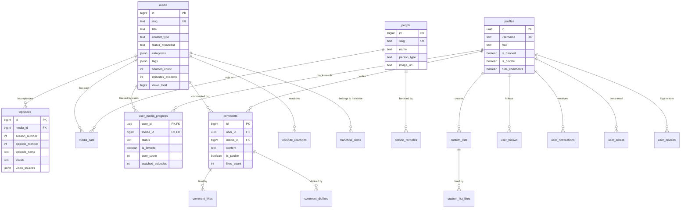

# 08 — Veri Katmanı: Supabase, SQLite ve Cloudflare R2

KoUp platformunun veri omurgası; yüksek hacimli video kaynakları, anlık kullanıcı etkileşimleri, katalog aramaları ve sıfır gecikmeli oynatma taleplerini karşılamak üzere tasarlanmış **üç katmanlı hibrit bir depolama mimarisine** dayanır. Bu dokümanda yerel SQLite veritabanı (`webdrama_archive.db`), Cloudflare R2 nesne depolama katmanı ve Supabase PostgreSQL bulut veritabanının yapısı, tabloları, politikaları ve senkronizasyon mantığı tüm detaylarıyla açıklanmaktadır.

---

## İçindekiler
1. [Üç Katmanlı Hibrit Depolama Stratejisi](#1-üç-katmanlı-hibrit-depolama-stratejisi)
   - [Neden Üç Farklı Depolama Katmanı?](#neden-üç-farklı-depolama-katmanı)
   - [N=3 Kuralı ve Egress Bant Genişliği Optimizasyonu](#n3-kuralı-ve-egress-bant-genişliği-optimizasyonu)
2. [Supabase Veritabanı Mimarisi (PostgreSQL 17)](#2-supabase-veritabanı-mimarisi-postgresql-17)
   - [Kronolojik Migration Listesi](#kronolojik-migration-listesi)
   - [Varlık-İlişki Diyagramı (Mermaid ER)](#varlık-ilişki-diyagramı-mermaid-er)
   - [Supabase Tablo Referansı (38 Tablo)](#supabase-tablo-referansı-38-tablo)
   - [Veritabanı Fonksiyonları ve Stored Procedure'lar](#veritabanı-fonksiyonları-ve-stored-procedurelar)
   - [Güvenlik ve İzolasyon: SECURITY DEFINER ve Sabit search_path](#güvenlik-ve-izolasyon-security-definer-ve-sabit-search_path)
   - [Veritabanı Tetikleyicileri (Triggers)](#veritabanı-tetikleyicileri-triggers)
3. [Yerel SQLite Veritabanı (webdrama_archive.db)](#3-yerel-sqlite-veritabanı-webdrama_archivedb)
   - [SQLite Şema Yapısı ve Tablo Rolleri](#sqlite-şema-yapısı-ve-tablo-rolleri)
   - [Yüksek Başarımlı PRAGMA Yapılandırması ve WAL Modu](#yüksek-başarımlı-pragma-yapılandırması-ve-wal-modu)
   - [Bekleyen Kaynak Yönetimi (source_status: pending vs verified)](#bekleyen-kaynak-yönetimi-source_status-pending-vs-verified)
4. [Cloudflare R2 Nesne Depolama Mimarisi](#4-cloudflare-r2-nesne-depolama-mimarisi)
   - [R2 Bucket ve Anahtar Hiyerarşisi](#r2-bucket-ve-anahtar-hiyerarşisi)
   - [JSON Bundle Veri Şeması (`sources/{mediaId}.json`)](#json-bundle-veri-şeması-sourcesmediaidjson)
   - [Çok Kademeli Sunucu Veri Okuma Sırası (seriesData.ts)](#çok-kademeli-sunucu-veri-okuma-sırası-seriesdatats)
5. [İlgili Dokümanlar](#5-ilgili-dokümanlar)

---

## 1. Üç Katmanlı Hibrit Depolama Stratejisi

KoUp; geleneksel tek merkezli veritabanı tasarımlarından farklı olarak, her veri türünü en verimli olduğu katmanda işleyen 3 kademeli bir depolama mimarisi kullanır:

```
[ İnternet / Sağlayıcılar ]
           │
           ▼ (Kazıma & Otomasyon)
┌───────────────────────────────────────┐
│     1. Yerel SQLite Arşivi            │
│  (webdrama_archive.db - 15 Tablo)     │  <-- Tek Doğruluk Kaynağı (Master Truth)
│  - 32.500+ Dizi / Film / Anime        │      1M+ ham video linki, fansub eşleştirmeleri,
│  - 627.000+ Bölüm                     │      ilişkisel önbellekler, offline dedup işlemleri
│  - 1.050.000+ Video Kaynağı (Tümü)    │
└──────────────────┬────────────────────┘
                   │
         ┌─────────┴────────────────────────┐
         │ (WAL Checkpoint & JSON Export)   │ (DB Yedekleme: db/webdrama_archive.db)
         ▼                                  ▼
┌───────────────────────────────────────┐  ┌───────────────────────────────────────┐
│    2. Cloudflare R2 Nesne Depolama   │  │    3. Supabase Bulut Veritabanı      │
│  (R2 S3 Bucket - koup-archive)        │  │  (PostgreSQL 17 - 38 Tablo)          │
│  - sources/{mediaId}.json (32.700+)   │  │  - Kullanıcılar, Profiller, Oturumlar│
│  - Tam bölüm listeleri ve tüm akışlar │  │  - Yorumlar, Listeler, İlerleme      │
│  - Sıfır Egress Maliyeti (Zero-Cost)  │  │  - Hızlı Arama & Filtreleme İndeksleri│
│  - Edge CDN Önbellekleme (604.800s)   │  │  - Sadece En İyi N=3 Akış Kaynağı   │
└───────────────────────────────────────┘  └───────────────────────────────────────┘
```

### Neden Üç Farklı Depolama Katmanı?

1. **Supabase Kota ve Egress Tasarrufu:**
   - KoUp arşivinde 1 milyondan fazla doğrudan video embed/akış linki bulunmaktadır. Eğer her bölümün 10-15 farklı video sağlayıcısı (OK.ru, VidMoly, VK, Mail.ru, Tau-Video vb.) doğrudan Supabase PostgreSQL üzerindeki `episodes.video_sources` JSONB sütununa kaydedilseydi; veritabanı boyutu onlarca gigabayta fırlar, satır okuma başına çekilen JSON payload'ları PostgreSQL RAM önbelleğini tüketir ve Vercel/Supabase arasındaki egress (veri çıkış) kotaları hızla aşılırdı.
   - Bu nedenle Supabase yalnızca platformun operasyonel verilerini, arama motorunu ve **bölüm başına en yüksek kaliteli azami 3 kaynağı (N=3)** tutar.

2. **Cloudflare R2 ile Sınırsız ve Ücretsiz Egress:**
   - Cloudflare R2, AWS S3 API uyumlu bir nesne depolama servisidir ve **egress (çıkış bant genişliği) ücreti $0'dır**.
   - Her yapımın tüm bölümleri ve bu bölümlere ait eksiksiz tüm kaynak alternatifleri (15+ ayna dahil) `r2_bundles/sources/{mediaId}.json` olarak paketlenir ve R2'ye yüklenir.
   - Kullanıcı dizi detay sayfasına girdiğinde veya bölüm değiştirdiğinde bu statik JSON paketi Cloudflare küresel kenar ağından (CDN) milisaniyeler mertebesinde (ve istemciye sıfır Supabase bant genişliği maliyetiyle) servis edilir.

3. **Yerel SQLite: Hızlı Toplu İşlemler ve Ağ Bağımsız Tek Doğruluk Kaynağı:**
   - 32.000 yapım ve 627.000 bölüm üzerinde çalışan kazıyıcılar, tekilleştirme algoritmaları, ölü link temizleyicileri ve franchise grafiği hesaplayıcıları yüz binlerce SQL işlemi gerçekleştirir.
   - Bu toplu operasyonları uzaktaki bir bulut veritabanına network istekleriyle yapmak saatler sürer ve rate limitlere takılır. Yerel NVMe diskte çalışan SQLite WAL modu sayesinde saniyede on binlerce satır sorgulanıp güncellenebilir.
   - Güncelleme tamamlandığında veritabanı dosyasının kendisi (`db/webdrama_archive.db`) Cloudflare R2'ye yedeklenir.

### N=3 Kuralı ve Egress Bant Genişliği Optimizasyonu
[scripts/sync_all_episodes_to_supabase.py](../scripts/sync_all_episodes_to_supabase.py#L108-L131) dosyasında tanımlanan SQL sorgusunda:
```sql
WITH ranked AS (
    SELECT s.episode_id, s.source_name, s.direct_url, s.provider, s.site,
           ROW_NUMBER() OVER (
               PARTITION BY s.episode_id, COALESCE(s.provider, s.site, 'other')
               ORDER BY ...
           ) as rn
    FROM episode_sources s
    WHERE s.direct_url IS NOT NULL AND s.direct_url != 'dead' AND ...
),
capped AS (
    SELECT episode_id, source_name, direct_url, provider, site,
           ROW_NUMBER() OVER (
               PARTITION BY episode_id
               ORDER BY 
                   CASE 
                       WHEN provider = 'tau-video' OR direct_url LIKE '%tau-video%' THEN 0
                       WHEN direct_url LIKE '%.m3u8%' THEN 1
                       WHEN provider = 'asyawatch' OR direct_url LIKE '%pichive%' THEN 2
                       WHEN provider = 'dizilla' OR direct_url LIKE '%dplayer%' THEN 3
                       WHEN provider = 'rapidrame' OR provider = 'hdfilm-close' THEN 4
                       WHEN provider = 'vidmoly' THEN 5
                       WHEN provider = 'uqload' THEN 6
                       WHEN provider = 'youtube' THEN 7
                       ELSE 8 
                   END
           ) as ep_rn
    FROM ranked WHERE rn = 1
)
SELECT episode_id, source_name, direct_url, provider, site
FROM capped
WHERE ep_rn <= 3;
```
Bu sorgu ile her bölüm için sağlayıcı bazında tekilleştirme yapıldıktan sonra kalite önceliğine göre **en iyi ilk 3 kaynak (`ep_rn <= 3`)** seçilerek Supabase'e gönderilir. Kullanıcı daha fazla alternatif kaynak isterse R2 bundle'ından tüm kaynaklara anında erişebilir.

---

## 2. Supabase Veritabanı Mimarisi (PostgreSQL 17)

KoUp'ın bulut veritabanı, Frankfurt (eu-central-1) bölgesinde barındırılan PostgreSQL 17 motorudur. Bütün tablolar Row Level Security (RLS) ile korunmaktadır.

### Kronolojik Migration Listesi
`koup-app/supabase/migrations/` dizinindeki 18 adet SQL migration dosyası sırasıyla şunlardır:

1. `20261016160000_security_and_database_hardening.sql`:
   - Kapsamlı veritabanı sertleştirme, temel tabloların (`profiles`, `media`, `episodes`, `comments`, `custom_lists`, `user_media_progress`, `user_notifications`, `episode_reactions`) RLS politikalarının oluşturulması.
   - Admin ve moderatör yetkilendirme fonksiyonları (`is_admin()`, `is_moderator()`), güvenli profil tetikleyicileri (`handle_new_user()`, `protect_profile_role()`).
   - Yorum moderasyonu, spoyler gizleme ve temel performans indeksleri.
2. `20261016191400_allow_trusted_role_changes.sql`:
   - `protect_profile_role()` fonksiyonuna güvenli SQL editörü ve `service_role` bağlamı için rol güncelleme istisnası tanımlanması.
3. `20261016200000_moderation_and_two_tier_ban_system.sql`:
   - İki kademeli yasaklama mimarisi: Geçici/kalıcı hesap yasakları (`banned_until`, `ban_reason`) ve cihaz/ağ tabanlı `banned_fingerprints` tablosu.
   - `admin_ban_user()`, `admin_unban_user()`, `admin_warn_user()` fonksiyonları ve kullanıcı engelleme (`user_blocks`) sistemi.
4. `20261017030000_fuzzy_search_and_aka_enrichment.sql`:
   - `pg_trgm` ve `unaccent` eklentileriyle Türkçe karakter duyarsız bulanık katalog araması (`search_catalog()`).
   - Başlık ve slug'lardan alternatif isimlerin (`aka_titles`) otomatik çıkarılması ve `media.search_text` kolonunun tetikleyiciyle (`media_update_search_text`) güncellenmesi.
5. `20261018120000_automated_notifications_triggers.sql`:
   - Diziye yeni bölüm eklendiğinde takipçilere otomatik bildirim oluşturan `handle_new_episode_notification()` tetikleyicisi.
   - Takip edilen oyuncunun yeni yapımı girdiğinde çalışan `handle_actor_new_media_notification()` ve yoruma yanıt bildirimi.
6. `20261018120000_clean_junk_notifications_and_add_reply_trigger.sql`:
   - Yanlışlıkla üretilen kendi kendine bildirimlerin ("Yanıtınız Gönderildi" vb.) temizlenmesi ve yanıt tetikleyicisinin sadeleştirilmesi.
7. `20261018140000_server_side_comment_and_register_rate_limits.sql`:
   - Yorum ekleme hız limiti (`prepare_comment_insert`): Kullanıcı başına 30 saniyede azami 1 yorum kuralı ve küfür filtresi.
   - Cihaz bazlı çoklu hesap açılmasını engelleyen kayıt sınırlamaları.
8. `20261019050000_weekly_trending_top10.sql`:
   - Netflix tarzı haftalık en popüler 10 yapım hesaplama fonksiyonu (`get_weekly_top10()`).
   - `media_view_events` tablosu üzerinden 7 günlük kayan pencere ağırlıklı izlenme algoritması.
9. `20261019210000_add_hide_comments_and_library_privacy.sql`:
   - Kullanıcı profillerine kütüphane gizliliği (`is_private`) yanında yorum gizleme (`hide_comments`) bayrağının eklenmesi.
10. `20261019213000_secure_user_emails_and_profiles_rls.sql`:
    - Güvenlik ve KVKK/GDPR sertleştirmesi: Kullanıcı e-postalarının `public.profiles` tablosundan tamamen kaldırılarak sadece `auth.uid() = user_id` ile okunabilen korumalı `public.user_emails` tablosuna taşınması.
11. `20261019213500_allow_pending_source_episodes.sql`:
    - `public.episodes` tablosundaki `status` kısıtına `'pending_source'` durumunun eklenmesi ve indekslenmesi.
12. `20261020045000_optimize_search_catalog.sql`:
    - `search_catalog()` fonksiyonunun 40ms altına indirilmesi; arama sorgularındaki gereksiz exception bloklarının ve unaccent maliyetinin optimize edilmesi.
13. `20261020180000_fix_top10_security_definer.sql`:
    - `get_weekly_top10()` fonksiyonunun anonim kullanıcılarda 403 Forbidden vermemesi için `SECURITY DEFINER` ve `GRANT EXECUTE TO anon, authenticated` izinlerinin verilmesi.
14. `20261021010000_fix_duplicate_episode_notifications.sql`:
    - Bölüm senkronizasyonunda mükerrer bildirim gitmesini ve okunmamış bildirim bayraklarının ezilmesini önleyen bildirim kilidi mantığı.
15. `20261023183500_rename_legacy_patch_media_metadata.sql`:
    - PostgREST PGRST203 aşırı yüklenmiş fonksiyon belirsizliğini gidermek için eski 12 parametreli `patch_media_metadata` fonksiyonunun `patch_media_metadata_legacy` olarak yeniden adlandırılması.
16. `20261024233000_series_requests_comment_locks_and_calendar_v2.sql`:
    - `series_requests` (kullanıcı dizi/film istekleri), `comment_locks` (spoyler ve tartışma kilitleme), `calendar_schedules` tablosu v2 geliştirmeleri.
17. `20261026160500_scraper_runs_logs_review_queue_and_domains.sql`:
    - Bot çalıştırma takibi (`scraper_runs`), canlı log akışı (`scraper_logs`), bot domain ayarları ve otomatik eşleşmeyen yapımlar için onay havuzu (`match_review_queue`).
18. `20261026175500_harden_scraper_configs_rls_and_optimize_indexes.sql`:
    - `scraper_configs` tablosu üzerindeki RLS politikalarının salt-admin seviyesine çekilmesi ve sorgu indekslerinin güçlendirilmesi.

---

### Varlık-İlişki Diyagramı (Mermaid ER)

Aşağıdaki diyagram KoUp Supabase veritabanındaki temel varlıklar arasındaki ilişkileri göstermektedir:



---

### Supabase Tablo Referansı (38 Tablo)

Veritabanındaki 38 tablonun işlevleri, güvenlik modelleri ve kritik sütunları 4 mantıksal kümede toplanmıştır:

#### A. Katalog ve Medya Tabloları (6 Tablo)

1. **`public.media`** (32.500+ satır):
   - **Amaç:** Platformdaki tüm dizi, film, anime ve Asya programlarının kanonik üst veri tablosudur.
   - **Önemli Kolonlar:** `id` (bigint PK), `slug` (text UK), `title` (text), `title_tr`, `title_en`, `native_title`, `aka_titles` (text[]), `content_type` (`dizi`, `film`, `anime`, `program`), `country_code` (`KR`, `JP`, `CN`, `TH` vb.), `release_year`, `episode_count`, `episodes_available`, `sources_count`, `status_broadcast` (`Devam Ediyor`, `Tamamlandı`), `cover_image`, `backdrop_image`, `overview`, `categories` (jsonb), `tags` (jsonb), `site_rating` (numeric), `site_rating_count` (int), `views_total` (bigint), `views_weekly` (bigint), `search_text` (tsvector/text).
   - **İndeksler:** `idx_media_slug`, `idx_media_content_type`, `idx_media_views_weekly`, `idx_media_search_text_gin`, `idx_media_aka_titles`.
   - **RLS:** `SELECT` herkese açık (`true`), `INSERT/UPDATE/DELETE` sadece yöneticilere (`is_admin()`).
   - **Tetikleyiciler:** `trg_media_search_text` (arama metnini günceller).

2. **`public.episodes`** (235.000+ satır):
   - **Amaç:** Yapımlara ait sezon ve bölüm kayıtlarını, en iyi N=3 akış alternatifini ve oynatıcı atlama sürelerini barındırır.
   - **Önemli Kolonlar:** `id` (bigint PK), `media_id` (bigint FK -> media.id), `season_number` (int), `episode_number` (int), `episode_name` (text), `episode_type` (`bolum`, `ozel`), `status` (`published`, `scheduled`, `broken`, `pending_source`), `scheduled_release_at` (timestamptz), `intro_start_sec`, `intro_end_sec`, `outro_start_sec`, `outro_end_sec`, `video_sources` (jsonb - azami 3 kaynak), `react_fire`, `react_cry`, `react_shock`, `react_angry`.
   - **İndeksler:** `idx_episodes_media_id`, `idx_episodes_media_season_ep`, `idx_episodes_pending_source` (status = 'pending_source').
   - **RLS:** `SELECT` herkese açık; `INSERT/UPDATE/DELETE` admin veya `service_role`. Reaksiyon sayaçları için `increment_episode_reaction()` fonksiyonu kullanılır.
   - **Tetikleyiciler:** `trg_new_episode_notification` (takipçilere yeni bölüm bildirimi gönderir), `trg_set_episode_content_type`.

3. **`public.people`** (93.000+ satır):
   - **Amaç:** Oyuncu, yönetmen, seslendirmen ve anime karakterlerinin kayıtları.
   - **Önemli Kolonlar:** `id` (bigint PK), `slug` (text UK), `name` (text), `native_name`, `person_type` (`actor`, `director`, `character`, `seiyuu`), `country_code`, `image_url`, `bio_tr`, `tmdb_id`, `anilist_id`, `mydramalist_url`, `gender`, `birth_date`.
   - **RLS:** Herkese açık okuma; yönetici yazma.

4. **`public.media_cast`** (176.000+ satır):
   - **Amaç:** Medya ile kişiler arasındaki ilişki tablosu (oyuncu kadrosu ve karakterler).
   - **Önemli Kolonlar:** `media_id` (bigint FK), `person_id` (bigint FK), `role_type` (`lead`, `support`, `guest`), `character_name`, `billing_order`, `voice_actor_name`, `voice_actor_image`.
   - **RLS:** Herkese açık okuma; yönetici yazma.
   - **Tetikleyiciler:** `trg_actor_new_media_notification` (oyuncuyu favorileyen kullanıcılara yeni dizi bildirimi).

5. **`public.media_relations`** (0 satır - dinamik franchise grafiği tarafından desteklenir):
   - **Amaç:** İki medya arasındaki doğrudan ilişkiler (prequel, sequel, spin-off, adaptation).

6. **`public.franchise_items`** (4.700+ satır):
   - **Amaç:** Seri Evreni & İzleme Sırası ilişkilerini temsil eder. AniList, MyDramaList ve TMDB koleksiyon verilerinden derlenir.
   - **Önemli Kolonlar:** `media_id` (bigint FK), `franchise_id` (text), `franchise_title` (text), `category` (`main`, `side`), `role_label` (Örn: "Sezon 1", "Film Devamı"), `watch_order` (int), `format` (`TV`, `Movie`, `OVA`), `release_year` (int). PK: `(media_id, franchise_id)`.
   - **RLS:** `Allow public read franchise_items` (`SELECT` açık).

---

#### B. Kullanıcı, Sosyal & Etkileşim Tabloları (14 Tablo)

7. **`public.profiles`**:
   - **Amaç:** Kullanıcı hesap profili. Auth.users ile 1:1 bağlıdır.
   - **Önemli Kolonlar:** `id` (uuid PK -> auth.users.id), `username` (text UK), `display_name`, `avatar_url`, `banner_url`, `bio`, `role` (`user`, `moderator`, `admin`), `is_banned` (boolean), `banned_until` (timestamptz), `ban_reason`, `warning_count`, `is_private` (boolean), `hide_comments` (boolean), `created_at`.
   - **RLS:** `Read public or own profile` (Genel okuma; gizli profiller sadece kendi sahibine ve adminlere açık), `Update own profile` (Sadece kendi profili).
   - **Tetikleyiciler:** `trg_protect_profile_role` (Kullanıcının kendi rolünü admin yapmasını kesinlikle engeller), `trg_protect_profile_moderation`.

8. **`public.user_emails`**:
   - **Amaç:** Kullanıcı e-postalarını `profiles` tablosundan izole ederek halka açık API'lerden gizler.
   - **Önemli Kolonlar:** `user_id` (uuid PK), `email` (text), `created_at`.
   - **RLS:** `User or admin read email` (`auth.uid() = user_id OR is_admin()`). Dışarıdan kimse başkasının e-postasını göremez.

9. **`public.user_media_progress`**:
   - **Amaç:** Kullanıcının dizi/film izleme durumu, favorisi, puanı ve izlediği bölümler.
   - **Önemli Kolonlar:** `user_id` (uuid PK), `media_id` (bigint PK), `status` (`watching`, `completed`, `plan_to_watch`, `dropped`, `on_hold`), `is_favorite` (boolean), `user_score` (1-10 arası tam sayı), `watched_episodes` (int), `last_season_num`, `last_episode_num`, `updated_at`.
   - **RLS:** Kullanıcı sadece kendi ilerlemesini ekler/günceller/siler; eğer profil gizli değilse diğer kullanıcılar da okuyabilir.
   - **Tetikleyiciler:** `trg_update_media_site_rating` (Kullanıcı puan verdiğinde `media.site_rating` otomatik yeniden hesaplanır).

10. **`public.comments`**:
    - **Amaç:** Dizi, bölüm, kişi veya magazin yazılarına yapılan yorumlar.
    - **Önemli Kolonlar:** `id` (bigint PK), `user_id` (uuid FK), `target_type` (`media`, `episode`, `person`, `magazine`), `media_id`, `season_number`, `episode_number`, `person_id`, `magazine_id`, `parent_id` (yanıt hiyerarşisi), `content` (text), `is_spoiler` (boolean), `is_pinned` (boolean), `is_deleted` (boolean), `likes_count`, `dislikes_count`, `created_at`.
    - **RLS:** Genel okuma; sadece kendi yorumunu ekleme/silme.
    - **Tetikleyiciler:** `trg_prepare_comment_insert` (rate limit kontrolü), `trg_protect_comment_moderation` (moderatör alanlarını koruma), `trg_comment_reply_notification` (yanıt bildirimi).

11. **`public.comment_likes`** & **`public.comment_dislikes`**:
    - **Amaç:** Yorum beğenileri ve beğenmemeleri.
    - **Tetikleyiciler:** `trg_comment_like_count` ve `trg_comment_dislike_count` ile sayaçlar otomatik artar/azalır.

12. **`public.comment_locks`**:
    - **Amaç:** Belirli bir dizinin, bölümün veya kişinin yorum alanını tartışmaya kapatma (kilit) tablosu.

13. **`public.custom_lists`**:
    - **Amaç:** Kullanıcıların oluşturduğu özel dizi/film listeleri.
    - **Önemli Kolonlar:** `id` (bigint PK), `user_id` (uuid FK), `slug` (text), `title` (text), `description`, `cover_image_url`, `visibility` (`public`, `unlisted`, `private`), `media_ids` (bigint[]), `likes_count`.

14. **`public.custom_list_likes`**: Liste beğenileri.
15. **`public.person_favorites`**: Kullanıcıların favorilediği oyuncular ve karakterler.
16. **`public.user_follows`**: Kullanıcıların takip ettiği diziler (`target_type = 'media'`).
17. **`public.user_notifications`**: Kullanıcı içi bildirim kutusu.
18. **`public.user_devices`**: Kullanıcı oturum açtığı cihazların parmak izi, tarayıcı ve OS bilgisi (oturum yönetimi).
19. **`public.user_blocks`**: Kullanıcıların birbirlerini engellemesi (engellenen kullanıcının yorumları gizlenir).
20. **`public.episode_reactions`**: Bölüm altındaki 4 emoji reaksiyonu (`fire`, `cry`, `shock`, `angry`).

---

#### C. İçerik, Magazin & Geri Bildirim Tabloları (5 Tablo)

21. **`public.magazine_posts`** (690+ yazı):
    - **Amaç:** Asya sineması, K-Drama haberleri, dizi incelemeleri ve magazin içerikleri.
    - **Önemli Kolonlar:** `id` (bigint PK), `slug` (text UK), `title`, `excerpt`, `content_html`, `featured_image`, `categories` (text[]), `tags` (text[]), `author_id`, `published_at`, `views_count`, `likes_count`.
22. **`public.magazine_likes`**: Magazin yazısı beğenileri.
23. **`public.calendar_schedules`** (1.950+ satır):
    - **Amaç:** Canlı yayın takvimindeki diziler, günleri ve saatleri.
24. **`public.broadcast_events`**:
    - **Amaç:** Site genelinde admin tarafından kullanıcılara gönderilen acil duyurular ve sistem bildirimleri.
25. **`public.issue_reports`**:
    - **Amaç:** Oynatıcı üzerinden kullanıcıların gönderdiği bozuk link, ses kayması veya altyazı hataları bildirimi.

---

#### D. Sistem, Moderasyon, Otomasyon & Kazıyıcı Tabloları (13 Tablo)

26. **`public.media_view_events`**:
    - **Amaç:** İzlenme sayacı olayları. Botları engellemek için `ip_hash` ve `viewer_key` ile tekilleştirilir. `trg_increment_media_views_on_event` ile `media.views_total` ve `views_weekly` sayaçlarını besler.
27. **`public.series_requests`**:
    - **Amaç:** Kullanıcıların platformda olmayan Asya yapımlarını talep etmesi. MyDramaList / TMDB linkiyle istek açılır.
28. **`public.banned_fingerprints`**:
    - **Amaç:** Ağır suistimal yapan kullanıcıların IP veya Canvas parmak izi bazında sisteme erişiminin engellenmesi.
29. **`public.admin_audit_log`**:
    - **Amaç:** Yönetici ve moderatörlerin yaptığı işlemlerin (rol değişimi, ban, içerik silme) denetim kaydı.
30. **`public.admin_jobs`**:
    - **Amaç:** Admin panelinden veya GitHub Actions üzerinden tetiklenen uzun süreli işlerin ilerleme ve log kaydı.
31. **`public.site_settings`**:
    - **Amaç:** Dinamik site ayarları (bakım modu, kayıt olma açık/kapalı, duyuru metinleri).
32. **`public.series_automations`**:
    - **Amaç:** Devam eden dizilerin periyodik olarak otomatik taranması ve yeni bölümlerinin çekilmesi için bağlanan kaynak konfigürasyonu.
    - **Önemli Kolonlar:** `media_id` (bigint UK), `title`, `slug`, `status_broadcast`, `connected_sites` (jsonb), `site_slugs` (jsonb), `is_active` (boolean), `last_synced_at`.
33. **`public.automation_runs`**:
    - **Amaç:** `cron_sync_pipeline.py` tarafından yürütülen 4 saatlik genel senkronizasyonların özet istatistikleri ve logları.
34. **`public.scraper_configs`**:
    - **Amaç:** Kazıyıcı botların (AsyaWatch, DiziKorea vb.) aktiflik durumu, cron takvimi ve başarı istatistikleri.
35. **`public.scraper_runs`**:
    - **Amaç:** Bulut ve yerel bot çalıştırmalarının tekil UUID (`id`), script adı, durum (`queued`, `running`, `completed`, `failed`) kaydı.
36. **`public.scraper_logs`**:
    - **Amaç:** Çalışan botların konsol çıktılarını satır satır ve gerçek zamanlı olarak admin paneline akıtan (`seq`, `level`, `line`) log tablosu.
37. **`public.match_review_queue`**:
    - **Amaç:** Kazıyıcının otomatik olarak %100 eşleştiremediği, benzerlik skoru eşik altında kalan yeni dizileri admin onayına sunan inceleme kuyruğu.

---

### Veritabanı Fonksiyonları ve Stored Procedure'lar

KoUp veritabanında kritik iş mantığı veritabanı fonksiyonları (PL/pgSQL) ile yürütülür:

- **`search_catalog(...)`**:
  - Türkçe transliterasyon (`unaccent`), boşluk duyarsızlaştırma ve `pg_trgm` benzerlik araması ile başlık, alternatif isim (`aka_titles`) ve slug eşleşmelerini 40ms altında döndürür.
- **`get_weekly_top10(content_type_filter, limit_count)`**:
  - Son 7 günün `media_view_events` tablosundaki tekil izlenmelerini ağırlıklandırarak haftalık trend ilk 10 listesini üretir.
- **`handle_new_user()`**:
  - `auth.users` tablosuna yeni bir kullanıcı kaydolduğunda tetiklenir; otomatik olarak `public.profiles` ve korumalı `public.user_emails` tablosunda satır oluşturur.
- **`is_admin()` & `is_moderator()`**:
  - Giriş yapmış kullanıcının (`auth.uid()`) `profiles` tablosundaki rolünü kontrol eden hafif SQL fonksiyonlarıdır.
- **`admin_apply_patches(p_patches)`**:
  - Admin panelinden toplu metadata güncelleme paketlerini atomik olarak uygular.
- **`prepare_comment_insert()`**:
  - Yorum eklenmeden önce çalışır; kullanıcının son yorumundan bu yana 30 saniye geçip geçmediğini (rate-limit) ve küfür kuralını denetler.

---

### Güvenlik ve İzolasyon: SECURITY DEFINER ve Sabit search_path

PostgreSQL'de bir fonksiyon `SECURITY DEFINER` olarak işaretlendiğinde, fonksiyonu çağıran kullanıcının değil, **fonksiyonu oluşturan süper kullanıcının yetkileriyle** çalışır.

> [!CAUTION] Güvenlik Prensibi: Mutable search_path Zafiyeti
> Eğer bir `SECURITY DEFINER` fonksiyonda `SET search_path` sabitlenmezse, kötü niyetli bir kullanıcı kendi şemasında sahte bir tablo veya fonksiyon tanımlayarak fonksiyonu kandırabilir ve yetki yükseltme (Privilege Escalation) saldırısı gerçekleştirebilir.

KoUp migration'larında oluşturulan tüm `SECURITY DEFINER` fonksiyonlar istisnasız:
```sql
CREATE OR REPLACE FUNCTION public.handle_new_user()
RETURNS trigger
LANGUAGE plpgsql
SECURITY DEFINER
SET search_path = public, auth, pg_temp
AS $$
...
```
şeklinde **sabit bir `search_path`** ile tanımlanmıştır. Bu sayede anonim veya yetkisiz istemciler sadece izin verilen işlevleri (Örn: izlenme sayacı artırma, profil oluşturma) güvenli şekilde tetikleyebilir; iç tablolara doğrudan müdahale edemez.

---

### Veritabanı Tetikleyicileri (Triggers)

| Tetikleyici Adı | Tablo | Zamanlama / Olay | Çalıştırdığı Fonksiyon | Görevi |
| :--- | :--- | :--- | :--- | :--- |
| `trg_media_search_text` | `media` | BEFORE INSERT / UPDATE | `media_update_search_text()` | Arama indeksini normalize edilmiş metinle doldurur. |
| `trg_new_episode_notification` | `episodes` | AFTER INSERT / UPDATE | `handle_new_episode_notification()` | Bölüm yayınlandığında (`status = 'published'`) takipçilere bildirim yollar. |
| `trg_actor_new_media_notification` | `media_cast` | AFTER INSERT | `handle_actor_new_media_notification()` | Oyuncuyu favorileyen kullanıcılara yeni dizi bildirimi yollar. |
| `trg_prepare_comment_insert` | `comments` | BEFORE INSERT | `prepare_comment_insert()` | Yorum hız limitini (30s) denetler. |
| `trg_protect_comment_moderation` | `comments` | BEFORE UPDATE | `protect_comment_moderation()` | Normal kullanıcıların moderatör alanlarını değiştirmesini engeller. |
| `trg_comment_reply_notification` | `comments` | AFTER INSERT | `handle_comment_reply_notification()` | Yorum yanıtlandığında üst yorum sahibine bildirim yollar. |
| `trg_protect_profile_role` | `profiles` | BEFORE UPDATE | `protect_profile_role()` | Kullanıcının kendi rolünü admin/moderatör yapmasını engeller. |
| `trg_protect_profile_moderation` | `profiles` | BEFORE UPDATE | `protect_profile_moderation_fields()` | Ban alanlarının yetkisiz değiştirilmesini engeller. |
| `trg_update_media_site_rating` | `user_media_progress` | AFTER INSERT / UPDATE / DELETE | `update_media_site_rating()` | Kullanıcı puan verdiğinde yapımın ortalama puanını günceller. |
| `on_media_view_event_inserted` | `media_view_events`| AFTER INSERT | `trg_increment_media_views_on_event()`| `media.views_total` ve `views_weekly` sayaçlarını artırır. |
| `trg_comment_like_count` | `comment_likes` | AFTER INSERT / DELETE | `update_comment_like_count()` | Yorum beğeni sayısını artırır/azaltır. |
| `trg_comment_dislike_count` | `comment_dislikes` | AFTER INSERT / DELETE | `update_comment_dislike_count()` | Yorum beğenmeme sayısını günceller. |
| `trg_person_fav_count` | `person_favorites` | AFTER INSERT / DELETE | `update_person_fav_count()` | Kişi favori sayısını günceller. |
| `trg_custom_list_like_count` | `custom_list_likes` | AFTER INSERT / DELETE | `update_custom_list_like_count()` | Liste beğeni sayısını günceller. |
| `trg_magazine_like_count` | `magazine_likes` | AFTER INSERT / DELETE | `update_magazine_like_count()` | Magazin beğeni sayısını günceller. |

---

## 3. Yerel SQLite Veritabanı (webdrama_archive.db)

KoUp platformundaki tüm dizi, bölüm ve video kaynaklarının **orijinal ve tam arşivi**, proje kökündeki yerel `webdrama_archive.db` SQLite veritabanında saklanır. Bu veritabanı harici ağ gecikmelerinden bağımsız olarak saniyede on binlerce okuma/yazma işlemi gerçekleştirebilir.

### SQLite Şema Yapısı ve Tablo Rolleri

Yerel SQLite veritabanı 15 tablodan oluşur:

1. **`dramas`** (32.589 satır):
   - Arşivdeki tüm yapımların ana kataloğudur.
   - Sütunlar: `id` (INTEGER PK AUTOINCREMENT), `slug` (UNIQUE), `title`, `native_title`, `source_url` (UNIQUE), `mydramalist_url`, `anilist_url`, `anilist_id`, `tmdb_id`, `imdb_id`, `cover_image`, `backdrop_image`, `country`, `country_name`, `release_year`, `episode_count`, `episodes_available`, `sources_count`, `status_broadcast`, `status_translation`, `overview`, `categories` (JSON string), `tags` (JSON string), `content_type` (`dizi`, `film`, `anime`), `alt_sites` (JSON string), `created_at`, `updated_at`.
   - İndeksler: `idx_dramas_slug`, `idx_dramas_title`, `idx_dramas_title_nocase`, `idx_dramas_content_type`, `idx_dramas_sources_count`, `idx_dramas_anilist_id`.

2. **`episodes`** (627.402 satır):
   - Dizilere ait tüm sezon ve bölümleri tutar.
   - Sütunlar: `id` (INTEGER PK), `drama_id` (INTEGER FK -> dramas.id ON DELETE CASCADE), `season_number`, `episode_number`, `episode_name`, `episode_url` (UNIQUE), `episode_type` (`bolum`, `ozel`), `sources_scraped` (INTEGER), `source_status` (TEXT: `'pending'` veya `'verified'`), `pending_since` (TEXT), `last_source_check` (TEXT), `source_check_attempts` (INTEGER), `created_at`.
   - İndeksler: `idx_episodes_drama_id`, `idx_episodes_drama_ep`, `idx_episodes_url`, `idx_episodes_source_status`, `idx_episodes_pending_recheck`.

3. **`episode_sources`** (1.051.483 satır):
   - Bölümlere ait tüm video kaynakları, embed kodları ve doğrudan akış bağlantılarıdır.
   - Sütunlar: `id` (INTEGER PK), `episode_id` (INTEGER FK -> episodes.id ON DELETE CASCADE), `source_name` (Örn: "OK.ru", "VidMoly"), `embed_id`, `ajax_embed_url`, `direct_url`, `provider` (Örn: "ok.ru", "vidmoly", "asyawatch", "tau-video"), `fansub` (Örn: "DiziKorea", "AsyaDizi"), `site` (Kaynak site), `created_at`.
   - Benzersizlik: `UNIQUE(episode_id, embed_id)`.
   - İndeksler: `idx_sources_episode_id`, `idx_sources_direct_url`, `idx_sources_fansub`.

4. **`actors`** (15.558 satır):
   - Oyuncuların yerel arşiv profil tablosu (`slug`, `name`, `profile_url`, `mydramalist_url`, `image_url`, `native_name`, `bio_tr`, `tmdb_id`, `anilist_id`).
5. **`drama_actors`** (42.435 satır):
   - Dizi ile oyuncu arasındaki ilişki tablosu (`drama_id`, `actor_id`, `character_name`).
6. **`franchise_items`** (4.724 satır):
   - Seri Evreni & İzleme Sırası ilişkilerinin yerel önbellek tablosudur (`media_id`, `franchise_id`, `watch_order`, `category`, `format`, `role_label`).
7. **`series_automations`** (4 satır):
   - Yerel otomasyon motoru tarafından takip edilen diziler ve bağlı site slug konfigürasyonları.
8. **`site_done`** (75.615 satır):
   - Kazıyıcıların daha önce tarayıp başarıyla işlediği URL'lerin kaydıdır (`site`, `url`). Mükerrer HTTP isteklerini önler.
9. **İlişkisel Önbellek Tabloları:**
   - `anilist_cache` (6.982 satır): AniList GraphQL sorgu yanıtları.
   - `anilist_relations_cache` (6.351 satır): Anime devam sezonları ve film ilişkileri.
   - `mdl_cache` (3.273 satır): MyDramaList dizi üst verileri.
   - `mdl_relations_cache` (4.327 satır): K-Drama ve Asya dizisi sezon/özel bölüm bağlantıları.
   - `tmdb_movie_collections` (8.306 satır): TMDB film serisi koleksiyonları.

---

### Yüksek Başarımlı PRAGMA Yapılandırması ve WAL Modu

KoUp platformunda SQLite bağlantıları [database.py](../database.py#L7-L14) üzerinden standart ve optimize edilmiş parametrelerle açılır:

```python
def get_connection():
    conn = sqlite3.connect(DB_PATH, timeout=120.0)
    conn.execute("PRAGMA journal_mode=WAL;")
    conn.execute("PRAGMA synchronous=NORMAL;")
    conn.execute("PRAGMA busy_timeout=120000;")
    conn.execute("PRAGMA temp_store=MEMORY;")
    conn.execute("PRAGMA cache_size=-64000;")
    return conn
```

#### Bu PRAGMA Ayarlarının Gerekçeleri:

1. **`PRAGMA journal_mode=WAL;` (Write-Ahead Logging):**
   - Varsayılan Rollback Journal modunda bir yazma işlemi tüm veritabanını kilitler ve okuyucuları engeller.
   - **WAL modunda okuyucular yazarları, yazarlar da okuyucuları engellemez.** Çok sayıda paralel kazıyıcı veya Next.js API rotası veritabanını okurken arka planda yeni bölümler rahatlıkla yazılabilir.
   - Çökme dayanıklılığı (Crash Resilience) sağlar; ani kapanmalarda veritabanı bozulmaz.
2. **`PRAGMA synchronous=NORMAL;`:**
   - WAL modunda `NORMAL` ayarı, her yazma işleminde diske anlık `fsync` yapma zorunluluğunu kaldırarak sadece kritik WAL checkpoint anlarında diske yazar. Bu, NVMe SSD ömrünü korur ve yazma hızını 10 kata kadar artırır.
3. **`PRAGMA busy_timeout=120000;` (120 Saniye):**
   - SQLite veritabanı yoğun yazma altında meşgulken (`SQLITE_BUSY`) anında hata fırlatmak yerine 120 saniyeye kadar kuyrukta bekler. Bu sayede eşzamanlı bot çalışmalarında kilitlenme hataları sıfıra iner.
4. **`PRAGMA temp_store=MEMORY;`:**
   - Geçici sıralama tabloları, `ORDER BY` ve `JOIN` işlemlerinin geçici dosyaları RAM üzerinde tutulur.
5. **`PRAGMA cache_size=-64000;`:**
   - SQLite için 64 megabaytlık (`-64000 KB`) geniş bir bellek önbelleği ayırır. Sık sorgulanan indeks sayfaları doğrudan RAM'de kalır.

---

### Bekleyen Kaynak Yönetimi (source_status: pending vs verified)

Birçok video sitesinde yeni bir bölümün sayfası açılır ancak çevirisi veya video linki henüz hazır değildir ("Bu bölümü sizler için hazırlıyoruz", "Yakında yüklenecektir" vb.).

[scrapers/pending_sources.py](../scrapers/pending_sources.py) modülü bu durumları tespit eder ve yönetir:

```
[ Kazıyıcı Bölüm Sayfasına Ulaşır ]
                │
                ▼
  [ HTML İncelemesi: page_is_placeholder() ]
                │
       ┌────────┴────────┐
       ▼ (Evet)          ▼ (Hayır)
[ Kaynak Boş / Placeholder ]    [ Oynatılabilir Kaynak Bulundu ]
       │                                     │
       ▼                                     ▼
source_status = 'pending'             source_status = 'verified' (veya NULL)
pending_since = NOW()                 pending_since = NULL
last_source_check = NOW()             last_source_check = NOW()
source_check_attempts += 1            (Supabase: status = 'published')
(Supabase: status = 'pending_source')
```

#### Tespit Kriterleri (`page_is_placeholder`):
- Sayfa metninde yüksek güvenilirlikli kalıplar aranır:
  `"sizler için hazırlıyoruz"`, `"çeviri ve player linki eklendiğinde"`, `"video henüz eklenmedi"`, `"altyazı hazırlanıyor"`, `"yakında yüklenecek"`, `"coming soon"`, `"translation in progress"`.
- Contextual Regex: `"yakında"` veya `"hazırlanıyor"` kelimelerinin `"bölüm"`, `"video"`, `"player"` kelimelerine 60 karakter mesafede olup olmadığı denetlenir.

#### Periyodik Kontrol ve Kurtarma:
- `source_status = 'pending'` olan bölümler `scripts/recheck_pending_episodes.py` ve `cron_sync_pipeline.py` tarafından belirli aralıklarla (en son kontrolden itibaren 4 saat sonra) tekrar ziyaret edilir.
- Çeviri veya video yüklendiği anda bölümün `source_status` değeri temizlenir ve Supabase üzerinde `status = 'published'` yapılarak kullanıcılara anlık bildirim (`handle_new_episode_notification`) fırlatılır.

---

## 4. Cloudflare R2 Nesne Depolama Mimarisi

Cloudflare R2, KoUp platformunun statik JSON paketlerini ve veritabanı arşiv yedeğini küresel ölçekte ve sıfır egress ücretiyle sunan nesne depolama katmanıdır.

### R2 Bucket ve Anahtar Hiyerarşisi

KoUp R2 bucket adı `koup-archive` (ortam değişkeni `CF_R2_BUCKET`) olup klasör hiyerarşisi şu şekildedir:

```
koup-archive/
│
├── db/
│   └── webdrama_archive.db           <-- Ana SQLite arşivinin sıkıştırılmış/atomik yedeği (>10MB)
│
├── sources/
│   ├── 1.json                        <-- mediaId = 1 olan yapımın tüm bölüm ve akış JSON paketi
│   ├── 2.json
│   ├── ...
│   └── 32709.json                    <-- Toplam 32.700+ statik dizi/film paketi
│
├── franchise_graph.json              <-- Tüm platformun Seri Evreni ve İzleme Sırası ilişkisel grafiği
│
└── posters/ (opsiyonel)              <-- Ön belleğe alınan afiş ve arka plan görselleri
```

#### İlgili Ortam Değişkenleri:
- `CF_R2_ENDPOINT`: Cloudflare S3 uyumlu uç nokta URL'si.
- `CF_R2_ACCESS_KEY_ID`: R2 API erişim anahtarı.
- `CF_R2_SECRET_ACCESS_KEY`: R2 gizli erişim anahtarı.
- `CF_R2_BUCKET`: `koup-archive` (varsayılan bucket adı).
- `R2_PUBLIC_URL`: R2 CDN genel erişim URL'si.

---

### JSON Bundle Veri Şeması (`sources/{mediaId}.json`)

[scripts/export_sources_bundles.py](../scripts/export_sources_bundles.py) scripti ile üretilen her bir yapım paketi aşağıdaki JSON veri yapısına sahiptir:

```json
{
  "mediaId": 1000,
  "totalEpisodes": 5,
  "episodes": [
    {
      "id": 11165,
      "season_number": 1,
      "episode_number": 1,
      "episode_name": "Bölüm 1",
      "episode_type": "bolum",
      "status": "published",
      "scheduled_release_at": null,
      "translation_note": null,
      "react_fire": 12,
      "react_cry": 0,
      "react_shock": 2,
      "react_angry": 0,
      "sources": [
        {
          "source_name": "Tau Video",
          "embed_id": "tau_a8f9b2c3",
          "direct_url": "https://tau-video.xyz/embed/...",
          "provider": "tau-video",
          "site": "animecix",
          "fansub": null,
          "stream_type": "tau",
          "quality_label": "1080p Doğrudan Akış"
        },
        {
          "source_name": "Orijinal",
          "embed_id": "aw_987654",
          "direct_url": "https://asyawatch.tv/stream/...",
          "provider": "asyawatch",
          "site": "asyawatch",
          "fansub": null,
          "stream_type": "hls",
          "quality_label": "1080p"
        },
        {
          "source_name": "Vidmoly",
          "embed_id": "vm_123456",
          "direct_url": "https://vidmoly.to/embed-...",
          "provider": "vidmoly",
          "site": "dizifon",
          "fansub": null,
          "stream_type": "hls",
          "quality_label": "1080p"
        }
      ]
    }
  ]
}
```

#### Alan Tanımları:
- `stream_type`:
  - `"hls"`: Doğrudan m3u8 manifest linki veya HLS oynatıcı (Hls.js / NetflixPlayer ile yerel oynatılır).
  - `"mp4"`: Doğrudan MP4 video dosyası.
  - `"tau"`: AnimeciX / Tau-Video yerel akış motoru.
  - `"locked_iframe"`: Harici sandbox iframe korumalı oynatıcı.
- `quality_label`: Arayüzdeki kaynak menüsünde görünen rozet ("1080p", "1080p Doğrudan Akış", "HD Embed").
- **YouTube Kuralı:** Eğer bölümde en az 1 adet oynatılabilir alternatif kaynak varsa, YouTube linki gizlenir. Bölümün başka hiçbir alternatifi yoksa YouTube kaynağı menüde tutulur ve kullanıcıya "YouTube'da Aç" seçeneği sunulur.

---

### Çok Kademeli Sunucu Veri Okuma Sırası (seriesData.ts)

Next.js Server-Side Rendering (SSR) ve ISR süreçlerinde bölüm listeleri [koup-app/src/lib/server/seriesData.ts](../koup-app/src/lib/server/seriesData.ts#L208-L289) içerisindeki 4 kademeli geri dönüş (fallback) mimarisiyle yüklenir:

```
[ İstemci Dizi Sayfasına İstek Atar ]
                 │
                 ▼
 ┌─────────────────────────────────────────────────────────┐
 │ Tier 0: Yerel Disk Bundle (0.2ms gecikme)               │
 │ r2_bundles/sources/{mediaId}.json var mı?               │
 └─────────────────────────┬───────────────────────────────┘
            Bulundu        │ Bulunamadı
            ┌──────────────┴──────────────┐
            ▼                             ▼
    [ Veriyi Hemen Döndür ] ┌─────────────────────────────────────────────┐
                            │ Tier 1: Cloudflare R2 Authenticated S3      │
                            │ s3Client.send(new GetObjectCommand(...))    │
                            └─────────────────────┬───────────────────────┘
                                       Bulundu    │ Bulunamadı / Hata
                                       ┌──────────┴──────────┐
                                       ▼                     ▼
                               [ Veriyi Döndür ] ┌────────────────────────────────────────┐
                                                 │ Tier 1.1: Cloudflare R2 Public CDN     │
                                                 │ fetch("${R2_PUBLIC_URL}/sources/...")  │
                                                 └──────────────────┬─────────────────────┘
                                                        Bulundu     │ Zaman aşımı / 404
                                                        ┌───────────┴──────────┐
                                                        ▼                      ▼
                                                [ Veriyi Döndür ] ┌───────────────────────────────┐
                                                                  │ Tier 2: Supabase Fallback     │
                                                                  │ client.from('episodes')       │
                                                                  │ .select('..., video_sources') │
                                                                  └───────────────────────────────┘
```

1. **Tier 0 (Yerel Disk - 0.2ms):** Geliştirme ortamında veya Next.js standalone container'ında `r2_bundles/sources/{mediaId}.json` diskte mevcutsa doğrudan okunur. Ağ gecikmesi sıfırdır.
2. **Tier 1 (R2 S3 Client - 15-25ms):** Vercel Serverless ortamında AWS SDK S3 istemcisi ile R2 bucket'ından authenticated GET işlemi yapılır.
3. **Tier 1.1 (R2 Public CDN):** S3 kimlik bilgileri tanımlı değilse Cloudflare R2'nin Edge CDN URL'sine 5 saniye zaman aşımlı (`AbortSignal.timeout(5000)`) ve Next.js revalidate (`{ next: { revalidate: 3600 } }`) HTTP GET isteği atılır.
4. **Tier 2 (Supabase Fallback):** R2'de henüz JSON paketi oluşturulmamış çok yeni bir diziyse, son çare olarak Supabase `episodes` tablosundaki `video_sources` JSONB sütunundan en iyi 3 kaynak çekilerek kullanıcıya sunulur.

---

## 5. İlgili Dokümanlar

- **[01-genel-bakis-ve-mimari.md](./01-genel-bakis-ve-mimari.md):** Üç katmanlı mimarinin genel sistem diyagramları ve Vercel-Cloudflare-Supabase veri akışı.
- **[05-oynatici-ve-yayin-akisi.md](./05-oynatici-ve-yayin-akisi.md):** NetflixPlayer bileşeni, HLS akışları ve stream proxy mimarisi.
- **[06-api-referansi.md](./06-api-referansi.md):** `/api/sources/[mediaId]` ve `/api/series-detail` uç noktalarının yanıt şemaları.
- **[07-kimlik-yetki-ve-guvenlik.md](./07-kimlik-yetki-ve-guvenlik.md):** Supabase Auth, RLS politikaları, roller ve parmak izi ban mekanizması.
- **[09-kaziyicilar-scriptler-ve-senkron.md](./09-kaziyicilar-scriptler-ve-senkron.md):** Kazıyıcılar, yönetim scriptleri ve 5 adımlı tam senkronizasyon zinciri.
- **[12-kurallar-ve-yasaklar.md](./12-kurallar-ve-yasaklar.md):** Veritabanı ve arşiv düzenlemelerinde tek halkayı güncelleyip bırakma yasağı ve gerekçeleri.
