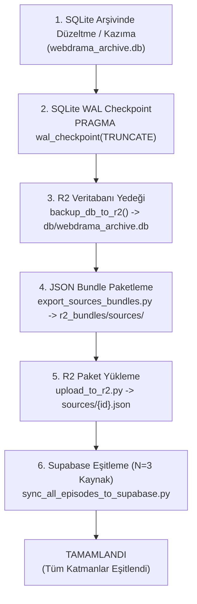

# 09 — Kazıyıcılar, Yönetim Scriptleri ve Senkronizasyon Zinciri

KoUp platformunun içerik zenginliği, Asya ve dünya genelindeki yüzlerce streaming kaynağından veri çeken gelişmiş **kazıyıcı motorlara (scrapers)**, arşiv sağlığını koruyan **yönetim scriptlerine (scripts)** ve tüm veriyi SQLite, Cloudflare R2 ve Supabase arasında tutarlı tutan **5 adımlı tam senkronizasyon zincirine** dayanır. Bu dokümanda tüm kazıyıcı motorlar, 63 bakım scripti, arka plan otomasyonları ve senkronizasyon protokolü ayrıntılı olarak belgelenmiştir.

---

## İçindekiler
1. [Kazıyıcılar (scrapers/) Mimarisi ve Site Motorları](#1-kazıyıcılar-scrapers-mimarisi-ve-site-motorları)
   - [Kök Dizin Kazıyıcı ve Yardımcı Modülleri](#kök-dizin-kazıyıcı-ve-yardımcı-modülleri)
   - [Siteler (scrapers/sites/)](#siteler-scraperssites)
   - [Dikey ve Kısa Diziler (scrapers/shortdrama/)](#dikey-ve-kısa-diziler-scrapersshortdrama)
   - [Cloudflare ve Bot Koruması Bypass Yöntemi: curl_cffi](#cloudflare-ve-bot-koruması-bypass-yöntemi-curl_cffi)
   - [Gerekli Ortam Değişkenleri](#gerekli-ortam-değişkenleri)
2. [Tüm Yönetim Scriptleri Kataloğu (scripts/ - 63 Script)](#2-tüm-yönetim-scriptleri-kataloğu-scripts---63-script)
3. [Önemli Kalıcı Araçlar ve Scriptlerin Detaylı İncelemesi](#3-önemli-kalıcı-araçlar-ve-scriptlerin-detaylı-i̇ncelemesi)
   - [cron_sync_pipeline.py](#cron_sync_pipelinepy)
   - [export_sources_bundles.py](#export_sources_bundlespy)
   - [upload_to_r2.py](#upload_to_r2py)
   - [sync_all_episodes_to_supabase.py](#sync_all_episodes_to_supabasepy)
   - [series_automation_runner.py](#series_automation_runnerpy)
   - [sync_single_series_runner.py](#sync_single_series_runnerpy)
   - [run_logger.py](#run_loggerpy)
   - [purge_dead_sources_full.py](#purge_dead_sources_fullpy)
   - [merge_duplicates.py ve merge_all_duplicates.py](#merge_duplicatespy-ve-merge_all_duplicatespy)
   - [build_franchise_graph.py](#build_franchise_graphpy)
   - [backup_db_to_r2() Fonksiyonu](#backup_db_to_r2-fonksiyonu)
4. [Tam Senkronizasyon Zinciri (The Full Storage Sync Protocol)](#4-tam-senkronizasyon-zinciri-the-full-storage-sync-protocol)
   - [Senkronizasyon Akış Şeması (Mermaid Flowchart)](#senkronizasyon-akış-şeması-mermaid-flowchart)
   - [Adım Adım Çalıştırma Komutları](#adım-adım-çalıştırma-komutları)
   - [Neden Tek Halkayı Güncelleyip Bırakmak Kesinlikle Yasaktır?](#neden-tek-halkayı-güncelleyip-bırakmak-kesinlikle-yasaktır)
5. [Otomasyon ve Arka Plan Çalıştırıcıları](#5-otomasyon-ve-arka-plan-çalıştırıcıları)
   - [GitHub Actions İş Akışları](#github-actions-iş-akışları)
   - [Next.js Admin API Tetikleme Mimarisi (scraperDispatch.ts)](#nextjs-admin-api-tetikleme-mimarisi-scraperdispatchts)
   - [Supabase Canlı İzleme Akışı (scraper_runs, scraper_logs, match_review_queue)](#supabase-canlı-i̇zleme-akışı-scraper_runs-scraper_logs-match_review_queue)
6. [Veri ve Rapor Klasörleri](#6-veri-ve-rapor-klasörleri)
7. [İlgili Dokümanlar](#7-ilgili-dokümanlar)

---

## 1. Kazıyıcılar (scrapers/) Mimarisi ve Site Motorları

KoUp kazıyıcı katmanı, farklı sitelerdeki video akışlarını, altyazıları, bölüm numaralarını ve dizi üst verilerini dinamik olarak tarayıp yerel SQLite arşivi (`webdrama_archive.db`) ile eşleştiren modüler bir mimariye sahiptir.

```
                      [ scrapers/ ]
                            │
   ┌────────────────────────┼────────────────────────┐
   ▼                        ▼                        ▼
[ Kök Modüller ]    [ scrapers/sites/ ]     [ scrapers/shortdrama/ ]
- live_scanner.py   - dizipal.py            - dramabox.py
- sync_target.py    - diziizle.py           - dramavadisi.py
- multisite.py      - webdramaturkey.py     - shortizle.py
- matching.py       - animelvl.py           - koredizi.py
- pending_sources   - sezonlukdizi.py       - common.py
- supabase_sync     - tranimaci_anizm.py
```

### Kök Dizin Kazıyıcı ve Yardımcı Modülleri

1. **`scrapers/live_scanner.py`** (2.439 satır):
   - **Amaç:** KoUp platformunun evrensel canlı tarayıcısıdır.
   - **İşleyiş:** AsyaWatch, DiziKorea, DiziFon, DiziBox, Dizilla, AnimeciX, DDizi, HDFilmcehennemi ve WebDramaTurkey sitelerinin "Son Eklenen Bölümler" sayfalarını eşzamanlı olarak tarar.
   - **Veri Akışı:** Yeni bölüm bulunduğunda `multisite.py` üzerinden `dramas` ve `episodes` eşleştirmesi yapar; video embed/akış linkini `episode_sources` tablosuna yazar ve `supabase_sync_helper.py` ile anlık senkronizasyon olayını (`__ITEM__`) fırlatır.

2. **`scrapers/sync_target_drama.py`** (2.447 satır):
   - **Amaç:** Belirli bir diziyi tüm sezon ve bölümleriyle derinlemesine tarayan tekil senkronizasyon motorudur.
   - **İşleyiş:** Parametre olarak verilen `drama_id` veya başlık için hedef sitelerde arama yapar. Eksik bölümleri otomatik oluşturur (`match_or_create_episode`) ve tüm video sağlayıcılarını sisteme kazır.
   - **Özellik:** CLI'dan veya Next.js Admin Panelinden (`/api/admin/sync-series`) tetiklenebilir; stdout üzerinden `__LOG__`, `__ITEM__` ve `__RESULT__` JSON formatında canlı akış çıktısı üretir.

3. **`scrapers/sync_hdfilm_target.py`** (491 satır):
   - **Amaç:** HDFilmcehennemi üzerinden film ve yabancı dizi senkronizasyonunu yönetir.
   - **İşleyiş:** Sitenin Cloudflare korumasını `curl_cffi` ile aşar; Rapidrame, VidMoly, HD-Close oynatıcılarını ve doğrudan m3u8 playlistlerini çözer.

4. **`scrapers/multisite.py`** (776 satır):
   - **Amaç:** Çok siteli birleştirme ve tekilleştirme motorudur.
   - **İşleyiş:** Farklı sitelerden gelen bölüm isimlerini normalize eder ("1. Sezon 5. Bölüm", "S01E05", "5. Bolum" -> Season 1, Episode 5). `match_or_create_episode()` fonksiyonu ile mükerrer bölüm oluşmasını engeller. SQLite WAL kilitlenmelerini önleyen 120 saniyeye kadar exponential backoff retry mekanizmasına (`_retry`) sahiptir.

5. **`scrapers/matching.py`** (269 satır):
   - **Amaç:** Akıllı Dizi & Film Eşleştirme Motorudur.
   - **İşleyiş:** Dizi başlıklarını Levenshtein mesafesi, SequenceMatcher, Türkçe karakter sadeleştirmesi (`_TR_MAP`), yayın yılı ve alternatif isim havuzuna göre karşılaştırarak %85 üzeri benzerlikte doğru yapımla eşleştirir.

6. **`scrapers/pending_sources.py`** (344 satır):
   - **Amaç:** Henüz oynatılabilir video linki eklenmemiş taslak/placeholder sayfaları tespit eder ve `source_status = 'pending'` olarak işaretler. (Bkz. [08-veri-katmani.md §3](./08-veri-katmani.md#bekleyen-kaynak-yönetimi-source_status-pending-vs-verified)).

7. **`scrapers/domain_resolver.py`** (185 satır):
   - **Amaç:** Alan adı sık sık değişen sitelerin (Örn: Dizipal, Diziİzle, WebDramaTurkey) güncel adreslerini otomatik tespit eder ve `data/domains_cache.json` dosyasına yazar.

8. **`scrapers/clean_fansub.py`** (99 satır):
   - **Amaç:** Kazınan kaynak isimlerindeki Discord davet linklerini, site URL uzantılarını ve gereksiz reklam etiketlerini temizler.

9. **`scrapers/translator.py`** (673 satır):
   - **Amaç:** AniList, TMDB ve MyDramaList üzerindeki İngilizce özetleri Türkçeye çevirir ve tür/etiket zenginleştirmesi yapar.

10. **`scrapers/stream_resolver.py`** (502 satır):
    - **Amaç:** Embed oynatıcı iframe'lerinden doğrudan `.m3u8` ve `.mp4` video URL'lerini çıkaran evrensel çözücüdür. (Ayrıntılı çözücü akışı ve player analizleri için bkz. [05-oynatici-ve-yayin-akisi.md](./05-oynatici-ve-yayin-akisi.md)).

11. **`scrapers/supabase_sync_helper.py`** (1.461 satır):
    - **Amaç:** Kazıyıcılar ile bulut katmanı arasındaki köprüdür.
    - **İçerik:** `backup_db_to_r2()`, `download_db_from_r2()`, `upload_to_r2()`, `sb_request()` (Supabase PostgREST istemcisi) ve `sync_drama_bundle_and_counts()` fonksiyonlarını barındırır.

12. **`scrapers/auto_heal_archive_gaps.py`** (213 satır):
    - **Amaç:** Bölüm numaralarında atlama (gap) olan dizileri tespit ederek eksik kalan bölümleri alternatif sağlayıcılardan tamamlar; belirli aralıklarla `backup_db_to_r2()` çağırır.

---

### Siteler (scrapers/sites/)

- **`animelvl.py`** (359 satır): AnimeLVL sitesinden Türkçe altyazılı anime bölümlerini ve video embed kodlarını çeker.
- **`diziizle.py`** (797 satır): DiziIzle.wiki üzerinden Asya dizilerini, canlı yayın takvimini ve doğrudan video akışlarını kazır.
- **`dizipal.py`** (663 satır): Dizipal'in güncel dinamik domainini takip eder; yabancı dizileri ve sinema filmlerini `curl_cffi` ile kazır.
- **`fullhdfilmizlesene.py`** (368 satır): Film kataloğunu, Türkçe dublaj ve altyazı alternatiflerini çeker.
- **`sezonlukdizi.py`** (430 satır): SezonlukDizi arşivinden çoklu video player kaynaklarını (DPlayer, VidMoly) toplar.
- **`tranimaci_anizm.py`** (400 satır): TrAnimaci ve Anizm sitelerindeki Türkçe anime bölümlerini AniList ID'leri ile eşleştirerek kazır.
- **`webdramaturkey.py`** (700 satır): WebDramaTurkey2 sitesinden dikey ve kısa Asya dizilerini çeken uzman motordur.

---

### Dikey ve Kısa Diziler (scrapers/shortdrama/)

Kısa bölümlü (1-3 dakikalık) dikey diziler özel bir önbellek ve süre yapısı gerektirir:
- **`common.py`** (702 satır): Kısa diziler için token üretimi, dikey video oranı tespiti ve süre hesaplama yardımcıları.
- **`dramabox.py`** (428 satır): DramaBox dikey dizilerini eşleştiren ve arşivleyen kazıyıcı.
- **`dramavadisi.py`** (396 satır): DramaVadisi sitesinden Türkçe dublajlı/altyazılı mini dizileri çeker.
- **`koredizi.py`** (327 satır): KoreDizi platformu üzerinden üyelik oturumu (`KOREDIZI_EMAIL`, `KOREDIZI_PASSWORD`) kullanarak özel Kore web dramalarını kazır.
- **`shortizle.py`** (425 satır): Shortİzle sitesinden dikey formatlı video kaynaklarını çeker.

---

### Cloudflare ve Bot Koruması Bypass Yöntemi: curl_cffi

Geleneksel Python `requests` veya `urllib` kütüphaneleri, Cloudflare Bot Management ve Turnstile koruması olan sitelerde (Örn: HDFilmcehennemi, Dizipal, FullHDFilmizlesene) standart TLS parmak izi (Client Hello paketindeki JA3/JA4 imzası) nedeniyle anında HTTP 403 Forbidden veya Cloudflare Challenge ekranına takılır.

KoUp kazıyıcıları bu engeli aşmak için **`curl_cffi`** kütüphanesini kullanır:

```python
from curl_cffi import requests as cfr

session = cfr.Session(impersonate="chrome120")
response = session.get(
    target_url,
    headers={
        "Referer": base_url,
        "Accept-Language": "tr-TR,tr;q=0.9,en-US;q=0.8",
    },
    timeout=15
)
```

#### Neden curl_cffi?
1. **Gerçek Tarayıcı TLS Parmak İzi (JA3/JA4 Spoofing):** `impersonate="chrome120"` parametresi ile OpenSSL yerine Google Chrome 120 sürümünün TLS şifreleme süitlerini (Cipher Suites, ALPN uzantıları, TLS Extension sıralaması) birebir taklit eder. Cloudflare bu istekleri gerçek bir Chrome tarayıcıdan ayırt edemez.
2. **HTTP/2 ve HTTP/3 Framing:** Headless tarayıcı (Puppeteer/Playwright) çalıştırmanın getirdiği yüksek RAM ve CPU maliyeti olmadan saf C tabanlı libcurl hızıyla çalışır.
3. **Session Cookie Persistence:** Cloudflare tarafından set edilen `cf_clearance` ve oturum çerezlerini session içinde saklayarak sonraki tüm sayfa isteklerine otomatik iliştirir.

---

### Gerekli Ortam Değişkenleri

> [!IMPORTANT] Gizli Anahtar İzolasyonu (Zero Hardcoded Secrets)
> Kod dosyalarının veya dokümanların içerisine asla gerçek API anahtarları veya şifreler yazılmaz. Kazıyıcılar ve scriptler kimlik bilgilerini yalnızca ortam değişkenlerinden okur.

- `NEXT_PUBLIC_SUPABASE_URL`: Supabase API uç noktası.
- `SUPABASE_SERVICE_ROLE_KEY`: Veritabanı ve RLS işlemlerini yürüten yetkili sunucu anahtarı.
- `CF_R2_ENDPOINT`: Cloudflare R2 S3 uyumlu endpoint.
- `CF_R2_ACCESS_KEY_ID`: Cloudflare R2 erişim anahtarı.
- `CF_R2_SECRET_ACCESS_KEY`: Cloudflare R2 gizli anahtarı.
- `CF_R2_BUCKET`: R2 bucket adı (`koup-archive`).
- `R2_PUBLIC_URL`: R2 CDN genel erişim URL'si.
- `TMDB_API_KEY`: The Movie Database API v3 anahtarı.
- `KOREDIZI_EMAIL` & `KOREDIZI_PASSWORD`: KoreDizi platformu giriş bilgileri.
- `GITHUB_TOKEN`: Vercel üzerinden GitHub Actions bulut işçilerini tetiklemek için kullanılan erişim belirteci.

---

## 2. Tüm Yönetim Scriptleri Kataloğu (scripts/ - 63 Script)

Aşağıdaki tablo, `scripts/` dizini altında bulunan tüm bakım, denetim, onarım, tekilleştirme ve senkronizasyon araçlarının kapsamlı kataloğudur:

| Script Dosyası | Kategori | İşlevi ve Kapsamı | Hedef Katman | Araç Niteliği |
| :--- | :---: | :--- | :---: | :---: |
| `admin_apply_catalog_patch.py` | sync | Admin panelinden yapılan katalog düzeltmelerini SQLite, R2 ve Supabase'e tam zincirle senkronize eder. | SQLite + R2 + Supabase | Kalıcı Araç |
| `audit_catalog.py` | audit | Arşivdeki mükerrer slug ve başlıkları listeler. | Salt Okuma / Stdout | Tek Seferlik Teşhis |
| `audit_engine.py` | audit | 24.000+ yapımın TMDB, AniList ve MDL ID eksikliklerini denetleyen teşhis motoru. | Salt Okuma / Stdout | Tek Seferlik Teşhis |
| `audit_sequence_gaps.py` | audit | Sezon içerisinde eksik olan bölüm numaralarını (ör. 1, 2, 4 -> 3 eksik) tespit eder. | Salt Okuma / Stdout | Tek Seferlik Teşhis |
| `backfill_episode_gaps.py` | backfill | Eksik tespit edilen bölümleri alternatif sitelerden arayarak veritabanına ekler. | SQLite + Supabase | Tek Seferlik Onarım |
| `backfill_pending_tags.py` | backfill | Sıfır kaynağı olan bölümleri toplu olarak `source_status = 'pending'` şeklinde etiketler. | SQLite + Supabase | Tek Seferlik Onarım |
| `backfill_phase3.py` | backfill | Faz 3 sitelerinden (DiziBox, DiziPal vb.) eksik dizileri arşive kazır. | Salt Okuma / Stdout | Tek Seferlik Onarım |
| `backfill_phase4.py` | backfill | Faz 4 sitelerinden (AnimeciX, TrAnimaci) anime bölümlerini arşive tamamlar. | Salt Okuma / Stdout | Tek Seferlik Onarım |
| `backfill_shortdrama.py` | backfill | Dikey kısa drama sağlayıcılarından (DramaBox, DramaVadisi) toplu bölüm çeker. | Supabase | Tek Seferlik Onarım |
| `build_franchise_graph.py` | sync | AniList, MDL ve TMDB verilerinden Seri Evreni & İzleme Sırası ilişkilerini derler. | SQLite + R2 + Supabase | Kalıcı Araç |
| `check_automation_logs.py` | inspect | Supabase `automation_runs` tablosunu okuyarak son bot çalışmalarının durumunu raporlar. | Supabase | Tek Seferlik Teşhis |
| `check_invalid_sources.py` | inspect | Geçersiz protokol (`javascript:`, boş string vb.) içeren kaynakları listeler. | Salt Okuma / Stdout | Tek Seferlik Teşhis |
| `check_misnumbered_singles.py`| inspect | Tek bölümlük yapımlarda (film vb.) bölüm numarası hatalarını denetler. | Salt Okuma / Stdout | Tek Seferlik Teşhis |
| `check_palemoon_details.py` | inspect | Pale Moon dizisine ait kaynak durumunu ve video linklerini inceler. | Salt Okuma / Stdout | Tek Seferlik Teşhis |
| `clean_and_heal_archive_ids.py`| heal | Arşivdeki geçersiz veya sahte AniList/TMDB ID'lerini temizleyip doğrularıyla değiştirir. | SQLite + R2 + Supabase | Kalıcı Araç |
| `clean_competitor_slugs.py` | heal | Rakip site uzantılarını (`-izle`, `-dizibox`, `-korea`) slug ve başlıklardan temizler. | SQLite + R2 + Supabase | Tek Seferlik Onarım |
| `cron_sync_pipeline.py` | cron | Her 4 saatte bir çalışan ana otomasyon boru hattı; yeni bölümleri tarar, eksikleri çözer. | SQLite + R2 + Supabase | Kalıcı Araç |
| `enrich_all_characters.py` | heal | Anime karakterlerinin diğer bilinen adlarını (`also_known_as`) AniList'ten çeker. | Supabase | Tek Seferlik Onarım |
| `enrich_missing_metadata.py` | heal | Eksik kalan poster, arka plan, özet ve yayın yılı bilgilerini API'lerden tamamlar. | SQLite + Supabase | Kalıcı Araç |
| `export_full_koup_backup.py` | export | SQLite veritabanı, Supabase tabloları ve R2 nesnelerinin tam güvenlik yedeğini alır. | SQLite + R2 + Supabase | Kalıcı Araç |
| `export_sources_bundles.py` | export | SQLite'taki tüm kaynakları `r2_bundles/sources/{mediaId}.json` statik paketlerine dönüştürür. | R2 | Kalıcı Araç |
| `fetch_franchise_metadata.py` | inspect | AniList GraphQL API üzerinden devam sezonu ve film ilişkilerini sorgular. | SQLite | Tek Seferlik Teşhis |
| `find_dead_gap_stubs.py` | inspect | Toplam bölümü az ama bölüm numarası çok yüksek olan hatalı taslakları bulur. | Salt Okuma / Stdout | Tek Seferlik Teşhis |
| `fix_episode_title_icons.py` | heal | Bölüm adlarında kalan emoji, kazıyıcı kalıntıları ve çöp metinleri temizler. | SQLite | Tek Seferlik Onarım |
| `heal_all_gaps_comprehensive.py` | heal | Tüm arşivdeki bölüm boşluklarını tespit edip otomatik olarak tamamlayan kapsamlı motor. | SQLite + R2 + Supabase | Tek Seferlik Onarım |
| `heal_and_purge_phantom_gaps.py`| heal | Gerçekte var olmayan hayali bölüm kayıtlarını (phantom gaps) arşivden siler. | SQLite + Supabase | Tek Seferlik Onarım |
| `heal_ongoing_and_gaps.py` | heal | Devam eden dizilerin yayınlanan yeni bölümlerini kontrol edip eksikleri onarır. | SQLite | Tek Seferlik Onarım |
| `heal_remaining_anime_ids.py` | heal | Eşleşmemiş kalan animelere doğrudan AniList ID'si bağlar ve bölümlerini eşitler. | SQLite + R2 + Supabase | Tek Seferlik Onarım |
| `heal_sequence_gaps.py` | heal | Belirli bir yapım kümesinde sıralama boşluklarını giderir. | SQLite + R2 + Supabase | Tek Seferlik Onarım |
| `heal_short_drama_posters.py` | heal | DramaVadisi ve DramaBox'ın engellenen görsel linklerini R2'ye yükleyerek iyileştirir. | SQLite + R2 + Supabase | Tek Seferlik Onarım |
| `inspect_daha17.py` | inspect | "Daha 17" adlı diziye ait bölüm ve kaynak kayıtlarını inceler. | Salt Okuma / Stdout | Tek Seferlik Teşhis |
| `inspect_dizikorea_samdalri.py`| inspect | Welcome to Samdal-ri dizisinin DiziKorea üzerindeki kaynaklarını inceler. | Salt Okuma / Stdout | Tek Seferlik Teşhis |
| `inspect_dk_page.py` | inspect | DiziKorea sayfalarındaki iframe ve player etiketlerini analiz eder. | Salt Okuma / Stdout | Tek Seferlik Teşhis |
| `inspect_duplicates.py` | inspect | Aynı yapımın birden fazla kopyasını başlık ve yıla göre listeler. | Salt Okuma / Stdout | Tek Seferlik Teşhis |
| `inspect_gapped_sample.py` | inspect | Denetim raporundaki örnek boşluklu dizileri (`#486`, `#1106`, `#1184`) inceler. | Salt Okuma / Stdout | Tek Seferlik Teşhis |
| `inspect_gaps_sample.py` | inspect | Rastgele seçilen 10 dizide bölüm atlaması olup olmadığını test eder. | Salt Okuma / Stdout | Tek Seferlik Teşhis |
| `inspect_palemoon.py` | inspect | Pale Moon dizisine ait HTML kaynaklarını ve player scriptlerini çözümler. | Salt Okuma / Stdout | Tek Seferlik Teşhis |
| `inspect_samdalri.py` | inspect | Samdal-ri dizisinin yerel SQLite üzerindeki bölüm ve kaynak sayılarını kontrol eder. | Salt Okuma / Stdout | Tek Seferlik Teşhis |
| `inspect_zero_source.py` | inspect | Kataloğunda bölümü olan ancak sıfır kaynak barındıran dizileri listeler. | Salt Okuma / Stdout | Tek Seferlik Teşhis |
| `live_multi_search.py` | inspect | AsyaWatch, DiziFon, DiziKorea, AnimeciX ve DiziBox üzerinde eşzamanlı canlı arama yapar. | Salt Okuma / Stdout | Kalıcı Araç |
| `match_unmatched_series.py` | inspect | Başlığı eşleşmeyen dizileri AniList arama API'si ile fuzzy karşılaştırır. | SQLite + Supabase | Tek Seferlik Onarım |
| `merge_all_duplicates.py` | merge | Supabase üzerindeki mükerrer aktör ve karakterleri birleştirir, rolleri aktarır. | Supabase | Kalıcı Araç |
| `merge_duplicate_actors.js` | merge | Node.js tabanlı aktör tekilleştirme motorudur. | Supabase | Tek Seferlik Onarım |
| `merge_duplicates.py` | merge | SQLite üzerindeki mükerrer dizileri birleştirir; bölümleri ve kaynakları aktarır. | SQLite + R2 + Supabase | Kalıcı Araç |
| `merge_sqlite_actors.py` | merge | SQLite `actors` tablosundaki kopya kayıtları birleştirip `drama_actors` ilişkilerini taşır. | SQLite | Tek Seferlik Onarım |
| `populate_anime_cast.py` | heal | AniList üzerinden anime seslendirmenlerini ve karakterlerini Supabase'e aktarır. | Supabase | Tek Seferlik Onarım |
| `purge_dead_sources_full.py` | purge | Tüm arşivdeki ölü video kaynaklarını asenkron olarak doğrulayıp temizleyen kalıcı motor. | SQLite | Kalıcı Araç |
| `purge_dead_voe_sources.py` | purge | VOE (voe.sx) sağlayıcısındaki silinmiş veya süresi dolmuş linkleri temizler. | SQLite + R2 + Supabase | Tek Seferlik Onarım |
| `purge_js_sources.py` | purge | Hatalı `javascript:false;` veya `void(0)` içeren kaynak satırlarını siler. | SQLite + Supabase | Tek Seferlik Onarım |
| `purge_palemoon.py` | purge | Pale Moon dizisine ait hatalı kayıtları SQLite ve R2'den arındırır. | SQLite + R2 | Tek Seferlik Onarım |
| `purge_zero_source_dramas.py`| purge | Hiçbir bölümü veya oynatılabilir kaynağı bulunmayan hayalet dizileri temizler. | SQLite + R2 + Supabase | Tek Seferlik Onarım |
| `recheck_pending_episodes.py` | inspect | Bekleyen (`pending`) etiketli bölümleri sağlayıcı sitelerde yeniden sorgular. | SQLite + Supabase | Kalıcı Araç |
| `recover_and_heal_sources.py` | heal | Ölü veya silinmiş kaynakları AnimeciX (Tau-Video) ve AsyaWatch'tan yeniden çeker. | SQLite + Supabase | Tek Seferlik Onarım |
| `run_batch_recovery_current.py`| inspect | Mevcut sağlayıcılardan toplu kaynak kurtarma denemesini koşturur. | Salt Okuma / Stdout | Tek Seferlik Teşhis |
| `run_logger.py` | cron | Kazıyıcı ve otomasyon scriptlerinin konsol loglarını Supabase'e canlı akıtan wrapper. | Supabase | Kalıcı Araç |
| `series_automation_runner.py` | cron | Devam eden dizileri takip edip yeni bölümlerini otomatik ekleyen periyodik motor. | R2 + Supabase | Kalıcı Araç |
| `sync_all_episodes_to_supabase.py` | sync | SQLite'taki tüm bölümleri en iyi N=3 kaynakla Supabase `episodes` tablosuna aktarır. | Supabase | Kalıcı Araç |
| `sync_cast_hierarchy.py` | sync | Oyuncu kadrosundaki başrol (`lead`) ve yan rol sıralamasını düzenler. | Supabase | Tek Seferlik Onarım |
| `sync_metadata_total_episodes.py` | sync | Yapımların `episodes_available` ve `sources_count` sayaçlarını yeniden hesaplar. | SQLite + Supabase | Tek Seferlik Onarım |
| `sync_real_calendars.py` | sync | DiziKorea yayın takvimini kazıyarak `calendar_schedules` tablosunu günceller. | Supabase | Kalıcı Araç |
| `sync_single_series_runner.py` | sync | Tek bir diziyi parametrik olarak çekip canlı güncelleyen GitHub Actions/CLI aracı. | SQLite + Supabase | Kalıcı Araç |
| `sync_vercel_env.py` | sync | Vercel ortam değişkenlerini senkronize eden yardımcı script. | R2 + Supabase | Tek Seferlik Yardımcı |
| `upload_to_r2.py` | sync | `r2_bundles/sources/` klasöründeki tüm JSON paketlerini 40 iş parçacığıyla R2'ye yükler. | R2 | Kalıcı Araç |

---

## 3. Önemli Kalıcı Araçlar ve Scriptlerin Detaylı İncelemesi

Aşağıdaki kalıcı araçlar, KoUp veri operasyonlarının ve senkronizasyonunun omurgasını oluşturur:

---

### `cron_sync_pipeline.py`

- **Ne İşe Yarar:** Platformun ana otomasyon boru hattıdır. Her 4 saatte bir GitHub Actions üzerinden (`scraper_cron.yml`) veya Admin panelinden çalıştırılır. Yeni bölümleri tespit eder, bekleyen kaynakları çözümler, takvimi günceller ve veritabanı yedeğini R2'ye aktarır.
- **Nasıl Çalışır:**
  1. `ensure_database_ready()` ile `webdrama_archive.db` dosyasını kontrol eder; yoksa R2'den indirir.
  2. Aktif botları (`scraper_configs`) denetler; AsyaWatch, DiziKorea, DiziFon, DiziBox, Dizilla, AnimeciX, WebDramaTurkey üzerinde yeni içerik taraması yapar.
  3. `recheck_pending_episodes` adımında `source_status = 'pending'` olan bölümleri tekrar ziyaret eder.
  4. Yeni dizi eklenmişse `merge_duplicates` ile tekilleştirme yapar ve `build_franchise_graph` ile izleme sırası grafiğini günceller.
  5. İşlem bitiminde SQLite üzerinde `PRAGMA wal_checkpoint(TRUNCATE);` çalıştırır ve `backup_db_to_r2()` çağırarak veritabanını Cloudflare R2'ye yükler.
  6. İstatistik ve logları Supabase `public.automation_runs` tablosuna yazar.
- **Neden Böyle:** Parçalı ve bağımsız çalışan onlarca bot yerine tek bir orkestratör altında kontrol, loglama ve hata yönetimi sağlamak için boru hattı mimarisi kurulmuştur.
- **Kısıtlar & Yasaklar:** Boru hattı çalışırken doğrudan SQLite dosyası kopyalanamaz veya silinemez; WAL checkpoint yapılması zorunludur.
- **Bağımlılıklar:** `database.py`, `scrapers.multisite`, `scrapers.supabase_sync_helper`, `automation_runs` tablosu.
- **Çalıştırma Komutu Örneği:**
  ```bash
  python scripts/cron_sync_pipeline.py --target all --pending-limit 150 --batch-dramas 30 --trigger manual
  ```

---

### `export_sources_bundles.py`

- **Ne İşe Yarar:** Yerel SQLite veritabanındaki 32.500+ yapımın tüm bölüm ve video kaynaklarını Cloudflare R2 için optimize edilmiş statik JSON paketlerine (`r2_bundles/sources/{mediaId}.json`) dönüştürür.
- **Nasıl Çalışır:**
  - `webdrama_archive.db` tablosundaki `dramas`, `episodes` ve `episode_sources` tablolarını birleştirir.
  - Video linklerini sınıflandırır (`classify_stream_type`: hls, mp4, tau, locked_iframe).
  - Kalite ve stabiliteye göre sağlayıcı önceliği (`get_provider_priority`) uygular.
  - YouTube Kuralını işletir: Eğer bölümde en az 1 adet alternatif oynatılabilir kaynak varsa YouTube kaynağını gizler; tek kaynaksa kullanıcıya buton olarak sunar.
  - Çıktıyı `r2_bundles/sources/{mediaId}.json` dosyasına yazar.
- **Neden Böyle:** Supabase'in 1 milyon satırlık video link yüküyle şişmesini önlemek ve kullanıcılara 0.2ms - 20ms arasında sıfır egress maliyetiyle tüm kaynakları sunmak için bu paketleme zorunludur.
- **Bağımlılıklar:** `webdrama_archive.db`, `scrapers.clean_fansub`.
- **Çalıştırma Komutu Örneği:**
  ```bash
  python scripts/export_sources_bundles.py
  ```

---

### `upload_to_r2.py`

- **Ne İşe Yarar:** Yerelde üretilen `r2_bundles/sources/*.json` paketlerini Cloudflare R2 `koup-archive` bucket'ına yükler.
- **Nasıl Çalışır:**
  - `boto3` S3 istemcisi ve `ThreadPoolExecutor(max_workers=40)` ile 40 iş parçacığı üzerinden paralel upload gerçekleştirir.
  - Her dosya için HTTP `Cache-Control: public, max-age=604800, stale-while-revalidate=86400` başlığını set eder (7 gün tarayıcı/CDN önbelleği, 1 gün arka plan tazeleme).
  - İsteğe bağlı `--ids-file` parametresi ile sadece güncellenen belirli dizi ID'lerinin paketlerini yükleyebilir (diferansiyel yükleme).
- **Bağımlılıklar:** `CF_R2_ENDPOINT`, `CF_R2_ACCESS_KEY_ID`, `CF_R2_SECRET_ACCESS_KEY`, `CF_R2_BUCKET`.
- **Çalıştırma Komutu Örneği:**
  ```bash
  # Tüm paketleri yükle (40 worker)
  python scripts/upload_to_r2.py --workers 40

  # Sadece değişen belirli yapımları yükle
  python scripts/upload_to_r2.py --ids-file affected_ids.json
  ```

---

### `sync_all_episodes_to_supabase.py`

- **Ne İşe Yarar:** Yerel SQLite veritabanındaki 627.000 bölümü, filtrelenmiş ve en kaliteli **azami 3 kaynakla (N=3)** Supabase `public.episodes` tablosuna aktarır.
- **Nasıl Çalışır:**
  - PostgreSQL SQL pencereleme fonksiyonları (`ROW_NUMBER() OVER (...)`) ile her bölüm için Tau-Video, doğrudan HLS, AsyaWatch ve Dizilla öncelikli ilk 3 kaynağı hafızaya alır.
  - Ölü hostları (`sibnet`, `sendvid`, `pixeldrain`, Google Drive, `uns.bio`, `javascript:`) eler.
  - Supabase REST API üzerinden 1.000'lik toplu paketler (`batch upsert`) halinde `episodes` tablosuna yazar.
- **Neden Böyle:** Canlı sitenin fallback mekanizması için Supabase'de temel oynatılabilir kaynakların bulunması gerekir ancak veritabanı boyutunun küçük tutulması şarttır.
- **Bağımlılıklar:** `webdrama_archive.db`, `NEXT_PUBLIC_SUPABASE_URL`, `SUPABASE_SERVICE_ROLE_KEY`.
- **Çalıştırma Komutu Örneği:**
  ```bash
  python scripts/sync_all_episodes_to_supabase.py
  ```

---

### `series_automation_runner.py`

- **Ne İşe Yarar:** Devam eden dizilerin yeni bölümlerini belirli aralıklarla bağlı sitelerden (AsyaWatch, DiziKorea, DiziFon, DiziBox, Dizilla, AnimeciX, DDizi, HDFilm) otomatik çeker.
- **Nasıl Çalışır:**
  - `series_automations` tablosundaki aktif dizileri ve site slug eşleştirmelerini okur.
  - Hedef siteleri tarayıp yeni bölüm numaralarını tespit eder.
  - Yeni bölüm bulduğunda SQLite'a ekler, bundle JSON dosyasını üretip R2'ye yükler ve Supabase `episodes` tablosunu günceller.
  - Admin paneli canlı izleme ekranı için `__LOG__`, `__ITEM__` ve `__RESULT__` formatında stdout çıktısı verir.
- **Çalıştırma Komutu Örneği:**
  ```bash
  # Tüm aktif serileri tara
  python scripts/series_automation_runner.py --all-active

  # Tek bir diziyi manuel tetikle
  python scripts/series_automation_runner.py --drama-id 1245
  ```

---

### `sync_single_series_runner.py`

- **Ne İşe Yarar:** GitHub Actions veya Admin Panelinden gelen tekil dizi senkronizasyon isteklerinin giriş noktasıdır.
- **Nasıl Çalışır:**
  - Bulut ortamındaysa SQLite veritabanını R2'den çeker (`download_db_from_r2`).
  - `scrapers/sync_target_drama.py` motorunu ilgili parametrelerle (`--drama-id`, `--provider`, `--manual-url`) alt süreç olarak başlatır.
  - Çalışma sırasında Supabase `public.admin_jobs` tablosundaki ilgili görevi `running`, `progress: 50%` ve log satırlarıyla günceller.
  - İşlem tamamlandığında R2 bundle yüklemesini ve R2 DB yedeğini tamamlayarak iş durumunu `completed` yapar.
- **Çalıştırma Komutu Örneği:**
  ```bash
  python scripts/sync_single_series_runner.py --drama-id 1245 --provider auto --job-id "uuid-1234"
  ```

---

### `run_logger.py`

- **Ne İşe Yarar:** Kazıyıcı veya arka plan scriptlerini sarmalayarak konsol çıktılarını anlık olarak Supabase `public.scraper_logs` ve `public.scraper_runs` tablolarına akıtan CLI ve kütüphane wrapper'ıdır.
- **Nasıl Çalışır:**
  - Alt süreci (`subprocess.Popen`) başlatır; stdout ve stderr akışlarını yakalar.
  - Log satırlarını regex ile analiz eder (`[EKLENDİ]`, `[GÜNCELLENDİ]`, `[HATA]`, `[DOĞRULANDI]`).
  - Logları 20 satırlık bloklar veya 1 saniyelik aralıklarla Supabase'e toplu (batch insert) yazar.
  - Script sonlandığında çıkış kodunu ve eklenen/güncellenen sayaçlarını `scraper_runs` tablosuna işler.
- **Çalıştırma Komutu Örneği:**
  ```bash
  python scripts/run_logger.py --script scrapers/live_scanner.py --target all --trigger admin
  ```

---

### `purge_dead_sources_full.py`

- **Ne İşe Yarar:** Arşivdeki tüm video linklerini asenkron HTTP HEAD/GET istekleriyle test eden ve **kesin olarak ölü olduğu teyit edilen kaynakları SQLite veritabanından temizleyen** kalıcı denetim motorudur.
- **Nasıl Çalışır:**
  - `mp4upload`, `uqload`, `vidmoly`, `vk.com`, `upns` gibi sağlayıcıları test eder.
  - Üçlü sınıflandırma uygular: `alive` (çalışıyor), `dead` (silinmiş/404/410/XFO-DENY), `unknown` (geçici timeout veya rate-limit). **Sadece kesin ölü (`dead`) olanlar silinir.**
  - Silme işleminden önce silinecek tüm satırları `deleted_sources_backup.jsonl` dosyasına yedekler.
  - SQLite'ı kilitlememek için azami 500'lük küçük parçalar (`chunks <= 500`) halinde siler ve her parçada commit atar; `VACUUM` çalıştırmaz.
- **Çalıştırma Komutu Örneği:**
  ```bash
  python scripts/purge_dead_sources_full.py --concurrency 30 --commit-interval 500
  ```

---

### `merge_duplicates.py` ve `merge_all_duplicates.py`

- **`merge_duplicates.py` (Dizi / Film Tekilleştirme):**
  - Başlık benzerliği, yayın yılı ve slug çakışmalarından kaynaklanan kopya yapımları tespit eder.
  - Ana yapımı belirler; kopya yapımın tüm sezon, bölüm ve kaynaklarını ana yapıma taşır.
  - Kopya kaydı SQLite ve Supabase'den siler; etkilenen yapımın R2 bundle'ını yeniden dışa aktarıp R2'ye yükler.
- **`merge_all_duplicates.py` (Kişi / Aktör Tekilleştirme):**
  - Supabase üzerindeki mükerrer aktör ve karakterleri (`slug-2`, `char-bulma-678` vb.) kanonik ana kayıt altında birleştirir.
  - `media_cast`, `comments`, `person_favorites` ve `magazine_posts` ilişkilerini birincil anahtar çakışması olmadan güvenle taşır.
  - `drama_count` değerlerini yeniden hesaplar.
- **Çalıştırma Komutları:**
  ```bash
  # Dizi tekilleştirme
  python scripts/merge_duplicates.py

  # Aktör/Karakter tekilleştirme
  python scripts/merge_all_duplicates.py
  ```

---

### `build_franchise_graph.py`

- **Ne İşe Yarar:** Platformdaki dizilerin devam sezonlarını, yan hikayelerini, film uyarlamalarını ve kronolojik izleme sıralarını hesaplayan **Seri Evreni (Franchise Graph)** motorudur.
- **Nasıl Çalışır:**
  - AniList GraphQL `Media.relations`, MyDramaList dizi ilişkileri ve TMDB Film Koleksiyonları verilerini tarar.
  - Yapımları kronolojik yayın yılı ve sezon/part numaralarına göre (`extract_order_markers`) sıralar.
  - Çıktıyı:
    1. SQLite `franchise_items` tablosuna yazar,
    2. `koup-app/src/data/franchise_graph.json` dosyasına kaydeder,
    3. Cloudflare R2'ye (`franchise_graph.json`) yükler,
    4. Supabase `public.franchise_items` tablosuna senkronize eder.
- **Çalıştırma Komutu Örneği:**
  ```bash
  python scripts/build_franchise_graph.py
  ```

---

### `backup_db_to_r2()` Fonksiyonu

Bu fonksiyon [scrapers/supabase_sync_helper.py](../scrapers/supabase_sync_helper.py#L163-L169) dosyasında tanımlanmıştır:

```python
def backup_db_to_r2() -> bool:
    """Backs up the local SQLite webdrama_archive.db file to R2 under db/webdrama_archive.db."""
    db_path = os.path.join(_ROOT, "webdrama_archive.db")
    if os.path.exists(db_path) and os.path.getsize(db_path) > 10_000_000:
        return upload_to_r2(db_path, "db/webdrama_archive.db")
    print(f"[R2_BACKUP_SKIPPED] Local DB file does not exist or is too small (<10MB).", flush=True)
    return False
```

- **Güvenlik Kontrolü:** Veritabanı dosyasının gerçekten var olduğunu ve boyutunun en az 10 Megabayttan (`> 10.000.000 bayt`) büyük olduğunu teyit eder. Boş veya bozulmuş bir veritabanının R2'deki sağlam yedeğin üzerine yazılmasını kesin olarak engeller.
- **Kullanım Kuralı:** SQLite üzerinde toplu bir işlem yapıldıktan sonra bu fonksiyon çağrılmadan önce **kesinlikle `PRAGMA wal_checkpoint(TRUNCATE);` çalıştırılmalıdır**. Aksi takdirde WAL dosyasında bekleyen son değişiklikler R2'ye yüklenen ana `.db` dosyasına yansımaz.

---

## 4. Tam Senkronizasyon Zinciri (The Full Storage Sync Protocol)

KoUp platformunda arşiv veritabanında (`webdrama_archive.db`) yapılan herhangi bir veri düzeltme, temizleme (purge), kaynak onarımı (heal), tekilleştirme (merge) veya yeni ekleme işlemi sonrasında yalnızca yerel veritabanında kalmak **kesinlikle yasaktır**. 

Yapılan değişikliklerin canlı sitede anında aktif olması ve veri bütünlüğünün korunması için **5 adımlı tam senkronizasyon zinciri** eksiksiz işletilmelidir:

### Senkronizasyon Akış Şeması (Mermaid Flowchart)



---

### Adım Adım Çalıştırma Komutları

Bir bakım veya onarım işlemi yapıldığında terminalden sırasıyla şu komutlar koşturulur:

#### Adım 1: SQLite Veritabanında Değişiklik Yapılması
İlgili onarım scripti çalıştırılır (Örn: ölü link temizliği veya dizi birleştirme):
```bash
python scripts/merge_duplicates.py
```

#### Adım 2: WAL Checkpoint (Değişikliklerin Ana DB Dosyasına Gömülmesi)
SQLite WAL dosyasındaki bekleyen yazma işlemlerini ana veritabanı dosyasına gömmek ve WAL dosyasını sıfırlamak için:
```bash
python -c "import sqlite3; c=sqlite3.connect('webdrama_archive.db'); c.execute('PRAGMA wal_checkpoint(TRUNCATE);'); c.close(); print('WAL Checkpoint Tamamlandi.')"
```

#### Adım 3: Cloudflare R2 Veritabanı Dosyası Yedeği
Güncellenen ana veritabanı dosyasını Cloudflare R2 üzerindeki `db/webdrama_archive.db` konumuna yüklemek için:
```bash
python -c "from scrapers.supabase_sync_helper import backup_db_to_r2; ok=backup_db_to_r2(); print('R2 DB Yedekleme Sonucu:', ok)"
```

#### Adım 4: R2 JSON Paketlerinin Yeniden Dışa Aktarılması
Etkilenen veya tüm dizilerin `r2_bundles/sources/{id}.json` paketlerini üretmek için:
```bash
python scripts/export_sources_bundles.py
```

#### Adım 5: JSON Paketlerinin Cloudflare R2'ye Yüklenmesi
Üretilen paketleri Cloudflare R2 `koup-archive` bucket'ına yüklemek için:
```bash
# Tüm paketleri 40 paralel işçiyle yükle:
python scripts/upload_to_r2.py --workers 40

# Veya sadece belirli yapımları yükle:
python scripts/upload_to_r2.py --ids-file affected_ids.json
```

#### Adım 6: Supabase Bölüm ve Kaynak Senkronizasyonu
Kullanıcıların canlı arama, bölüm listeleri ve mobil uç noktalarında güncel veriyi görmesi için en iyi N=3 kaynakla Supabase'i güncellemek:
```bash
python scripts/sync_all_episodes_to_supabase.py
```

---

### Neden Tek Halkayı Güncelleyip Bırakmak Kesinlikle Yasaktır?

> [!WARNING] Ağır Hata: Katmanlar Arası Veri Uyuşmazlığı ve Desenkronizasyon
> Bir geliştirici veya bot SQLite üzerinde bir hatayı düzeltip senkronizasyon zincirini yarıda bırakırsa sistem çöker:

1. **Canlı Site SQLite Dosyasını Değil, R2 ve Supabase'i Okur:**
   - Vercel üzerinde çalışan prodüksiyon sunucuları yerel SQLite dosyasına erişemez. Kullanıcı dizi sayfasına girdiğinde Cloudflare R2 üzerindeki `sources/{mediaId}.json` dosyasını çeker.
   - Eğer SQLite'ta ölü link temizlenmiş ama R2 paketi güncellenmemişse, kullanıcılar sitede **hala ölü ve çalışmayan linkleri** görür; yapılan onarım sıfır etki yaratır.
2. **Katalog ve Bölüm Sayısı Tutarsızlığı:**
   - Yeni bir bölüm kazındığında SQLite'a eklenir ancak Supabase `episodes` tablosuna aktarılmazsa; kullanıcı ana sayfada veya arama sonuçlarında "Bölüm sayısı: 12" görür ancak diziye tıkladığında 11 bölüm listelenir.
3. **Müteakip Senkronizasyonlarda Veri Kaybı:**
   - Eğer SQLite WAL checkpoint yapılmadan R2'ye yüklenirse, GitHub Actions bulut işçisi R2'den eski veritabanını indirir ve yerelde yapılan tüm düzeltmelerin üzerine eski veriyi yazar.
4. **Kural:**
   - **GEMINI.md Kural 10 uyarınca:** Zincirin 5 halkası (`SQLite` -> `WAL Checkpoint` -> `R2 DB Yedeği` -> `R2 JSON Paketleri` -> `Supabase`) eksiksiz tamamlanmadan hiçbir arşiv düzeltmesi "tamamlandı" sayılamaz ve git commit atılamaz.

---

## 5. Otomasyon ve Arka Plan Çalıştırıcıları

KoUp platformundaki kazıma ve senkronizasyon süreçleri; zamanlanmış cron görevleri, GitHub Actions bulut işçileri ve Next.js Admin Panelinden tetiklenen gerçek zamanlı arka plan servisleri ile yürütülür.

```
[ Zamanlanmış Cron (0 */4 * * *) ] ──┐
                                     │
[ Admin Paneli (/admin/scraper) ] ──┼──► [ koup-app/src/lib/server/scraperDispatch.ts ]
                                     │                     │
[ Tekil Dizi İstekleri ] ────────────┘                     │
                                           ┌───────────────┴───────────────┐
                                           ▼                               ▼
                             [ hasLocalPython() == True ]    [ Serverless / Vercel ]
                             (Yerel Python Alt Süreci)        (GitHub Actions API Tetikleme)
                                           │                               │
                                           ▼                               ▼
                              [ scripts/run_logger.py ]       [ .github/workflows/*.yml ]
                                           │                               │
                                           └───────────────┬───────────────┘
                                                           │
                                                           ▼
                                           [ Supabase: public.scraper_runs ]
                                           [ Supabase: public.scraper_logs ]
                                           [ Supabase: public.match_review_queue ]
```

---

### GitHub Actions İş Akışları

`.github/workflows/` dizininde 3 adet bulut otomasyon iş akışı yer alır:

1. **`scraper_cron.yml` (Zamanlanmış Periyodik Otomasyon):**
   - **Tetikleyici:** `cron: '0 */4 * * *'` (Her 4 saatte bir, günde 6 defa) veya `workflow_dispatch`.
   - **İşleyiş:** Ubuntu çalıştırıcı üzerinde Python 3.12 kurar; `curl_cffi`, `requests`, `boto3` bağımlılıklarını yükler ve `scripts/cron_sync_pipeline.py` çalıştırır.
   - **Girdi Parametreleri:** `target_site` (varsayılan: `all`), `pending_limit` (varsayılan: `150`), `batch_dramas` (varsayılan: `30`).

2. **`admin_job.yml` (Admin Panelinden Tetiklenen Bulut İşleri):**
   - **Tetikleyici:** `workflow_dispatch`.
   - **İşleyiş:** Admin panelinden seçilen herhangi bir scripti (`scrapers/live_scanner.py`, `scripts/cron_sync_pipeline.py`, `scripts/admin_apply_catalog_patch.py` vb.) R2'den SQLite veritabanını çekerek 240 dakikaya kadar kesintisiz çalıştırır.
   - **Canlı Log Akışı:** Çalışma esnasında üretilen tüm loglar Supabase `scraper_logs` tablosuna aktarılır.

3. **`sync_single_series.yml` (Tekil Dizi Senkronizasyonu):**
   - **Tetikleyici:** `workflow_dispatch` (Girdiler: `drama_id`, `provider`, `manual_url`, `job_id`).
   - **İşleyiş:** Sadece istenen tek bir diziyi bulutta günceller; bitişte `admin_jobs` tablosundaki görevi `completed` yapar.

---

### Next.js Admin API Tetikleme Mimarisi (scraperDispatch.ts)

Admin panelindeki `/api/admin/scraper` ve `/api/admin/sync-series` uç noktaları, [koup-app/src/lib/server/scraperDispatch.ts](../koup-app/src/lib/server/scraperDispatch.ts) modülü üzerinden çalışır:

1. **Çalışma Ortamı Tespiti (`hasLocalPython`):**
   - Kod, üzerinde çalıştığı ortamın Vercel/Serverless mı yoksa yerel geliştirme makinesi mi olduğunu inceler (`isServerlessRuntime()`).
2. **Yerel Ortam:**
   - Eğer yerel makinedeyse ve sistemde Python mevcutsa, doğrudan yerel alt süreç (`spawn`) başlatır; logları anında HTTP SSE (Server-Sent Events) ile istemciye aktarır.
3. **Bulut / Vercel Ortamı (`dispatchCloudScraperJob`):**
   - Vercel üzerinde Python çalıştırma imkanı olmadığından, sistem otomatik olarak GitHub Actions API'sine (`POST https://api.github.com/repos/:repo/actions/workflows/:workflow/dispatches`) istek atar.
   - Benzersiz bir `runId` (UUID) üretir ve Supabase `scraper_runs` tablosuna `status: 'queued'` olarak kaydeder.
   - GitHub Actions işçisi başladığında logları `scraper_logs` tablosuna yazar; Next.js API rotası bu tabloyu poll ederek tarayıcıya canlı log akışı sağlar.

---

### Supabase Canlı İzleme Akışı (scraper_runs, scraper_logs, match_review_queue)

- **`scraper_runs`:**
  - Her bot çalıştırmasının benzersiz `id`, hedef site (`target`), çalıştırılan script, tetiklenme türü (`cron`, `admin`, `api`), durum (`queued`, `running`, `completed`, `failed`), başlangıç/bitiş zamanı ve eklenen bölüm sayılarını tutar.
- **`scraper_logs`:**
  - Gerçek zamanlı konsol satırlarıdır. Her satır `(run_id, seq, level, line)` olarak indekslenir. Admin panelindeki terminal ekranı bu tablodan beslenir.
- **`match_review_queue`:**
  - Kazıyıcının otomatik olarak %100 emin olamadığı (benzerlik oranı %70 - %85 arasında kalan) yapımlar doğrudan veritabanına eklenmez; `match_review_queue` tablosuna düşer.
  - Yöneticiler `/admin/match-queue` sayfasında kaynak başlığı ile aday dizi eşleştirmesini inceler; tek tıkla onaylar veya reddeder.

---

## 6. Veri ve Rapor Klasörleri

Proje kökünde ve uygulama dizininde yer alan statik veri ve denetim klasörlerinin işlevleri şunlardır:

1. **`data/domains_cache.json`:**
   - [scrapers/domain_resolver.py](../scrapers/domain_resolver.py) tarafından üretilir. Sık domain değiştiren sitelerin (Örn: Diziİzle, WebDramaTurkey) anlık geçerli alan adlarını önbelleğe alır.
2. **`data/checkpoints/`:**
   - Uzun soluklu kazıyıcıların ve ölü link denetleyicilerinin (Örn: `purge_dead_sources_full.py`) elektrik kesintisi veya kapanma durumunda kaldığı yeri hatırlamasını sağlayan geçici durum dosyalarıdır.
3. **`audit_reports/` (Arşiv Denetim Raporları):**
   - [audit_reports/MASTER_CATALOG_AUDIT.md](../audit_reports/MASTER_CATALOG_AUDIT.md): 21 Ekim 2026 tarihinde yapılan ve arşivdeki 24.238 yapım, 236.544 bölüm ve 573.809 video kaynağının taranmasını içeren büyük denetim raporudur.
   - Alt Kategori Raporları: `summary_korea.md`, `summary_anime_donghua.md`, `summary_asia_other.md`, `summary_movies_tr.md`, `summary_western.md`, `summary_anime_jp.md`.
4. **`koup-app/src/data/franchise_graph.json`:**
   - [scripts/build_franchise_graph.py](../scripts/build_franchise_graph.py) tarafından üretilen ve tüm yapımların devam sezonu, spin-off ve film bağlantılarını içeren statik JSON grafiğidir. Next.js dizi detay sayfalarında sıfır veritabanı sorgusuyla doğrudan diskten okunur.
5. **`koup-app/src/data/masterpieces_config.json`:**
   - Başyapıtlar ve vitrin koleksiyonlarının günlük rotasyon modunu (`rotationMode: "daily"`) ve sabitlenmiş yapım ID'lerini (`pinnedIds`) tutan konfigürasyon dosyasıdır.

---

## 7. İlgili Dokümanlar

- **[01-genel-bakis-ve-mimari.md](./01-genel-bakis-ve-mimari.md):** Üç katmanlı hibrit mimari ve veri akış şemaları.
- **[02-kurulum-ortam-ve-deploy.md](./02-kurulum-ortam-ve-deploy.md):** Python bağımlılıklarının kurulumu ve GitHub Actions secret ayarları.
- **[05-oynatici-ve-yayin-akisi.md](./05-oynatici-ve-yayin-akisi.md):** Stream resolver, player ayrıştırma ve HLS proxy mekanizmaları.
- **[06-api-referansi.md](./06-api-referansi.md):** Admin kazıyıcı ve senkronizasyon API rotaları (`/api/admin/scraper`, `/api/admin/sync-series`).
- **[08-veri-katmani.md](./08-veri-katmani.md):** Supabase tabloları, SQLite şeması ve Cloudflare R2 bundle yapısı.
- **[12-kurallar-ve-yasaklar.md](./12-kurallar-ve-yasaklar.md):** Veritabanı ve arşiv düzenlemelerinde tek halkayı güncelleyip bırakma yasağı ve gerekçeleri.
