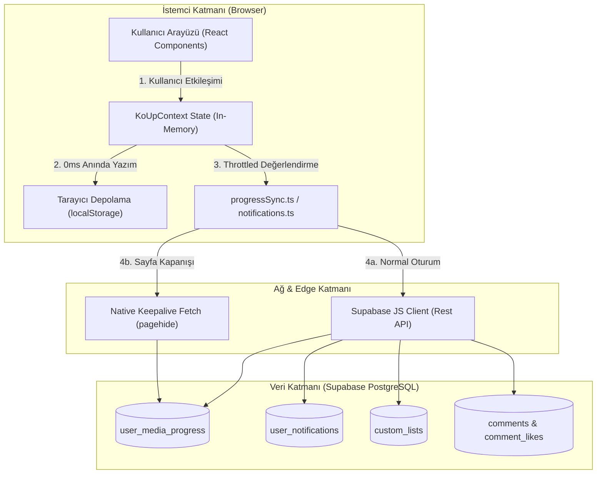
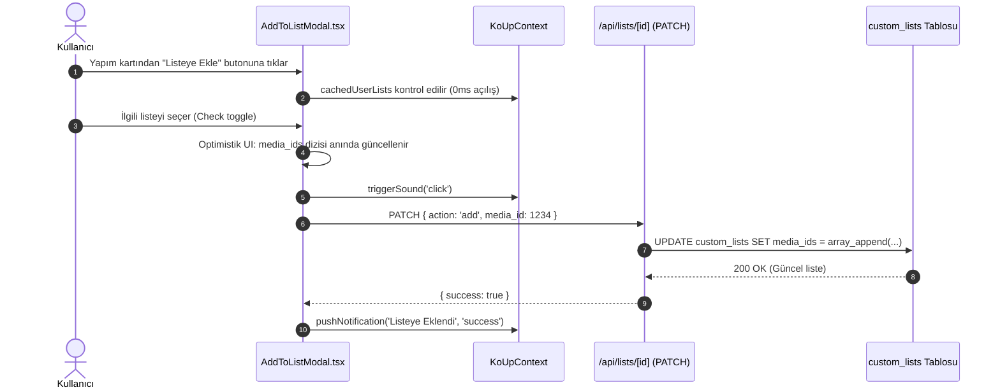

# 10 — Kullanıcı Özellikleri ve Kütüphane Mimarisi

KoUp platformundaki kullanıcı deneyimi; izleme ilerlemesinin cihazlar arası senkronizasyonundan zengin yorum topluluğuna, özel listelerden canlı takvime, yapım isteklerinden kişiselleştirilmiş Zevk DNA'sı (Taste Profile) önerilerine kadar uzanan kapsamlı bir özellik setini barındırır. Bu doküman, sitedeki kullanıcı odaklı tüm yeteneklerin uçtan uca mimarisini, veri akışını, karar gerekçelerini ve kısıtlarını açıklamaktadır.

---

## İçindekiler
1. [Genel Bakış ve Mimari Yaklaşım](#1-genel-bakış-ve-mimari-yaklaşım)
2. [İzleme İlerlemesi, Devam Et ve Geçmiş Sistemi](#2-izleme-ilerlemesi-devam-et-ve-geçmiş-sistemi)
   - [progressSync.ts Uzlaştırma Algoritması](#progresssyncts-uzlaştırma-algoritması)
   - [LocalStorage vs Supabase Çakışma Çözümü](#localstorage-vs-supabase-çakışma-çözümü)
   - [Tetikleyiciler, Eşikler ve Egress Koruması](#tetikleyiciler-eşikler-ve-egress-koruması)
   - [Misafir Kullanıcı ve Giriş Yapınca Birleştirme](#misafir-kullanıcı-ve-giriş-yapınca-birleştirme)
   - [Tombstone Mekanizması ve Veri Dirilmesini Önleme](#tombstone-mekanizması-ve-veri-dirilmesini-önleme)
   - [Sayfadan Ayrılma ve Keepalive Senkronizasyonu](#sayfadan-ayrılma-ve-keepalive-senkronizasyonu)
   - [Gizlilik Kontrolleri](#gizlilik-kontrolleri)
3. [Kütüphane ve Durum Yönetimi](#3-kütüphane-ve-durum-yönetimi)
   - [Kütüphane Durumları ve Anlamları](#kütüphane-durumları-ve-anlamları)
   - [Durum Geçişleri ve Otomatik İlerleme Kuralları](#durum-geçişleri-ve-otomatik-ilerleme-kuralları)
   - [Kullanıcı Puanlama Mekanizması](#kullanıcı-puanlama-mekanizması)
4. [Özel Listeler Sistemi (Custom Lists)](#4-özel-listeler-sistemi-custom-lists)
   - [Liste Mimarisi ve Veri Modeli](#liste-mimarisi-ve-veri-modeli)
   - [AddToListModal ve Optimistik Kullanıcı Deneyimi](#addtolistmodal-ve-optimistik-kullanıcı-deneyimi)
   - [Herkese Açık ve Gizli Listeler](#herkese-açık-ve-gizli-listeler)
   - [Liste Beğenileri ve Keşif](#liste-beğenileri-ve-keşif)
5. [Yorum Sistemi (RichCommentSection)](#5-yorum-sistemi-richcommentsection)
   - [Zengin Metin Editörü ve Apple Dark Paleti](#zengin-metin-editörü-ve-apple-dark-paleti)
   - [Spoiler Maskeleme ve Katı Topluluk Standardı](#spoiler-maskeleme-ve-katı-topluluk-standardı)
   - [GIF ve Çıkartma (Sticker) Entegrasyonu](#gif-ve-çıkartma-sticker-entegrasyonu)
   - [Yanıt Ağacı (Reply Tree) ve İç İçe Yanıt Kutusunun Çalışması](#yanıt-ağacı-reply-tree-ve-iç-içe-yanıt-kutusunun-çalışması)
   - [Moderasyon, XSS Sanitizasyonu ve Soft-Ban Kısıtlamaları](#moderasyon-xss-sanitizasyonu-ve-soft-ban-kısıtlamaları)
   - [Yorum Kilidi ve Sabitleme (Pinning)](#yorum-kilidi-ve-sabitleme-pinning)
6. [Bölüm Reaksiyonları](#6-bölüm-reaksiyonları)
7. [Bildirimler ve Toast Sistemi](#7-bildirimler-ve-toast-sistemi)
8. [Takip ve Favoriler](#8-takip-ve-favoriler)
9. [Dizi ve Yapım İstek Sistemi](#9-dizi-ve-yapım-istek-sistemi)
10. [Magazin ve Canlı Haber Akışı (AsyaMag & KoreZin)](#10-magazin-ve-canlı-haber-akışı-asyamag--korezin)
11. [Yayın Takvimi ve Canlı Geri Sayım](#11-yayın-takvimi-ve-canlı-geri-sayım)
12. [Keşfet ve Arama Motoru](#12-keşfet-ve-arama-motoru)
13. [Top 10 ve Haftalık Trendler](#13-top-10-ve-haftalık-trendler)
14. [Franchise ve İzleme Sırası](#14-franchise-ve-izleme-sırası)
15. [Oyuncu Profilleri ve Etkileşimli Biyografi](#15-oyuncu-profilleri-ve-etkileşimli-biyografi)
16. [Kişisel Öneriler ve Zevk DNA'sı (Taste Profile)](#16-kişisel-öneriler-ve-zevk-dhası-taste-profile)
17. [Başyapıtlar Vitrini (Masterpieces)](#17-başyapıtlar-vitrini-masterpieces)
18. [Ayarlar, Oturum Güvenliği ve Çoklu Cihaz Yönetimi](#18-ayarlar-oturum-güvenliği-ve-çoklu-cihaz-yönetimi)
19. [Profil ve Genel Kullanıcı Sayfaları](#19-profil-ve-genel-kullanıcı-sayfaları)
20. [Çerez Rızası (KVKK/GDPR) ve Mikro-Ses Sistemi](#20-çerez-rızası-kvkkgdpr-ve-mikro-ses-sistemi)
21. [İlgili Dokümanlar](#21-ilgili-dokümanlar)

---

## 1. Genel Bakış ve Mimari Yaklaşım

KoUp kullanıcı mimarisi, **Local-First & Optimistic Sync** (Önce Yerel, İyimser Eşitleme) prensibiyle inşa edilmiştir. Kullanıcının platformdaki hiçbir etkileşimi (video duraklatma, bölüm tamamlama, listeye ekleme, beğeni verme veya sekme değiştirme) uzak sunucudan yanıt beklemez. Tüm işlemler anında istemci tarafında (`localStorage` ve React state) tamamlanır, ardından akıllı kuyruklar ve kısma (throttling) algoritmaları üzerinden PostgreSQL/Supabase katmanına aktarılır.



---

## 2. İzleme İlerlemesi, Devam Et ve Geçmiş Sistemi

### Ne İşe Yarar?
Kullanıcının hangi dizinin hangi sezon ve bölümünde kaldığını, video içindeki net saniye pozisyonunu (`resume_position_sec`), toplam süreyi (`resume_duration_sec`), tamamlanan bölümleri (`watched_episodes`) ve bölüm bazlı ilerleme durumlarını hafızada tutar. Ana sayfadaki "İzlemeye Devam Et" (Continue Watching) rayını, dizi detayındaki "Kaldığın Yerden Devam Et" butonunu ve `/gecmis` sayfasını besler.

### Nasıl Çalışır?

#### progressSync.ts Uzlaştırma Algoritması
İlerleme motoru [`progressSync.ts`](../koup-app/src/lib/progressSync.ts) dosyasında tanımlıdır. Kullanıcı siteye girdiğinde veya giriş yaptığında `reconcileProgressMaps()` fonksiyonu devreye girer:

```typescript
// koup-app/src/lib/progressSync.ts
export function reconcileProgressMaps(
  localMap: Record<number, UserMediaProgress>,
  dbRows: any[],
  activeUserId: string
): {
  mergedMap: Record<number, UserMediaProgress>;
  itemsToSyncToSupabase: any[];
}
```

1. **DB Haritası Oluşturma:** Supabase'den gelen `user_media_progress` kayıtları `media_id` anahtarıyla bir sözlüğe dönüştürülür.
2. **Kimlik İzolasyonu:** Eğer yerel `localStorage` içindeki kayıt başka bir kullanıcıya aitse (farklı `user_id` ve misafir değilse), hesaplar arası veri kirlenmesini önlemek için yerel kayıt yok sayılır.
3. **Çatışma Çözümü (Conflict Resolution):** Hem yerelde hem DB'de aynı `media_id` varsa şu kurallara göre kazanan belirlenir:
   - Yerel kaydın `updated_at` zaman damgası DB'den kesinlikle daha yeniyse yerel kazanır.
   - Aynı sezon ve bölümde yerel saniye pozisyonu (`resume_position_sec`) DB'den büyükse yerel kazanır.
   - Yerel kayıt daha ileri bir sezon veya bölümde ise yerel kazanır.
   - Yerel kayıttaki izlenmiş bölüm sayısı (`watched_episodes.length`) DB'dekinden fazlaysa yerel kazanır.
4. **Bölüm Pozisyonları ve İzlenenler Birleşimi (Union):** İzlenen bölüm dizileri (`watched_episodes`) kayıp yaşanmaması adına küme birleşimiyle (`Set([ ...dbWatched, ...localWatched ])`) harmanlanır. Tek tek bölümlerin saniyelerini tutan `episode_positions` haritaları da zaman damgası veya en ileri saniye referans alınarak birleştirilir.
5. **Geri Eşitleme (Reconcile Back-Sync):** Yerel verinin daha ileri olduğu tespit edilen tüm yapımlar `itemsToSyncToSupabase` dizisine eklenir ve arka planda toplu olarak veritabanına geri yazılır.

#### LocalStorage vs Supabase Çakışma Çözümü
| Durum | Kazanan Taraf | Yapılan İşlem |
|---|---|---|
| Yalnızca Yerelde Var (Misafir veya Çevrimdışı İzleme) | Yerel (LocalStorage) | Veri korunur, aktif kullanıcı ID'siyle Supabase'e ekleme (insert/upsert) kuyruğuna alınır. |
| Yalnızca Supabase'de Var (Yeni Cihaz / Farklı Tarayıcı) | Supabase | Veritabanı kaydı yerel `koup_progress_v1` hafızasına çekilir. |
| İki Tarafta da Var, Yerel Daha İleri / Yeni | Yerel (LocalStorage) | Yerel durum korunur, DB kaydı güncellenir. |
| İki Tarafta da Var, DB Daha İleri / Yeni | Supabase | Yerel durum DB seviyesine yükseltilir. |
| `watched_episodes` Listesi Farklı | Birleşim (Union) | İki listedeki tüm bölüm numaraları tekilleştirilerek korunur. |

#### Tetikleyiciler, Eşikler ve Egress Koruması
Veritabanını lüzumsuz UPDATE sorgularıyla boğmamak ve Supabase egress kotasını korumak amacıyla [`shouldSyncToSupabase()`](../koup-app/src/lib/progressSync.ts#L321) fonksiyonu ile akıllı kısma uygulanır:
- **`LOCAL_TICK_INTERVAL_MS` (4 saniye):** Oynatma sürerken yerel state ve `localStorage` her 4 saniyede bir güncellenir. UI anında tepki verir.
- **`SIGNIFICANT_DELTA_SEC` (10 saniye):** Kullanıcı duraklattığında (`pause`) veya sayfadan ayrıldığında (`exit`), son DB eşitlemesinden bu yana en az 10 saniyelik bir ilerleme farkı oluşmamışsa Supabase'e ağ isteği atılmaz.
- **`PERIODIC_SYNC_INTERVAL_MS` (150 saniye / 2.5 dakika):** Kesintisiz, uzun izleme seanslarında arka plan emniyet eşitlemesi en fazla 2.5 dakikada bir çalışır.
- **Anında Eşitleme Durumları:** Bölüm tamamlandığında (`completed`), bir sonraki bölüme geçildiğinde (`newEpisode !== lastSync.episodeNum`) veya kütüphane durumu (`status`) değiştiğinde eşitleme derhal (`immediate: true`) tetiklenir.

#### Misafir Kullanıcı ve Giriş Yapınca Birleştirme
- Giriş yapmamış misafir kullanıcıların izleme kayıtları `localStorage` içindeki `koup_progress_v1` anahtarında `user_id: 'guest'` olarak güvenle tutulur. Misafirin hiçbir verisi Supabase'e gönderilmez; böylece RLS yetki hataları ve DB kirliliği engellenir.
- Misafir kullanıcı hesap açtığında veya giriş yaptığında, `reconcileProgressMaps` devreye girerek misafir döneminde izlediği tüm dizi ve bölümleri yeni açılan hesaba pürüzsüzce aktarır (`user_id = activeUserId`) ve Supabase'e kaydeder.

#### Tombstone Mekanizması ve Veri Dirilmesini Önleme
Bir kullanıcı kütüphanesinden veya geçmişinden bir yapımı sildiğinde (`removeFromLibrary`), Supabase'deki kayıt silinir. Ancak arka planda çalışan eski revalidate işlemleri veya açık kalan diğer sekmeler silinen yapımı tekrar yerel hafızaya yazabilir. Bunu önlemek için **Tombstone Mekanizması** kullanılır:
- Silinen yapım ID'si `koup_deleted_media_v1` anahtarına silinme zaman damgasıyla (`now`) yazılır.
- `TOMBSTONE_TTL_MS` (600.000 ms / 10 dakika) boyunca bu ID'ye ait hiçbir eski veri ne yerel haritaya kabul edilir ne de DB senkronizasyonuna sokulur. 10 dakika sonra mezar taşı otomatik temizlenir.

#### Sayfadan Ayrılma ve Keepalive Senkronizasyonu
Kullanıcı tarayıcı sekmesini kapattığında veya sayfayı yenilediğinde standart `async/await` fetch çağrıları tarayıcı tarafından iptal edilir. `progressSync.ts`, bu senaryoda native fetch API'sinin `keepalive: true` bayrağını kullanır:
- Bellekte tutulan `cachedAccessToken` veya `sb-*-auth-token` anahtarı okunur.
- Supabase REST uç noktasına (`/rest/v1/user_media_progress?on_conflict=user_id,media_id`) doğrudan `keepalive: true` ile POST isteği gönderilir. Tarayıcı kapansa bile işletim sistemi ağ isteğini arka planda tamamlar.

#### Gizlilik Kontrolleri
Kullanıcı profil ayarlarından `hide_watch_history = true` seçeneğini aktif ettiğinde, kendi geçmişini `/gecmis` sayfasında görmeye devam eder; ancak diğer kullanıcılar onun herkese açık profilini ziyaret ettiğinde (`/profil/[username]`) izleme geçmişi ve devam et listesi tamamen gizlenir.

### Neden Böyle Yapıldı?
- **Video İzleme Kesintisini Sıfırlamak:** Ağ gecikmesi veya anlık kopmalar oynatıcı arayüzünü asla dondurmaz.
- **Egress ve Veritabanı Yükünü Azaltmak:** Her saniye DB'ye yazmak yerine 10s delta + 150s periyot kuralı veritabanı yazma maliyetini %98 azaltmıştır.
- **Foreign Key Hata Koruması:** Eğer silinmiş/birleştirilmiş bir dizi DB'de yoksa (`error.code === '23503'`), istemci döngüye girip tekrar tekrar denemez; yerel kaydı derhal temizler.

### Kısıtlar & Yasaklar
- **Misafir Verisini Supabase'e Yazma Yasağı:** Geçerli UUID formatında olmayan (`isValidUuid`) veya `guest` kimliğine sahip kayıtlar kesinlikle Supabase'e upsert edilemez.
- **Tombstone İhlali Yasağı:** Mezar taşı listesindeki (`getDeletedMediaMap`) ID'ler TTL süresince asla diriltilemez.

### Bağımlılıklar
- Tablo: `user_media_progress`
- Yerel Anahtarlar: `koup_progress_v1`, `koup_deleted_media_v1`, `koup_ep_pos_{id}_{season}_{ep}`
- Modüller: [`koup-app/src/lib/progressSync.ts`](../koup-app/src/lib/progressSync.ts), [`koup-app/src/lib/supabase.ts`](../koup-app/src/lib/supabase.ts)

---

## 3. Kütüphane ve Durum Yönetimi

### Ne İşe Yarar?
Kullanıcının platformdaki yapımları kişisel durumlarına göre sınıflandırmasını, puanlamasını ve koleksiyonunu yönetmesini sağlar. `/kutuphane` sayfasında sekmeler halinde listelenir.

### Nasıl Çalışır?

#### Kütüphane Durumları ve Anlamları
`user_media_progress.status` kolonu ENUM benzeri kısıtla şu 5 geçerli durum değerini alabilir:
1. **`watching` (İzleniyor):** Kullanıcının şu anda aktif olarak takip ettiği diziler. Ana sayfadaki "İzlemeye Devam Et" rayında öncelikli yer alır.
2. **`completed` (İzlendi / Tamamlandı):** Tüm bölümleri veya filmi bitirilen yapımlar. "Devam Et" listesinden otomatik düşer, kütüphanenin "Tamamlananlar" sekmesine taşınır.
3. **`plan_to_watch` (İzlenecek):** Kullanıcının daha sonra izlemek üzere listesine kaydettiği yapımlar.
4. **`on_hold` (Askıda / Beklemede):** Yeni sezonu beklenen veya geçici olarak ara verilen yapımlar.
5. **`dropped` (Bırakıldı):** Kullanıcının izlemekten vazgeçtiği yapımlar. Öneri motorunda ceza puanı alır.

#### Durum Geçişleri ve Otomatik İlerleme Kuralları
- **İlk Başlatma:** Kullanıcı bir dizinin ilk bölümünü oynattığında durumu otomatik olarak `watching` yapılır.
- **Otomatik Tamamlama:** Dizinin yayınlanan son bölümü izlendiğinde veya bir filmin ilerleme çubuğu %85'i aştığında, durum otomatik olarak `completed` seviyesine çekilebilir.
- **Toplu İşaretleme (`toggleEpisodeWatched`):** Kullanıcı "Buraya Kadar Olanları İzlendi Say" seçeneğini seçtiğinde, 1'den ilgili bölüme kadar olan tüm sayılar `watched_episodes` dizisine eklenir.
- **Kütüphaneden Çıkarma:** `removeFromLibrary(mediaId)` çağrıldığında yapımın durumu `null` yapılır, yerel mezar taşına eklenir ve veritabanı satırı silinir.

#### Kullanıcı Puanlama Mekanizması
- Kullanıcı bir yapıma 1 ile 10 arasında tam sayı puan verebilir (`user_score`).
- Puanlama `sanitizeProgressDbPayload` içinde doğrulanır (`Math.round`, 1..10 aralığı). Verilen puan yapımın `site_rating` ve `site_rating_count` genel istatistiklerine yansıtılır.

---

## 4. Özel Listeler Sistemi (Custom Lists)

### Ne İşe Yarar?
Kullanıcıların kendi tematik seçkilerini (örn. "En İyi İntikam K-Dramaları", "2025 Romantik Komediler", "Ağlatan Finaller") oluşturmasını, düzenlemesini, herkese açık paylaşmasını veya diğer üyelerin listelerini beğenip keşfetmesini sağlar.

### Nasıl Çalışır?



#### Liste Mimarisi ve Veri Modeli
- Tablo: `custom_lists`
  - `id`: Benzersiz sayısal ID.
  - `user_id`: Listeyi oluşturan kullanıcının UUID'si.
  - `title`: Liste başlığı (maksimum 120 karakter).
  - `slug`: URL dostu benzersiz slug (`baslik-12345`).
  - `description`: Liste açıklaması.
  - `visibility`: `'public'` veya `'private'`.
  - `media_ids`: Dizideki yapım ID'lerini tutan `INTEGER[]` dizisi.
  - `likes_count`: Toplam beğeni sayısı.
  - `created_at`, `updated_at`: Zaman damgaları.

#### AddToListModal ve Optimistik Kullanıcı Deneyimi
[`AddToListModal.tsx`](../koup-app/src/components/AddToListModal.tsx) bileşeni portal (`createPortal`) üzerinden DOM köküne bağlanır:
- **Modül Düzeyi Önbellek (`cachedUserLists`):** Kullanıcının listeleri ilk açılışta çekildikten sonra modül hafızasında saklanır. İkinci açılışta 0ms içinde ekrana gelir; yükleme animasyonu gösterilmez.
- **İyimser Güncelleme:** Kullanıcı bir listeye tıkladığında `media_ids` dizisi anında yerel state üzerinde güncellenir (tik işareti belirir). Ardından arka planda `/api/lists/[id]` rotasına PATCH isteği gönderilir. Hata olursa işlem geri alınır.

#### Herkese Açık ve Gizli Listeler
- **`public`:** `/listeler` keşif sayfasında tüm üyelere gösterilir. Profil sayfasında listelenir, başkaları tarafından beğenilebilir ve paylaşılabilir.
- **`private`:** Yalnızca oluşturan kullanıcının `/listelerim` sayfasında görünür. Arama sonuçlarında ve genel akışta yer almaz.

#### Liste Beğenileri ve Keşif
- `/listeler` sayfasında en çok beğenilen listeler ve yeni derlemeler sergilenir.
- Kullanıcı bir listeyi beğendiğinde `koup_liked_custom_lists_v1` yerel hafızasına yazılır ve `custom_lists.likes_count` atomik olarak artırılır.

---

## 5. Yorum Sistemi (RichCommentSection)

### Ne İşe Yarar?
Dizi detay sayfalarında, bölümlerde, oyuncu profillerinde ve magazin haberlerinde kullanıcıların zengin içerikli yorumlar yapmasını, spoiler içeren kısımları gizlemesini, sahne zaman damgaları bırakmasını, GIF/çıkartma eklemesini ve iç içe yanıt ağaçlarıyla tartışmasını sağlar.

### Nasıl Çalışır?

#### Zengin Metin Editörü ve Apple Dark Paleti
[`RichCommentSection.tsx`](../koup-app/src/components/RichCommentSection.tsx) gelişmiş bir metin biçimlendirme araç çubuğu sunar:
- **Biçimlendirme:** Başlık (`H2`), Kalın (`Bold`), İtalik (`Italic`).
- **Renk Paleti (Apple Dark Cinema):** Kullanıcı yorumundaki metinleri 8 özel tonda renklendirebilir:
  - *Beyaz* (`#FFFFFF`), *Lumina Mavi* (`#38BDF8`), *Sinema Kehribar* (`#E5A93C`), *Kore Mercan* (`#FB7185`), *Zümrüt Yeşili* (`#34D399`), *Lavanta Mor* (`#C084FC`), *Turkuaz* (`#2DD4BF`), *Gümüş* (`#A1A1AA`).
- **Zaman Damgası (Timestamp Tag):** Bölüm yorumlarında kullanıcının o an izlediği saniyeyi (örn. `14:25`) yoruma iliştirmesini sağlar. Diğer kullanıcılar bu etikete tıkladığında oynatıcı doğrudan ilgili saniyeye atlar.

#### Spoiler Maskeleme ve Katı Topluluk Standardı
- Kullanıcı yorum yazarken "Spoiler" butonunu aktif ettiğinde `has_spoiler = true` bayrağı atanır.
- Spoiler içeren yorumlar arayüzde buzlu/karartılmış maske ile kapatılır:
  > *"Bu yorum Spoiler içeriyor • Görmek için tıkla"*
- Kullanıcı tıkladığında içerik açılır; dilerse *"Spoiler içeriği tekrar gizle"* butonuyla geri kapatabilir.

#### GIF ve Çıkartma (Sticker) Entegrasyonu
- **Özel Seçilmiş GIF'ler (Curated GIFs):** Duygusal tepkiler için sık kullanılan yüksek kaliteli K-Drama reaksiyon GIF'leri hazır sunulur.
- **Tenor API Entegrasyonu:** `/api/gifs/search` rotası üzerinden canlı Tenor araması yapılır.
- **K-Drama / Anime Çıkartmaları:** Platforma özel 6 özel rozet:
  - `finger-heart` (K-Heart), `cinema-fire` (Efsane Sahne), `crying-bowl` (Mendil Bitti), `crown-king` (Başyapıt), `popcorn` (Maraton), `shock-twist` (Ters Köşe).

#### Yanıt Ağacı (Reply Tree) ve İç İçe Yanıt Kutusunun Çalışması
- Yorumlar düz bir liste yerine `parent_id` hiyerarşisiyle 2 kademeli yanıt ağacı oluşturur.
- Bir yoruma "Yanıtla" denildiğinde sayfa en alta kaydırılmaz; yanıtlanan yorum kartının hemen altında inline bir yanıt alanı (`inlineReplyId === c.id`) açılır.
- Yanıt gönderildiğinde `parent_id` sahibine otomatik olarak `reply` tipinde bildirim gönderilir.

#### Moderasyon, XSS Sanitizasyonu ve Soft-Ban Kısıtlamaları
- **`sanitizeHtml()` Fonksiyonu:** Kullanıcının girdiği HTML içeriği sıkı bir XSS süzgecinden geçirilir. `<script>`, `<iframe>`, `<object>`, `<embed>`, `onload`, `onclick`, `javascript:` ve `data:` bağlantıları tamamen silinir. Yalnızca güvenli metin etiketleri (`span`, `strong`, `em`, `h2`, `p`, `br`) ve renk stilleri korunur.
- **Soft-Ban Kısıtlaması:** Moderatörler tarafından hesabı kısıtlanan (`is_banned = true` veya `ban_type = 'soft'`) kullanıcılar sitede video izleyebilir; ancak yorum yazamaz, beğeni bırakamaz veya istek gönderemez. Yorum alanında bilgilendirici kırmızı uyarı kartı görüntülenir.
- **Spam ve Hız Kısıtlaması (Rate Limiting):** Aynı kullanıcının peş peşe yorum atmasını engelleyen zaman eşikleri ve mükerrer metin kontrolü uygulanır.

#### Yorum Kilidi ve Sabitleme (Pinning)
- **Yorum Kilidi:** Bir dizide veya bölümde `is_comments_closed = true` yapılmışsa form gizlenir ve "Bu yapım için yorumlar kapatılmıştır" bildirimi gösterilir.
- **Sabitleme (`is_pinned`):** Admin ve moderatörler önemli duyuruları veya rehber niteliğindeki yorumları en üste sabitleyebilir (`pinned_at`). Sabitlenen yorumlar altın sarısı taç rozetiyle en başta gösterilir.
