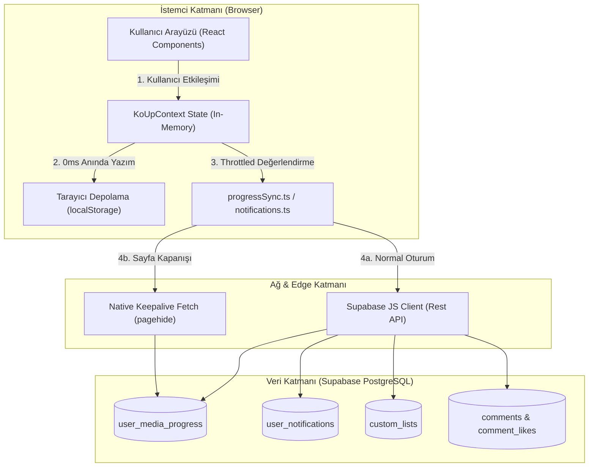
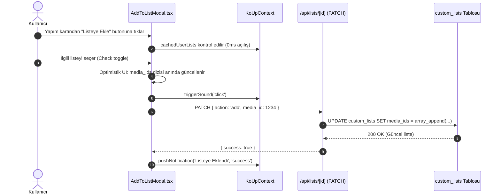

# 10 — Kullanıcı Özellikleri ve Kütüphane Mimarisi

KoUp platformundaki kullanıcı deneyimi; izleme ilerlemesinin cihazlar arası senkronizasyonundan zengin yorum topluluğuna, özel listelerden canlı takvime, yapım isteklerinden kişiselleştirilmiş Zevk DNA'sı (Taste Profile) önerilerine kadar uzanan kapsamlı bir özellik setini barındırır. Bu doküman, sitedeki kullanıcı odaklı tüm yeteneklerin uçtan uca mimarisini, veri akışını, karar gerekçelerini ve kısıtlarını açıklamaktadır.

---

## İçindekiler
1. [Genel Bakış ve Mimari Yaklaşım](#1-genel-bakış-ve-mimari-yaklaşım)
2. [İzleme İlerlemesi, Devam Et ve Geçmiş Sistemi](#2-izleme-ilerlemesi-devam-et-ve-geçmiş-sistemi)
   - [progressSync.ts Uzlaştırma Algoritması](#progresssyncts-uzlaştırma-algoritması)
   - [LocalStorage vs Supabase Çakışma Çözümü](#localstorage-vs-supabase-çakışma-çözümü)
   - [Tetikleyiciler, Eşikler ve Egress Koruması](#tetikleyiciler-eşikler-ve-egress-koruması)
   - [Misafir Kullanıcı ve Giriş Yapınca Birleştirme](#misafir-kullanıcı-ve-giriş-yapınca-birleştirme)
   - [Tombstone Mekanizması ve Veri Dirilmesini Önleme](#tombstone-mekanizması-ve-veri-dirilmesini-önleme)
   - [Sayfadan Ayrılma ve Keepalive Senkronizasyonu](#sayfadan-ayrılma-ve-keepalive-senkronizasyonu)
   - [Gizlilik Kontrolleri](#gizlilik-kontrolleri)
3. [Kütüphane ve Durum Yönetimi](#3-kütüphane-ve-durum-yönetimi)
   - [Kütüphane Durumları ve Anlamları](#kütüphane-durumları-ve-anlamları)
   - [Durum Geçişleri ve Otomatik İlerleme Kuralları](#durum-geçişleri-ve-otomatik-ilerleme-kuralları)
   - [Kullanıcı Puanlama Mekanizması](#kullanıcı-puanlama-mekanizması)
4. [Özel Listeler Sistemi (Custom Lists)](#4-özel-listeler-sistemi-custom-lists)
   - [Liste Mimarisi ve Veri Modeli](#liste-mimarisi-ve-veri-modeli)
   - [AddToListModal ve Optimistik Kullanıcı Deneyimi](#addtolistmodal-ve-optimistik-kullanıcı-deneyimi)
   - [Herkese Açık ve Gizli Listeler](#herkese-açık-ve-gizli-listeler)
   - [Liste Beğenileri ve Keşif](#liste-beğenileri-ve-keşif)
5. [Yorum Sistemi (RichCommentSection)](#5-yorum-sistemi-richcommentsection)
   - [Zengin Metin Editörü ve Apple Dark Paleti](#zengin-metin-editörü-ve-apple-dark-paleti)
   - [Spoiler Maskeleme ve Katı Topluluk Standardı](#spoiler-maskeleme-ve-katı-topluluk-standardı)
   - [GIF ve Çıkartma (Sticker) Entegrasyonu](#gif-ve-çıkartma-sticker-entegrasyonu)
   - [Yanıt Ağacı (Reply Tree) ve İç İçe Yanıt Kutusunun Çalışması](#yanıt-ağacı-reply-tree-ve-iç-içe-yanıt-kutusunun-çalışması)
   - [Moderasyon, XSS Sanitizasyonu ve Soft-Ban Kısıtlamaları](#moderasyon-xss-sanitizasyonu-ve-soft-ban-kısıtlamaları)
   - [Yorum Kilidi ve Sabitleme (Pinning)](#yorum-kilidi-ve-sabitleme-pinning)
6. [Bölüm Reaksiyonları](#6-bölüm-reaksiyonları)
7. [Bildirimler ve Toast Sistemi](#7-bildirimler-ve-toast-sistemi)
8. [Takip ve Favoriler](#8-takip-ve-favoriler)
9. [Dizi ve Yapım İstek Sistemi](#9-dizi-ve-yapım-istek-sistemi)
10. [Magazin ve Canlı Haber Akışı (AsyaMag & KoreZin)](#10-magazin-ve-canlı-haber-akışı-asyamag--korezin)
11. [Yayın Takvimi ve Canlı Geri Sayım](#11-yayın-takvimi-ve-canlı-geri-sayım)
12. [Keşfet ve Arama Motoru](#12-keşfet-ve-arama-motoru)
13. [Top 10 ve Haftalık Trendler](#13-top-10-ve-haftalık-trendler)
14. [Franchise ve İzleme Sırası](#14-franchise-ve-izleme-sırası)
15. [Oyuncu Profilleri ve Etkileşimli Biyografi](#15-oyuncu-profilleri-ve-etkileşimli-biyografi)
16. [Kişisel Öneriler ve Zevk DNA'sı (Taste Profile)](#16-kişisel-öneriler-ve-zevk-dhası-taste-profile)
17. [Başyapıtlar Vitrini (Masterpieces)](#17-başyapıtlar-vitrini-masterpieces)
18. [Ayarlar, Oturum Güvenliği ve Çoklu Cihaz Yönetimi](#18-ayarlar-oturum-güvenliği-ve-çoklu-cihaz-yönetimi)
19. [Profil ve Genel Kullanıcı Sayfaları](#19-profil-ve-genel-kullanıcı-sayfaları)
20. [Çerez Rızası (KVKK/GDPR) ve Mikro-Ses Sistemi](#20-çerez-rızası-kvkkgdpr-ve-mikro-ses-sistemi)
21. [İlgili Dokümanlar](#21-ilgili-dokümanlar)

---

## 1. Genel Bakış ve Mimari Yaklaşım

KoUp kullanıcı mimarisi, **Local-First & Optimistic Sync** (Önce Yerel, İyimser Eşitleme) prensibiyle inşa edilmiştir. Kullanıcının platformdaki hiçbir etkileşimi (video duraklatma, bölüm tamamlama, listeye ekleme, beğeni verme veya sekme değiştirme) uzak sunucudan yanıt beklemez. Tüm işlemler anında istemci tarafında (`localStorage` ve React state) tamamlanır, ardından akıllı kuyruklar ve kısma (throttling) algoritmaları üzerinden PostgreSQL/Supabase katmanına aktarılır.



---

## 2. İzleme İlerlemesi, Devam Et ve Geçmiş Sistemi

### Ne İşe Yarar?
Kullanıcının hangi dizinin hangi sezon ve bölümünde kaldığını, video içindeki net saniye pozisyonunu (`resume_position_sec`), toplam süreyi (`resume_duration_sec`), tamamlanan bölümleri (`watched_episodes`) ve bölüm bazlı ilerleme durumlarını hafızada tutar. Ana sayfadaki "İzlemeye Devam Et" (Continue Watching) rayını, dizi detayındaki "Kaldığın Yerden Devam Et" butonunu ve `/gecmis` sayfasını besler.

### Nasıl Çalışır?

#### progressSync.ts Uzlaştırma Algoritması
İlerleme motoru [`progressSync.ts`](../koup-app/src/lib/progressSync.ts) dosyasında tanımlıdır. Kullanıcı siteye girdiğinde veya giriş yaptığında `reconcileProgressMaps()` fonksiyonu devreye girer:

```typescript
// koup-app/src/lib/progressSync.ts
export function reconcileProgressMaps(
  localMap: Record<number, UserMediaProgress>,
  dbRows: any[],
  activeUserId: string
): {
  mergedMap: Record<number, UserMediaProgress>;
  itemsToSyncToSupabase: any[];
}
```

1. **DB Haritası Oluşturma:** Supabase'den gelen `user_media_progress` kayıtları `media_id` anahtarıyla bir sözlüğe dönüştürülür.
2. **Kimlik İzolasyonu:** Eğer yerel `localStorage` içindeki kayıt başka bir kullanıcıya aitse (farklı `user_id` ve misafir değilse), hesaplar arası veri kirlenmesini önlemek için yerel kayıt yok sayılır.
3. **Çatışma Çözümü (Conflict Resolution):** Hem yerelde hem DB'de aynı `media_id` varsa şu kurallara göre kazanan belirlenir:
   - Yerel kaydın `updated_at` zaman damgası DB'den kesinlikle daha yeniyse yerel kazanır.
   - Aynı sezon ve bölümde yerel saniye pozisyonu (`resume_position_sec`) DB'den büyükse yerel kazanır.
   - Yerel kayıt daha ileri bir sezon veya bölümde ise yerel kazanır.
   - Yerel kayıttaki izlenmiş bölüm sayısı (`watched_episodes.length`) DB'dekinden fazlaysa yerel kazanır.
4. **Bölüm Pozisyonları ve İzlenenler Birleşimi (Union):** İzlenen bölüm dizileri (`watched_episodes`) kayıp yaşanmaması adına küme birleşimiyle (`Set([ ...dbWatched, ...localWatched ])`) harmanlanır. Tek tek bölümlerin saniyelerini tutan `episode_positions` haritaları da zaman damgası veya en ileri saniye referans alınarak birleştirilir.
5. **Geri Eşitleme (Reconcile Back-Sync):** Yerel verinin daha ileri olduğu tespit edilen tüm yapımlar `itemsToSyncToSupabase` dizisine eklenir ve arka planda toplu olarak veritabanına geri yazılır.

#### LocalStorage vs Supabase Çakışma Çözümü
| Durum | Kazanan Taraf | Yapılan İşlem |
|---|---|---|
| Yalnızca Yerelde Var (Misafir veya Çevrimdışı İzleme) | Yerel (LocalStorage) | Veri korunur, aktif kullanıcı ID'siyle Supabase'e ekleme (insert/upsert) kuyruğuna alınır. |
| Yalnızca Supabase'de Var (Yeni Cihaz / Farklı Tarayıcı) | Supabase | Veritabanı kaydı yerel `koup_progress_v1` hafızasına çekilir. |
| İki Tarafta da Var, Yerel Daha İleri / Yeni | Yerel (LocalStorage) | Yerel durum korunur, DB kaydı güncellenir. |
| İki Tarafta da Var, DB Daha İleri / Yeni | Supabase | Yerel durum DB seviyesine yükseltilir. |
| `watched_episodes` Listesi Farklı | Birleşim (Union) | İki listedeki tüm bölüm numaraları tekilleştirilerek korunur. |

#### Tetikleyiciler, Eşikler ve Egress Koruması
Veritabanını lüzumsuz UPDATE sorgularıyla boğmamak ve Supabase egress kotasını korumak amacıyla [`shouldSyncToSupabase()`](../koup-app/src/lib/progressSync.ts#L321) fonksiyonu ile akıllı kısma uygulanır:
- **`LOCAL_TICK_INTERVAL_MS` (4 saniye):** Oynatma sürerken yerel state ve `localStorage` her 4 saniyede bir güncellenir. UI anında tepki verir.
- **`SIGNIFICANT_DELTA_SEC` (10 saniye):** Kullanıcı duraklattığında (`pause`) veya sayfadan ayrıldığında (`exit`), son DB eşitlemesinden bu yana en az 10 saniyelik bir ilerleme farkı oluşmamışsa Supabase'e ağ isteği atılmaz.
- **`PERIODIC_SYNC_INTERVAL_MS` (150 saniye / 2.5 dakika):** Kesintisiz, uzun izleme seanslarında arka plan emniyet eşitlemesi en fazla 2.5 dakikada bir çalışır.
- **Anında Eşitleme Durumları:** Bölüm tamamlandığında (`completed`), bir sonraki bölüme geçildiğinde (`newEpisode !== lastSync.episodeNum`), bölüm listesinden tekil veya toplu ("Tümünü İzlendi İşaretle" - `markAllEpisodesWatched`) izlendi yapıldığında ya da kütüphane durumu (`status`) değiştiğinde eşitleme derhal (`immediate: true`) tetiklenir.

#### Misafir Kullanıcı ve Giriş Yapınca Birleştirme
- Giriş yapmamış misafir kullanıcıların izleme kayıtları `localStorage` içindeki `koup_progress_v1` anahtarında `user_id: 'guest'` olarak güvenle tutulur. Misafirin hiçbir verisi Supabase'e gönderilmez; böylece RLS yetki hataları ve DB kirliliği engellenir.
- Misafir kullanıcı hesap açtığında veya giriş yaptığında, `reconcileProgressMaps` devreye girerek misafir döneminde izlediği tüm dizi ve bölümleri yeni açılan hesaba pürüzsüzce aktarır (`user_id = activeUserId`) ve Supabase'e kaydeder.

#### Tombstone Mekanizması ve Veri Dirilmesini Önleme
Bir kullanıcı kütüphanesinden veya geçmişinden bir yapımı sildiğinde (`removeFromLibrary`), Supabase'deki kayıt silinir. Ancak arka planda çalışan eski revalidate işlemleri veya açık kalan diğer sekmeler silinen yapımı tekrar yerel hafızaya yazabilir. Bunu önlemek için **Tombstone Mekanizması** kullanılır:
- Silinen yapım ID'si `koup_deleted_media_v1` anahtarına silinme zaman damgasıyla (`now`) yazılır.
- `TOMBSTONE_TTL_MS` (600.000 ms / 10 dakika) boyunca bu ID'ye ait hiçbir eski veri ne yerel haritaya kabul edilir ne de DB senkronizasyonuna sokulur. 10 dakika sonra mezar taşı otomatik temizlenir.

#### Sayfadan Ayrılma ve Keepalive Senkronizasyonu
Kullanıcı tarayıcı sekmesini kapattığında veya sayfayı yenilediğinde standart `async/await` fetch çağrıları tarayıcı tarafından iptal edilir. `progressSync.ts`, bu senaryoda native fetch API'sinin `keepalive: true` bayrağını kullanır:
- Bellekte tutulan `cachedAccessToken` veya `sb-*-auth-token` anahtarı okunur.
- Supabase REST uç noktasına (`/rest/v1/user_media_progress?on_conflict=user_id,media_id`) doğrudan `keepalive: true` ile POST isteği gönderilir. Tarayıcı kapansa bile işletim sistemi ağ isteğini arka planda tamamlar.

#### Gizlilik Kontrolleri
Kullanıcı profil ayarlarından `hide_watch_history = true` seçeneğini aktif ettiğinde, kendi geçmişini `/gecmis` sayfasında görmeye devam eder; ancak diğer kullanıcılar onun herkese açık profilini ziyaret ettiğinde (`/profil/[username]`) izleme geçmişi ve devam et listesi tamamen gizlenir.

### Neden Böyle Yapıldı?
- **Video İzleme Kesintisini Sıfırlamak:** Ağ gecikmesi veya anlık kopmalar oynatıcı arayüzünü asla dondurmaz.
- **Egress ve Veritabanı Yükünü Azaltmak:** Her saniye DB'ye yazmak yerine 10s delta + 150s periyot kuralı veritabanı yazma maliyetini %98 azaltmıştır.
- **Foreign Key Hata Koruması:** Eğer silinmiş/birleştirilmiş bir dizi DB'de yoksa (`error.code === '23503'`), istemci döngüye girip tekrar tekrar denemez; yerel kaydı derhal temizler.

### Kısıtlar & Yasaklar
- **Misafir Verisini Supabase'e Yazma Yasağı:** Geçerli UUID formatında olmayan (`isValidUuid`) veya `guest` kimliğine sahip kayıtlar kesinlikle Supabase'e upsert edilemez.
- **Tombstone İhlali Yasağı:** Mezar taşı listesindeki (`getDeletedMediaMap`) ID'ler TTL süresince asla diriltilemez.

### Bağımlılıklar
- Tablo: `user_media_progress`
- Yerel Anahtarlar: `koup_progress_v1`, `koup_deleted_media_v1`, `koup_ep_pos_{id}_{season}_{ep}`
- Modüller: [`koup-app/src/lib/progressSync.ts`](../koup-app/src/lib/progressSync.ts), [`koup-app/src/lib/supabase.ts`](../koup-app/src/lib/supabase.ts)

---

## 3. Kütüphane ve Durum Yönetimi

### Ne İşe Yarar?
Kullanıcının platformdaki yapımları kişisel durumlarına göre sınıflandırmasını, puanlamasını ve koleksiyonunu yönetmesini sağlar. `/kutuphane` sayfasında sekmeler halinde listelenir.

### Nasıl Çalışır?

#### Kütüphane Durumları ve Anlamları
`user_media_progress.status` kolonu ENUM benzeri kısıtla şu 5 geçerli durum değerini alabilir:
1. **`watching` (İzleniyor):** Kullanıcının şu anda aktif olarak takip ettiği diziler. Ana sayfadaki "İzlemeye Devam Et" rayında öncelikli yer alır.
2. **`completed` (İzlendi / Tamamlandı):** Tüm bölümleri veya filmi bitirilen yapımlar. "Devam Et" listesinden otomatik düşer, kütüphanenin "Tamamlananlar" sekmesine taşınır.
3. **`plan_to_watch` (İzlenecek):** Kullanıcının daha sonra izlemek üzere listesine kaydettiği yapımlar.
4. **`on_hold` (Askıda / Beklemede):** Yeni sezonu beklenen veya geçici olarak ara verilen yapımlar.
5. **`dropped` (Bırakıldı):** Kullanıcının izlemekten vazgeçtiği yapımlar. Öneri motorunda ceza puanı alır.

#### Durum Geçişleri ve Otomatik İlerleme Kuralları
- **İlk Başlatma:** Kullanıcı bir dizinin ilk bölümünü oynattığında durumu otomatik olarak `watching` yapılır.
- **Otomatik Tamamlama:** Dizinin yayınlanan son bölümü izlendiğinde veya bir filmin ilerleme çubuğu %85'i aştığında, durum otomatik olarak `completed` seviyesine çekilebilir.
- **Toplu İşaretleme (`toggleEpisodeWatched`):** Kullanıcı "Buraya Kadar Olanları İzlendi Say" seçeneğini seçtiğinde, 1'den ilgili bölüme kadar olan tüm sayılar `watched_episodes` dizisine eklenir.
- **Kütüphaneden Çıkarma:** `removeFromLibrary(mediaId)` çağrıldığında yapımın durumu `null` yapılır, yerel mezar taşına eklenir ve veritabanı satırı silinir.

#### Kullanıcı Puanlama Mekanizması
- Kullanıcı bir yapıma 1 ile 10 arasında tam sayı puan verebilir (`user_score`).
- Puanlama `sanitizeProgressDbPayload` içinde doğrulanır (`Math.round`, 1..10 aralığı). Verilen puan yapımın `site_rating` ve `site_rating_count` genel istatistiklerine yansıtılır.

---

## 4. Özel Listeler Sistemi (Custom Lists)

### Ne İşe Yarar?
Kullanıcıların kendi tematik seçkilerini (örn. "En İyi İntikam K-Dramaları", "2025 Romantik Komediler", "Ağlatan Finaller") oluşturmasını, düzenlemesini, herkese açık paylaşmasını veya diğer üyelerin listelerini beğenip keşfetmesini sağlar.

### Nasıl Çalışır?



#### Liste Mimarisi ve Veri Modeli
- Tablo: `custom_lists`
  - `id`: Benzersiz sayısal ID.
  - `user_id`: Listeyi oluşturan kullanıcının UUID'si.
  - `title`: Liste başlığı (maksimum 120 karakter).
  - `slug`: URL dostu benzersiz slug (`baslik-12345`).
  - `description`: Liste açıklaması.
  - `visibility`: `'public'` veya `'private'`.
  - `media_ids`: Dizideki yapım ID'lerini tutan `INTEGER[]` dizisi.
  - `likes_count`: Toplam beğeni sayısı.
  - `created_at`, `updated_at`: Zaman damgaları.

#### AddToListModal ve Optimistik Kullanıcı Deneyimi
[`AddToListModal.tsx`](../koup-app/src/components/AddToListModal.tsx) bileşeni portal (`createPortal`) üzerinden DOM köküne bağlanır:
- **Modül Düzeyi Önbellek (`cachedUserLists`):** Kullanıcının listeleri ilk açılışta çekildikten sonra modül hafızasında saklanır. İkinci açılışta 0ms içinde ekrana gelir; yükleme animasyonu gösterilmez.
- **İyimser Güncelleme:** Kullanıcı bir listeye tıkladığında `media_ids` dizisi anında yerel state üzerinde güncellenir (tik işareti belirir). Ardından arka planda `/api/lists/[id]` rotasına PATCH isteği gönderilir. Hata olursa işlem geri alınır.

#### Herkese Açık ve Gizli Listeler
- **`public`:** `/listeler` keşif sayfasında tüm üyelere gösterilir. Profil sayfasında listelenir, başkaları tarafından beğenilebilir ve paylaşılabilir.
- **`private`:** Yalnızca oluşturan kullanıcının `/listelerim` sayfasında görünür. Arama sonuçlarında ve genel akışta yer almaz.

#### Liste Beğenileri ve Keşif
- `/listeler` sayfasında en çok beğenilen listeler ve yeni derlemeler sergilenir.
- Kullanıcı bir listeyi beğendiğinde `koup_liked_custom_lists_v1` yerel hafızasına yazılır ve `custom_lists.likes_count` atomik olarak artırılır.

---

## 5. Yorum Sistemi (RichCommentSection)

### Ne İşe Yarar?
Dizi detay sayfalarında, bölümlerde, oyuncu profillerinde ve magazin haberlerinde kullanıcıların zengin içerikli yorumlar yapmasını, spoiler içeren kısımları gizlemesini, sahne zaman damgaları bırakmasını, GIF/çıkartma eklemesini ve iç içe yanıt ağaçlarıyla tartışmasını sağlar.

### Nasıl Çalışır?

#### Zengin Metin Editörü ve Apple Dark Paleti
[`RichCommentSection.tsx`](../koup-app/src/components/RichCommentSection.tsx) gelişmiş bir metin biçimlendirme araç çubuğu sunar:
- **Biçimlendirme:** Başlık (`H2`), Kalın (`Bold`), İtalik (`Italic`).
- **Renk Paleti (Apple Dark Cinema):** Kullanıcı yorumundaki metinleri 8 özel tonda renklendirebilir:
  - *Beyaz* (`#FFFFFF`), *Lumina Mavi* (`#38BDF8`), *Sinema Kehribar* (`#E5A93C`), *Kore Mercan* (`#FB7185`), *Zümrüt Yeşili* (`#34D399`), *Lavanta Mor* (`#C084FC`), *Turkuaz* (`#2DD4BF`), *Gümüş* (`#A1A1AA`).
- **Zaman Damgası (Timestamp Tag):** Bölüm yorumlarında kullanıcının o an izlediği saniyeyi (örn. `14:25`) yoruma iliştirmesini sağlar. Diğer kullanıcılar bu etikete tıkladığında oynatıcı doğrudan ilgili saniyeye atlar.

#### Spoiler Maskeleme ve Katı Topluluk Standardı
- Kullanıcı yorum yazarken "Spoiler" butonunu aktif ettiğinde `has_spoiler = true` bayrağı atanır.
- Spoiler içeren yorumlar arayüzde buzlu/karartılmış maske ile kapatılır:
  > *"Bu yorum Spoiler içeriyor • Görmek için tıkla"*
- Kullanıcı tıkladığında içerik açılır; dilerse *"Spoiler içeriği tekrar gizle"* butonuyla geri kapatabilir.

#### GIF ve Çıkartma (Sticker) Entegrasyonu
- **Özel Seçilmiş GIF'ler (Curated GIFs):** Duygusal tepkiler için sık kullanılan yüksek kaliteli K-Drama reaksiyon GIF'leri hazır sunulur.
- **Tenor API Entegrasyonu:** `/api/gifs/search` rotası üzerinden canlı Tenor araması yapılır.
- **K-Drama / Anime Çıkartmaları:** Platforma özel 6 özel rozet:
  - `finger-heart` (K-Heart), `cinema-fire` (Efsane Sahne), `crying-bowl` (Mendil Bitti), `crown-king` (Başyapıt), `popcorn` (Maraton), `shock-twist` (Ters Köşe).

#### Yanıt Ağacı (Reply Tree) ve İç İçe Yanıt Kutusunun Çalışması
- Yorumlar düz bir liste yerine `parent_id` hiyerarşisiyle 2 kademeli yanıt ağacı oluşturur.
- Bir yoruma "Yanıtla" denildiğinde sayfa en alta kaydırılmaz; yanıtlanan yorum kartının hemen altında inline bir yanıt alanı (`inlineReplyId === c.id`) açılır.
- Yanıt gönderildiğinde `parent_id` sahibine otomatik olarak `reply` tipinde bildirim gönderilir.

#### Moderasyon, XSS Sanitizasyonu ve Soft-Ban Kısıtlamaları
- **`sanitizeHtml()` Fonksiyonu:** Kullanıcının girdiği HTML içeriği sıkı bir XSS süzgecinden geçirilir. `<script>`, `<iframe>`, `<object>`, `<embed>`, `onload`, `onclick`, `javascript:` ve `data:` bağlantıları tamamen silinir. Yalnızca güvenli metin etiketleri (`span`, `strong`, `em`, `h2`, `p`, `br`) ve renk stilleri korunur.
- **Soft-Ban Kısıtlaması:** Moderatörler tarafından hesabı kısıtlanan (`is_banned = true` veya `ban_type = 'soft'`) kullanıcılar sitede video izleyebilir; ancak yorum yazamaz, beğeni bırakamaz veya istek gönderemez. Yorum alanında bilgilendirici kırmızı uyarı kartı görüntülenir.
- **Spam ve Hız Kısıtlaması (Rate Limiting):** Aynı kullanıcının peş peşe yorum atmasını engelleyen zaman eşikleri ve mükerrer metin kontrolü uygulanır.

#### Yorum Kilidi ve Sabitleme (Pinning)
- **Yorum Kilidi:** Bir dizide veya bölümde `is_comments_closed = true` yapılmışsa form gizlenir ve "Bu yapım için yorumlar kapatılmıştır" bildirimi gösterilir.
- **Sabitleme (`is_pinned`):** Admin ve moderatörler önemli duyuruları veya rehber niteliğindeki yorumları en üste sabitleyebilir (`pinned_at`). Sabitlenen yorumlar altın sarısı taç rozetiyle en başta gösterilir.


---

## 6. Bölüm Reaksiyonları

### Ne İşe Yarar?
Bölüm izleme sayfasında kullanıcının o bölüme dair hissettiği anlık duygusal tepkiyi hızlıca iletmesini sağlar. Sayfa genelinde bölümün atmosferini yansıtan canlı sayaçlar üretir.

### Nasıl Çalışır?

#### 4 Reaksiyon Duygusu ve Veri Modeli
`episodes` tablosunda her bölüm için 4 bağımsız sayaç tutulur:
1. 🔥 **Ateş / Efsane (`react_fire`):** Aksiyon, heyecan veya destansı sahneler için.
2. 😢 **Gözyaşı / Hüzün (`react_cry`):** Duygusal, dramatik veya trajik anlar için.
3. 😱 **Şok / Ters Köşe (`react_shock`):** Beklenmedik olay örgüleri (plot twist) ve şaşırtıcı sahneler için.
4. 😡 **Öfke / Gerilim (`react_angry`):** Kötü karakterlere veya haksızlıklara karşı tepki için.

#### LocalStorage Tekilleştirme ve Optimistik Güncelleme
- Kullanıcının bir bölüme daha önce reaksiyon verip vermediği yerel depolamada saklanır:
  `koup_reaction_${mediaId}_${seasonNum}_${episodeNum}`
- Kullanıcı bir emojiye tıkladığında:
  1. Arayüzdeki sayaç anında +1 artar (veya daha önce verilmişse -1 azalarak geri alınır).
  2. Yeni durum `localStorage` içine kaydedilir.
  3. Supabase tarafında ilgili `episodes` satırındaki sayaç atomik olarak güncellenir.
- Misafir kullanıcılar da reaksiyon verebilir; durumları tarayıcılarında korunur.

---

## 7. Bildirimler ve Toast Sistemi

### Ne İşe Yarar?
Takip edilen dizilerin yeni bölümleri yayınlandığında, favori oyuncuların yeni bir yapıma katıldığı duyurulduğunda, bir kullanıcı yorumuna yanıt geldiğinde veya sistem duyurusu yapıldığında üyeye anlık sesli toast ve kalıcı bildirim kutusu sunar.

### Nasıl Çalışır?

#### ToastNotification Arayüzü
[`notifications.ts`](../koup-app/src/lib/notifications.ts) dosyasında tanımlı standart bildirim modeli:

```typescript
// koup-app/src/lib/notifications.ts
export interface ToastNotification {
  id: string;
  title: string;
  body: string;
  type: 'episode' | 'actor' | 'reply' | 'system' | 'info' | 'success' | 'error' | 'warning';
  linkUrl?: string;
  imageUrl?: string;
  createdAt: string;
  rawCreatedAt?: string;
  isRead: boolean;
  mediaId?: number;
  personId?: number;
}
```

#### Bildirim Üretim Mantığı
1. **Veritabanı Tetikleyicileri (Triggers & Edge Functions):** Takip edilen bir diziye yeni bölüm yüklendiğinde veya bir yoruma yanıt verildiğinde Supabase tarafında `user_notifications` tablosuna satır eklenir.
2. **Realtime Postgres Aboneliği:** [`KoUpContext.tsx`](../koup-app/src/context/KoUpContext.tsx) içinde oturum açmış kullanıcı için şu kanal dinlenir:
   `realtime:user_notifications:${user.id}`
   Yeni bir bildirim geldiğinde ses efekti (`playNotificationChime`) çalar ve ekranın sağ üst köşesinde animasyonlu toast belirir.
3. **İstemci İçi Anlık Bildirimler (`pushNotification`):** Kullanıcı bir listeye dizi eklediğinde veya ayarlarını kaydettiğinde anlık geribildirim için yerel bildirimler üretilir.

#### notifications.ts Sıralama ve Tekilleştirme Algoritması
Sayfa yenilendiğinde (F5) veya yeni bildirimler eklendiğinde listenin rastgele karışmasını önlemek için iki özel algoritma çalışır:

1. **`parseEpisodeInfo()`:** Bildirim metninden ve URL'sinden dizi adı, sezon ve bölüm numarasını ayrıştırır (`seriesKey`, `seasonNumber`, `episodeNumber`).
2. **`compareNotifications()` (Deterministik Sıralama):**
   - **Bölüm Önceliği Kuralı:** Eğer iki bildirim aynı diziye aitse ve 24 saatlik pencerede yayınlanmışsa, **yüksek olan bölüm numarası her zaman en üstte** yer alır (örn. `16. Bölüm > 15. Bölüm > 14. Bölüm`). Kullanıcı en güncel bölümü ilk sırada görür.
   - **Kronolojik Kural:** Farklı yapımlarda zaman damgası yeni olan (`rawCreatedAt`) önce gelir.
   - **Deterministik Tie-Breaker:** Zaman damgaları milisaniyesine kadar aynı olsa dahi `b.id.localeCompare(a.id)` ile sıralama kilitlenir; liste F5 yapıldığında asla yer değiştirmez.
3. **`dedupeAndSortNotifications()` (Tekilleştirme):** Aynı içeriğe sahip mükerrer bildirimler URL veya başlık parmak iziyle (`fp`) tekilleştirilir. Kopyalardan biri daha önce okunmuşsa (`isRead: true`), birleştirilen kayıtta `isRead = true` durumu korunur.

#### Bakım ve Sistem Hatalarını Filtreleme Kuralı
Kullanıcının bildirim kutusunu kirletmemek adına [`isMaintenanceOrErrorNotification()`](../koup-app/src/lib/notifications.ts#L141) fonksiyonu çalışır:
- İstemciye düşen geçici bakım bildirimleri (`sqlite`, `webdrama_archive`, `python motoru`, `bakım tamamlandı`, `senkronizasyon hatası`) toast olarak gösterilse bile **kalıcı bildirim kutusuna (`notifications` state) asla kaydedilmez**.

#### Okundu İşaretleme ve Temizlik
- **Tekil Okuma:** `markNotificationRead(id)` ile bildirim okundu yapılır.
- **Toplu Okuma:** `markAllNotificationsRead()` ile kullanıcının tüm bildirimleri tek seferde okunmuş sayılır ve Supabase'de `is_read = true` yapılır.
- **Tümünü Temizle:** `clearAllNotifications()` çağrıldığında kullanıcının tüm geçmiş bildirimleri veritabanından silinir.

---

## 8. Takip ve Favoriler

### Ne İşe Yarar?
Kullanıcının dizi, film, anime veya oyuncuları takibe alarak yeni bölümlerden ve gelişmelerden anında haberdar olmasını, ayrıca en sevdiklerini profilinde "Favoriler" vitrininde sergilemesini sağlar.

### Nasıl Çalışır?

#### Dizi Takip ve Favorileme
- **Takip Etme (`toggleMediaFollow`):** Dizi takip edildiğinde `media_follows` tablosuna kayıt atılır ve yapımın `followers_count` sayacı artar. Yeni bir bölüm eklendiğinde takipçilere otomatik bildirim üretilir.
- **Favorilere Ekleme (`toggleMediaFavorite`):** Yapım kullanıcının favorilerine eklenir (`user_media_progress.is_favorite = true`). Yapımın `favorites_count` sayacı artırılır. Profilde ve `/favoriler` sayfasında sergilenir.

#### Oyuncu / Kişi Takip ve Favorileme
- **Oyuncu Takibi (`togglePersonFollow`):** `person_follows` tablosuna yazılır. Oyuncunun yeni bir dizi veya filmi kütüphaneye eklendiğinde takipçiye bildirim gider.
- **Oyuncu Favorileme (`togglePersonFavorite`):** `person_favorites` tablosuna yazılır. Oyuncunun `favorites_count` değeri artar.

#### /api/follow Uç Noktası ve IDOR Güvenliği
[`koup-app/src/app/api/follow/route.ts`](../koup-app/src/app/api/follow/route.ts) uç noktası katı güvenlik denetimleriyle çalışır:
- İstek gövdesindeki `user_id` ile `verifyUserSession(req)` üzerinden çözülen oturum sahibi uyuşmak zorundadır. Başka bir kullanıcının ID'sini göndererek takip listesini manipüle etme (IDOR) girişimleri `401 Unauthorized` ile engellenir.
- İşlem Supabase üzerindeki `toggle_user_follow(p_user_id, p_target_type, p_target_id)` saklı yordamı (RPC) ile tek bir atomik veritabanı işleminde tamamlanır.

---

## 9. Dizi ve Yapım İstek Sistemi

### Ne İşe Yarar?
Kullanıcıların platformda henüz yer almayan Asya dizilerini, filmlerini veya animelerini dış platform bağlantısı vererek talep etmesini; moderatörlerin bu istekleri inceleyip tek tıkla arşive kazandırmasını sağlar. `/seri-istek` sayfasında çalışır.

### Nasıl Çalışır?

```mermaid
flowchart LR
    User["Kullanıcı"] -->|1. URL Yapıştırır| Page["/seri-istek"]
    Page -->|2. Canlı Önizleme| PreviewAPI["/api/series-requests/preview"]
    PreviewAPI --> Resolver["seriesRequestResolver.ts"]
    Resolver -->|3. AniList / TMDB / MDL / IMDb| ExternalAPIs["Dış Kaynaklar"]
    ExternalAPIs -->> Resolver: Ham Metadata (İngilizce)
    Resolver -->|4. Otomatik Çeviri| Trans["translate.googleapis.com"]
    Resolver -->|5. Katalog Çakışma Kontrolü| MediaDB[("media Tablosu")]
    Resolver -->> PreviewAPI: Zenginleştirilmiş Önizleme
    PreviewAPI -->> Page: Afiş, Başlık, Özet, Yıl Gösterimi
    User -->|6. İsteği Gönder| SubmitAPI["/api/series-requests (POST)"]
    SubmitAPI --> ReqTable[("series_requests Tablosu")]
```

#### Desteklenen 4 Dış Kaynak
[`seriesRequestResolver.ts`](../koup-app/src/lib/seriesRequestResolver.ts) şu 4 kaynaktan gelen bağlantıları tanır ve ayrıştırır:
1. **AniList:** `https://anilist.co/anime/{id}` (Anime yapımları için doğrudan GraphQL ID'si çözülür).
2. **The Movie Database (TMDB):** `https://www.themoviedb.org/{tv|movie}/{id}` (Dizi ve filmler için çok dilli TMDB API sorgulanır).
3. **MyDramaList (MDL):** `https://mydramalist.com/{id}-{slug}` (K-Drama, C-Drama, J-Drama ve Thai yapımları için başlık ve kimlik çözülür).
4. **IMDb:** `https://www.imdb.com/title/{ttId}/` (TMDB Find API üzerinden `find/tt...` ile eşleştirilir).

#### Otomatik Türkçe Çeviri ve Katalog Çakışma Kontrolü
- **Çeviri Motoru:** Dış kaynaktan gelen özet metin İngilizce ise `translateToTurkish()` fonksiyonu Google Translate API (`translate.googleapis.com`) üzerinden metni doğal Türkçeye çevirir.
- **Katalogda Zaten Var mı? (`existing_media`):** Önizleme çözülürken yapımın başlığı veya dış kimliği `media` tablosunda taranır. Eğer yapım zaten sitede mevcutsa kullanıcıya uyarı verilir ve doğrudan ilgili dizinin sayfasına yönlendirme linki sunulur (`existing_media: { id, title, slug }`).

#### İstek Yaşam Döngüsü ve Durumlar
1. **`pending` (İncelemede):** İstek havuza düşmüştür. Kullanıcı kendi profilinde isteğini takip edebilir.
2. **`approved` (Onaylandı):** Moderatör veya yönetici isteği onaylamıştır. Kazıyıcı botlar ve kaynak bulma süreçleri başlatılır.
3. **`rejected` (Reddedildi):** Telif kısıtı, kaynağın bulunamaması veya format uyumsuzluğu nedeniyle istek reddedilmiştir (varsa `admin_note` açıklamasıyla).

---

## 10. Magazin ve Canlı Haber Akışı (AsyaMag & KoreZin)

### Ne İşe Yarar?
Asya eğlence dünyasından (K-Drama dedikoduları, aktör/aktris röportajları, reyting rekorları, K-Pop gelişmeleri ve yeni yapım duyuruları) en taze haberleri canlı olarak platforma aktarır. `/magazin` sayfasında ve ana sayfadaki dedikodu kartlarında yayınlanır.

### Nasıl Çalışır?

#### AsyaMag Entegrasyonu (`asyamag-live.ts`)
- **Resmi WordPress REST API:** `https://asyamag.com/wp-json/wp/v2/posts?_embed=true&per_page=20` adresinden canlı veri çeker.
- **Kategori Haritalama (`CAT_MAP`):** WordPress sayısal kategori ID'lerini Türkçe etiketlere dönüştürür (2419 -> *Dedikodu*, 9 -> *Kore*, 20 -> *Dizi*, 10 -> *Çin*, 6 -> *BL GL*, 2249 -> *Japonya*, 2224 -> *Tayland*, 19 -> *K-Pop*).
- **Dedikodu Tespiti (`is_gossip`):** Başlık veya kategoride "dedikodu", "skandal", "sevgili" kelimeleri geçiyorsa özel pembe rozet atanır.
- **Supabase Eşleme:** Canlı çekilen makalelerin slug'ları Supabase `magazine_posts` tablosuyla çapraz kontrol edilerek dizi/oyuncu bağlantıları (`related_media_ids`, `related_person_ids`) ve görüntülenme sayıları birleştirilir.
- **Önbellek:** Next.js `revalidate: 180` (3 dakika) kuralıyla çalışır; harici siteye gereksiz yük bindirilmez.

#### KoreZin Entegrasyonu (`korezin-live.ts`)
- **Canlı WordPress RSS 2.0 XML Ayrıştırıcı:** `https://www.korezin.com/feed/` akışını doğrudan çeker.
- **XML Çözümleme:** `media:content`, `media:thumbnail`, `enclosure` ve içerik içi `` etiketlerinden yüksek çözünürlüklü kapak görselleri ayıklanır.
- **Temizlik:** WordPress RSS şablon yazıları (*"The post ... appeared first on KoreZin"*), Google AdSense kodları ve scriptler regex ile temizlenir.
- **Kimlik İzolasyonu:** KoreZin gönderileri `800_000_000 + wpId` formülüyle ID alır ve slug'ları `kz-` önekiyle adlandırılır; AsyaMag gönderileriyle çakışma yaşanmaz.
- **Bellek İçi Önbellek (`koreZinCache`):** 180 saniyelik bellek içi TTL ile korunur.

---

## 11. Yayın Takvimi ve Canlı Geri Sayım

### Ne İşe Yarar?
Halen devam etmekte olan (airing/ongoing) K-Drama, C-Drama ve animelerin haftanın hangi günlerinde yayınlandığını, bir sonraki bölümün ne zaman çıkacağını ve kalan süreyi canlı geri sayım sayacıyla gösterir. `/takvim` sayfasında yer alır.

### Nasıl Çalışır?

#### Türkiye Saati Hesaplaması (UTC+3)
[`api/takvim/live/route.ts`](../koup-app/src/app/api/takvim/live/route.ts) sunucu tarafında çalışırken sunucu bölgesi neresi olursa olsun `getTurkeyNow()` fonksiyonuyla saati kalıcı olarak **Europe/Istanbul (UTC+3)** standardına kaydırır:
```typescript
const trTime = new Date(now.getTime() + 3 * 3600_000);
```

#### Gün Haritası ve air_days Kodu
Veritabanındaki `media.air_days` kolonu tam sayılardan oluşan bir dizidir:
- `1`: Pazartesi, `2`: Salı, `3`: Çarşamba, `4`: Perşembe, `5`: Cuma, `6`: Cumartesi, `7`: Pazar.
- Bir dizi haftada birden fazla gün yayınlanıyorsa (örn. Cumartesi-Pazar dizileri `[6, 7]`) takvimde her iki günün listesinde de uygun saat bilgisiyle yer alır.

#### Canlı Geri Sayım (`computeCountdownInfo`)
- Eğer dizinin `next_episode_at` ISO tarihi mevcutsa, Türkiye saatiyle hedef tarih arasındaki gün ve saat farkı hesaplanır.
- Sonuç kullanıcıya canlı geri sayım etiketi olarak sunulur:
  - *Bugün Yayında!*
  - *Yarın Yayında!*
  - *2 Gün Sonra*
  - *18 Saat Kaldı*


---

## 12. Keşfet ve Arama Motoru

### Ne İşe Yarar?
17.000'den fazla yapımı barındıran dev arşiv içerisinde kullanıcıların milisaniyeler içinde aradıkları dizi, film, anime veya oyuncuyu bulmasını; çok kriterli filtrelerle (tür, ülke, kategori, çıkış yılı, puan ve yayın durumu) arşivi derinlemesine taramasını sağlar. `/kesfet` sayfasında ve navbar arama modalında çalışır.

### Nasıl Çalışır?

#### CJK ve Türkçe Karakter Normalizasyonu (`search.ts`)
[`koup-app/src/lib/search.ts`](../koup-app/src/lib/search.ts) arama sorgusunu normalize eder:
- **Türkçe Karakter Eşleme:** Büyük/küçük harf ve Türkçe diyakritikler (`ı -> i`, `ğ -> g`, `ü -> u`, `ş -> s`, `ö -> o`, `ç -> c`, `İ -> i`) düzleştirilir.
- **Doğu Asya Dilleri ve Kiril Koruması:** Standart regexler CJK (Korece Hangul `\uac00-\ud7af`, Japonca Hiragana/Katakana `\u3040-\u30ff`, Çince Hanzi `\u4e00-\u9fff`) ve Kiril karakterlerini yok etmez; özel unicode aralığıyla korur.
- **Sıkıştırılmış Arama Metni (Condensed String):** Boşluksuz arama varyantı (örn. "doctor x" -> "doctorx") üretilerek yapışık yazılan aramalar da yakalanır.

#### Arama Puanlama Algoritması (`searchRanking.ts`)
Arama sonuçlarının kalitesi [`getSearchRelevanceScore()`](../koup-app/src/lib/searchRanking.ts#L7) fonksiyonuyla ağırlıklandırılır:

| Eşleşme Tipi | Taban Puan | Açıklama & Örnek |
|---|---|---|
| **Tam Eşleşme (Exact Match)** | **+1.000.000** | Başlık veya normalize başlık sorguyla birebir aynı (örn. "Goblin"). |
| **Ayraçlı Başlık Öneki** | **+500.000** | Başlık sorgudan sonra iki nokta, tire veya parantezle devam ediyor (örn. "One Piece: ..."). |
| **Başlangıç Eşleşmesi** | **+300.000** | Başlık doğrudan sorguyla başlıyor (örn. "Vincenzo"). |
| **Kelime Sınırı (Word Boundary)** | **+150.000** | Sorgu başlık içinde bağımsız bir tam kelime olarak geçiyor. |
| **İçerik Eşleşmesi (Contains)** | **+80.000** | Başlığın herhangi bir yerinde sorgu geçiyor. |
| **Slug veya Orijinal Ad Eşleşmesi** | **+40.000** | Slug veya Korece/Çince/Japonca `native_title` eşleşiyor. |
| **Çoklu Kelime Sıralı Eşleşme** | **+250.000** | Sorgudaki tüm kelimeler başlıkta aynı sırayla geçiyor (örn. "Dragon Super" -> "Dragon Ball Super"). |
| **Başlık Uzunluğu Cezası** | **-150 / Karakter** | Sorguyla eşleşen ana yapımları 60 karakterlik uzun spin-off/film adlarının önüne geçirmek için (maks -40.000). |
| **Bölüm Sayısı Bonusu** | **+15.000 - +80.000** | 1 bölümlük OVA ve özel bölümler yerine 16-50+ bölümlük ana dizilere öncelik verir. |
| **İzlenme & Puan Takviyesi** | **+views * 2 + rating * 500** | Popüler ve yüksek puanlı yapımlara hafif üstünlük tanır. |

#### Çoklu Filtreleme ve Sayfalama
- `/kesfet` sayfasında filtreler: İçerik Türü (`dizi`, `anime`, `kisa_drama`, `film`, `program`), Ülke (`KR`, `TR`, `CN`, `JP`, `TH`, `TW`, `US`), Çıkış Yılı (1980 - 2026), Kategoriler, Yayın Durumu ve Sıralama (`views_total`, `rating`, `new`, `alpha`).
- Sayfalama `ITEMS_PER_PAGE = 36` öğe ile çalışır. URL arama parametreleri (`?q=...&type=...&page=...`) ile tam senkronizedir; tarayıcının geri/ileri butonları arama durumunu bozmaz.

---

## 13. Top 10 ve Haftalık Trendler

### Ne İşe Yarar?
Ana sayfada kullanıcıların o hafta platformda en çok izlediği ilk 10 dizi ve ilk 10 filmi Netflix tarzı devasa numaralı tipografik gliflerle sergiler.

### Nasıl Çalışır?

#### media_view_events ve İzlenme Sayımı
[`viewTracker.ts`](../koup-app/src/lib/viewTracker.ts) üzerinden izlenme kaydedilir:
1. **İstemci Soğuma Süresi (6 Saat Anti-F5):** Kullanıcının aynı diziyi peş peşe yenileyerek (F5) sahte izlenme basmasını önlemek için `koup_view_cooldown_v1` hafızasında 6 saatlik kilit tutulur.
2. **Cihaz Parmak İzi ile Bildirim:** `/api/media/view` uç noktasına cihaz parmak izi (`viewer_key`) iletilir.
3. **`increment_media_view` RPC:** Veritabanında `media_view_events` tablosuna günlük tekil kayıt eklenir. Yapımın genel `views_total` ve bölümün `views_count` sayaçları atomik olarak artırılır.

#### Haftalık Trend RPC (`get_weekly_top10`)
- Supabase tarafında çalışan `get_weekly_top10(p_content_type)` saklı yordamı, son 7 gün içindeki `media_view_events` kayıtlarını gruplayarak en çok tekil izlenen 10 yapımı listeler.
- Eğer haftalık kayıt havuzu boşsa veya yetersizse, otomatik olarak genel `views_total` sıralamasına geri düşer (fallback).

#### Top10Numeral.tsx Tipografik Glifleri
[`Top10Numeral.tsx`](../koup-app/src/components/Top10Numeral.tsx) bileşeni, 1'den 10'a kadar olan sayıları özel SVG yol koordinatlarıyla (`GLYPH_PATHS`) çizer:
- **Görsel Stil:** Koyu gri gövde dolgusu, 2px gümüş krom kontur (`#9ca3af`) ve arka planda hafif mavi/beyaz radyal parlama (glow).
- **Mikro Etkileşim:** Kullanıcı kartın üzerine geldiğinde (`group-hover`), kontur rengi saf beyaza (`#FFFFFF`) yükselir ve parlama yoğunlaşır.

---

## 14. Franchise ve İzleme Sırası

### Ne İşe Yarar?
Birden fazla sezonu, devam filmi, yan hikayesi (spin-off) veya özel bölümü (OVA) bulunan evrenlerde (örn. *Reply* serisi, *Dr. Romantic*, *Alchemy of Souls*, *Attack on Titan*, *Fate* evreni) kullanıcının doğru kronolojik izleme sırasını kaybetmeden yapımları peş peşe takip etmesini sağlar.

### Nasıl Çalışır?

#### franchise_graph.json ve Bellek İçi Önbellek
Franchise grafiği [`src/data/franchise_graph.json`](../koup-app/src/data/franchise_graph.json) dosyasında statik ve optimize edilmiş bir ağaç yapısında tutulur:
- `media_to_franchise`: Yapım `media_id`'sini evren kimliğine bağlar (örn. `"1042": "reply_series"`).
- `franchises`: Evrene ait yapımları listeler:
  - `watch_order`: 1, 2, 3... şeklinde önerilen izleme sırası.
  - `category`: `'main'` (Ana hikaye dizisi) veya `'side'` (Film, yan hikaye, özel bölüm).
  - `role_label`: *"1. Sezon"*, *"Sinema Filmi"*, *"Devam Dizisi"* gibi açıklayıcı etiket.
  - `format`: TV, Film, OVA.
- [`seriesData.ts`](../koup-app/src/lib/server/seriesData.ts#L68) dosyası dosyanın son değiştirilme zamanını (`stat.mtimeMs`) izleyerek grafiği RAM'de önbelleğe alır (0.1ms erişim hızı).

#### FranchiseWatchOrder.tsx Arayüzü
[`FranchiseWatchOrder.tsx`](../koup-app/src/components/FranchiseWatchOrder.tsx) bileşeni dizi detay sayfasında dinamik bir ray olarak çalışır:
- **Filtre Sekmeleri:** *"Tümü (Kronolojik)"*, *"Ana Seri"*, *"Filmler & Özel"*.
- **Akıllı Otomatik Kaydırma:** Sayfa açıldığında kullanıcının o an incelediği dizi kartı tespit edilir (`currentMediaId`) ve yatay ray otomatik olarak bu kartı ekranın ortasına kaydırır.
- **Aktif Kart Vurgusu:** O anki dizinin üzerinde mavi neon çerçeve ve *"Şu Anki Yapım"* rozeti parıldar.

---

## 15. Oyuncu Profilleri ve Etkileşimli Biyografi

### Ne İşe Yarar?
Asyalı oyuncu, yönetmen ve seslendirmenlerin (seiyuu) kapsamlı profil sayfalarını (`/oyuncu/[slug]`), doğum yeri/tarihi gibi kişisel bilgilerini, oynadıkları tüm yapımları (başrol/yan rol ayrımıyla) ve diğer oyuncularla ortak projelerini (Co-Stars) sunar.

### Nasıl Çalışır?

#### /api/person/bio Dinamik Zenginleştirme
[`api/person/bio/route.ts`](../koup-app/src/app/api/person/bio/route.ts) uç noktası, profilde eksik olan biyografi veya kişisel bilgileri dinamik olarak tamamlar:
- **Doğum Yeri Normalizasyonu (`COUNTRY_NORM`):** Ham doğum yeri metinleri ("Seoul, South Korea") Türkçeleştirilir ("Seoul, Güney Kore") ve bayrak kodu (`KR`) çözülür.
- **Dinamik Çeviri:** İngilizce biyografiler Google Translate API üzerinden Türkçeye çevrilerek veritabanına geri kaydedilir.

#### WikiBioText.tsx ile Wikipedia Tarzı Varlık Bağlantılama
[`WikiBioText.tsx`](../koup-app/src/components/WikiBioText.tsx) bileşeni, oyuncunun biyografi metnini anlamsal olarak tarar:
1. **Otomatik Varlık Tespiti:** Oyuncunun rol aldığı dizi başlıklarını ve birlikte oynadığı rol arkadaşlarının isimlerini metin içinde otomatik olarak tespit eder.
2. **Etkileşimli Hover Kartları (Wikipedia Style):** Kullanıcı biyografi içindeki bir dizi adına fareyi getirdiğinde, ekranda o dizinin afişini, puanını, çıkış yılını ve hızlı izleme butonunu barındıran zengin bir önizleme kartı (popover) açılır.
3. **Akıllı Stop-Words Koruması:** *"love"*, *"drama"*, *"rol"*, *"ve"* gibi genel kelimelerin yanlışlıkla dizi linkine dönüşmesi engellenir.

---

## 16. Kişisel Öneriler ve Zevk DNA'sı (Taste Profile)

### Ne İşe Yarar?
Kullanıcının sitedeki gezinme ve izleme alışkanlıklarını analiz ederek kişisel bir "Zevk DNA'sı" oluşturur. Ana sayfadaki "Sana Özel Seçki" rayını ve dizi detayındaki "Benzer Yapımlar" listesini bu zevk profiline göre hassas şekilde puanlar.

### Nasıl Çalışır?

#### Zevk Profili Modeli (`tasteProfile.ts`)
[`koup-app/src/lib/tasteProfile.ts`](../koup-app/src/lib/tasteProfile.ts) dosyasında tutulan model:

```typescript
export interface UserTasteProfile {
  genres: Record<string, number>;    // Kategori ağırlıkları (Romantik: 45, Aksiyon: 20)
  countries: Record<string, number>; // Ülke ilgisi (KR: 80, CN: 30, JP: 15)
  types: Record<string, number>;     // İçerik türü ilgisi (dizi: 100, film: 25)
  tags: Record<string, number>;      // Etiket ilgisi
  viewedIds: number[];               // Son incelenen 60 yapım
  watchedIds: number[];              // İzlenen veya favorilenen yapımlar
  updatedAt: number;
}
```

#### Sinyal Ağırlıkları
Kullanıcının arayüzdeki hareketleri Zevk DNA'sına şu puanlarla işlenir:
- **`hover` (+1 puan):** Kullanıcı bir dizi kartının üzerine gelip genişlemesini beklediğinde.
- **`view` (+3 puan):** Kullanıcı dizi detay sayfasına tıkladığında.
- **`watch` (+6 puan):** Kullanıcı bir bölümü oynatmaya başladığında.
- **`favorite` (+10 puan):** Kullanıcı diziyi favorilerine veya kütüphanesine eklediğinde.

#### rankRelatedMedia Çok Kriterli Benzerlik Puanlayıcısı
Dizi detay sayfasındaki benzer yapımlar şu formülle sıralanır:
1. **İçerik Türü Eşleşmesi (+25 / -15):** Dizi -> Dizi ise +25, film ise -15.
2. **Ülke Eşleşmesi (+35):** Kaynak dizi Kore ise diğer Kore dizilerine +35 puan.
3. **Kategori Kesişimi (+30 / Kategori):** Ortak her kategori için +30 puan, birincil ana kategori eşleşirse ekstra +15 puan.
4. **Ortak Etiketler (+12 / Etiket):** Ortak tema etiketleri için puan artışı.
5. **Yıl Yakınlığı (+8 / +4):** Aynı dönemde (±2 yıl) çıkan yapımlara bonus.
6. **Kullanıcının Kendi Zevk DNA'sı:** Kullanıcının geçmişte sevdiği kategorilerdeki adaylara ilave kişisel bonus.

#### buildPersonalizedFeed (Ana Sayfa "Sana Özel Seçki")
Kullanıcının Zevk DNA'sı incelenerek kütüphanesinde `completed` veya `dropped` durumunda **olmayan** en uygun 60 yapım seçilir. Kullanıcı henüz siteye yeni girmiş ve hiç izleme yapmamışsa, en yüksek puanlı (MDL/IMDb) evrensel başyapıtlar sunulur.

---

## 17. Başyapıtlar Vitrini (Masterpieces)

### Ne İşe Yarar?
Asya sinema ve dizi tarihinin gelmiş geçmiş en yüksek puanlı, kültleşmiş ve mutlaka izlenmesi gereken yapımlarını özel bir vitrinde sergiler.

### Nasıl Çalışır?
- **Yönetici Seçkisi:** Admin paneli veya `/api/admin/masterpieces` üzerinden belirlenir.
- **Kriterler:** `media.is_featured = true` olan ve yüksek çözünürlüklü sinematik `backdrop_image` görseline sahip yapımlar `featured_order` sırasına göre ana sayfa vitrinine ve başyapıtlar rayına dizilir.

---

## 18. Ayarlar, Oturum Güvenliği ve Çoklu Cihaz Yönetimi

### Ne İşe Yarar?
Kullanıcının profil bilgilerini güncellemesini, gizlilik tercihlerini belirlemesini, hesabına bağlı aktif cihazları görüp uzaktan oturum kapatmasını (Remote Session Termination) ve engellediği kullanıcıları yönetmesini sağlar. `/ayarlar` sayfasında çalışır.

### Nasıl Çalışır?

#### Profil ve Gizlilik Tercihleri
- **Profil Bilgileri:** `display_name`, `bio`, `avatar_url`, `banner_url`.
- **Gizlilik Bayrakları:**
  - `is_private`: Hesabı tamamen gizli yapar.
  - `hide_watch_history`: Herkese açık profilde izleme geçmişini gizler.
  - `hide_library`: Kütüphaneyi gizler.
  - `hide_comments`: Yorum hareketlerini gizler.

#### Çoklu Cihaz ve Oturum Güvenliği (`deviceTracker.ts`)
[`koup-app/src/lib/deviceTracker.ts`](../koup-app/src/lib/deviceTracker.ts) modülü donanım düzeyinde oturum takibi sağlar:
1. **Cihaz Parmak İzi (`getClientFingerprint`):** Ekran çözünürlüğü, renk derinliği, CPU çekirdek sayısı, bellek, saat dilimi ve HTML5 Canvas çizim testi birleştirilerek donanım parmak izi hash'i (`koup_device_fingerprint_v1`) üretilir.
2. **Cihaz Kaydı (`registerOrHeartbeatDevice`):** Giriş yapıldığında tarayıcı ve işletim sistemi (`Windows 11 • Google Chrome`), IP adresi ve cihaz tipi `user_devices` tablosuna kaydedilir.
3. **Uzaktan Oturum Kapatma (`terminateDeviceSession`):**
   - Kullanıcı telefonundan veya başka bir bilgisayardan açık oturumunu kapatmak istediğinde `revoke_user_device` çağrılır (`is_revoked = true`).
   - Aynı anda Supabase Realtime üzerinden `device_session_${userId}` kanalına `device_revoked` yayını yapılır.
   - İlgili cihazdaki açık tarayıcı sekmesi bu sinyali aldığı anda yerel token'ları siler (`performRemoteSignOut`) ve misafir moduna düşerek sayfayı yeniler.
4. **Diğer Tüm Cihazlardan Çıkış (`terminateAllOtherDevices`):** Tek tıkla mevcut cihaz hariç tüm açık oturumları sonlandırır.

---

## 19. Profil ve Genel Kullanıcı Sayfaları

### Ne İşe Yarar?
Kullanıcının izleme istatistiklerini (toplam izlenen bölüm, bitirilen dizi/film sayısı, toplam izleme süresi), favorilerini, kütüphanesini ve özel listelerini hem kendisine (`/profil`) hem de topluluktaki diğer üyelere (`/profil/[username]`) şık bir arayüzle sunar.

### Nasıl Çalışır?
- **İstatistik Sayaçları:** `stats_episodes_watched`, `stats_series_completed`, `stats_movies_completed`, `stats_total_minutes`. Her bölüm tamamlandığında otomatik güncellenir.
- **Gizlilik Koruması:** Ziyaret edilen profil `is_private = true` ise veya ziyaretçi hesap sahibi tarafından engellenmişse (`isUserBlocked`), içerikler kilitlenir ve *"Bu profil gizlidir"* uyarısı verilir.

---

## 20. Çerez Rızası (KVKK/GDPR) ve Mikro-Ses Sistemi

### Ne İşe Yarar?
Kullanıcının gizlilik tercihlerine yasal uyumlulukla (KVKK & GDPR) saygı gösterilmesini; arayüzdeki önemli etkileşimlerde ise donanım hızlandırmalı, zarif mikro-seslerle Apple kalitesinde bir deneyim yaşatılmasını sağlar.

### Nasıl Çalışır?

#### Çerez Rıza Durumu (`CookieConsentBanner.tsx` & `tasteProfile.ts`)
- `koup_cookie_consent_v1` anahtarında 3 kategori saklanır:
  1. **`necessary` (Zorunlu):** Oturum açma ve temel oynatıcı fonksiyonları (her zaman aktif).
  2. **`personalization` (Kişiselleştirme):** Zevk DNA'sı ve kişisel dizi önerileri.
  3. **`performance` (Performans):** Arayüz hızlandırma ve önbellek metrikleri.
- **Rızanın Geri Çekilmesi:** Kullanıcı kişiselleştirme çerezini kapattığında `koup_taste_profile_v1` ve `koup_taste_dna` çerezleri tarayıcıdan derhal silinir; veri toplama durur.

#### Mikro-Ses Sistemi (`sound.ts`)
[`koup-app/src/lib/sound.ts`](../koup-app/src/lib/sound.ts) harici ses dosyaları (MP3/WAV) indirmek yerine Web Audio API osilatörleri ile doğrudan tarayıcı işlemcisinde gerçek zamanlı harmonik ses dalgaları üretir:
- **`apple_glass` (Apple TV+ Kristal Çan):** 1046.5 Hz, 1567.98 Hz ve 2093.0 Hz frekanslarında 55ms aralıklarla yükselen 3 sinüs dalgasıyla kristal cam tınısı oluşturur.
- **`soft_chime` (Yumuşak Akor):** 587.33 Hz'den 880 Hz'e yumuşak frekans rampası yapan üçgen dalga.
- **`minimal_pop` (Hafif Tıklama):** 420 Hz -> 760 Hz aralığında 80ms süren mikro tıklama sesi.
- **Tam Ekran Koruması (`muteDuringFullscreen`):** `document.fullscreenElement` kontrol edilir; kullanıcı tam ekranda video izlerken dizi keyfinin bölünmemesi için tüm sistem bildirim sesleri otomatik olarak susturulur.

---

## 21. İlgili Dokümanlar
- 🏗️ **Mimari ve Veri Akışı:** [01-genel-bakis-ve-mimari.md](./01-genel-bakis-ve-mimari.md)
- 🖥️ **Sayfalar ve Rotalar:** [03-sayfalar-ve-rotalar.md](./03-sayfalar-ve-rotalar.md)
- 🎨 **Bileşenler ve Tasarım Sistemi:** [04-bilesenler-ve-tasarim-sistemi.md](./04-bilesenler-ve-tasarim-sistemi.md)
- 🎬 **Oynatıcı ve Akış Çözücü:** [05-oynatici-ve-yayin-akisi.md](./05-oynatici-ve-yayin-akisi.md)
- 🔐 **Kimlik, Yetki ve Güvenlik:** [07-kimlik-yetki-ve-guvenlik.md](./07-kimlik-yetki-ve-guvenlik.md)
- 🗄️ **Veri Katmanı ve Şemalar:** [08-veri-katmani.md](./08-veri-katmani.md)
- ⚙️ **State, Hook'lar ve Kütüphaneler:** [11-state-hooklar-ve-kutuphaneler.md](./11-state-hooklar-ve-kutuphaneler.md)
- 📜 **Kurallar ve Yasaklar:** [12-kurallar-ve-yasaklar.md](./12-kurallar-ve-yasaklar.md)
