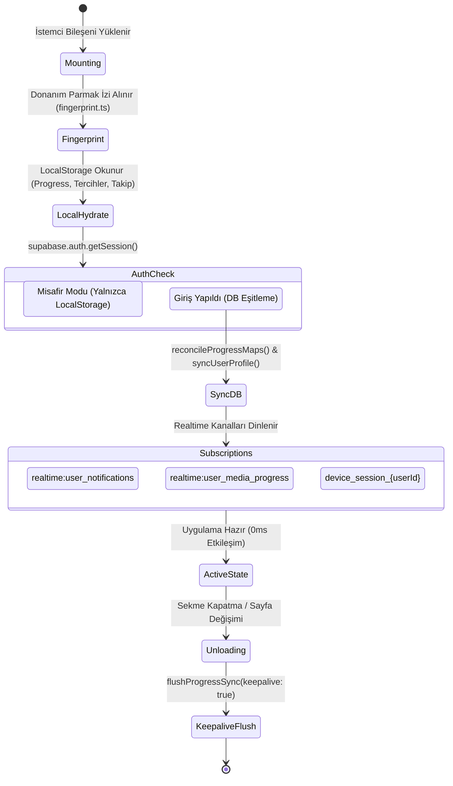
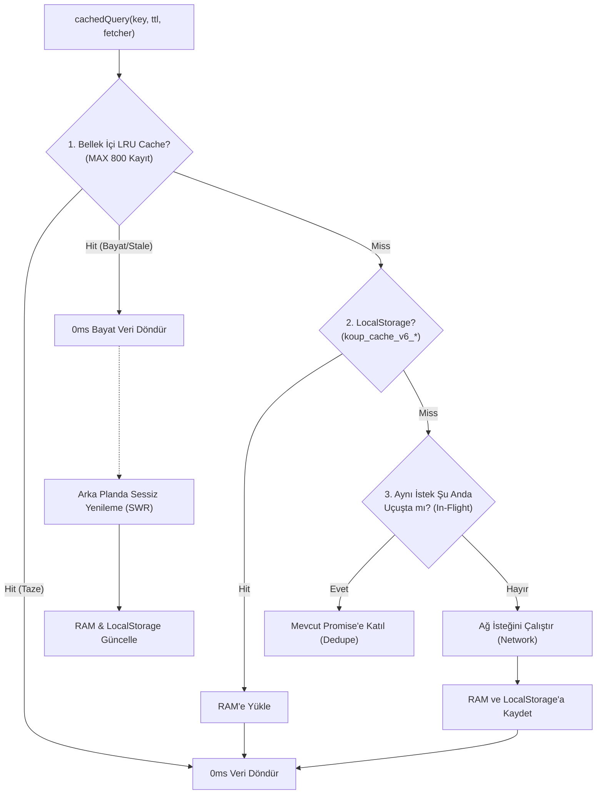
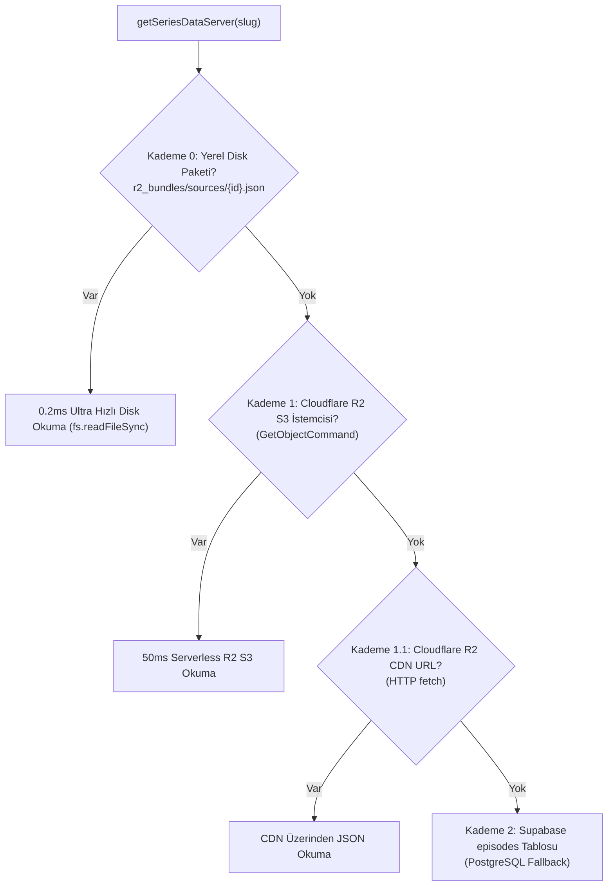

# 11 — State Yönetimi, Özel Hook'lar ve Kütüphaneler

KoUp platformunun istemci ve sunucu mimarisinde veri akışının tutarlılığı, donanım hızlandırmalı pürüzsüz arayüz tepkileri (120/144 FPS) ve arka plan senkronizasyonu; merkezi bir Context sağlayıcısı, özel React kancaları (hooks) ve modüler yardımcı kütüphaneler (`lib/*` ve `lib/server/*`) tarafından yönetilir. Bu doküman, kod tabanındaki tüm durum yönetimini, kancaları ve yardımcı servisleri ayrıntılı olarak açıklamaktadır.

---

## İçindekiler
1. [Genel Bakış ve Mimari İlke](#1-genel-bakış-ve-mimari-ilke)
2. [KoUpContext.tsx Global State Katmanı](#2-koupcontexttsx-global-state-katmanı)
   - [Neden Dev Context? Mimari Gerekçe ve Zorluklar](#neden-dev-context-mimari-gerekçe-ve-zorluklar)
   - [useKoUpSelector ve useSyncExternalStore Tabanlı Dilim Aboneliği](#usekoupselector-ve-usesyncexternalstore-tabanlı-dilim-aboneliği)
   - [KoUpContextValue Eksiksiz Referans Tablosu](#koupcontextvalue-eksiksiz-referans-tablosu)
   - [State Grupları](#state-grupları)
   - [Uçtan Uca Yaşam Döngüsü (Lifecycle & Cleanup)](#uçtan-uca-yaşam-döngüsü-lifecycle--cleanup)
   - [Projedeki Tüm LocalStorage Anahtarları Envanteri](#projedeki-tüm-localstorage-anahtarları-envanteri)
   - [Performans ve Re-Render Önlemleri](#performans-ve-re-render-önlemleri)
3. [Özel React Hook'ları (hooks/*)](#3-özel-react-hookları-hooks)
   - [useDeferredMount: Aşamalı Render ve Idle Kuyruğu](#usedeferredmount-aşamalı-render-ve-idle-kuyruğu)
   - [useDragScroll: 120/144 FPS Mouse Drag-to-Scroll & Eylemsizlik](#usedragscroll-120144-fps-mouse-drag-to-scroll--eylemsizlik)
   - [usePillDragTracking: Sekme Gezinimi ve Otomatik Merkezleme](#usepilldragtracking-sekme-gezinimi-ve-otomatik-merkezleme)
4. [Genel İstemci Kütüphaneleri (lib/*)](#4-genel-istemci-kütüphaneleri-lib)
   - [supabase.ts](#supabasets)
   - [cache.ts](#cachets)
   - [progressSync.ts](#progresssyncts)
   - [notifications.ts](#notificationsts)
   - [tasteProfile.ts](#tasteprofilets)
   - [search.ts ve searchRanking.ts](#searchts-ve-searchrankingts)
   - [sound.ts](#soundts)
   - [fingerprint.ts](#fingerprintts)
   - [deviceTracker.ts](#devicetrackerts)
   - [cleanFansub.ts](#cleanfansubts)
   - [viewTracker.ts](#viewtrackerts)
   - [youtubeTrailer.ts](#youtubetrailerts)
   - [seriesRequestResolver.ts](#seriesrequestresolverts)
   - [asyamag-live.ts ve korezin-live.ts](#asyamag-livets-ve-korezin-livets)
   - [adminClient.ts](#adminclientts)
   - [adminAuth.ts](#adminauthts)
5. [Sunucu-Özel Modüller (lib/server/*)](#5-sunucu-özel-modüller-libserver)
   - [homeData.ts](#homedatats)
   - [seriesData.ts](#seriesdatats)
   - [scraperDispatch.ts](#scraperdispatchts)
   - [Sunucu Modüllerinin İstemciden Yalıtılma Zorunluluğu](#sunucu-modüllerinin-istemciden-yalıtılma-zorunluluğu)
6. [İlgili Dokümanlar](#6-ilgili-dokümanlar)

---

## 1. Genel Bakış ve Mimari İlke

KoUp'ın istemci mimarisi 3 temel sütun üzerinde durur:
1. **Reaktif ve Bölümlenmiş Durum (Reactive & Sliced State):** Tüm uygulama için tek bir gerçeklik kaynağı (Single Source of Truth) sunulurken, gereksiz yeniden render döngülerini (re-render) önlemek için React 18/19 `useSyncExternalStore` mekanizması ile seçici abonelik (`useKoUpSelector`) kullanılır.
2. **GPU Senkronize Mikro Etkileşimler (Compositor-Synced Motion):** Kaydırma, sürükleme ve modal geçişleri JavaScript ana iş parçacığını (main thread) kilitlemeden strictly `requestAnimationFrame` (rAF) üzerinden yürütülür.
3. **Çok Katmanlı Önbellek (Multi-Tier Caching):** RAM (LRU) -> LocalStorage -> SessionStorage -> Network hiyerarşisiyle dizi detay sayfaları 0ms gecikmeyle açılır.

---

## 2. KoUpContext.tsx Global State Katmanı

[`koup-app/src/context/KoUpContext.tsx`](../koup-app/src/context/KoUpContext.tsx) platformun sinir merkezidir (~2930 satır). Kullanıcı kimliği, oturum durumu, video izleme ilerlemesi, favoriler, bildirimler, arayüz tercihleri ve yasaklama/güvenlik kontrollerini tek bir çatı altında toplar.

### Neden Dev Context? Mimari Gerekçe ve Zorluklar
KoUp gibi bir streaming platformunda birden çok bağımsız bileşen aynı veriyi eşzamanlı olarak tüketmek ve değiştirmek zorundadır:
- Bir kullanıcı video izlerken duraklattığında:
  - Oynatıcı (`NetflixPlayer`) saniye pozisyonunu günceller.
  - Navbar'daki bildirim ve profil menüsü güncellenir.
  - Ana sayfadaki "İzlemeye Devam Et" kartının ilerleme çubuğu anında değişir.
  - Dizi detayındaki bölüm listesinde ilgili bölüm "İzlendi" durumuna geçer.
  - Zevk profili (`tasteProfile`) bu izlemeyi sinyal olarak kaydeder.

Bu çapraz bağımlılıkları Redux veya harici ağır kütüphaneler eklemeden, sıfır harici paket maliyetiyle yönetmek için React'in yerleşik Context API'si tercih edilmiştir.

### useKoUpSelector ve useSyncExternalStore Tabanlı Dilim Aboneliği
Klasik `useContext(KoUpContext)` kullanımı, Context içindeki **herhangi** bir state (örn. arama kutusunun açılması, bir bildirim tostu belirmesi veya video oynatılırken saniyede bir tetiklenen ilerleme tiki) değiştiğinde Context'i tüketen **tüm** bileşenlerin yeniden render edilmesine yol açar. Sayfada 100'den fazla dizi kartı varken bu durum FPS düşüşlerine neden olur.

Bu sorunu çözmek için `KoUpContext.tsx` içinde özel bir harici mağaza (`KoUpStore`) kurulmuştur:

```typescript
// koup-app/src/context/KoUpContext.tsx
export function useKoUpSelector<T>(selector: (state: KoUpContextValue) => T): T {
  const store = useContext(KoUpStoreContext);
  if (!store) {
    throw new Error('useKoUpSelector must be used within a KoUpProvider');
  }

  const getSnapshot = useCallback(() => selector(store.get()), [store, selector]);

  return useSyncExternalStore(store.subscribe, getSnapshot, getSnapshot);
}
```

- **Seçici Abonelik:** Bileşen yalnızca ilgilendiği veriyi seçer:
  ```typescript
  // Yalnızca soundEnabled değiştiğinde render olur; izleme ilerlemesi değiştiğinde tetiklenmez!
  const soundEnabled = useKoUpSelector((s) => s.soundEnabled);
  ```
- **Sonuç:** Ana sayfadaki yüzlerce `AccordionMediaCard` veya `DirectMediaCard`, arka planda gerçekleşen bildirim akışlarından veya sayaç güncellemelerinden etkilenmez.

### KoUpContextValue Eksiksiz Referans Tablosu

| Alan / Fonksiyon | Türü | Açıklama |
|---|---|---|
| `user` | `UserProfile \| null` | Giriş yapmış kullanıcının profil verisi (ID, rol, istatistikler). |
| `profile` | `UserProfile \| null` | `user` nesnesinin geriye dönük uyumluluk takma adı. |
| `authLoading` | `boolean` | İlk oturum kontrolünün sürüp sürmediği (SSR hidrasyon kilidi). |
| `progressMap` | `Record<number, UserMediaProgress>` | Tüm yapımların izleme ilerleme kayıtlarını tutan ana sözlük (`mediaId -> progress`). |
| `continueWatchingList` | `UserMediaProgress[]` | Aktif olarak izlenen yapımların güncellenme tarihine göre sıralı dizisi. |
| `favPersonIds` | `number[]` | Kullanıcının favorilediği oyuncu/yönetmen ID'leri. |
| `personFavorites` | `number[]` | `favPersonIds` takma adı. |
| `followedMediaIds` | `number[]` | Takip edilen dizi ve film ID'leri (`media_follows`). |
| `followedPersonIds` | `number[]` | Takip edilen oyuncu ID'leri (`person_follows`). |
| `likedMagazinePostIds` | `number[]` | Beğenilen magazin haber ID'leri. |
| `toggleMagazineLike` | `(postId: number) => Promise<boolean>` | Magazin haberi beğenisini açıp kapatır. |
| `isMagazinePostLiked` | `(postId: number) => boolean` | Belirli bir haberin beğenilip beğenilmediğini sorgular. |
| `notifications` | `ToastNotification[]` | Kullanıcının bildirim kutusundaki tüm bildirimler. |
| `activeToast` | `ToastNotification \| null` | Ekranda o an animasyonla görünen anlık bildirim tostu. |
| `soundEnabled` | `boolean` | Web Audio bildirim ve tıklama seslerinin açık olup olmadığı. |
| `toggleSound` | `() => void` | Ses efektlerini açar/kapatır (`koup_sound_enabled`). |
| `triggerSound` | `(kind?: string) => void` | Ses efekti çalar (`click`, `success`, `chime`). |
| `isTrailerMuted` | `boolean` | Kart ve vitrin fragmanlarının sessizde olup olmadığı (`koup_trailer_muted`). |
| `toggleTrailerMuted` | `() => void` | Fragman sesini açar/kapatır. |
| `setTrailerMuted` | `(muted: boolean) => void` | Fragman ses durumunu doğrudan belirler. |
| `navbarBehavior` | `'floating' \| 'sticky' \| 'static'` | Üst menünün gezinme davranışı (`koup_pref_navbar_behavior`). |
| `setNavbarBehavior` | `(mode: NavbarBehavior) => void` | Navbar davranışını değiştirir. |
| `floatingNavbarEnabled`| `boolean` | Yüzen navbar aktif mi bayrağı. |
| `setFloatingNavbarEnabled`| `(v: boolean) => void` | Yüzen navbar modunu açar/kapatır. |
| `autoCardTrailerEnabled`| `boolean` | Kart üzerine gelindiğinde otomatik fragman oynatma tercihi. |
| `setAutoCardTrailerEnabled`| `(v: boolean) => void`| Otomatik fragman tercihini günceller. |
| `cardHoverExpandEnabled`| `boolean` | Kartların fare üzerine gelince genişleme animasyonu tercihi. |
| `setCardHoverExpandEnabled`| `(v: boolean) => void`| Kart genişleme tercihini günceller. |
| `isSearchOpen` | `boolean` | Global arama modalının açık olup olmadığı. |
| `setIsSearchOpen` | `(v: boolean) => void` | Arama modalını açar/kapatır. |
| `isAuthModalOpen` | `boolean` | Giriş/Kayıt modalının açık olup olmadığı. |
| `setIsAuthModalOpen` | `(v: boolean) => void` | Giriş modalını açar/kapatır. |
| `authModalMessage` | `string \| null` | Giriş modalında gösterilecek özel yönlendirme mesajı. |
| `setAuthModalMessage` | `(msg: string \| null) => void` | Giriş modalı mesajını belirler. |
| `openAuthModal` | `(message?: string) => void` | Belirli bir mesajla giriş modalını tetikler. |
| `isSoftBanned` | `boolean` | Kullanıcının yorum/beğeni yetkisinin kısıtlı olup olmadığı. |
| `isHardBanned` | `boolean` | Cihaz veya IP düzeyinde kalıcı ban uygulanıp uygulanmadığı. |
| `hardBanReason` | `string \| null` | Kalıcı ban gerekçesi. |
| `deviceFingerprint` | `string` | Cihazın SHA-256 donanım parmak izi hash'i. |
| `isRouletteOpen` | `boolean` | Rastgele dizi seçme çarkı (Rulet) modalı açık mı. |
| `setIsRouletteOpen` | `(v: boolean) => void` | Rulet modalını açar/kapatır. |
| `unreadCount` | `number` | Okunmamış bildirim sayısı. |
| `updateWatchStatus` | `(mediaId, status, season?, ep?) => void` | Yapımın izleme durumunu (`watching`, `completed` vb.) günceller. |
| `updateEpisodeProgress`| `(media, season, ep, title, pos, dur, markCompleted?, opts?) => void` | Bölüm oynatma saniyesini yerel ve uzaktan günceller. |
| `flushProgressSync` | `(mediaId?, options?) => void` | Sayfadan ayrılırken bekleyen ilerleme verisini keepalive ile gönderir. |
| `toggleEpisodeWatched` | `(media, episodeNum, upToHere?) => void` | Bölümü izlendi/izlenmedi yapar veya buraya kadarki tüm bölümleri işaretler. |
| `setLibraryStatus` | `(media, status, score?) => void` | Kütüphane sekmesini ve isteğe bağlı puanı belirler. |
| `setMediaScore` | `(media, score) => void` | Yapıma 1-10 arası kullanıcı puanı verir veya kaldırır. |
| `removeFromLibrary` | `(mediaId: number) => Promise<void>` | Yapımı kütüphaneden ve devam et listesinden siler (Tombstone ekler). |
| `removeMultipleFromLibrary` | `(mediaIds: number[]) => Promise<void>` | Birden fazla yapımı topluca kütüphaneden siler. |
| `refreshUserLibrary` | `() => Promise<void>` | Supabase'den en taze kütüphane verisini çekip yerelle uzlaştırır. |
| `toggleMediaFavorite` | `(media: MediaItem) => void` | Diziyi favorilere ekler veya çıkarır. |
| `toggleMediaFollow` | `(media: MediaItem) => void` | Diziyi takibe alır veya takipten çıkarır. |
| `togglePersonFavorite` | `(personId: number, name?) => Promise<number>` | Oyuncuyu favorilere ekler/çıkarır. |
| `togglePersonFollow` | `(personId: number, name?) => void` | Oyuncuyu takibe alır/çıkarır. |
| `pushNotification` | `(title, body, type?, linkUrl?, extra?) => void` | Yeni bir bildirim üretir ve ekranda toast patlatır. |
| `markAllNotificationsRead` | `() => void` | Tüm bildirimleri tek tıkla okundu yapar. |
| `markNotificationRead` | `(id: string) => void` | Tekil bir bildirimi okundu olarak işaretler. |
| `markNotificationUnread` | `(id: string) => void` | Bildirimi tekrar okunmadı durumuna çeker. |
| `deleteNotification` | `(id: string) => void` | Tekil bildirimi siler. |
| `clearAllNotifications` | `() => void` | Tüm bildirim kutusunu temizler. |
| `dismissToast` | `() => void` | Ekranda açık olan toast'ı kapatır. |
| `updateProfileSettings` | `(patch: Partial<UserProfile>) => Promise<void>` | Profil ve bildirim ayarlarını Supabase'e kaydeder. |
| `blockedUsers` | `Array<{ id, username, display_name, avatar_url }>` | Engellenen kullanıcılar listesi. |
| `blockedByUserIds` | `string[]` | Oturum sahibini engelleyen kullanıcıların ID listesi. |
| `blockUser` | `(targetUserId, ...) => Promise<boolean>` | Belirli bir kullanıcıyı engeller. |
| `unblockUser` | `(targetUserId: string) => Promise<boolean>` | Kullanıcının engelini kaldırır. |
| `isUserBlocked` | `(userId?: string \| null) => boolean` | Kullanıcının engellenip engellenmediğini sorgular. |
| `isBlockedBy` | `(userId?: string \| null) => boolean` | Karşı tarafın bizi engelleyip engellemediğini sorgular. |
| `loginWithEmail` | `(email, password) => Promise<string \| null>` | E-posta ve şifre ile giriş yapar. |
| `registerWithEmail` | `(email, password, username) => Promise<string \| null>` | Yeni kullanıcı kaydı açar. |
| `logout` | `() => Promise<void>` | Oturumu kapatır, yerel hafızayı temizler. |
| `confirmDialog` | `(options: ConfirmDialogOptions) => Promise<boolean>` | Global onay modalı (Promise tabanlı: Onay=true, İptal=false). |

### State Grupları
State yönetimi 5 ana mantıksal kümede toplanmıştır:
1. **Kullanıcı & Yetki (Auth & Profile):** `user`, `authLoading`, `deviceFingerprint`, `isSoftBanned`, `isHardBanned`.
2. **İzleme & Kütüphane (Progress & Library):** `progressMap`, `continueWatchingList`, `lastSyncedProgressRef`.
3. **Sosyal & Bildirimler (Social & Alerts):** `favPersonIds`, `followedMediaIds`, `followedPersonIds`, `likedMagazinePostIds`, `notifications`, `activeToast`, `blockedUsers`.
4. **Tercihler & UI (Preferences & Modals):** `isTrailerMuted`, `navbarBehavior`, `autoCardTrailerEnabled`, `cardHoverExpandEnabled`, `isSearchOpen`, `isAuthModalOpen`, `isRouletteOpen`.
5. **Eylemsel Doğrulama:** `confirmDialog` (Promise döndüren asenkron onay modalı).

### Uçtan Uca Yaşam Döngüsü (Lifecycle & Cleanup)



- **Dinleyicilerin Temizliği (Teardown):** Bileşen unmount olduğunda veya kullanıcı çıkış (`logout`) yaptığında:
  - `supabase.removeChannel(channel)` ile tüm Realtime kanalları kapatılır.
  - `window.removeEventListener` ile klavye (`keydown`), sekme odağı (`focus`, `visibilitychange`) ve pointer dinleyicileri kaldırılır.
  - 60 saniyelik cihaz iptal kontrolü (`setInterval`) temizlenir (`clearInterval`).

### Projedeki Tüm LocalStorage Anahtarları Envanteri
Aşağıdaki tablo, `koup-app/src` genelinde kullanılan tüm `localStorage` anahtarlarını, veri tiplerini ve amaçlarını listelemektedir:

| Anahtar Adı | Veri Tipi | Amacı & Saklanan Bilgi | Kullanan Dosyalar |
|---|---|---|---|
| `koup_progress_v1` | `Record<number, UserMediaProgress>` | İzlenen tüm dizi/filmlerin saniye, bölüm ve kütüphane durumları sözlüğü. | `KoUpContext.tsx`, `progressSync.ts`, `deviceTracker.ts` |
| `koup_deleted_media_v1` | `Record<number, number>` | Silinen yapımların 10 dakikalık mezar taşı (Tombstone) sözlüğü (`id -> timestamp`). | `progressSync.ts` |
| `koup_ep_pos_{id}_{season}_{ep}` | `string (JSON: { position, duration })` | Bölüm bazlı mikro izleme pozisyonu (oynatıcı anında okur). | `progressSync.ts`, `supabase.ts`, `NetflixPlayer.tsx`, `NetflixEpisodePopover.tsx` |
| `koup_fav_people_v1` | `number[]` | Favorilenen oyuncu ve yönetmen ID'leri listesi. | `KoUpContext.tsx`, `deviceTracker.ts` |
| `koup_fol_media_v1` | `number[]` | Takip edilen dizi ve film ID'leri listesi. | `KoUpContext.tsx`, `deviceTracker.ts` |
| `koup_fol_people_v1` | `number[]` | Takip edilen oyuncu ID'leri listesi. | `KoUpContext.tsx`, `deviceTracker.ts` |
| `koup_mag_likes_v1` | `number[]` | Beğenilen magazin haberlerinin ID dizisi. | `KoUpContext.tsx`, `deviceTracker.ts` |
| `koup_liked_custom_lists_v1` | `number[]` | Beğenilen özel kullanıcı listelerinin ID dizisi. | `page.tsx` (`app/listeler`) |
| `koup_profile_v1` | `UserProfile (JSON)` | Çevrimdışı ve anlık açılış için kullanıcı temel profil önbelleği. | `KoUpContext.tsx`, `deviceTracker.ts` |
| `koup_notifs_v1` | `ToastNotification[] (JSON)` | Çevrimdışı bildirim kutusu yedeği. | `KoUpContext.tsx`, `deviceTracker.ts` |
| `koup_device_fingerprint_v1` | `string (Hex Hash)` | Donanım ve tarayıcı özelliklerinden üretilen 64 karakterlik parmak izi. | `fingerprint.ts`, `deviceTracker.ts` |
| `koup_view_cooldown_v1` | `Record<string, number>` | 6 saatlik anti-F5 izlenme soğuma süresi haritası. | `viewTracker.ts` |
| `koup_reaction_{id}_{season}_{ep}`| `string` | Kullanıcının bölüme verdiği reaksiyon türü (`fire`, `cry`, `shock`, `angry`). | `page.tsx` (`app/seri/[slug]`) |
| `koup_last_issue_report_time` | `number (Epoch ms)` | Hata/sorun bildirim formunun spam kısma zaman damgası (60s kuralı). | `page.tsx`, `SeriesDetailClient.tsx` |
| `koup_trailer_muted` | `'true' \| 'false'` | Fragmanların sessizde başlatılma tercihi. | `KoUpContext.tsx` |
| `koup_pref_navbar_behavior` | `'floating' \| 'sticky' \| 'static'` | Navbar gezinme modu tercihi. | `KoUpContext.tsx`, `ayarlar/page.tsx` |
| `koup_pref_floating_navbar` | `'true' \| 'false'` | Eski yüzen navbar uyumluluk bayrağı. | `KoUpContext.tsx` |
| `koup_pref_auto_card_trailer` | `'true' \| 'false'` | Kart üzerine gelindiğinde otomatik fragman oynatma tercihi. | `KoUpContext.tsx`, `ayarlar/page.tsx` |
| `koup_pref_card_hover_expand` | `'true' \| 'false'` | Kart hover genişleme animasyonunun açık/kapalı olma tercihi. | `KoUpContext.tsx`, `AccordionMediaCard.tsx` |
| `koup_player_volume` | `string (Float 0..1)` | Video oynatıcının son ses seviyesi. | `NetflixPlayer.tsx` |
| `koup_player_muted` | `'true' \| 'false'` | Video oynatıcının sessize alınıp alınmadığı. | `NetflixPlayer.tsx` |
| `koup_preferred_quality` | `string` | Tercih edilen çözünürlük ('1080p', '720p', 'Otomatik'). | `NetflixPlayer.tsx` |
| `koup_preferred_provider` | `string` | Tercih edilen yayın sunucusu/kaynağı. | `NetflixPlayer.tsx` |
| `koup_ambient_lighting` | `'true' \| 'false'` | Video etrafındaki sinematik ortam ışığı (ambient glow) tercihi. | `NetflixPlayer.tsx`, `page.tsx` |
| `koup_auto_next` | `'true' \| 'false'` | Bölüm bitince sonraki bölüme otomatik geçme tercihi. | `NetflixPlayer.tsx`, `page.tsx` |
| `koup_cookie_consent_v1` | `CookieConsentState (JSON)` | Çerez izinleri (necessary, personalization, performance). | `tasteProfile.ts` |
| `koup_taste_profile_v1` | `UserTasteProfile (JSON)` | Kullanıcının kategori ve ülke ağırlıklarını tutan Zevk DNA'sı. | `tasteProfile.ts` |
| `koup_cache_v6_*` | `CacheEntry<T> (JSON)` | Multi-tier önbellek katmanının disk kayıtları. | `cache.ts` |
| `sb-*-auth-token` | `Session (JSON)` | Supabase yerel kimlik doğrulama oturum anahtarı (JWT). | `@supabase/supabase-js`, `progressSync.ts` |

### Performans ve Re-Render Önlemleri
- `continueWatchingList` hesaplaması `useMemo` ile `progressMap` referansı değişmediği sürece kilitlenir.
- `unreadCount`, `notifications` dizisindeki `isRead: false` öğeler filtrelenerek memoize edilir.
- Kart bileşenleri `useKoUpSelector` kullanarak yalnızca kendi ihtiyaç duydukları primitive değerleri (örn. `soundEnabled` veya `cardHoverExpandEnabled`) dinler; böylece saniyede bir tetiklenen oynatıcı süre güncellemeleri sayfadaki 100 kartı yeniden çizmez.


---

## 3. Özel React Hook'ları (hooks/*)

### useDeferredMount: Aşamalı Render ve Idle Kuyruğu
[`koup-app/src/hooks/useDeferredMount.ts`](../koup-app/src/hooks/useDeferredMount.ts) ana sayfadaki onlarca içerik rayının (KDrama, CDrama, Animeler, Top 10, Kısa Dramalar vb.) aynı anda DOM'a basılarak ilk ekran boyama (FCP/LCP) süresini geciktirmesini engeller.

#### İmza ve Kullanım
```typescript
export function useDeferredMount(order: number): {
  isMounted: boolean;
  ref: (node: HTMLElement | null) => void;
};
```

#### Çalışma Mantığı
1. **İlk 3 Rayın Anında Basılması (`order <= 2`):** Ekranın görünen üst kısmında (above-the-fold) bulunan ilk 3 bölüm `isMounted = true` ile 1. karede (frame 1) anında render edilir. Kullanıcı hiçbir zaman iskelet (skeleton) veya boşluk titremesi görmez.
2. **Kalan Rayların Kuyruğa Alınması (`IdleQueueScheduler`):** Daha alttaki raylar tekil bir çizelgeleyiciye (`scheduler.register`) kaydedilir. Çizelgeleyici her bir animasyon karesinde (`requestAnimationFrame`) sıradaki yalnızca **1** rayı DOM'a monte eder.
3. **Yaklaşma Promosyonu (`IntersectionObserver`):** Ray henüz sırası gelmeden kullanıcının görüş alanına 400 piksel yaklaştığında (`rootMargin: '400px 0px'`), gözlemci bunu fark eder ve görevi kuyruğun en önüne acil (`urgent: true`) olarak taşır.
4. **Geri Dönüşte Hızlı Montaj (`isScrollRestorationActive`):** Kullanıcı sayfayı yenilediğinde veya başka bir sayfadan "Geri" butonuna basarak geldiğinde, eski kaydırma pozisyonu sıfırlanmasın diye tüm kuyruk tek seferde (`mountAllNow`) derhal açılır.
5. **Temizlik:** Bileşen ekrandan kaldırıldığında gözlemci bağlantısı kesilir (`disconnect`), bekleyen zamanlayıcılar iptal edilir.

---

### useDragScroll: 120/144 FPS Mouse Drag-to-Scroll & Eylemsizlik
[`koup-app/src/hooks/useDragScroll.ts`](../koup-app/src/hooks/useDragScroll.ts) masaüstü kullanıcılarına yatay içerik raylarını fare ile tıklayıp kaydırma (drag-to-scroll) yeteneği kazandırır.

#### İmza ve Kullanım
```typescript
export function useDragScroll<T extends HTMLElement = HTMLDivElement>(): React.RefObject<T | null>;
```

#### Çalışma Mantığı
1. **Yalnızca Sol Tık:** Sağ tık veya orta tık sürüklemeyi tetiklemez (`e.button !== 0`). Form girdileri ve interaktif butonlar sürükleme algılayıcısından muaf tutulur.
2. **1:1 Doğrudan Piksel Takibi:** Farenin X eksenindeki hareketi anında `targetScrollLeftRef` üzerine yansıtılır. DOM'un `scrollLeft` özelliğine yazma işlemi strictly `requestAnimationFrame` senkronizasyonunda yapılarak ekran yenileme hızıyla (60/120/144 Hz) eşleşir.
3. **Accordion Hover Kilidi (`setAccordionDragLock`):** Kullanıcı rayı sürüklerken dizi kartlarının üzerine fare gelince kartların büyüyüp açılmasını engeller (`is-dragging`).
4. **Fırlatma Eylemsizliği (Momentum / Inertia):** Farenin son 5 hareketindeki hız vektörü (`velocityX`) hesaplanır. Kullanıcı fareyi hızla fırlatıp bıraktığında, hareket aniden durmaz; `0.94` oranında pürüzsüz azalan bir sürtünme döngüsüyle (`momentumLoop`) akmaya devam eder.
5. **Yanlışlıkla Tıklamayı Engelleme (Click Capture):** 4 pikselden fazla sürükleme yapılmışsa, farenin bırakıldığı yerdeki dizi kartının linki (`onClick`) yakalanarak (`e.preventDefault()`, `e.stopPropagation()`) iptal edilir; kullanıcının istemeden dizi sayfasına gitmesi engellenir.

---

### usePillDragTracking: Sekme Gezinimi ve Otomatik Merkezleme
[`koup-app/src/hooks/usePillDragTracking.ts`](../koup-app/src/hooks/usePillDragTracking.ts) kategori, filtre ve sezon sekmelerinin (Pills) mobil ve masaüstünde akıcı çalışmasını sağlar.

#### İmza ve Kullanım
```typescript
export function usePillDragTracking<T extends string | number>(options: {
  activeTab: T;
  onTabChange: (id: T) => void;
  triggerSound?: (type: string) => void;
  tabAttribute?: string; // Varsayılan: 'data-tab-id'
  disableAutoScroll?: boolean;
}): {
  containerRef: React.RefObject<HTMLDivElement | null>;
  // ...diğer sürükleme yöneticileri
};
```

#### Çalışma Mantığı
1. **Mobil Cihazlarda Doğal Kaydırma:** Dokunmatik ekranlarda tarayıcının yerel yatay kaydırma davranışı engellenmez; sıfır dirençle doğal kayar.
2. **Masaüstünde Sürükleyerek Seçme:** Masaüstünde fare basılı tutulup sekmeler üzerinde gezdirildiğinde, farenin altındaki en yakın sekme tespit edilir, hafif tıklama sesi (`triggerSound('click')`) eşliğinde aktif sekme değiştirilir.
3. **Otomatik Ortaya Hizalama (`centerTabInContainer`):** Hangi sekme seçilirse seçilsin, konteyner otomatik olarak yumuşak bir animasyonla (`smooth scroll`) o sekmeyi ekranın tam ortasına hizalar. Eğer ilk sekme seçilmişse en sola (`left: 0`), son sekme seçilmişse en sağa yaslar.

---

## 4. Genel İstemci Kütüphaneleri (lib/*)

### supabase.ts
[`koup-app/src/lib/supabase.ts`](../koup-app/src/lib/supabase.ts) veritabanı istemcilerini, arayüz tiplerini ve kritik veri temizleme fonksiyonlarını barındırır:
- **İstemci Tanımları:**
  - `supabase`: Anonim anahtarla (`NEXT_PUBLIC_SUPABASE_ANON_KEY`) çalışan, oturum yenilemesi (`autoRefreshToken: true`) açık istemci.
  - `supabaseAdmin`: Yalnızca sunucu ortamında (`typeof window === 'undefined'`) çalışan ve gizli servis anahtarıyla (`SUPABASE_SERVICE_ROLE_KEY`) tam yetkili işlem yapan istemci.
- **Veri Modelleri:** `MediaItem`, `PersonItem`, `CastMember`, `EpisodeData`, `EpisodeSource`, `MagazinePost`, `UserProfile`, `UserMediaProgress`.
- **Önemli Yardımcı Fonksiyonlar:**
  - `cleanMediaTitle(raw)`: Scraper artığı "izleSpider", "filmi izle", "türkçe altyazılı" kelimelerini ve bozuk UTF-8 mojibake karakterlerini temizler.
  - `cleanEpisodeName(raw, s, e)`: Bölüm adındaki tekrarlı "1. Sezon 2. Bölüm", yayın tarihleri ve parantez gürültülerini ayıklar; yalnızca özgün bölüm adını bırakır.
  - `cleanOverviewText(raw)`: Kazınan özetlerdeki `<br>`, `<p>`, `&nbsp;` ve SEO spam ön eklerini temizleyerek doğal paragraflara dönüştürür.
  - `getProxiedImageUrl(url, ...)`: TMDB ve AniList dışındaki korumalı afişleri Vercel/Cloudflare CDN üzerinden güvenle ve WebP formatında optimize eder.
  - `formatViewCount(count)`: İzlenme sayılarını kompakt formata çevirir (1500 -> "1.5K", 1.200.000 -> "1.2M").
  - `isShortDrama(media)`: Dikey kısa formatlı webdramaları (`kisa_drama`) standart dizilerden ayırır.

---

### cache.ts
[`koup-app/src/lib/cache.ts`](../koup-app/src/lib/cache.ts) KoUp'ın çok katmanlı istemci önbellek motorudur:



- **Dinamik TTL Çözümleme (`resolveQueryTTL`):**
  - Oyuncu ve kategoriler için: **20 dakika** (1.200.000 ms).
  - Dizi detay ve katalog sorguları için: **10 dakika** (600.000 ms).
  - Varsayılan sorgular için: **5 dakika** (300.000 ms).
- **Kota Yönetimi ve Budama (`pruneStorage`):** `localStorage` kotası dolduğunda en eski %30'luk önbellek dilimi otomatik silinir; kritik kullanıcı verileri (`koup_progress_v1`) asla zarar görmez.
- **Senkron Medya Kaydı (`registerMediaItem` / `getMediaFromCache`):** Bir dizinin kartı ekranda göründüğü anda stub bilgisi RAM sözlüğüne kaydedilir. Kullanıcı karta tıkladığında dizi detay sayfası **0 milisaniyede** açılır.

---

### progressSync.ts
[`koup-app/src/lib/progressSync.ts`](../koup-app/src/lib/progressSync.ts) video izleme ilerlemesini güvenli ve tasarruflu biçimde Supabase'e aktarır:
- **`syncProgressRecordToSupabase()`:**
  - Giriş yapmamış kullanıcıların verisini veritabanına göndermez (misafir güvenliği).
  - Tablo şemasına uygunluk için `user_score` (1..10) ve `status` değerlerini sterilize eder.
  - Sayfa kapanışında `keepalive: true` ile tarayıcı kapansa bile ağ paketinin Vercel/Supabase'e ulaşmasını sağlar.
  - Veritabanında silinmiş bir diziye dair yabancı anahtar hatası (`23503`) alınırsa, yerel `koup_progress_v1` içindeki artık kaydı budar; tarayıcının sonsuz döngüde hata basmasını engeller.
- **`shouldSyncToSupabase()`:**
  - Sürekli oynatma sırasında her saniye istek atmaz.
  - Yalnızca duraklatmada (delta >= 10s), sayfa çıkışında (delta >= 10s), bölüm bitiminde veya 2.5 dakikalık periyotta istek tetikler.
- **`reconcileProgressMaps()`:**
  - Yerel ile uzak DB arasındaki en ileri ilerlemeyi seçer, izlenen bölümleri birleştirir, silinmiş yapımları mezar taşıyla (`Tombstone`) engeller.

---

### notifications.ts
[`koup-app/src/lib/notifications.ts`](../koup-app/src/lib/notifications.ts) bildirimlerin biçimlendirilmesi, tekilleştirilmesi ve sıralanmasından sorumludur:
- **`parseEpisodeInfo(n)`:** Bildirim metninden veya URL'sinden dizi slug'ını, sezon ve bölüm numarasını Regex ile çıkarır.
- **`compareNotifications(a, b)`:**
  - Aynı dizinin ardışık bölümleri bildirildiğinde **büyük bölüm numarasını en üste** koyar (16. Bölüm, 15'in üzerinde durur).
  - Zaman damgaları eşit olduğunda `id.localeCompare` ile mutlak deterministik sıralama sağlar (F5 yapıldığında liste asla yer değiştirmez).
- **`isMaintenanceOrErrorNotification()`:** Python motoru, SQLite veya senkronizasyon log mesajlarının kalıcı kullanıcı bildirim kutusunu kirletmesini engeller.
- **`dedupeAndSortNotifications()`:** URL veya metin parmak iziyle yinelenen bildirimleri teke düşürürken okunma durumunu (`isRead = true`) korur.

---

### tasteProfile.ts
[`koup-app/src/lib/tasteProfile.ts`](../koup-app/src/lib/tasteProfile.ts) kullanıcı hareketlerini analiz eden Zevk DNA'sı kütüphanesidir:
- **`getCookieConsent()` / `saveCookieConsent()`:** Kullanıcının KVKK/GDPR çerez onay durumunu `koup_cookie_consent_v1` üzerinde yönetir. Kişiselleştirme kapatılırsa zevk profili anında bellekten ve diskten silinir.
- **`recordTasteSignal(media, signal)`:** Kullanıcı etkileşimlerini ağırlıklandırır (`hover: 1`, `view: 3`, `watch: 6`, `favorite: 10`). Ülke, içerik türü ve kategorilere puan ekler.
- **`rankRelatedMedia(source, candidates, limit)`:** Dizi detayındaki benzer yapımları tür, ülke, kategori örtüşmesi, çıkış yılı ve kullanıcı zevkine göre çoklu sinyalle puanlar.
- **`buildPersonalizedFeed(pool, progressMap, limit)`:** Ana sayfadaki "Sana Özel Seçki" satırını oluşturur. Tamamlanmış ve bırakılmış yapımları bu keşif listesinden eler.

---

### search.ts ve searchRanking.ts
Arama motorunun iki çekirdek parçasıdır:
- **`normalizeSearchQuery(input)` (`search.ts`):** Türkçe diyakritikleri düzleştirir, noktalama işaretlerini boşluğa çevirir, CJK ve Kiril karakterleri korur. Hem kelime dizisi (`tokens`) hem de boşluksuz birleşik varyant (`condensed`) döner.
- **`getSearchRelevanceScore(item, query)` (`searchRanking.ts`):** Tam eşleşmeye 1.000.000 puan, sıralı token eşleşmesine 250.000 puan verir. Çok uzun başlıklara karakter başı 150 puan ceza uygularken, 12+ ve 50+ bölümlük ana dizilere bölüm sayısı bonusu vererek 1 bölümlük OVA ve özel bölümlerin ana diziyi ezmesini engeller.

---

### sound.ts
[`koup-app/src/lib/sound.ts`](../koup-app/src/lib/sound.ts) harici ses dosyalarına ihtiyaç duymadan, Web Audio API osilatörleriyle (`OscillatorNode`, `GainNode`) doğrudan tarayıcıda ses sentezler:
- **`apple_glass`:** 1046.5, 1567.98 ve 2093.0 Hz frekanslarında 3 katmanlı kristal cam akoru.
- **`soft_chime`:** 587.33 Hz -> 880 Hz üçgen dalga tınısı.
- **`minimal_pop`:** 420 Hz -> 760 Hz aralığında 80 milisaniyelik mikro tıklama sesi.
- **`muteDuringFullscreen`:** `document.fullscreenElement` kontrolüyle kullanıcı tam ekranda video izlerken tüm sesleri susturur.

---

### fingerprint.ts
[`koup-app/src/lib/fingerprint.ts`](../koup-app/src/lib/fingerprint.ts) istemci donanım parmak izini hesaplar:
- User-Agent, tarayıcı dili, işletim sistemi platformu, `hardwareConcurrency` (CPU çekirdekleri), `deviceMemory` (RAM miktarı), ekran çözünürlüğü ve renk derinliği, piksel oranı (`devicePixelRatio`), saat dilimi (`timeZone`) ve görünmez bir HTML5 Canvas çizim testi (`toDataURL`) birleştirilir.
- Elde edilen veri `window.crypto.subtle.digest('SHA-256')` (veya FNV-1a yedeği) ile 64 karakterlik kararlı bir karma koda dönüştürülür ve `koup_device_fingerprint_v1` anahtarında saklanır. Kalıcı cihaz yasaklamalarında (Hard Ban) bu hash kullanılır.

---

### deviceTracker.ts
[`koup-app/src/lib/deviceTracker.ts`](../koup-app/src/lib/deviceTracker.ts) kullanıcının hesabına bağlı tüm aktif oturumları izler:
- **`parseDeviceEnvironment()`:** User-Agent'tan cihaz tipini (`desktop`, `mobile`, `tablet`), işletim sistemini ve tarayıcıyı tespit eder (örn. *"Windows 11 • Google Chrome"*).
- **`registerOrHeartbeatDevice()`:** Kullanıcı siteye girdiğinde cihazı `user_devices` tablosuna kaydeder veya son aktiflik zamanını günceller. Eğer cihaz daha önce uzaktan iptal edilmişse (`is_revoked = true`), kullanıcıyı derhal sistemden atar (`performRemoteSignOut`).
- **`terminateDeviceSession()` / `terminateAllOtherDevices()`:** Uzaktaki oturumları sonlandırır ve Realtime kanalı (`device_session_${userId}`) üzerinden ilgili cihazlara sinyal göndererek anında çıkış yapmalarını sağlar.

---

### cleanFansub.ts
[`koup-app/src/lib/cleanFansub.ts`](../koup-app/src/lib/cleanFansub.ts) çeviri grubu ve video kaynak isimlerini temizler:
- `cleanFansubName(raw)`: Metin içindeki `discord.gg/...`, `instagram.com/...`, web siteleri, sosyal medya etiketleri (@...), reklam sloganları (*"destek olmak için:"*) ve çevirmen rolleri (*"encoder:", "çeviri:"*) ayıklanır. Yalnızca temiz grup adı (örn. *SomeSub*, *CultureSubs*, *LeeFansub*) bırakılır.
- `cleanSourceName(raw)`: Video kaynak etiketlerindeki çözünürlük gürültülerini (`(1080p)`, `FHD`, `HD`) ve fansub artıklarını temizlerken çeviri türü etiketlerini (*"Altyazılı"*, *"Dublaj"*, *"Dual"*) korur.

---

### viewTracker.ts
[`koup-app/src/lib/viewTracker.ts`](../koup-app/src/lib/viewTracker.ts) izlenme etkinliklerini kaydeder:
- `trackMediaView(mediaId, kind, season, episode)`:
  - `kind = 'detail'`: Dizi detay sayfasına girildiğinde tetiklenir (`media.views_total` artar).
  - `kind = 'watch'`: Bölüm oynatıldığında tetiklenir (`episodes.views_count` ve `media.views_total` artar).
- **6 Saatlik Soğuma:** `koup_view_cooldown_v1` anahtarı üzerinden aynı bölüm veya dizinin 6 saat içinde tekrar tekrar izlenme basmasını engeller.

---

### youtubeTrailer.ts
[`koup-app/src/lib/youtubeTrailer.ts`](../koup-app/src/lib/youtubeTrailer.ts) YouTube gömülü fragmanlarını sinematik kalitede oynatır:
- YouTube'un harici iframe içerisindeki kocaman oynat/duraklat butonunu ve başlık çubuğunu gizlemek amacıyla iframe'i **3.9 saniye boyunca (`TRAILER_FIRST_REVEAL_SEC`) şeffaf (opacity: 0) tutar**; YouTube'un arayüzü kaybolunca video görünür hale gelir.
- Video duraklatıldığında veya tamponlama yaptığında arayüz tekrar gizlenir (`TRAILER_RESUME_REVEAL_SEC = 2.0s`).
- Bitiş ekranındaki ilgili videolar ızgarasının çıkmaması için video süresinin bitimine 0.6 saniye kala (`duration - 0.6s`) otomatik başa sarılır (`seekTo 0`).
- Adblocker nedeniyle telemetri mesajları engellenirse 6 saniyelik emniyet zamanlayıcısıyla video açılır.

---

### seriesRequestResolver.ts
[`koup-app/src/lib/seriesRequestResolver.ts`](../koup-app/src/lib/seriesRequestResolver.ts) `/seri-istek` sayfasında dış linkleri çözer:
- `parseSeriesRequestUrl()`: AniList, TMDB, MyDramaList ve IMDb bağlantılarını ayrıştırır.
- `resolveSeriesRequestUrl()`: Dış platform API'lerine bağlanıp başlık, poster, çıkış yılı ve bölüm sayısını çeker. İngilizce özetleri Google Translate ile Türkçeleştirir. Dizinin zaten arşivde olup olmadığını kontrol eder (`existing_media`).

---

### asyamag-live.ts ve korezin-live.ts
Magazin haber servisleridir:
- `asyamag-live.ts`: AsyaMag resmi REST API'sini sorgular (`_embed=true`), kategorileri eşler, dedikodu etiketlerini atar, Supabase `magazine_posts` tablosuyla birleştirir (3 dk SWR).
- `korezin-live.ts`: KoreZin WordPress RSS 2.0 XML akışını çeker; CDATA, resim ve özetleri temizler; 3 dakika bellek içi önbellekle sunar.

---

### adminClient.ts ve adminAuth.ts
- `adminClient.ts`: İstemci tarafında `adminFetch` fonksiyonunu sunar. Supabase oturum anahtarını (Bearer Token) otomatik olarak `Authorization` başlığına ekler.
- `adminAuth.ts`: Sunucu tarafında Next.js API rotalarını korur:
  - `verifyUserSession(req)`: Standart kullanıcı oturumunu doğrular, ban kontrolü yapar.
  - `verifyAdminAuth(req, opts)`: Yalnızca `admin` veya `moderator` rolündeki kullanıcıların kritik yönetim rotalarına girmesine izin verir.
  - `checkAdminRateLimit(key, max, window)`: Bellek içi kova algoritmasıyla API isteklerini sınırlar (dakikada maks 30 istek).
  - `logAdminAudit(params)`: Yönetici hareketlerini `admin_audit_log` tablosuna işler.
  - `resolvePythonBinary()`: Yerel sistemdeki Python yürütücüsünü tespit eder.


---

## 5. Sunucu-Özel Modüller (lib/server/*)

`koup-app/src/lib/server/` altındaki modüller yalnızca Node.js sunucu ortamında (Server Components, API Route Handlers veya Server Actions) çalışmak üzere tasarlanmıştır.

### homeData.ts
[`koup-app/src/lib/server/homeData.ts`](../koup-app/src/lib/server/homeData.ts) ana sayfanın sunucu tarafında ilk render (SSR) sırasında ihtiyaç duyduğu tüm içerik paketini (`HomeDataBundle`) tek bir paralel sorgu demetinde çeker:
- **12 Paralel Veritabanı Sorgusu (`Promise.all`):**
  1. `feats`: Vitrin yapımları (`is_featured = true`, `featured_order`).
  2. `kds`: En popüler Güney Kore dizileri (`country_code = 'KR'`, `mdl_rating` desc, limit 28).
  3. `cds`: En popüler Çin dizileri (`country_code = 'CN'`, `mdl_rating` desc, limit 28).
  4. `ans`: En popüler animeler (`content_type = 'anime'`, `anilist_rating` desc, limit 28).
  5. `gls`: Tayvan, Tayland ve Batı yapımları (`US`, `TH`, `TW`, `JP`, limit 28).
  6. `episodes`: Son yayınlanan 2000 bölüm.
  7. `people`: En çok takip edilen 12 oyuncu (`favorites_count` desc).
  8. `magPosts`: Son 6 magazin haberi.
  9. `top10SeriesRes`: `get_weekly_top10` RPC (Haftalık trend diziler).
  10. `top10MoviesRes`: `get_weekly_top10` RPC (Haftalık trend filmler).
  11. `recentMediaRes`: Kütüphaneye son eklenen 30 dizi/film.
  12. `shortDramasRes`: Dikey kısa drama yapımları (`kisa_drama`, limit 20).
- **Kısa Drama İzolasyonu (`isNotShort`):** Dikey formatlı yapımların standart 16:9 yatay raylara sızmasını önlemek için filtrelenir.
- **Top 10 Fallback Koruması:** Eğer RPC boş dönerse `views_total` sıralamasıyla yedek Top 10 listesi oluşturulur.

---

### seriesData.ts
[`koup-app/src/lib/server/seriesData.ts`](../koup-app/src/lib/server/seriesData.ts) dizi detay sayfasının (`/seri/[slug]`) sunucu tarafında yıldırım hızında render edilmesini sağlar:
- **Akıllı Slug Çözümleme (4 Seviyeli Fallback):**
  1. *Birebir Slug Eşleşmesi:* `media.slug == decodedSlug`.
  2. *Temizlenmiş Kazıyıcı Slug'ı:* `cleanScrapedSlug(slug)` ile "-izle", "-dizi-izle" ekleri silinerek arama yapılır.
  3. *Alternatif Başlıklar:* `aka_titles` dizisi taranır.
  4. *Ön Ek / Son Ek / Sayısal ID Arama:* `slug.ilike.${decodedSlug}%` veya doğrudan sayısal `id` kontrol edilir.
- **4 Kademeli Bölüm Verisi Okuma (Multi-Tier Episode Retrieval):**



- **Oyuncu Kadrosu Sıralaması:** Başroller (`role_type === 'lead'`) en başta, ardından faturalandırma sırasına (`billing_order`) göre dizilir.
- **Franchise Entegrasyonu (`getFranchiseForMedia`):** Dizi bir evrene aitse `franchise_graph.json` dosyasından evren yapımları ve izleme sırası çekilir.

---

### scraperDispatch.ts
[`koup-app/src/lib/server/scraperDispatch.ts`](../koup-app/src/lib/server/scraperDispatch.ts) admin paneli üzerinden kazıyıcı botları ve senkronizasyon betiklerini tetikler:
- **Çalışma Ortamı Tespiti (`isServerlessRuntime`):** Vercel, AWS Lambda veya Cloudflare Pages üzerinde çalışıp çalışmadığını belirler.
- **Yerel Python Kontrolü (`hasLocalPython`):** Sunucuda Python yorumlayıcısının (`python --version`) kurulu olup olmadığını yoklar.
- **GitHub Actions Bulut İş Akışı Dağıtımı (`dispatchCloudScraperJob`):**
  - Vercel gibi sunucusuz ortamlarda uzun süren Python kazıyıcıları çalıştırılamaz (timeout riski).
  - Bu durumda GitHub Actions REST API'sine (`/actions/workflows/{workflowFile}/dispatches`) bağlanarak `admin_job.yml` veya `scraper_cron.yml` iş akışını tetikler.
  - Göreve benzersiz bir `run_id` (UUID) atanır ve `scraper_runs` tablosuna kaydedilir.
  - **Canlı Log Akışı:** GitHub Actions çalışırken Supabase `scraper_logs` tablosunu 1.5 saniyede bir yoklayarak konsol çıktılarını admin arayüzüne anlık akıtır (`sendEvent`).

---

### Sunucu Modüllerinin İstemciden Yalıtılma Zorunluluğu

> [!CAUTION] Güvenlik ve Mimari Yalıtım
> `lib/server/*` dizini altındaki hiçbir dosya istemci bileşenlerine (`'use client'`) veya tarayıcı tarafına import edilemez.

**Neden Yasak?**
1. **Node.js Yerel API Bağımlılıkları:** Bu dosyalar `node:fs`, `node:child_process`, `node:crypto` ve `node:path` modüllerini kullanır. Tarayıcıda bu modüller bulunmadığı için istemci bundle'ına dahil edilmeleri durumunda derleme hatası (build failure) oluşur.
2. **Kritik Gizli Anahtar İzolasyonu (Zero Secrets Leak):** Bu modüller `CF_R2_ACCESS_KEY_ID`, `CF_R2_SECRET_ACCESS_KEY`, `GITHUB_TOKEN`, `GITHUB_PAT` ve `SUPABASE_SERVICE_ROLE_KEY` ortam değişkenlerine erişir. İstemci tarafına sızmaları durumunda tüm veritabanı ve bulut depolama sistemi yetkisiz erişime açık hale gelir.
3. **Paket Boyutu ve Tree-Shaking:** `@aws-sdk/client-s3` gibi ağır sunucu kütüphanelerinin istemci JS bundle'ına dahil edilerek kullanıcının internet kotasını tüketmesi ve FCP/LCP performansını düşürmesi engellenir.

---

## 6. İlgili Dokümanlar
- 🏗️ **Genel Bakış ve Mimari:** [01-genel-bakis-ve-mimari.md](./01-genel-bakis-ve-mimari.md)
- 🖥️ **Sayfalar ve Rotalar:** [03-sayfalar-ve-rotalar.md](./03-sayfalar-ve-rotalar.md)
- 🎨 **Bileşenler ve Tasarım Sistemi:** [04-bilesenler-ve-tasarim-sistemi.md](./04-bilesenler-ve-tasarim-sistemi.md)
- 🎬 **Oynatıcı ve Akış Çözücü:** [05-oynatici-ve-yayin-akisi.md](./05-oynatici-ve-yayin-akisi.md)
- 🔌 **API Referansı:** [06-api-referansi.md](./06-api-referansi.md)
- 🔐 **Kimlik, Yetki ve Güvenlik:** [07-kimlik-yetki-ve-guvenlik.md](./07-kimlik-yetki-ve-guvenlik.md)
- 🗄️ **Veri Katmanı ve Şemalar:** [08-veri-katmani.md](./08-veri-katmani.md)
- 🤖 **Kazıyıcılar ve Senkron:** [09-kaziyicilar-scriptler-ve-senkron.md](./09-kaziyicilar-scriptler-ve-senkron.md)
- 👤 **Kullanıcı Özellikleri:** [10-kullanici-ozellikleri.md](./10-kullanici-ozellikleri.md)
- 📜 **Kurallar ve Yasaklar:** [12-kurallar-ve-yasaklar.md](./12-kurallar-ve-yasaklar.md)
