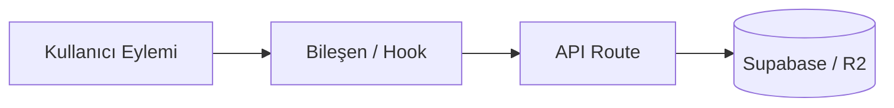

# KoUp Dokümantasyon Rehberi (Living Documentation Guide)

Bu rehber, KoUp projesinde dokümantasyonun nasıl güncel tutulacağını, hangi kod değişikliğinde hangi doküman dosyasının düzenlenmesi gerektiğini ve yeni bir özellik eklendiğinde kullanılacak standart şablonu açıklar.

KoUp projesinde dokümantasyon bir formalite değil; **kodun ayrılmaz bir parçasıdır ve yaşayan tek doğruluk kaynağıdır (Single Source of Truth)**. `GEMINI.md` §12 uyarınca, doküman güncellemesi yapılmayan hiçbir geliştirme görevi "tamamlandı" sayılamaz.

---

## İçindekiler
1. [Değişiklik Eşleme Tablosu (Hangi Değişiklikte Hangi Dosya Güncellenir?)](#1-değişiklik-eşleme-tablosu-hangi-değişiklikte-hangi-dosya-güncellenir)
2. [Standart Yeni Özellik Doküman Şablonu](#2-standart-yeni-özellik-doküman-şablonu)
3. [Doküman Yazım ve Format Standartları](#3-doküman-yazım-ve-format-standartları)
   - [3.1. Dil ve Üslup Standartları](#31-dil-ve-üslup-standartları)
   - [3.2. Göreli Bağlantı (Relative Links) Zorunluluğu](#32-göreli-bağlantı-relative-links-zorunluluğu)
   - [3.3. Kesin Gizli Anahtar (Secret) Yasağı](#33-kesin-gizli-anahtar-secret-yasağı)
   - [3.4. Mermaid Diyagram Standartları](#34-mermaid-diyagram-standartları)
   - [3.5. Kod Blokları ve Tip Referansları](#35-kod-blokları-ve-tip-referansları)
4. [Yeni Doküman Dosyası Ekleme Prosedürü](#4-yeni-doküman-dosyası-ekleme-prosedürü)
5. [Changelog Güncelleme Disiplini](#5-changelog-güncelleme-disiplini)
6. [İlgili Dokümanlar](#6-ilgili-dokümanlar)

---

## 1. Değişiklik Eşleme Tablosu (Hangi Değişiklikte Hangi Dosya Güncellenir?)

Bir kod değişikliği yaptığınızda, aşağıdaki tabloya göre ilgili doküman dosyasını ve her zaman [`CHANGELOG.md`](./CHANGELOG.md) dosyasını güncellemekle yükümlüsünüz:

| Yapılan Değişikliğin Türü | Değiştirilen / Eklenen Kod Alanı | Güncellenecek Doküman Dosyası | Ek Notlar |
| :--- | :--- | :--- | :--- |
| **Yeni Sayfa / Rota** | `koup-app/src/app/**/page.tsx`, `layout.tsx` | [`03-sayfalar-ve-rotalar.md`](./03-sayfalar-ve-rotalar.md) | Sayfa amacı, layout hiyerarşisi, client/server rendering tipi |
| **Yeni UI Bileşeni** | `koup-app/src/components/**` | [`04-bilesenler-ve-tasarim-sistemi.md`](./04-bilesenler-ve-tasarim-sistemi.md) | Props tablosu, animasyonlar, mobil uyum, CustomSelect |
| **Oynatıcı & Video Akışı** | `NetflixPlayer.tsx`, `resolve-stream`, `stream-proxy` | [`05-oynatici-ve-yayin-akisi.md`](./05-oynatici-ve-yayin-akisi.md) | HLS, MP4, dikey mod, Hls.js ayarları, proxy yeniden yazımı |
| **Yeni API Rota Handler'ı** | `koup-app/src/app/api/**/route.ts` | [`06-api-referansi.md`](./06-api-referansi.md) | Metod, parametreler, auth gereksinimi, rate limit, örnek yanıt |
| **Güvenlik, Auth, İzinler** | `adminAuth.ts`, Supabase Auth, RLS, ban | [`07-kimlik-yetki-ve-guvenlik.md`](./07-kimlik-yetki-ve-guvenlik.md) | Rol kontrolleri, SSRF/XSS önlemleri, advisor bulguları |
| **Veritabanı / Migration** | `supabase/migrations/*.sql`, SQLite şeması | [`08-veri-katmani.md`](./08-veri-katmani.md) | Tablo kolonları, foreign key'ler, indexler, RLS politikaları |
| **Scraper / Script / Cron** | `scrapers/**`, `scripts/**`, senkronizasyon | [`09-kaziyicilar-scriptler-ve-senkron.md`](./09-kaziyicilar-scriptler-ve-senkron.md) | CLI argümanları, hedef siteler, R2 yükleme, tam senkron zinciri |
| **Kullanıcı Deneyimi / Özellik**| Listeler, izleme geçmişi, takvim, magazin | [`10-kullanici-ozellikleri.md`](./10-kullanici-ozellikleri.md) | Kullanıcı akışı, UI deneyimi, bildirim tetikleyicileri |
| **Context, Hook veya Lib** | `src/context/**`, `src/hooks/**`, `src/lib/**` | [`11-state-hooklar-ve-kutuphaneler.md`](./11-state-hooklar-ve-kutuphaneler.md) | Global state, hook imzası, return değerleri, helper fonksiyonlar |
| **Proje Kuralı / Yasak** | Tasarım dili, güvenlik kuralı, yeni yasak | [`12-kurallar-ve-yasaklar.md`](./12-kurallar-ve-yasaklar.md) | Kural kodu, nedeni, ihlal örneği vs doğru örnek |
| **Sık Karşılaşılan Sorun** | Yeni bir hata çözümü veya yaygın soru | [`13-sss.md`](./13-sss.md) | Soru-cevap formatında net ve doğrulanmış açıklama |
| **Ortam / Kurulum / Deploy**| `next.config.mjs`, `vercel.json`, env listesi | [`02-kurulum-ortam-ve-deploy.md`](./02-kurulum-ortam-ve-deploy.md) | Env değişken isimleri, build komutları, portlar |
| **MİMARİ DEĞİŞİKLİK** | 3 katmanlı yapıda köklü değişiklik | [`01-genel-bakis-ve-mimari.md`](./01-genel-bakis-ve-mimari.md) | Mimari diyagramları, teknoloji yığını |
| **HERHANGİ BİR DEĞİŞİKLİK** | Projede yapılan her somut değişiklik | [`CHANGELOG.md`](./CHANGELOG.md) | Tarih, tür (Added/Changed/Fixed), özet, ilgili dosyalar |

---

## 2. Standart Yeni Özellik Doküman Şablonu

Doküman dosyalarına yeni bir bölüm, bileşen, API ucu veya özellik eklerken aşağıdaki **6 maddelik standart şablonu** birebir uygulayın:

````markdown
### [Özellik / Bileşen / API Adı]

#### 1. Ne İşe Yarar?
- **Amaç:** [Bu özellik neden geliştirildi? Sisteme ne katıyor?]
- **Kullanıcıya Etkisi:** [Kullanıcı veya geliştirici bu özelliği nasıl deneyimler?]

#### 2. Nasıl Çalışır?
- **Çalışma Mantığı:** [Adım adım işleyiş akışı.]
- **Veri Akışı:** [Veri nereden gelir, hangi fonksiyondan geçer, nereye kaydedilir?]
- **İlgili Dosyalar ve Fonksiyonlar:**
  - [`DosyaAdi.tsx`](../koup-app/src/.../DosyaAdi.tsx#L10-L45) — `fonksiyonAdi()`: [Görevi]
  - [`route.ts`](../koup-app/src/app/api/.../route.ts) — `GET / POST`: [Görevi]



#### 3. Neden Böyle Yapıldı? (Tasarım ve Mimari Kararı)
- **Tercih Edilen Çözüm:** [Neden bu yöntem seçildi?]
- **Reddedilen Alternatifler:** [Hangi alternatifler düşünüldü ve neden elendi? (Örn: Neden localStorage yerine DB tercih edildi? Neden REST yerine RPC kullanıldı?)]

#### 4. Kısıtlar ve Yasaklar (Constraints & Prohibitions)
- **Yasaklar:** [Bu özellikte kesinlikle yapılmaması gerekenler.]
- **Neden Yasak:** [İhlal edilirse oluşacak somut risk (performans çökmesi, bellek sızıntısı, güvenlik açığı).]

#### 5. Bağımlılıklar (Dependencies)
- **Veritabanı Tabloları:** `tablo_adi_1`, `tablo_adi_2`
- **Ortam Değişkenleri (Sadece İsimler):** `NEXT_PUBLIC_SUPABASE_URL`, `TMDB_API_KEY`
- **Kütüphaneler:** `motion/react`, `sharp`, `hls.js`

#### 6. Doğrulama ve Test Adımları
- **Tip Kontrolü:** `npx tsc --noEmit`
- **Çalıştırma / Tetikleme:** [Hangi sayfadan veya curl komutuyla test edilir?]
````

---

## 3. Doküman Yazım ve Format Standartları

### 3.1. Dil ve Üslup Standartları
- Dokümanlar **düzgün, profesyonel ve teknik Türkçe** ile yazılır.
- Doküman dosyalarında "caveman" veya devrik konuşma üslubu kullanılmaz.
- Fonksiyon, tip, dosya ve ortam değişkeni adları asla Türkçeleştirilmez; kodda nasılsa birebir korunur (`verifyAdminAuth`, `CustomSelectProps`, `SUPABASE_SERVICE_ROLE_KEY`).

### 3.2. Göreli Bağlantı (Relative Links) Zorunluluğu
- Dokümanlar içinden proje dosyalarına veya diğer dokümanlara verilecek tüm bağlantılar `docs/` klasöründen **göreli yol (relative path)** formatında olmalıdır:
  - Diğer doküman için: `[bkz. 05-oynatici-ve-yayin-akisi.md](./05-oynatici-ve-yayin-akisi.md)`
  - Proje kaynak dosyası için: `[`NetflixPlayer.tsx`](../koup-app/src/components/NetflixPlayer.tsx#L40-L95)`
  - Kök dizindeki script için: `[`upload_to_r2.py`](../scripts/upload_to_r2.py)`
  - Kural dosyası için: `[`GEMINI.md`](../GEMINI.md)`
- Var olmayan veya tahmin edilen uydurma çapa linkleri (anchor) verilmemelidir.

### 3.3. Kesin Gizli Anahtar (Secret) Yasağı
- Dokümanların hiçbir satırında gerçek API anahtarı, şifre, JWT token'ı, cookie verisi, özel R2 bucket ID'si veya Supabase gizli anahtarı yazılamaz.
- Yalnızca ortam değişkenlerinin büyük harfli **İSİMLERİ** belirtilir (`process.env.SUPABASE_SERVICE_ROLE_KEY`).

### 3.4. Mermaid Diyagram Standartları
- Veri akışları ve mimari şemalar için mutlaka Mermaid kullanılır.
- Mermaid düğüm etiketlerinde parantez, tire veya özel karakterler varsa etiket **çift tırnak içine alınmalıdır**:
  - `A["Bölüm Seçimi (Popover)"] --> B["HLS Akış Çözücü"]`
- Sadece standart desteklenen diyagram tipleri kullanılır: `flowchart TD`, `flowchart LR`, `sequenceDiagram`.

### 3.5. Kod Blokları ve Tip Referansları
- Kod örnekleri kısa, amaca yönelik ve vurgulanmak istenen kısmı gösterecek şekilde tutulmalıdır.
- Hatalı ve doğru yaklaşımlar karşılaştırılırken `// ❌ YANLIŞ` ve `// ✅ DOĞRU` yorum satırları kullanılmalıdır.

---

## 4. Yeni Doküman Dosyası Ekleme Prosedürü

Eğer projeye 14 ana konunun dışına taşan tamamen yeni bir alt sistem (örneğin WebRTC tabanlı canlı oda sistemi veya yapay zeka altyazı motoru) eklenirse:

1. **Yeni Dosya Oluşturun:** `docs/` altına iki basamaklı numara sırasını takip eden bir dosya oluşturun (ör. `15-canli-izleme-odalari.md`).
2. **Başlık ve İçindekiler Ekleyin:** Sayfanın en üstüne `# Başlık`, kısa giriş özeti ve `## İçindekiler` çapa linklerini koyun.
3. **Standart Şablonu Uygulayın:** Bölümleri 2. maddedeki şablona göre doldurun.
4. **README.md İndeksini Güncelleyin:** [`docs/README.md`](./README.md) dosyasındaki "İçindekiler Tablosu"na yeni dosyayı başlığı ve tek satırlık özetiyle ekleyin.
5. **CHANGELOG.md Dosyasına İşleyin:** Eklenen dokümanı ve kapsadığı özelliği changelog'a kaydedin.

---

## 5. Changelog Güncelleme Disiplini

KoUp projesinde [`docs/CHANGELOG.md`](./CHANGELOG.md) dosyası [Keep a Changelog](https://keepachangelog.com/) standardını takip eder.

Yapılan her commit veya özellik tesliminde aşağıdaki kategorilerden biriyle kayıt düşülmelidir:
- `Added`: Yeni eklenen sayfalar, bileşenler, scriptler, tablolar.
- `Changed`: Mevcut bir özellikte yapılan davranış, stil veya mantık değişiklikleri.
- `Fixed`: Onarılan hatalar, kırık linkler, player fallback düzeltmeleri.
- `Security`: Güvenlik başlıkları, RLS güncellemeleri, advisor onarımları.
- `Performance`: CWV optimizasyonları, önbellek iyileştirmeleri, DB sorgu birleştirmeleri.

---

## 6. İlgili Dokümanlar
- [README.md](./README.md) — Dokümantasyon Ana İndeksi
- [12-kurallar-ve-yasaklar.md](./12-kurallar-ve-yasaklar.md) — Proje Kuralları ve Standartları
- [13-sss.md](./13-sss.md) — Sıkça Sorulan Sorular
- [CHANGELOG.md](./CHANGELOG.md) — Değişiklik Günlüğü
- [GEMINI.md](../GEMINI.md) — Genel Geliştirme Standartları (Madde §12)
