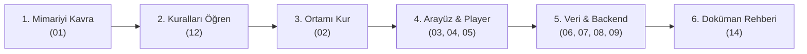

# KoUp Dokümantasyon Portalı (Living Documentation Hub)

**KoUp**; Apple TV+ zarafeti, Netflix akıcılığı ve MUBI estetiğiyle tasarlanmış, 17.000+ yapımı (Kore/Çin/Japon dizileri, sinema filmleri, Asya animeleri ve 9:16 dikey kısa dramalar) bünyesinde barındıran yeni nesil bir streaming, arşiv ve Asya eğlence platformudur. 

Sistem; Next.js 15 App Router tabanlı yüksek performanslı bir ön uç, Cloudflare Worker & R2 tabanlı dağıtık CDN depolama katmanı ve Supabase PostgreSQL ilişkisel veritabanı üzerine kurulu 3 katmanlı modern bir mimariyle çalışır.

Bu dokümantasyon klasörü (`docs/`), projenin mimarisinden güvenlik protokollerine, video oynatıcı motorundan veri senkronizasyon zincirine kadar tüm bileşenlerini ayrıntılarıyla açıklayan **yaşayan tek doğruluk kaynağıdır (Single Source of Truth)**.

---

## ⚡ Hızlı Çözüm Bağlantıları

Bir sorunla karşılaştıysanız veya belirli bir işlem yapacaksanız doğrudan ilgili rehbere gidin:

- 🎬 **Video açılmıyor, donuyor veya oynatıcı hata veriyor:** [05-oynatici-ve-yayin-akisi.md](./05-oynatici-ve-yayin-akisi.md)
- ❓ **En sık karşılaşılan sorular ve hızlı çözümler (45+ SSS):** [13-sss.md](./13-sss.md)
- 🚫 **Projede hangi kurallar ve yasaklar geçerli?:** [12-kurallar-ve-yasaklar.md](./12-kurallar-ve-yasaklar.md)
- 🛠️ **Yeni bir özellik, sayfa veya API ucu ekleyeceğim:** [14-dokumantasyon-rehberi.md](./14-dokumantasyon-rehberi.md)
- 🔐 **Admin paneline erişemiyorum veya 403 alıyorum:** [07-kimlik-yetki-ve-guvenlik.md](./07-kimlik-yetki-ve-guvenlik.md)
- 🔄 **Arşivde değişiklik yaptım, R2 ve Supabase ile nasıl eşitlerim?:** [09-kaziyicilar-scriptler-ve-senkron.md](./09-kaziyicilar-scriptler-ve-senkron.md)
- 💻 **Projeyi yerel bilgisayarımda nasıl çalıştırırım?:** [02-kurulum-ortam-ve-deploy.md](./02-kurulum-ortam-ve-deploy.md)
- 📋 **Son yapılan değişiklikler ve sürüm notları:** [CHANGELOG.md](./CHANGELOG.md)

---

## 📖 Önerilen Okuma Sırası (Yeni Geliştirici Yol Haritası)

Projeye yeni katılan bir geliştirici veya yapay zeka ajanı için tavsiye edilen okuma akışı:

1. **Adım 1 — Büyük Resmi Kavrayın:** [01-genel-bakis-ve-mimari.md](./01-genel-bakis-ve-mimari.md) dosyasını okuyarak sistemin 3 katmanlı mimarisini ve veri akışını öğrenin.
2. **Adım 2 — Kırmızı Çizgileri Bilin:** [12-kurallar-ve-yasaklar.md](./12-kurallar-ve-yasaklar.md) dosyasındaki kuralları (`<select>` yasağı, zero secrets, 4 kademeli mobil benchmark, no fake success) kesinlikle özümseyin.
3. **Adım 3 — Yerel Ortamı Hazırlayın:** [02-kurulum-ortam-ve-deploy.md](./02-kurulum-ortam-ve-deploy.md) ile bağımlılıkları ve ortam değişkenlerini yapılandırın.
4. **Adım 4 — Frontend ve Akış Katmanını İnceleyin:** Sayfa yapısı ([03](./03-sayfalar-ve-rotalar.md)), bileşenler ([04](./04-bilesenler-ve-tasarim-sistemi.md)) ve oynatıcı motorunu ([05](./05-oynatici-ve-yayin-akisi.md)) inceleyin.
5. **Adım 5 — Veri ve Güvenlik Altyapısını Öğrenin:** API rotaları ([06](./06-api-referansi.md)), kimlik yetkilendirme ([07](./07-kimlik-yetki-ve-guvenlik.md)), veritabanı şeması ([08](./08-veri-katmani.md)) ve senkron zincirini ([09](./09-kaziyicilar-scriptler-ve-senkron.md)) kavrayın.
6. **Adım 6 — Doküman Güncelleme Disiplini:** Kod yazdıktan sonra dokümanı nasıl güncelleyeceğinizi [14-dokumantasyon-rehberi.md](./14-dokumantasyon-rehberi.md) üzerinden takip edin.

---

## 📚 Dokümantasyon İçindekiler Tablosu

Aşağıdaki fihrist, `docs/` klasöründeki tüm teknik dokümanları ve kapsamlarını listeler:

| Dosya | Başlık | Kapsam ve Açıklama |
| :--- | :--- | :--- |
| **[01-genel-bakis-ve-mimari.md](./01-genel-bakis-ve-mimari.md)** | Genel Bakış & 3 Katmanlı Mimari | Platform vizyonu, teknoloji yığını, frontend ⇄ edge ⇄ veritabanı veri akışı diyagramları. |
| **[02-kurulum-ortam-ve-deploy.md](./02-kurulum-ortam-ve-deploy.md)** | Kurulum, Ortam Değişkenleri & Deploy | Yerel ortam kurulum adımları, tüm `.env` değişken isimleri, Vercel & Cloudflare dağıtımı. |
| **[03-sayfalar-ve-rotalar.md](./03-sayfalar-ve-rotalar.md)** | Sayfalar & Rota Hiyerarşisi | 26+ Next.js App Router sayfası (Vitrin, Seri, Shorts, Magazin, Takvim, Kütüphane, Admin vb.). |
| **[04-bilesenler-ve-tasarim-sistemi.md](./04-bilesenler-ve-tasarim-sistemi.md)** | Bileşenler & Lumina Tasarım Dili | Lumina OLED cam teması, CustomSelect, AccordionMediaCard, mobil dokunma hedefleri ve animasyonlar. |
| **[05-oynatici-ve-yayin-akisi.md](./05-oynatici-ve-yayin-akisi.md)** | Oynatıcı (Player) & Video Akışı | NetflixPlayer motoru, 16:9 yatay ve 9:16 dikey modlar, Hls.js, resolve-stream, stream-proxy ve fallback zinciri. |
| **[06-api-referansi.md](./06-api-referansi.md)** | API Referansı & Rota Handler'ları | 39+ REST API ucu (istek metodu, arama parametreleri, rate-limit, cache başlıkları ve JSON yanıtları). |
| **[07-kimlik-yetki-ve-guvenlik.md](./07-kimlik-yetki-ve-guvenlik.md)** | Kimlik, Yetkilendirme & Güvenlik | Supabase Auth, adminAuth, hard ban & fingerprint, RLS politikaları, SSRF/XSS engelleme ve güvenlik başlıkları. |
| **[08-veri-katmani.md](./08-veri-katmani.md)** | Veri Katmanı: Supabase, SQLite & R2 | 27+ PostgreSQL tablosu, SQLite şeması, R2 JSON bundle yapısı, ilişkiler ve kota yönetimi. |
| **[09-kaziyicilar-scriptler-ve-senkron.md](./09-kaziyicilar-scriptler-ve-senkron.md)** | Kazıyıcılar, Scriptler & Senkron | 9 kaynak kazıyıcı motoru, 64 Python scripti, otonom watchdog ve 3 halkalı tam arşiv senkron zinciri. |
| **[10-kullanici-ozellikleri.md](./10-kullanici-ozellikleri.md)** | Kullanıcı Özellikleri & Sosyal Akış | İzleme geçmişi (progressSync), listeler, akıllı bildirimler, zengin yorumlar, dizi istek ve magazin. |
| **[11-state-hooklar-ve-kutuphaneler.md](./11-state-hooklar-ve-kutuphaneler.md)** | Global State, Hook'lar & Kütüphaneler | KoUpContext mimarisi, özel React hook'ları (`usePillDragTracking`, `useDragScroll`) ve `src/lib/` servisleri. |
| **[12-kurallar-ve-yasaklar.md](./12-kurallar-ve-yasaklar.md)** | Proje Kuralları, Güvenlik & Yasaklar | 24 temel kural ve yasak (`<select>` yasağı, zero hardcoded secrets, CWV, 4 kademeli mobil benchmark, no fake success). |
| **[13-sss.md](./13-sss.md)** | Sıkça Sorulan Sorular (SSS / FAQ) | 9 kategoride toplanmış 45+ teknik soru ve doğrulanmış çözüm adımları. |
| **[14-dokumantasyon-rehberi.md](./14-dokumantasyon-rehberi.md)** | Dokümantasyon Rehberi & Şablonlar | Hangi kod değişikliğinde hangi dokümanın güncelleneceğini gösteren eşleme tablosu ve özellik şablonu. |
| **[CHANGELOG.md](./CHANGELOG.md)** | Sürüm & Değişiklik Günlüğü | Tarih ve tür bazında listelenen tüm sistem değişiklikleri ve sürüm kayıtları. |

---

## 🛡️ Yaşayan Dokümantasyon Kuralı (GEMINI.md §12)

KoUp geliştirme sürecinde geçerli olan temel kural şudur:

> **"Yeni Özellik = Yeni Dokümantasyon & Değişiklik = Doküman Güncellemesi"**
> 
> Projeye yeni bir sayfa, bileşen, API ucu, script, tablo, entegrasyon veya kural eklendiğinde; ya da mevcut bir işlev değiştirildiğinde, aynı görev içinde ilgili `docs/*.md` dosyası güncellenmeli ve [`docs/CHANGELOG.md`](./CHANGELOG.md) dosyasına işlenmelidir. Dokümantasyonu güncellenmeyen hiçbir geliştirme tamamlanmış sayılmaz ve git commit atılamaz.
> 
> Ayrintili kural metni için bkz: [`GEMINI.md`](../GEMINI.md).
